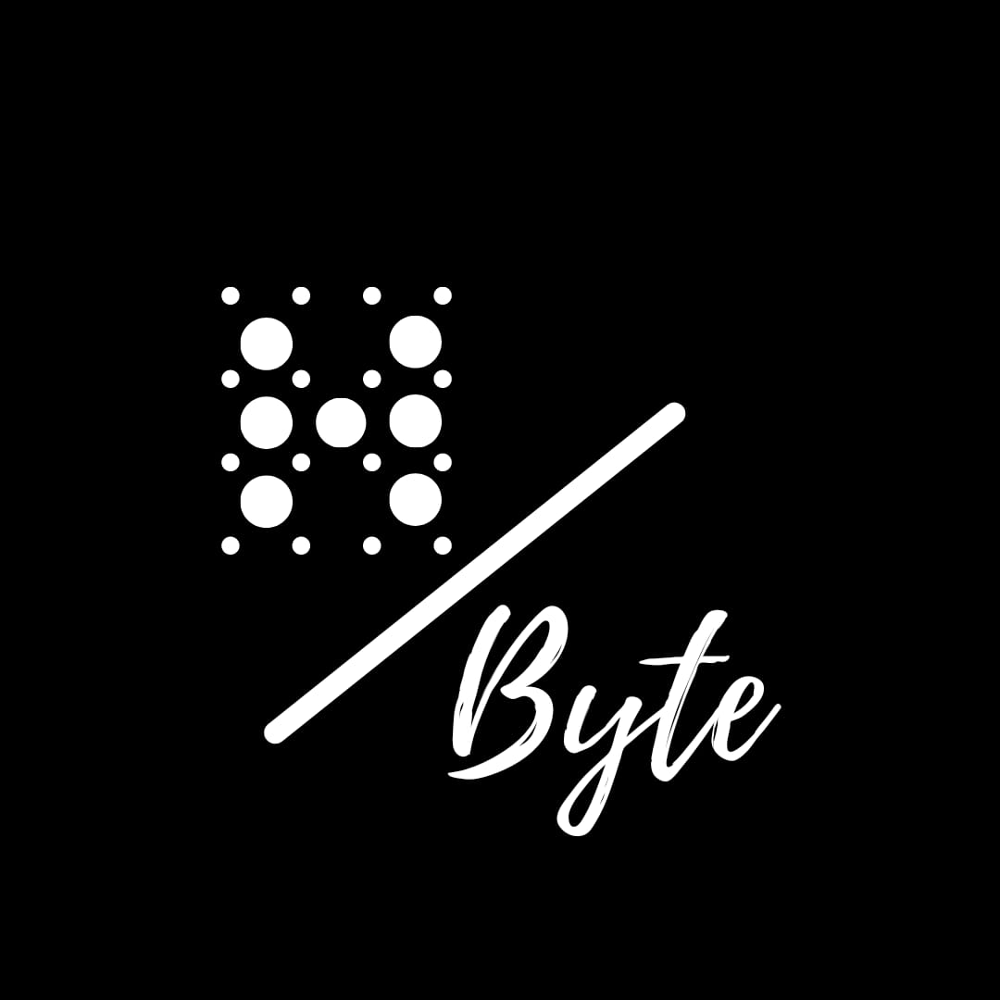

# HealthyByte

<div align="center">
  
  
  <p><strong>Your go-to resource for enhancing digital security awareness</strong></p>
  
  [](https://squidfunk.github.io/mkdocs-material/)
  [](LICENSE)
</div>

---

## About

HealthyByte is a cybersecurity blog built with MkDocs Material, featuring in-depth blogs. 

## Quick Start

### Prerequisites

- Python 3.9+
- pip

### Installation

```bash
# Clone the repository
git clone https://github.com/Shasheen8/h.byte.git
cd h.byte

# Create virtual environment
python3 -m venv venv
source venv/bin/activate  # On Windows: venv\Scripts\activate

# Install dependencies
pip install -r requirements.txt
```

### Local Development

```bash
# Start development server
mkdocs serve

# Visit http://localhost:8000
```

### Build for Production

```bash
# Build static site
mkdocs build

# Output in /site directory
```

## Features

- **Material Theme** with dark/light mode toggle
- **Mermaid Diagrams** for visual explanations
- **Search** with suggestions and highlighting
- **Code Copy Buttons** for easy copying
- **RSS Feed** for blog updates
- **Responsive Design** optimized for all devices
- **Navigation** organized by security topics


## Contributing

Contributions, suggestions, and corrections are welcome! Please:

1. Fork the repository
2. Create a feature branch
3. Make your changes
4. Submit a pull request

## License

This project is licensed under the MIT License - see the [LICENSE](LICENSE) file for details.

## Author

**Shasheen Bandodkar**

- GitHub: [@Shasheen8](https://github.com/Shasheen8)
- Blog: [HealthyByte](https://healthybyte.net)

---

<div align="center">
  <p>Built with ❤️ using <a href="https://www.mkdocs.org/">MkDocs</a> and <a href="https://squidfunk.github.io/mkdocs-material/">Material for MkDocs</a></p>
</div>
