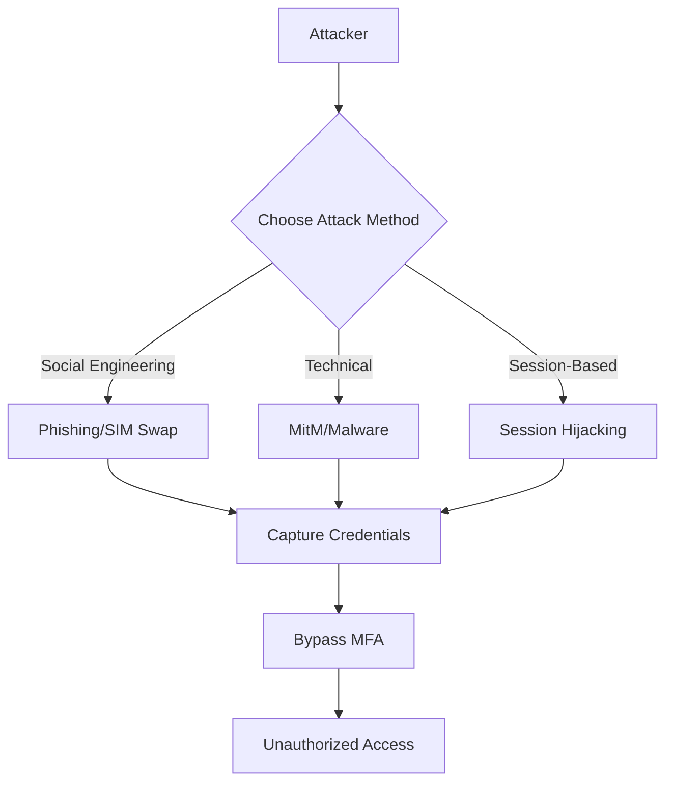

*Multi-factor authentication (MFA)* is designed to provide an additional layer of security by requiring multiple verification steps before granting access to sensitive information. However, when organizations experience data breaches, attackers can exploit weaknesses when implementing MFA by accessing publicly visible databases via forums and sites. For instance, if an attacker gains access to user credentials through *phishing* or *database leaks*, they may also find ways to bypass or compromise the second authentication factor, mainly if it relies on *SMS codes*, which can be intercepted or redirected. It accentuates the importance of employing robust MFA methods, such as those utilizing *hardware tokens* or *authenticator apps*, to mitigate the risks associated with compromised data.

> **Key Insight**: While MFA is a critical security layer, it's not impenetrable. Understanding bypass methods is essential for implementing stronger defenses.

## Common MFA Bypass Techniques

### 1. Phishing Attacks

*Phishing* is a technique used to deceive individuals into providing sensitive information, such as *login credentials* or *authentication codes*. Attackers often create fake login pages or spoof legitimate sites.

**Attack Method:**
- **Creation of a Fake Login Page**: Attackers replicate the login page of a trusted website. When a user enters their credentials, the attacker collects those details.
- **Timing of MFA Prompt**: After stealing the initial credentials (*email* & *password*), the attacker can initiate a login attempt and capture the *MFA token* sent to the user's device.

**Mitigation:**
- Educate users to verify URLs.
- Utilize security features like *anti-phishing tools* in email clients.

> **Pro Tip**: Always check for HTTPS and verify the domain name before entering credentials.

### 2. SIM Swapping

Attackers use this technique to convince a mobile service provider to transfer a victim's phone number to a *SIM card* controlled by the attacker.

**Attack Method:**
- **Social Engineering**: Attackers gather personal information about the target and call the mobile carrier, impersonating the victim to initiate a *SIM swap*.
- **Receiving MFA Codes**: Once the swap is complete, the attacker can access the victim's *MFA codes* sent via *SMS*.

**Mitigation:**
- Use carrier-specific options to lock the *SIM* with additional layers of authentication.
- Consider using an *authenticator app* instead of *SMS* for MFA.

> **Warning**: SMS-based MFA is the most vulnerable form of two-factor authentication.

### 3. Man-in-the-Middle Attacks

In a *man-in-the-middle (MitM)* attack, the attacker intercepts the communication between the user and the application during the authentication process.

**Attack Method:**
- **Intercepting Traffic**: Attackers set up a *proxy server* that captures the communication. Users may unknowingly connect to these malicious servers.
- **Capturing MFA Tokens**: The attacker gains access to the username, password, and any *MFA codes*.

**Mitigation:**
- Utilize *end-to-end encryption* and secure connections (*HTTPS*).
- Implement *device-level security measures* to prevent unauthorized access.

### 4. Malware and Spyware

*Malware* and *spyware* installed on users machines can capture a user's credentials and *MFA codes* directly from their devices.

**Attack Method:**
- **Keyloggers**: Used to record user keystrokes, capturing the password and subsequent *MFA inputs*.
- **Remote Access Trojans (RATs)**: Attackers gain control of devices, allowing them to intercept authentication processes.

**Mitigation:**
- Regularly update *antivirus software* and conduct security scans.
- Encourage users to be cautious when downloading unknown software.

### 5. Session Hijacking

*Session hijacking* is when an attacker takes over a user session after the user has logged in, often through exposing *session tokens*. This means that the attacker can essentially 'hijack' the user's session and gain access to their account without needing to go through the *MFA process* again.

**Attack Method:**
- **Capturing Session Tokens**: Using techniques such as *cross-site scripting (XSS)*, attackers can steal *session tokens* after a user has authenticated with MFA.
- **Using the Compromised Session**: Once they have the *session token*, they may invalidate the need for further MFA checks.

**Mitigation:**
- Implement *HttpOnly* and *Secure flags* on cookies to make them less accessible to scripts.
- Regularly monitor user sessions and employ *anomaly detection systems*.

### 6. Recovery Options Abuse

Many services provide recovery options for accessing accounts when *MFA devices* are lost or inaccessible. Unfortunately, these mechanisms can be exploited.

**Attack Method:**
- **Social Engineering**: Attackers can impersonate the account owner and request password resets or access through recovery questions.
- **Abuse of Backup Codes**: If *backup codes* are stored insecurely, they could be accessed by an attacker who can use them to bypass MFA.

**Mitigation:**
- Encourage users to secure *backup codes* and regularly change passwords.
- Standardize the methods for verifying identity during recovery processes.

## MFA Bypass Attack Flow

## Best Practices for Robust MFA Implementation

To strengthen your *MFA implementation* and reduce bypass risks:

- **Use Hardware Tokens**: Prefer *FIDO2* or *U2F* hardware keys over *SMS* or *email-based* MFA.
- **Implement Phishing-Resistant MFA**: Use *WebAuthn* or *certificate-based authentication*.
- **Enable Login Notifications**: Alert users of login attempts from new devices or locations.
- **Restrict Recovery Options**: Implement strict verification for account recovery processes.
- **Monitor for Anomalies**: Use *behavioral analytics* to detect unusual authentication patterns.
- **Regular Security Training**: Educate users about *phishing*, *social engineering*, and *MFA bypass* techniques.

> **Key Takeaway**: The strongest MFA methods combine something you have (hardware token) with something you are (biometric), rather than something you know or something you can receive via SMS.

## Conclusion

*Multi-factor authentication (MFA)* is a key layer of defense for securing user accounts. However, addressing existing vulnerabilities is equally essential. By pinpointing and addressing these weak points, you can enhance account protection against unauthorized access and take proactive measures to reduce security risk. Organizations should move beyond *SMS-based MFA* and adopt more secure methods like *hardware tokens*, *biometric authentication*, and *risk-based adaptive authentication* to stay ahead of evolving threats.