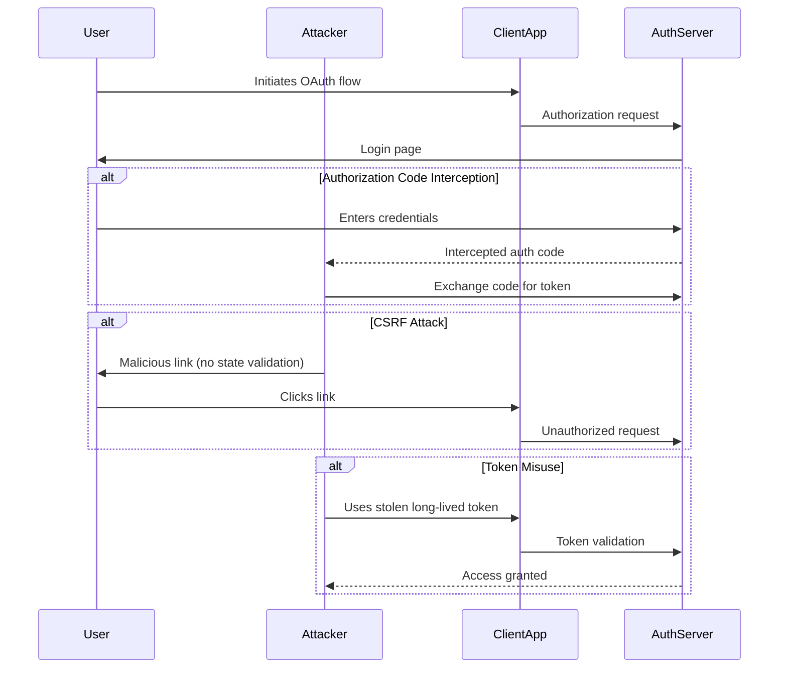

*OAuth 2.0* is a popular *authorization framework* that allows *third-party applications* to access a user's resources without knowing their credentials. While it enhances convenience and security in web applications, its implementation can introduce various vulnerabilities. Understanding these risks is essential for developers and organizations to safeguard sensitive user data and maintain trust. Because *OAuth 2.0* is widely used, it becomes an attractive target for attackers, especially since *implementation errors* can lead to vulnerabilities. These flaws might enable attackers to access sensitive information or even bypass authentication entirely.

> **Key Insight**: OAuth 2.0 is not inherently insecure, but improper implementation creates significant security gaps that attackers can exploit.

## Common OAuth 2.0 Vulnerabilities

### 1. Authorization Code Interception

**Vulnerability:** It occurs when an attacker intercepts the *authorization code* returned from the *authorization server* before the client application can use it to receive an *access token*. If the attacker captures the authorization code, they can use it to request an access token.

**Example:** In a typical *eCommerce site* where a user is redirected to *PayPal* for payment authorization if the redirect URI is not secured (e.g., using *HTTP* instead of *HTTPS*), an attacker could intercept the code through *man-in-the-middle attacks*.

**Remediation:** Implement proof of authorization using *Proof Key for Code Exchange (PKCE)*. This adds a layer of security by requiring a *code challenge* and *code verifier*, reducing the risk of interception.

> **Pro Tip**: Always use PKCE for public clients, even when it's not strictly required.

### 2. Implicit Grant Flow Misuse

**Vulnerability:** The *implicit grant flow* is designed for *client-side applications*, where *access tokens* are returned directly in the redirect URI. If not implemented correctly, it exposes the tokens in URLs, which browsers can log or cache.

**Example:** An eCommerce application that uses the implicit flow could expose the *access token* in the browser's address bar or *third-party tracking tools*, making it accessible to malicious users. This situation compromises secure transactions, especially those with PayPal.

**Remediation:** Avoid using the *implicit grant flow*. Instead, switch to the *authorization code grant type* with *PKCE*. This reduces token exposure and minimizes the risks of unauthorized token access.

> **Warning**: The OAuth 2.0 Security Best Current Practice explicitly recommends against using the implicit flow.

### 3. Cross-Site Request Forgery (CSRF)

**Vulnerability:** *CSRF attacks* exploit the trust a web application has in the user's browser. If an attacker tricks a user into clicking on a link that performs actions with their credentials, they could gain unauthorized access.

**Example:** If a user has already authenticated with *PayPal* and the eCommerce site does not use *CSRF tokens* for critical operations, an attacker could send a fraudulent request to initiate a payment, leveraging the already accepted session.

**Remediation:** Include *anti-CSRF tokens* in state parameters during the OAuth flow (enable *SameSite*). This helps prevent malicious requests from being processed and ensures that the requests are legitimate.

### 4. Lack of State Parameter Validation

**Vulnerability:** The *state parameter* is designed to maintain the state between the authorization request and the callback. If an application does not validate the state parameter, it becomes prone to *CSRF attacks* and *session fixation*.

**Example:** An eCommerce site that fails to validate the state returns from *PayPal* could allow attackers to redirect users to different sites and execute unauthorized actions, as the application would have no way to verify the authenticity of the request.

**Remediation:** 
- Ensure the *state parameter* is included in your OAuth requests and validated on the callback.
- Implement a mechanism to generate a unique state for each authorization request and store it securely.
- Upon receiving the callback, compare the returned state with the stored value to mitigate CSRF attacks.

### 5. Insufficient Token Expiration and Revocation Policies

**Vulnerability:** *OAuth access tokens* should have limited lifetimes, and there should be a way to revoke them if they are compromised. If tokens are long-lived or not revocable, the risk of misuse increases.

**Example:** If an eCommerce platform using PayPal provides *long-lived access tokens*, an attacker who gains access to one could indefinitely make fraudulent transactions until the token expires or is manually revoked.

**Remediation:**
- **Establish clear token expiration policies** for access tokens. Set reasonable expiration times depending on the application's requirements.
- **Implement refresh tokens** with shorter lifespans and ensure they can only be used in secure contexts.
- **Regularly review and update** token lifetimes as necessary.
- **Develop and document** a robust token revocation process. This should include:
 - End-user interfaces to manually revoke tokens
 - Automated processes to revoke tokens upon user logout or account suspension
 - Regular audits of active tokens with mechanisms to invalidate them as needed

### 6. Scope Misconfiguration

**Vulnerability:** OAuth allows the specification of *scopes* that define resource access levels. Inadequate scope definitions can lead to overly broad access to user data or operations.

**Example:** If the eCommerce site incorrectly requests broad permissions (e.g., access to the user's complete profile) without needing it, an attacker who gains the *access token* could harm sensitive data or perform unintended actions without user awareness.

**Remediation:** 
- Review and configure scopes carefully to match the *principle of least privilege*.
- Only request and grant access to scopes that are strictly necessary for your application's functionality.
- Regularly audit scopes and permissions for outdated or unnecessary configurations and refine them to enhance security.

> **Best Practice**: Request the minimum scopes necessary and progressively request additional permissions only when needed.

### 7. Cross-Site Scripting (XSS)

**Vulnerability:** If an application is vulnerable to *XSS*, an attacker could execute scripts in the context of a user's session, potentially intercepting *OAuth tokens* or redirecting users to malicious sites.

**Remediation:** A *Content Security Policy (CSP)* acts as a security measure that helps prevent XSS attacks by defining the sources from which content can be loaded and executed.

**Set Up a CSP Header:** The CSP should be configured to specify trusted sources for scripts, styles, and other content.

```http
Content-Security-Policy: default-src 'self'; script-src 'self' https://trusted.cdn.com; object-src 'none';
```

In this policy, only scripts from the same origin and from `trusted.cdn.com` can execute.

**Additional XSS Protections:**
- **Restrict Inline Scripts**: Inline scripts should be avoided. Consider using *hash-based* or *nonce-based CSP* to allow specific inline scripts without permitting arbitrary code execution.
- **Limit Token Exposure**: Use the *sandbox directive* where appropriate to limit the capabilities of the document in which the OAuth 2.0 flows occur. This can prevent the execution of scripts in unsecured contexts.

### 8. Open Redirects

**Vulnerability:** An *open redirect vulnerability* can occur if the authorization server allows redirection to untrusted addresses. Attackers can exploit this feature to redirect users to *phishing sites*.

**Example:** If the eCommerce site is integrated with PayPal and allows arbitrary redirections in the OAuth flow, an attacker could change the *redirect URI* to a phishing site, controlling the user's actions after authentication.

**Remediation:** 
- Validate *redirect URIs* meticulously.
- Only allow redirects to pre-registered URIs.
- Reject any unrecognized or potentially dangerous addresses to mitigate the risk of phishing.

## OAuth 2.0 Attack Flow Diagram



## OAuth 2.0 Security Best Practices

To secure your *OAuth 2.0 implementation*:

| **Best Practice** | **Description** |
|-------------------|-----------------|
| **Use PKCE** | Implement *Proof Key for Code Exchange* for all OAuth flows, especially public clients |
| **Avoid Implicit Flow** | Use *Authorization Code flow with PKCE* instead |
| **Validate State Parameter** | Always generate, store, and validate the *state parameter* |
| **Short-Lived Tokens** | Issue *access tokens* with short expiration times (15-60 minutes) |
| **Secure Redirect URIs** | Whitelist and validate all *redirect URIs* |
| **Implement CSP** | Use *Content Security Policy* to prevent XSS attacks |
| **Scope Minimization** | Request only the *minimum necessary scopes* |
| **Token Revocation** | Implement and test *token revocation* mechanisms |
| **HTTPS Everywhere** | Enforce *HTTPS* for all OAuth-related communications |
| **Regular Security Audits** | Conduct periodic reviews of OAuth implementations |

> **Key Takeaway**: Defense in depth is essential. Implement multiple layers of security controls rather than relying on a single mechanism.

## Conclusion

In conclusion, security risks such as *token leakage*, *improper implementation*, and *phishing attacks* can undermine OAuth 2.0's effectiveness. Developers and organizations must understand these weaknesses and adopt best practices to mitigate them. This includes implementing *secure storage solutions*, *short-lived access tokens*, and conducting thorough *security audits*. By staying informed and vigilant, we can enhance the security posture of applications utilizing *OAuth 2.0* and better protect user data. Continuously updating and refining security measures will ensure that the *OAuth 2.0 framework* remains reliable in an ever-evolving threat landscape.

## References

- [OAuth 2.0 Security Best Current Practice](https://datatracker.ietf.org/doc/html/draft-ietf-oauth-security-topics)
- [RFC 7636: Proof Key for Code Exchange (PKCE)](https://datatracker.ietf.org/doc/html/rfc7636)
- [OWASP OAuth 2.0 Security Cheat Sheet](https://cheatsheetseries.owasp.org/cheatsheets/OAuth2_Cheat_Sheet.html)