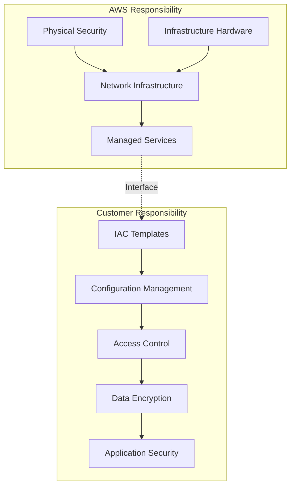
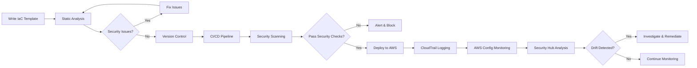

In a cloud-centric environment, *Infrastructure as Code (IaC)* is used extensively around us for managing and deploying infrastructure resources in a streamlined, efficient, and automated manner. *AWS services* and tools are used in implementing IaC, such as *AWS CloudFormation* and *AWS CDK (Cloud Development Kit)*. However, as with any cloud-based solution, security is of paramount importance. These are some best practices and strategies for securing Infrastructure as Code deployments on *AWS*. **[In no particular order]**

> **Key Insight**: IaC security is not just about protecting your templates—it's about securing the entire infrastructure lifecycle from development to deployment.

## Understanding the Shared Responsibility Model

*AWS* operates on the *Shared Responsibility Model*, which means that both AWS and the customer share the responsibility for security. AWS ensures the security **of the cloud**, while customers are responsible for securing their *applications*, *data*, and *infrastructure configurations*. Understanding this model is crucial when it comes to securing your IaC.



## Best Practices for Securing IaC

### 1. Adopt a Secure Coding Framework

A *secure coding framework* involves:

- **Regularly updating dependencies** and libraries used in templates to ensure they are free of known vulnerabilities.
- **Implement input validation** and sanitization to prevent injection attacks.
- **Using parameterized** and dynamically generated resource names avoids naming conflicts and improves security.
- **Apply the principle of least privilege**, granting only the necessary permissions to each resource and service.
- **Ensure proper error handling** and logging to identify and respond to security incidents.

> **Best Practice**: Treat your IaC templates with the same security rigor as application code.

### 2. Utilize Secure Authentication and Authorization Mechanisms

- **Avoid hardcoding** access keys and secrets in your IaC templates. Instead, use *AWS Identity and Access Management (IAM)* roles, which provide temporary security credentials (*STS*).
- **Leverage AWS Secrets Manager** or *AWS Systems Manager Parameter Store* to securely store and retrieve sensitive information, such as database credentials or API keys.
- **Implement multi-factor authentication (MFA)** for IAM users and enforce strong password policies.

**Example of Secure Credentials Management:**

```yaml
# CloudFormation example - Using Parameter Store
Parameters:
 DatabasePassword:
 Type: AWS::SSM::Parameter::Value<String>
 NoEcho: true
 Default: /myapp/database/password
```

### 3. Enforce Infrastructure Configuration Monitoring

- **Regularly audit** the Infrastructure as Code templates for security vulnerabilities using tools like *AWS Config* and *AWS CloudTrail*. These services can help identify unauthorized changes, resource misconfigurations, and potential security risks.
- **Enable AWS CloudTrail** to log API calls to your infrastructure resources and integrate them with *AWS CloudWatch* or a *SIEM solution* to monitor and analyze these logs for security incidents.

> **Pro Tip**: Set up automated alerts for configuration drift to catch unauthorized changes immediately.

### 4. Secure the Build and Deployment Pipeline

- **Ensure IaC templates** are version-controlled using a secure repository with appropriate access controls, such as *AWS CodeCommit* or *GitHub*.
- **Implement a secure** *Continuous Integration/Continuous Deployment (CI/CD)* pipeline. Use *AWS CodePipeline*, *AWS CodeBuild*, *AWS CodeDeploy*, and tools like *AWS CodeArtifact* or *Docker Trusted Registry* to securely build, test, and deploy your infrastructure.
- **Engage in secure software development practices** for your CI/CD pipeline, such as:
 - *Static code analysis*
 - *Vulnerability scanning*
 - *Automatic testing* to identify and fix security issues early in development

### 5. Regularly Update and Patch Infrastructure Resources

- **Stay updated** with the latest security patches and updates AWS provides for your infrastructure resources, such as *EC2 instances*, *RDS databases*, and *Lambda functions*.
- **Enable automated patch management** using services like *AWS Systems Manager Patch Manager* to ensure the timely application of security patches across your infrastructure.

### 6. Implement Network Security Measures

- **Apply appropriate security groups** and *network ACLs (Access Control Lists)* to restrict inbound and outbound traffic to your infrastructure resources.
- **Leverage AWS Web Application Firewall (WAF)** to protect your web applications from common security threats, such as *SQL injection*, *cross-site scripting*, and *DDoS attacks*.
- **Use AWS Shield** to protect against DDoS.

## Essential Tools for Securing IaC on AWS

Securing *Infrastructure as Code (IaC)* for AWS also involves ensuring the security and compliance of your infrastructure deployments. Here are the most common tools used for securing IaC on AWS:

### AWS Native Security Tools

| **Tool** | **Purpose** | **Key Features** |
|----------|-------------|------------------|
| **AWS CloudFormation** | Infrastructure provisioning | YAML/JSON templates, version control, rollback capabilities |
| **AWS CloudFormation Guard** | Policy enforcement | Custom security rules, compliance validation, open-source |
| **AWS Config** | Configuration monitoring | Continuous monitoring, compliance tracking, drift detection |
| **AWS Security Hub** | Centralized security view | Aggregates findings, compliance checks, automated remediation |
| **AWS Systems Manager Parameter Store** | Secrets management | Secure configuration data storage, encryption at rest |
| **AWS Secrets Manager** | Secrets lifecycle management | Automatic rotation, secure storage, integration with AWS services |
| **AWS IAM** | Access management | Role-based access, least privilege, temporary credentials |
| **AWS CloudTrail** | Audit logging | API call logging, security analysis, compliance evidence |

### Third-Party Security Tools

- **cfn-lint**: Validates CloudFormation templates for errors and best practices
- **Checkov**: Static code analysis for IaC security and compliance
- **AWS CloudFormation Guardrails**: Policy-as-code framework
- **Twistlock/Prisma Cloud**: Comprehensive cloud security platform
- **HashiCorp Sentinel**: Policy-as-code framework for Terraform
- **Terraform Cloud**: SaaS platform with built-in security features

> **Key Consideration**: Use a combination of AWS native tools and third-party solutions for comprehensive security coverage.

## Tool Descriptions

### AWS CloudFormation

*CloudFormation* is a robust *infrastructure as code* service provided by AWS. It allows you to define and provision AWS resources using *YAML* or *JSON templates*. CloudFormation provides a way to version-control the infrastructure, making tracking changes easier and ensuring security compliance.

### AWS CloudFormation Guard

*CloudFormation Guard* is an open-source tool from AWS that allows you to define and enforce additional security rules and best practices for your CloudFormation templates. It helps to ensure that templates adhere to security standards and policies specific to your organization.

### AWS Config

*AWS Config* enables you to assess, audit, and evaluate the configurations of AWS resources. It continuously monitors and records configuration changes, providing a detailed inventory of your AWS infrastructure. Config can be used to track compliance, detect drift, and identify security vulnerabilities in IaC templates.

### AWS Security Hub

*Security Hub* provides a comprehensive view of your security and compliance posture on AWS. It integrates with various AWS services, including Config, to aggregate and analyzes security findings and alerts. Security Hub helps identify security risks, misconfigurations, and potential vulnerabilities in IaC deployments.

### AWS Systems Manager Parameter Store

*Parameter Store* allows you to store configuration data and secrets securely. It provides a central repository for storing sensitive information, such as passwords, API keys, and database credentials. You can retrieve these values programmatically during the deployment of your IaC templates.

### AWS Secrets Manager

*Secrets Manager* is a managed service that helps you protect secrets, such as database credentials, API keys, and OAuth tokens. It provides secure storage, automatic rotation, and integration with AWS services, allowing you to access secrets within your IaC templates securely.

### AWS Identity and Access Management (IAM)

*IAM* is a fundamental service for managing access and permissions in AWS. It allows you to create and manage user accounts, roles, and permissions for accessing and deploying IaC templates. By following the *principle of least privilege*, you can ensure that only authorized entities have the necessary permissions to deploy and manage your infrastructure.

### AWS CloudTrail

*CloudTrail* provides detailed logs of API calls made within your AWS account. By enabling CloudTrail, you can monitor and audit changes made to your IaC deployments, track user activity, and detect potential security incidents or unauthorized modifications.

### Infrastructure as Code Linters

Several open-source tools and frameworks are available for linting and validating IaC templates for security and best practices. Examples include:
- **cfn-lint**: CloudFormation template validation
- **Checkov**: Security and compliance scanning
- **AWS CloudFormation Guardrails**: Policy enforcement

### Third-Party Security Tools

Besides AWS-native tools, various *third-party security tools* are available for securing IaC on AWS. Examples include:
- **Twistlock**
- **Prisma Cloud**
- **HashiCorp Sentinel**

These tools provide additional features like *vulnerability scanning*, *policy enforcement*, and *compliance monitoring* to enhance the security of your IaC deployments.

## Security Implementation Workflow



## Conclusion

Securing *Infrastructure as Code* for AWS requires a multi-layered approach that combines *secure coding practices*, *robust authentication and authorization*, *continuous monitoring*, and *comprehensive tooling*. By following the *Shared Responsibility Model* and implementing these best practices, you can significantly reduce the risk of security incidents and ensure that your cloud infrastructure remains secure, compliant, and resilient.

> **Final Takeaway**: Security is not a one-time effort but a continuous process. Regularly review and update your IaC security practices to stay ahead of evolving threats.

## References

- [AWS Well-Architected Framework - Security Pillar](https://docs.aws.amazon.com/wellarchitected/latest/security-pillar/welcome.html)
- [AWS CloudFormation Best Practices](https://docs.aws.amazon.com/AWSCloudFormation/latest/UserGuide/best-practices.html)
- [AWS Security Hub](https://aws.amazon.com/security-hub/)
- [cfn-lint Documentation](https://github.com/aws-cloudformation/cfn-lint)
- [Checkov Documentation](https://www.checkov.io/)
