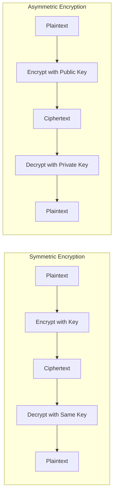
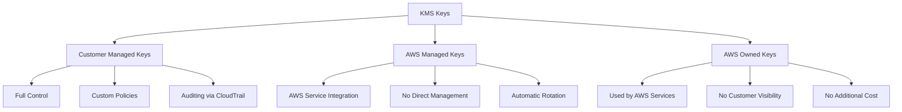
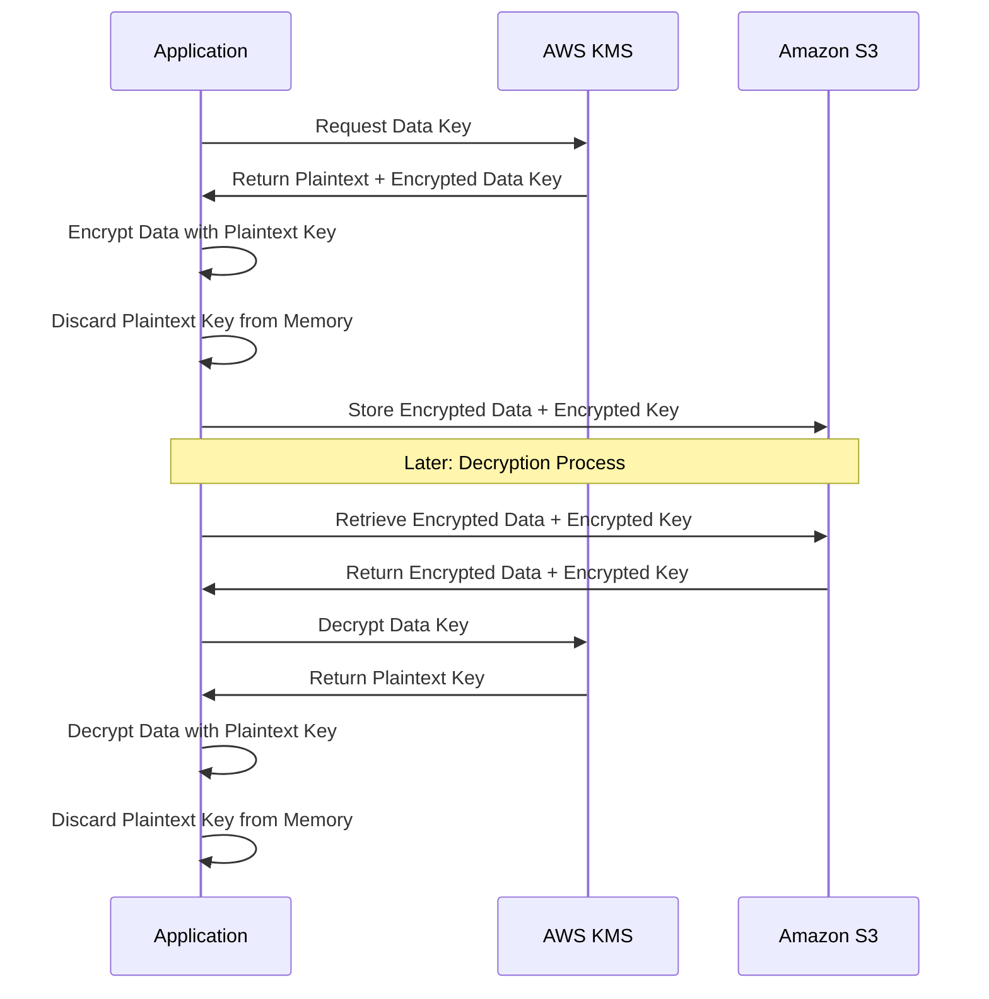

*AWS Key Management Service (KMS)* is a managed service provided by Amazon Web Services (AWS) that enables customers to create and control the encryption keys used to encrypt their data. The service is designed to make it easy for customers to create, rotate, and manage encryption keys, which can be used to encrypt data stored in AWS services such as *S3*, *RDS*, and *EBS*, as well as data stored outside of AWS.

> **Key Insight**: KMS separates the management of encryption keys from the data being encrypted, giving you full control over who can access and use your keys.

## Benefits of AWS KMS

One of the main benefits of using *KMS* is that it allows customers to separate the management of encryption keys from the data that is being encrypted. This means that customers can control who has access to the encryption keys and rotate them regularly to ensure that their data remains secure. Additionally, KMS provides customers with several security features, such as:

- **Automatic key rotation**
- **Key auditing**
- **Key access controls**

These features can help further protect their data and ensure compliance with security standards.

## Understanding KMS Key Policies

A *key policy* in AWS KMS is a JSON document that defines who can access and use a particular KMS key. The policy specifies the *AWS Identity and Access Management (IAM)* entities that can perform specific actions on the key, such as *encrypting*, *decrypting*, and *re-encrypting* data. It also includes the resources, such as *S3 buckets* or *RDS instances*, that the key can be used to encrypt. Configuring key policies to meet your organization's specific needs and security requirements is vital.

> **Best Practice**: Always apply the principle of least privilege when creating KMS key policies.

## Example KMS Key Policy

```json
{
 "Version": "2012-10-17",
 "Id": "example-key-policy",
 "Statement": [
 {
 "Sid": "Allow administration of the key",
 "Effect": "Allow",
 "Principal": {
 "AWS": "arn:aws:iam::ACCOUNT_ID:root"
 },
 "Action": [
 "kms:*"
 ],
 "Resource": "*"
 },
 {
 "Sid": "Allow use of the key",
 "Effect": "Allow",
 "Principal": {
 "AWS": [
 "arn:aws:iam::ACCOUNT_ID:role/example-role",
 "arn:aws:iam::ACCOUNT_ID:user/example-user"
 ]
 },
 "Action": [
 "kms:Encrypt",
 "kms:Decrypt",
 "kms:ReEncrypt*",
 "kms:GenerateDataKey*",
 "kms:DescribeKey"
 ],
 "Resource": "*"
 }
 ]
}
```

### Policy Breakdown

This key policy allows:

**Administrator Permissions:**
- The AWS account root user to perform any action (`kms:*`) on the key.

**User Permissions:**
- The IAM role `example-role` and the IAM user `example-user` to perform the following actions on the key:
 - **Encrypt**: Encrypt data using the key
 - **Decrypt**: Decrypt data that was encrypted with this key
 - **ReEncrypt**: Re-encrypt data without exposing plaintext
 - **GenerateDataKey***: Generate data encryption keys
 - **DescribeKey**: View key metadata

> **Security Tip**: Never grant `kms:*` permissions to non-administrative users or roles.

## KMS Encryption Capabilities

Another benefit of using *KMS* is that it makes it easy for customers to encrypt data stored in various AWS services. For example, customers can use KMS to encrypt data stored in *S3*, *RDS*, and *EBS*, as well as other AWS services such as *Elasticsearch* and *Redshift*. Additionally, customers can use KMS to encrypt data stored outside of AWS, such as data stored on-premises or in other cloud providers.

### Encryption Options

KMS provides customers with several different *encryption options*:

| **Feature** | **Description** |
|-------------|-----------------|
| **Standard Algorithms** | Use AWS-provided algorithms like *AES-256* |
| **Custom Algorithms** | Bring your own encryption algorithm |
| **Symmetric Encryption** | Same key for encryption and decryption (most common) |
| **Asymmetric Encryption** | Public/private key pairs for advanced use cases |

**Symmetric vs. Asymmetric Encryption:**



> **Pro Tip**: Use symmetric encryption for most use cases as it's faster and more cost-effective. Reserve asymmetric encryption for specific scenarios like digital signatures or key exchange.

## KMS Integration with AWS Services

*KMS* seamlessly integrates with various AWS services to provide *encryption at rest* and *encryption in transit*:

### Storage Services
- **Amazon S3**: Server-side encryption with KMS keys (*SSE-KMS*)
- **Amazon EBS**: Encrypted volumes for EC2 instances
- **Amazon EFS**: Encrypted file systems
- **Amazon Glacier**: Long-term archive encryption

### Database Services
- **Amazon RDS**: Encrypted database instances
- **Amazon DynamoDB**: Encryption at rest
- **Amazon Redshift**: Data warehouse encryption
- **Amazon Aurora**: MySQL and PostgreSQL encryption

### Other Services
- **AWS Lambda**: Environment variable encryption
- **Amazon SQS**: Queue message encryption
- **Amazon SNS**: Topic encryption
- **AWS Secrets Manager**: Secret encryption
- **AWS Systems Manager Parameter Store**: Parameter encryption

## KMS Pricing Model

Regarding pricing, *KMS* charges based on:

1. **Number of requests** made to the service
2. **Amount of data** stored (customer master keys)

### Free Tier

KMS offers a *free tier* of service, which allows customers to:
- Make up to **20,000 requests** per month
- Store up to **4,000 GB** of data per month at no cost

> **Cost Optimization**: Monitor your KMS usage with CloudWatch to avoid unexpected charges and optimize key usage patterns.

## KMS Key Types



## Best Practices for KMS

To maximize security when using *AWS KMS*:

1. **Enable Automatic Key Rotation**: Rotate keys annually to limit exposure
2. **Use Key Aliases**: Simplify key management and application updates
3. **Implement Key Policies**: Define granular access control for each key
4. **Enable CloudTrail Logging**: Audit all key usage for compliance
5. **Use VPC Endpoints**: Keep KMS traffic within AWS network
6. **Separate Keys by Environment**: Use different keys for dev, staging, and production
7. **Implement Key Deletion Protection**: Enforce waiting periods before key deletion
8. **Monitor Key Usage**: Set up CloudWatch alarms for unusual activity
9. **Use Grants for Temporary Access**: Provide time-limited permissions
10. **Regular Access Reviews**: Audit who has access to keys quarterly

> **Security Warning**: Never share KMS keys across AWS accounts unless absolutely necessary. Use cross-account access policies instead.

## KMS Security Features

### Audit and Compliance

*AWS KMS* provides comprehensive *auditing capabilities*:

- **CloudTrail Integration**: Every KMS API call is logged
- **CloudWatch Metrics**: Monitor key usage patterns
- **AWS Config**: Track key configuration changes
- **Key Usage Reports**: Identify unused or overused keys

### Data Protection

- **FIPS 140-2 Level 2 Compliance**: Hardware security modules (HSMs)
- **Multi-tenant key isolation**: Keys are logically isolated per account
- **Deletion protection**: 7-30 day waiting period for key deletion
- **Key material origin tracking**: Know where your keys come from

## Common Use Cases

### 1. S3 Bucket Encryption

```yaml
# CloudFormation example
MyS3Bucket:
 Type: AWS::S3::Bucket
 Properties:
 BucketEncryption:
 ServerSideEncryptionConfiguration:
 - ServerSideEncryptionByDefault:
 SSEAlgorithm: aws:kms
 KMSMasterKeyID: !Ref MyKMSKey
```

### 2. RDS Database Encryption

```yaml
MyDBInstance:
 Type: AWS::RDS::DBInstance
 Properties:
 StorageEncrypted: true
 KmsKeyId: !GetAtt MyKMSKey.Arn
```

### 3. Lambda Environment Variable Encryption

```python
import boto3
import os

kms_client = boto3.client('kms')

def decrypt_environment_variable(encrypted_var):
 decrypted = kms_client.decrypt(
 CiphertextBlob=bytes.fromhex(encrypted_var)
 )
 return decrypted['Plaintext'].decode('utf-8')
```

## Encryption Workflow



## Conclusion

In conclusion, *AWS KMS* is a powerful and versatile service that enables customers to easily encrypt and manage the encryption keys used to protect their data. The service is designed to make it easy for customers to create, rotate, and manage encryption keys. It provides customers with many security features, such as *automatic key rotation*, *key auditing*, and *key access controls*. KMS supports a wide range of encryption options and makes it easy for customers to encrypt data stored in various AWS services. 

Overall, *KMS* is an excellent option for customers looking to secure their data in AWS. By implementing proper *key policies*, enabling *automatic rotation*, and following *security best practices*, organizations can ensure their sensitive data remains protected while maintaining compliance with regulatory requirements.

> **Final Takeaway**: KMS is not just about encryption—it's about comprehensive key lifecycle management that gives you full control and visibility over your encryption strategy.

## References

- [AWS KMS Documentation](https://docs.aws.amazon.com/kms/)
- [AWS KMS Best Practices](https://docs.aws.amazon.com/kms/latest/developerguide/best-practices.html)
- [AWS KMS Cryptographic Details](https://docs.aws.amazon.com/kms/latest/cryptographic-details/)
- [FIPS 140-2 Compliance](https://aws.amazon.com/compliance/fips/)
