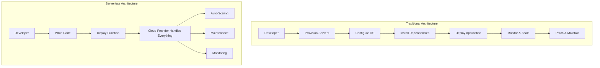
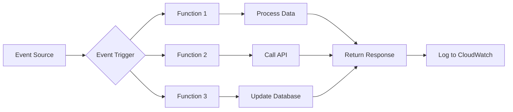
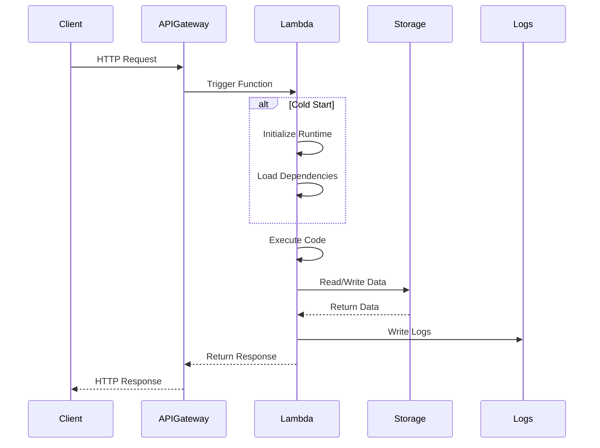
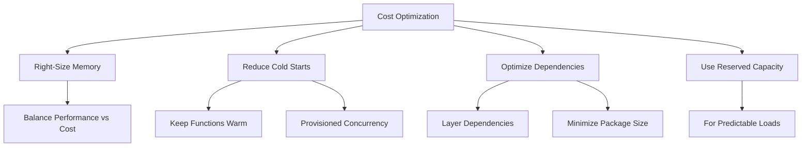

*Serverless architecture* does not include physical servers. *Serverless computing* enables users to no longer spend time and resources on provisioning, maintenance, updates, scaling, and server capacity planning. It eliminates the need for manual patching, administration, and file system monitoring; these activities are handled by the individual cloud service provider and operated by orchestration, therefore removing the burden from developers and IT/Security teams and focusing more on the business logic.

> **Key Insight**: "Serverless" doesn't mean no servers—it means you don't manage them. The cloud provider handles all infrastructure concerns.

## Understanding Serverless Architecture

**Serverless:** Everything is developed as a *function* or *micro-service* within a serverless architecture. This architecture functions within virtualized runtime containers in a cloud environment rather than on a dedicated server instance. With the increased number of workloads moving to the cloud, it didn't take long for *IaaS providers* to understand the significance of providing fully-managed backends such as databases, caches, load balancers, etc., that sustain the infrastructure required by the workloads.

### Serverless vs Traditional Architecture

### Serverless Disadvantages

- **Loss of Control**: As the cloud provider and users, the loss of fine-grained control and manage all the infrastructure have no access to backend infrastructure for custom configurations.
- **Limited Customization**: Some serverless applications will lack specialized configurations known to end-users. Dealing with *serverless database* applications is predominant as some features available on standard database deployments will sometimes not be available in the serverless versions.
- **Potentially Costly**: It might be cost-effective to have dedicated servers to handle the load if you deal with massive data sets or data requests based on use cases.

> **Warning**: Serverless can be more expensive than traditional hosting for high-volume, predictable workloads.

## Function as a Service (FaaS)

*FaaS* is a service model that supports *serverless architecture* by provisioning runtime containers in which code is executed in a particular programming language and empowers organizations to build/run scalable applications using dynamic cloud models. Building with FaaS allows to pay for individual function implementing w.r.t time rather than paying for constantly running physical servers.

### FaaS Characteristics

**Ideal FaaS Use Cases:**
- **Stateless event-driven tasks**: Functions that don't maintain state between invocations
- **Independent units of work**: Tasks can be broken into small independent units
- **Irregular usage patterns**: Irregular or unpredictable usage patterns within functions
- **Peer-to-Peer communication**: System-to-system communication without human interaction

### FaaS vs PaaS

*Platform as a service (PaaS)* services are similar to FaaS in hiding "servers" from developers. However, such hosting services have at least one server process that receives external requests. Consequently, scalability remains visible to the developer. Scaling is achieved by booting up more server processes, which the developer is generally charged directly for.

| **Aspect** | **FaaS** | **PaaS** |
|------------|----------|----------|
| **Scaling** | Automatic, per-invocation | Manual or auto-scaling of instances |
| **Pricing** | Pay per execution | Pay per instance/hour |
| **Cold Starts** | Yes | No |
| **State Management** | Stateless | Can be stateful |
| **Control** | Limited | More control |

## AWS Lambda: A FaaS Example

An example of a *FaaS architecture* is the *AWS Lambda*. *AWS Lambda* is used as a serverless, event-driven compute service that lets one run code virtually for any type of application or backend service without the provisioning or managing of servers. One can trigger lambda from over *200 AWS services* and *software as a service (SaaS)* applications and only pay for the service one uses.

### Key Differences from Previous Serverless Technology

The difference between *AWS Lambda* and previous serverless technology is that the development focus is on a **single function or module** instead of service with a large surface area like in the application runtime abstraction. Another rudimentary difference between application and functional level abstraction is where and how you define the invocation mechanism for workloads. The application code describes the invocation mechanism in application abstraction and allows the developer to choose the framework.

### AWS Lambda Use Cases

#### 1. Process Data at Scale

Provides the ability to execute code at the capacity needed and scale to match the data volume automatically and enable custom event triggers.

#### 2. Run Interactive Web and Mobile Backends

One can combine *AWS Lambda* with other AWS services to create secure, stable, and scalable online experiences.

#### 3. Enable Powerful ML Insights

Preprocess data before feeding it to your *machine learning (ML) model*. With *Amazon Elastic File System (EFS)* access, AWS Lambda handles infrastructure management and provisioning to simplify scaling.

#### 4. Create Event-Driven Applications

Build event-driven functions for accessible communication between decoupled services, effectively reducing costs by running applications during peak demand without crashing or over-provisioning resources.

## FaaS Architecture Diagram

## Comprehensive Features of AWS Lambda

### Advantages of FaaS

- **Save time and money** on managing servers
- **Pay for what you use**: No idle server costs
- **Increased scalability**: Automatic scaling based on demand
- **Enhanced security and reliability**: Cloud provider manages infrastructure security
- **Improved developer productivity**: Focus on code, not infrastructure
- **Decreased management responsibility**: No OS patching or server maintenance
- **Convenient integrations**: Native integration with cloud services

> **Pro Tip**: Use Lambda for sporadic, unpredictable workloads to maximize cost savings.

### Disadvantages of FaaS

- **Cold Starts**: Initial invocation latency when function hasn't run recently
- **Compute Time Limits**: Maximum execution time restrictions (15 minutes for AWS Lambda)
- **VPC/Network Issues**: Complex networking configurations
- **Application Size Limits**: Deployment package size restrictions
- **Vendor Lock-in**: Difficulty migrating between cloud providers
- **Complex Debugging**: Harder to debug distributed function architectures
- **Forensics Investigations**: Limited access to underlying infrastructure for security analysis

## FaaS Execution Flow

## Real-World Use Cases

### Netflix: Custom Node.js FaaS Platform

**Challenge**: Netflix needed to operate a *Serverless-like Platform* for its API infrastructure at massive scale.

**Solution**: Netflix rolled its own *Node.js Functions-as-a-Service* platform to handle:
- Content recommendation APIs
- User authentication services
- Streaming quality optimization
- Real-time analytics processing

**Benefits**:
- Reduced operational overhead
- Improved developer velocity
- Cost-effective scaling
- Better resource utilization

> **Case Study Insight**: Even tech giants build on FaaS principles to achieve operational efficiency at scale.

### Common FaaS Patterns

1. **API Backends**: Microservices architecture with API Gateway + Lambda
2. **Data Processing**: ETL pipelines triggered by S3 uploads
3. **Scheduled Tasks**: Cron-like jobs using CloudWatch Events
4. **Real-time Stream Processing**: Process Kinesis/DynamoDB streams
5. **Chatbot Backends**: Event-driven conversational interfaces
6. **Image/Video Processing**: On-demand media transformation
7. **IoT Backends**: Process sensor data at scale

## Best Practices for FaaS

### Design Principles

- **Keep Functions Small**: Single responsibility principle
- **Minimize Cold Starts**: Keep deployment packages small, use provisioned concurrency
- **Handle Errors Gracefully**: Implement retry logic and dead-letter queues
- **Use Environment Variables**: Configure without redeployment
- **Implement Idempotency**: Ensure functions can be safely retried
- **Optimize Memory Allocation**: Balance cost vs performance
- **Monitor and Alert**: Use CloudWatch metrics and alarms

### Security Considerations

- Use *IAM roles* with least privilege
- Encrypt environment variables with *KMS*
- Store secrets in *AWS Secrets Manager* or *Parameter Store*
- Enable *VPC* for functions accessing private resources
- Implement *API authentication* and *authorization*
- Enable *AWS X-Ray* for distributed tracing
- Regular security audits and vulnerability scanning

## Cost Optimization Strategies

## Conclusion

*Serverless architecture* and *Function as a Service (FaaS)* represent a paradigm shift in how we build and deploy applications. By abstracting away infrastructure management, these technologies allow developers to focus on business logic while benefiting from automatic scaling, reduced operational overhead, and cost efficiency.

While *FaaS* has limitations such as *cold starts*, *execution time limits*, and potential *vendor lock-in*, the benefits often outweigh these drawbacks for appropriate use cases. Organizations like *Netflix* have demonstrated that FaaS principles can scale to support massive, mission-critical workloads.

> **Final Takeaway**: Choose serverless for event-driven, sporadic workloads with variable demand. For predictable, high-volume workloads, traditional server-based architectures may still be more cost-effective.

## References

- [AWS Lambda Documentation](https://docs.aws.amazon.com/lambda/)
- [Netflix Tech Blog: Function as a Service](https://netflixtechblog.com/)
- [Serverless Framework](https://www.serverless.com/)
- [AWS Well-Architected Framework - Serverless Applications Lens](https://docs.aws.amazon.com/wellarchitected/latest/serverless-applications-lens/welcome.html)
- [Martin Fowler: Serverless Architectures](https://martinfowler.com/articles/serverless.html)
