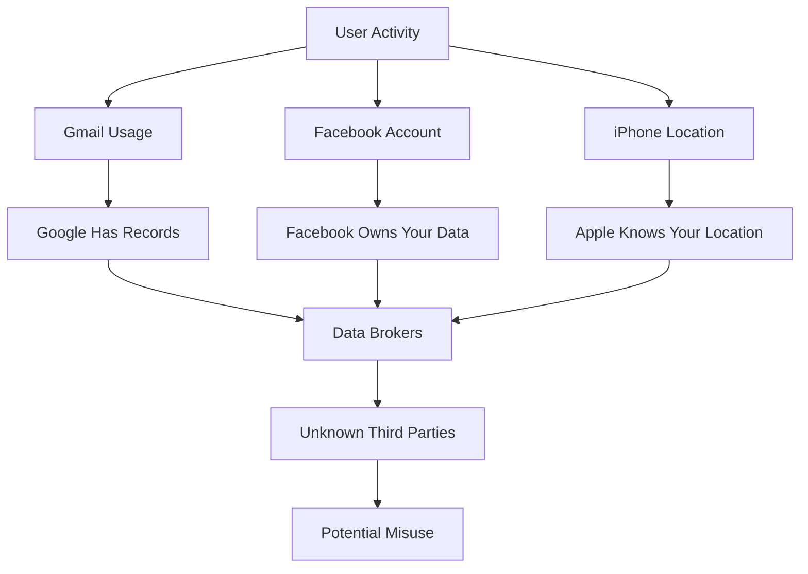
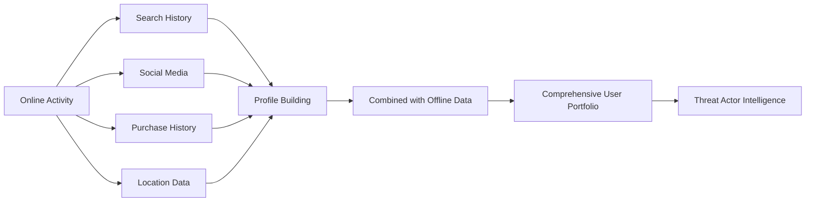
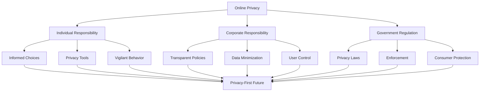

Today's internet makes it possible to view, share and comment on any of your content by anyone, anywhere, and at any given point in time. The internet makes it possible for people from all walks of life to connect. But, with all its benefits, the internet has its flaws too. What was once an issue raised only for famous people has now become relevant to all of us. In a time and world where information is universally accessible, **how do we control our online privacy?**

> **Critical Question**: In an age where data is the new oil, should privacy be a fundamental right or a luxury feature?

## The Blurred Line Between Online and Offline

The line between our online lives and our offline lives is very blurred these days. The privacy & control of who we are and how we want people to view us is slowly but steadily disappearing. Whenever you download an application to your device, we know that there's always an **exchange of value**. Nothing comes free in today's world, not offline nor online.

### The Data Exchange Economy

Our information is collected, stored, and shared by companies whenever you:
- Sign up for services
- Hit "Accept" on privacy policies
- Use free applications
- Browse websites
- Interact on social media

But no matter how in control you think you are of your privacy, **you are not**.

**Examples of Data Collection:**
- When you use your *Gmail*, *Google* has a record of it
- When you sign up on *Facebook* for a new account, that account is **owned by Facebook, not you**
- When you use your *iPhone*, *Apple* knows the location of your phone

> **Reality Check**: You are not the customer of free services—you are the product.

## The Real Threat: Unknown Entities

But in reality, it's not these companies we should be afraid of, as they are established companies or, in other words, a **"Source of Trust."** In contrast, we should be fearful of:

- **Unknown companies** you've never heard of
- **Anonymous entities** making threats on your social media account
- **Malicious applications** asking for data that should be none of their business
- **Data brokers** selling your information without consent

## What is Personally Identifiable Information (PII)?

As Internet security experts say, online privacy is not so much **what a person does online** but more of **who the person is** and then **what he or she does online**.

### Categories of PII

**Who a person is** (Personally Identifiable Information):
- Full name
- Home address
- Date of birth
- Social Security number
- Phone numbers
- Email addresses
- Other vital information

**What people do online:**
- Search queries and browsing history
- Work-related research
- Personal research
- Vacation planning
- Online purchases
- Social interactions
- Content consumption

### Beyond Basic PII

Apart from this, companies and governments also have access to **private and sensitive information** such as:
- Medical records
- Sexual orientation
- Political views
- Religious beliefs
- Financial information
- Biometric data

> **Privacy Concern**: Everything or activity you perform on the internet leaves behind traces that someone can use against you.

## The Digital Paper Trail

Spurred by individual needs, people engage in all kinds of online searches:
- News consumption
- Work-related and personal research
- Vacation spots
- Different types of purchases
- Social interactions

**What is more**, people hardly think that every search leaves an extensive **digital paper trail** of personal information.

### The Profile Building

Given a context, your **online information** combined with your **offline information** can lead a threat actor to size a good portfolio about you.

## Envisioning a Privacy-First Future

**Imagine a world** where you have **complete control** of all your online and offline information because as we progress more and more, it will become even more difficult to disconnect the two into separate things.

### What Complete Control Means

When you control your information, you can choose between:
- Information you **want to share**
- Information you **choose to keep private**

### Why Don't We Have Control Today?

**Today, why don't we have complete control over the information we provide to companies?**

The answer that comes to mind is because we:
1. **Haven't demanded it**
2. **Don't have the urgency to care about it**
3. **Accept default settings without question**
4. **Trade privacy for convenience**

> **Technology Limitation**: Technology can only solve one part of the problem, which is to give us the best in class framework to protect and reserve our data from the people we choose to keep it private from, but it **cannot change our behavior, action, and thinking**—we need to do that.

## Taking Action: Changing Our Behavior

**Dr. Timothy A. Pychyl**, Associate Professor of Psychology at Carleton University, said:

> "Making specific implementation intentions for action is effective, particularly in the form of the conditional 'if . . . then.' For example, 'if I'm about to look up a term with a search engine, I will take five minutes and choose a private search tool.' This approach provides a clear cue for action, which makes it more likely that we'll remember our intention and act."

### Practical Privacy Actions

| **Action** | **Implementation** |
|------------|-------------------|
| **Use Private Search** | Switch to DuckDuckGo or Startpage |
| **Browser Privacy** | Use Firefox with privacy extensions |
| **VPN Usage** | Always use VPN on public networks |
| **Two-Factor Authentication** | Enable 2FA on all accounts |
| **Password Manager** | Use unique passwords for each service |
| **Regular Audits** | Review app permissions quarterly |
| **Data Minimization** | Only provide necessary information |
| **Read Privacy Policies** | Understand what you're agreeing to |

## The Human Element

We need to remember that **there's a human** behind every:
- Blog post
- Comment
- Tweet
- Troll
- Bot

It is also important to note that the products you use need to **hold up to the privacy and control standards** that you as a consumer who uses that service of the company wants.

> **Critical Reminder**: Always remember that someone can follow the breadcrumbs, which can lead them to you.

## The Shared Responsibility Model

## Making Privacy a Priority

### For Individuals

1. **Educate Yourself**: Understand privacy risks and tools
2. **Take Control**: Actively manage your digital footprint
3. **Demand Better**: Support privacy-focused companies
4. **Spread Awareness**: Help others understand privacy importance

### For Companies

1. **Privacy by Design**: Build privacy into products from the start
2. **Transparency**: Clear, honest privacy policies
3. **User Control**: Give users real choices about their data
4. **Data Minimization**: Collect only what's necessary
5. **Security First**: Protect data with strong encryption

### For Regulators

1. **Strong Laws**: Comprehensive privacy legislation (like GDPR)
2. **Enforcement**: Hold companies accountable for violations
3. **Education**: Public awareness campaigns
4. **Innovation**: Balance privacy with technological advancement

## The Path Forward

The question "Should online privacy be a necessity or an option?" has only one answer: **Privacy must be a fundamental right, not a premium feature.**

However, achieving this requires:
- **Individual action**: Changing our behavior and demanding better
- **Corporate responsibility**: Companies prioritizing user privacy
- **Regulatory oversight**: Governments protecting citizens
- **Technological solutions**: Tools that make privacy accessible

> **Call to Action**: Privacy is not just about protecting your data—it's about protecting your freedom, your identity, and your right to be forgotten.

## Conclusion

In today's interconnected world, the notion that online privacy is optional is fundamentally flawed. As our digital and physical lives become increasingly intertwined, privacy becomes not just a luxury but a **necessity**. The digital breadcrumbs we leave behind can be used to build comprehensive profiles that affect our opportunities, our security, and our freedom.

The path forward requires a fundamental shift in how we think about privacy:
- **Individuals** must become more vigilant and informed
- **Companies** must adopt privacy-by-design principles
- **Governments** must enact and enforce strong privacy protections

Privacy is not about having something to hide—it's about having the right to control your own narrative in an increasingly digital world. The choice is clear: we must make online privacy a **fundamental right**, not an optional feature.

> **Final Thought**: Your privacy is not dead—it's just being held hostage. It's time to take it back.

## References

- [Electronic Frontier Foundation](https://www.eff.org/)
- [Privacy International](https://privacyinternational.org/)
- [Dr. Timothy A. Pychyl Research](https://carleton.ca/psychology/)
- [GDPR Official Documentation](https://gdpr.eu/)
- [Privacy Tools Guide](https://www.privacytools.io/)
