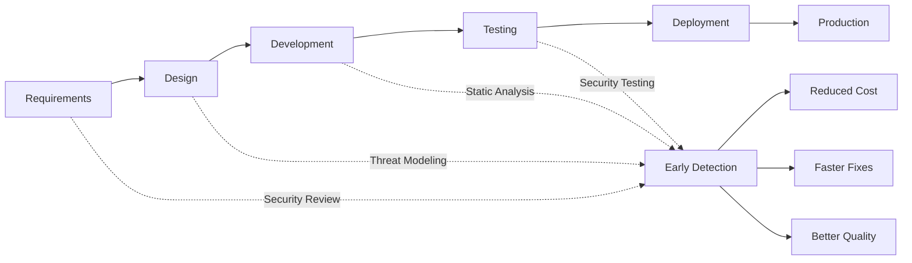
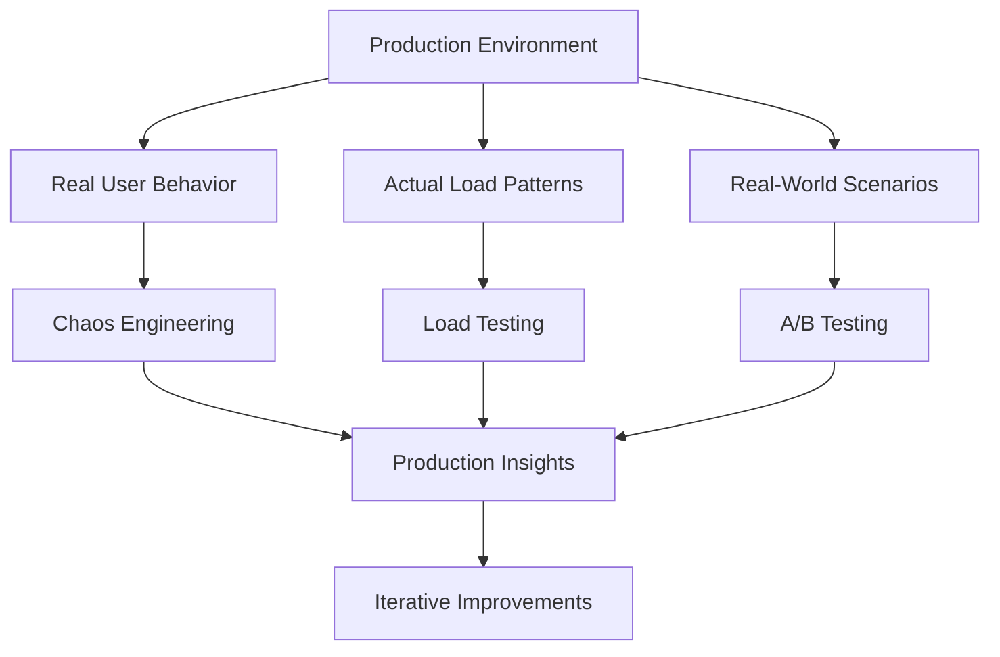
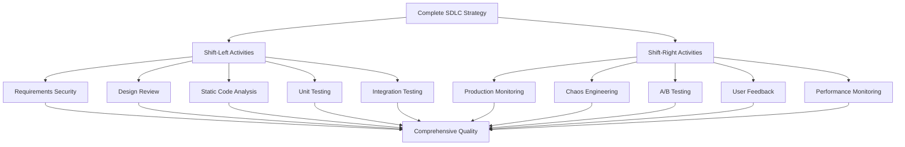
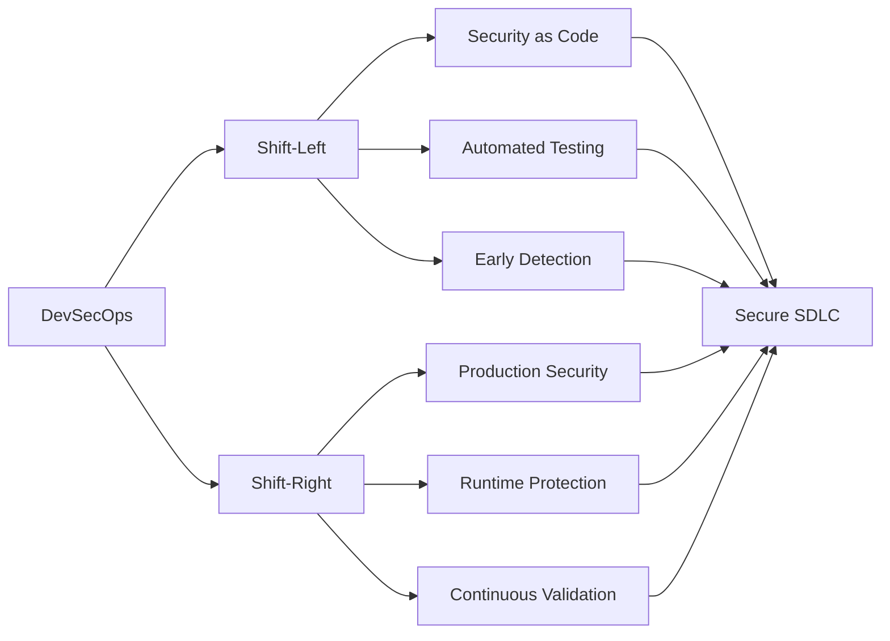

In an *SDLC lifecycle*, testing comes far to the right. *Shifting left* focuses on high-quality performance within the software delivery pipeline; therefore, one can easily detect and fix issues early in the software lifecycle rather than delaying higher risks when deployed in production. The shift-left approach may not always be able to give optimal performance and functioning in the real world. The shift-left approach primarily focuses on testing, securing the application, maintaining quality. Testing starts at the requirement analysis and planning stage during the shift left operation.

> **Key Insight**: Shifting left or right isn't an either/or decision—it's about finding the right balance for your organization's needs.

## Understanding Shift-Left

Within an *SDLC*, security may not always be integrated therefore leaving vulnerabilities to be handled differently. There is a need for high-priority security checkpoints at every stage of the SDLC. It allows *agile software development* without compromising security measures.

### How to Shift-Left?

#### 1. Demand Planning

It is essential to have a forward view of demand like:
- **Budget**: Allocate resources for early testing
- **Resources**: Assign security champions to teams
- **Test Strategies**: Define comprehensive test plans upfront

#### 2. Static Testing

Testing is carried out in the early cycles of the project and includes:
- **Validating requirements**: Ensure security requirements are clear
- **Design review**: Check architecture for security flaws
- **Code analysis**: Run static code analyzers

**Purpose**: Find early defects so that the process is not very expensive.

#### 3. Unified Test Strategy

*Unified test strategy* will allow analyzing dependencies in the environments, stubs, automation, and test data. The risk-based analysis determines the impact and likelihood of failure for each test scenario.

> **Best Practice**: Integrate security testing into your CI/CD pipeline from day one.

## Benefits of Shift-Left

### 1. Automation

*Left shift* gives a more remarkable ability to have **automated testing**. There are significantly fewer human errors.

- Continuous integration/continuous deployment
- Automated security scanning
- Consistent test execution
- Faster feedback loops

### 2. Increased Test Coverage (Multiple tests at a time)

Increased testing means bugs are fixed at the early stages **before they ever reach the production or end-users**. It decreases production issues and improves overall design implementations.

### 3. Increased Delivery Speed

If you find defects earlier, you can fix them faster. It improves not only the quality of software but overall throughput as well.

### 4. Increased Satisfaction

The shift-left approach allows developers to focus from the early stage and concentrate on quality. It massively saves time and effort and reduces the gaps between development and testing. It also helps perform daily tasks such as:
- Testing
- Providing feedback
- Reviewing changes & progress

## Understanding Shift-Right

The *Shift-Right approach* is the exact opposite of the *Shift-Left Approach*. **Shift-right focuses on testing once the software is in production**, where one can test user behavior. The *Shift-Right approach* encourages enhanced end-user experience and customer feedback. It enables automated testing and high test coverage.

### Why Shift-Right?

Shifting left has inevitable downgrades because no matter how much one thinks ahead and tries test scenarios, it can **never predict and cover the different permutations and combinations that actual user behavior can generate at a mass scale**.

> **Reality Check**: You can't test for what you don't know. Real user behavior often surprises even the most thorough pre-production testing.

## Benefits of Shift-Right

### 1. Real-World Testing

- **Actual user interactions**: See how users really use your application
- **Production data**: Work with real data volumes and patterns
- **True performance metrics**: Measure under actual conditions

### 2. Continuous Monitoring

- **Live feedback**: Real-time insights into application performance
- **User experience**: Monitor actual user satisfaction
- **Issue detection**: Catch problems as they happen

### 3. Chaos Engineering

- **Resilience testing**: Test system behavior under failure conditions
- **Recovery procedures**: Validate incident response in real scenarios
- **System limits**: Discover breaking points before users do

### 4. Feature Validation

- **A/B testing**: Compare feature variations with real users
- **Feature flags**: Gradually roll out features
- **Canary deployments**: Test with a small user subset first

## Shift-Left vs Shift-Right Comparison

| **Aspect** | **Shift-Left** | **Shift-Right** |
|------------|----------------|-----------------|
| **Timing** | Before production | In production |
| **Focus** | Prevent defects | Detect issues in real-world |
| **Testing Type** | Unit, integration, static analysis | Chaos engineering, A/B testing, monitoring |
| **Cost of Failure** | Low | Medium to High |
| **User Impact** | None | Potential impact |
| **Feedback Speed** | Fast (automated) | Varies (real-time to delayed) |
| **Environment** | Controlled | Production |
| **Predictability** | High | Low (real user behavior) |
| **Automation** | High | Moderate to High |
| **Risk** | Low | Higher (production impact) |

## The Balanced Approach: Shift Both Ways

Should one choose Shift-Left or Right? **Shifting both ways is a good and robust practice** to maintain security and confidence. Shifting both ways can help companies fix bugs and code errors before they reach end-users and compliance concerns in the cloud.

### Integrated Strategy

**Shift-Left Components:**
1. **Requirements phase**: Security requirements, threat modeling
2. **Design phase**: Architecture review, security design patterns
3. **Development phase**: Secure coding, static analysis, peer review
4. **Testing phase**: Unit tests, integration tests, security tests
5. **Pre-deployment**: Penetration testing, vulnerability scanning

**Shift-Right Components:**
1. **Deployment**: Blue-green deployments, canary releases
2. **Monitoring**: Real-time monitoring, log analysis, alerting
3. **Testing in Production**: Feature flags, A/B testing, chaos engineering
4. **User Feedback**: Analytics, user reports, satisfaction surveys
5. **Continuous Improvement**: Iterate based on production insights

## Implementation Best Practices

### For Shift-Left

1. **Automate Everything**: CI/CD pipeline with security gates
2. **Security Champions**: Embed security experts in development teams
3. **Training**: Regular security training for developers
4. **Tools Integration**: SAST, DAST, dependency scanning
5. **Code Reviews**: Mandatory security-focused code reviews

### For Shift-Right

1. **Observability**: Comprehensive logging and monitoring
2. **Gradual Rollouts**: Feature flags and canary deployments
3. **Chaos Engineering**: Regular resilience testing
4. **User Feedback Loops**: Actively collect and act on feedback
5. **Incident Response**: Well-defined processes and runbooks

> **Pro Tip**: Start with shift-left to prevent issues, then add shift-right to validate and improve based on real-world usage.

## Common Pitfalls to Avoid

### Shift-Left Pitfalls

- **Over-reliance on automation**: Automation can't catch everything
- **Ignoring user experience**: Focus on security shouldn't compromise usability
- **Analysis paralysis**: Don't let perfection prevent shipping
- **Tool overload**: Too many tools create noise

### Shift-Right Pitfalls

- **Testing in production without safeguards**: Always have rollback plans
- **Ignoring pre-production testing**: Shift-right complements, doesn't replace shift-left
- **Poor monitoring**: Can't shift-right effectively without observability
- **Slow response times**: Need rapid incident response capabilities

## The DevSecOps Connection

*DevSecOps* embodies both shift-left and shift-right principles:
- **Shift-left**: Integrate security early in development
- **Shift-right**: Monitor and protect in production
- **Continuous**: Security is never "done"

## Conclusion

The question shouldn't be "Should you shift-left **or** shift-right?" but rather "**How do you effectively implement both?**"

**Shift-left** helps you:
- Catch bugs early when they're cheap to fix
- Improve code quality through automation
- Reduce production incidents

**Shift-right** helps you:
- Validate assumptions with real user behavior
- Discover issues that only appear at scale
- Continuously improve based on production insights

The most successful organizations embrace **both approaches**, creating a comprehensive strategy that prevents issues early while remaining responsive to real-world conditions. By shifting both ways, companies can deliver high-quality, secure software that meets user needs while maintaining operational excellence.

> **Final Takeaway**: Security and quality are not binary choices. Shift-left to prevent, shift-right to validate, and continuously improve based on insights from both.

## References

- [DevOps Research and Assessment (DORA)](https://www.devops-research.com/)
- [Shift-Left Testing: A Practical Approach](https://www.ibm.com/garage/method/practices/code/shift-left-testing/)
- [Chaos Engineering Principles](https://principlesofchaos.org/)
- [Feature Flags Best Practices](https://featureflags.io/feature-flags/)
- [OWASP DevSecOps Guideline](https://owasp.org/www-project-devsecops-guideline/)
