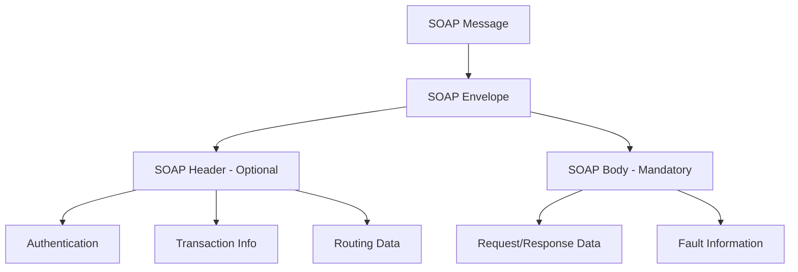
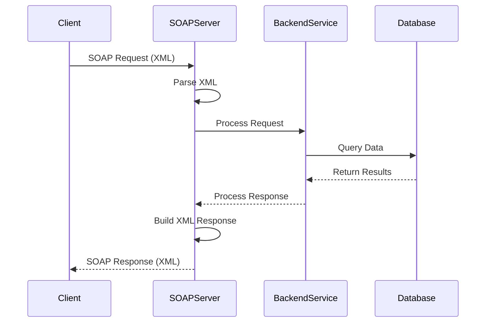
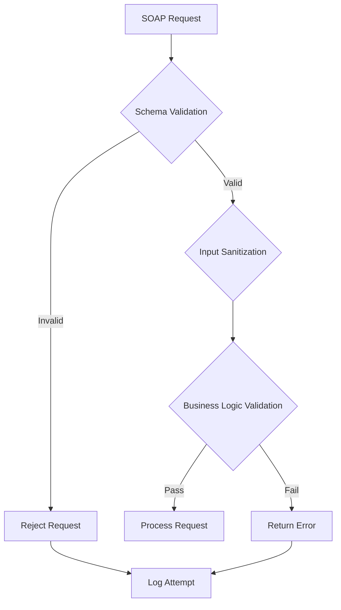

*SOAP* stands for **Simple Object Access Protocol** and is a messaging protocol for exchanging structured information to implement web services. It uses *XML* as its primary message format and application layer protocols for message communication.

> **Key Insight**: SOAP provides robust enterprise-level security features, but these must be properly configured to prevent vulnerabilities.

## SOAP Message Structure

The XML message is divided into three parts:

1. **Envelope**: Used to define the message structure and how to process it
2. **Set of encoding rules**: Used for expressing instances of application-defined datatypes
3. **Convention**: Used for representing procedure calls and responses



## Core SOAP Characteristics

SOAP relies on three primary characteristics:

- **Extensibility**: Provides customization capabilities
- **Neutrality**: Protocol agnostic - works over HTTP, SMTP, TCP, etc.
- **Independence**: No dependency on any programming language

> **Advantage**: SOAP's platform and language independence make it ideal for enterprise integrations.

## How SOAP Works

### Request-Response Flow



**The Workflow:**

1. The application sends a *SOAP request* to a server with web services enabled with the parameters for a search
2. The server returns a *SOAP response* (an XML-formatted document with the resulting data)
3. The resulting information is in machine-parsable format, therefore, the requesting application would be able to integrate directly

## SOAP API Structure

SOAP is also an extension of *Web Security Standard protocols*. *WS Standard protocols* supplement the primary protocol. Therefore SOAP is used as an interface by both public and private APIs. SOAP APIs give better structure, datatype control, and a defined standard.

### SOAP with WSDL

SOAP APIs merge a *WSDL (Web Services Description Language)* with *XML Schema*, providing a potent web service where messages are traded using specified procedures and field types. As *WSDL* is machine-readable, a SOAP client can determine what operations are possible and the data needed to meet the call and then present data to the user. To counter is also used to generate human-readable documentation for SOAP APIs.

## Example SOAP API Request

```xml
<?xml version="1.0"?>
<SOAP-ENV:Envelope 
 xmlns:SOAP-ENV="http://www.w3.org/2001/12/soap-envelope" 
 SOAP-ENV:encodingStyle="http://www.w3.org/2001/12/soap-encoding">
 <soap:Body>
 <HealthybyteWebService xmlns="http://example.org/">
 <BlogID>int</BlogID>
 </HealthybyteWebService>
 </soap:Body>
</SOAP-ENV:Envelope>
```

## WS-Security: Securing SOAP

*Web Standard (WS) Security* is critical in ensuring SOAP Security. *WS-Security* is a set of principles for standardizing SOAP messages using authentication and confidentiality processes.

### Security Methods

- **Digital Signatures**: Ensure message integrity and non-repudiation
- **XML Encryption**: Prevents unauthorized users from accessing & reading data
- **X.509 Certificates**: Provides authentication and trust
- **SAML Tokens**: Enables Single Sign-On (SSO)
- **Username Tokens**: Basic authentication mechanism

> **Best Practice**: Always encrypt sensitive data in SOAP messages, even when using HTTPS.

## Common SOAP API Vulnerabilities

### 1. SOAP Injections

*SOAP injection* attacks exploit vulnerabilities in XML parsing:

#### SQL Injection via SOAP

```xml
<SOAP-ENV:Body>
 <getUserInfo>
 <userID>1' OR '1'='1</userID>
 </getUserInfo>
</SOAP-ENV:Body>
```

**Impact**: Unauthorized database access, data exfiltration

**Mitigation**:
- Use parameterized queries
- Validate and sanitize all input
- Implement input length restrictions

#### XML Injection

```xml
<SOAP-ENV:Body>
 <updateUser>
 <userRole>user</userRole><admin>true</admin></updateUser>
 </updateUser>
</SOAP-ENV:Body>
```

**Impact**: Privilege escalation, data manipulation

**Mitigation**:
- Use XML schema validation
- Implement strict input validation
- Escape special XML characters

#### XAML Injection

**Impact**: Code execution, application compromise

**Mitigation**:
- Disable external entity processing
- Use safe XML parsers
- Implement content security policies

#### Command Injection

```xml
<SOAP-ENV:Body>
 <executeTask>
 <command>ls; rm -rf /</command>
 </executeTask>
</SOAP-ENV:Body>
```

**Impact**: Server compromise, data loss

**Mitigation**:
- Never execute user-supplied commands
- Use allowlists for permitted operations
- Implement strict input validation

### 2. SOAP Action Spoofing

*SOAP Action spoofing* occurs when an attacker modifies the SOAPAction header to invoke unintended operations.

**Example Attack:**

```http
POST /webservice HTTP/1.1
Host: vulnerable-site.com
Content-Type: text/xml
SOAPAction: "deleteUser"

<SOAP-ENV:Body>
 <getUser>...</getUser>
</SOAP-ENV:Body>
```

**Mitigation**:
- Validate SOAPAction header matches request body
- Implement proper authorization checks
- Use WS-Security for message-level security

### 3. SAML Vulnerabilities

*Security Assertion Markup Language (SAML)* tokens can be exploited if not properly validated:

**Common Issues**:
- Token replay attacks
- XML signature wrapping
- Certificate validation bypass

**Mitigation**:
- Implement token expiration
- Validate XML signatures properly
- Use certificate pinning

### 4. Replay Attacks

Attackers intercept and retransmit valid SOAP messages to perform unauthorized actions.

**Mitigation**:
- Implement timestamps in messages
- Use nonces (one-time tokens)
- Enable WS-Security with replay detection

### 5. Cross-Site Scripting (XSS)

XSS in SOAP services can occur when responses include unescaped user input.

**Example**:

```xml
<SOAP-ENV:Body>
 <searchResponse>
 <result><script>alert('XSS')</script></result>
 </searchResponse>
</SOAP-ENV:Body>
```

**Mitigation**:
- Escape all XML special characters
- Implement Content Security Policy
- Validate and sanitize responses

### 6. Broken Access and Authorization

Insufficient authorization checks allow users to access unauthorized operations.

**Mitigation**:
- Implement role-based access control (RBAC)
- Validate authorization for each operation
- Use OAuth 2.0 or similar standards

### 7. Denial of Service (DoS)

*XML bombs* and large payload attacks can exhaust server resources.

**XML Bomb Example**:

```xml
<?xml version="1.0"?>
<!DOCTYPE lolz [
 <!ENTITY lol "lol">
 <!ENTITY lol2 "&lol;&lol;&lol;&lol;&lol;&lol;&lol;&lol;&lol;&lol;">
 <!ENTITY lol3 "&lol2;&lol2;&lol2;&lol2;&lol2;&lol2;&lol2;&lol2;&lol2;&lol2;">
]>
<SOAP-ENV:Body>&lol3;</SOAP-ENV:Body>
```

**Mitigation**:
- Limit XML parsing depth
- Implement request size limits
- Disable external entity processing
- Use rate limiting

## SOAP Security Best Practices

### 1. Message-Level Security

| **Security Feature** | **Implementation** |
|---------------------|-------------------|
| **Encryption** | Use WS-Security with XML Encryption |
| **Authentication** | Implement mutual SSL/TLS |
| **Integrity** | Apply XML Digital Signatures |
| **Non-repudiation** | Use digital signatures with timestamps |

### 2. Transport-Level Security

- Always use **HTTPS/TLS** for SOAP communications
- Implement **certificate pinning**
- Use **mutual TLS (mTLS)** for service-to-service communication
- Enable **HSTS** (HTTP Strict Transport Security)

### 3. Input Validation



**Validation Layers**:
1. **Schema validation**: Validate against WSDL/XSD
2. **Input sanitization**: Clean and escape input
3. **Business logic validation**: Check business rules
4. **Authorization validation**: Verify permissions

### 4. Error Handling

**Bad Practice**:
```xml
<SOAP-ENV:Fault>
 <faultstring>
 SQL Error: Table 'users' doesn't exist in database 'production_db'
 </faultstring>
</SOAP-ENV:Fault>
```

**Good Practice**:
```xml
<SOAP-ENV:Fault>
 <faultcode>Server.InternalError</faultcode>
 <faultstring>An internal error occurred. Please contact support.</faultstring>
</SOAP-ENV:Fault>
```

> **Security Tip**: Never expose internal system details in error messages.

## SOAP Advantages

### Benefits of SOAP

- **Neutral Factor**: SOAP's neutral factor makes it possible to work with any transport protocol. For example, protocols such as *SMTP*, *HTTP/S*, *JMS*, and message queues.
- **Firewall Friendly**: SOAP tunnels quickly through existing firewalls and proxies and consequently doesn't require modifying the general computing and communication infrastructures when combined with HTTP post/response exchanges for processing HTTP post/response exchanges.
- **Extensibility**: SOAP is available to facilitate XML, including effortless internationalization and extensibility with *XML Namespaces*.
- **Built-in Error Handling**: Standardized fault handling mechanism
- **Enterprise Ready**: Extensive tooling and enterprise support

## SOAP Disadvantages

### Limitations

- **Verbosity**: The verbosity of the protocol, gradually parsing speed of XML, and absence of a standardized interaction model make SOAP a more complex service than a service like *REST*.
- **Performance**: The XML Infoset is serialized as XML when using standard implementation and the default SOAP/HTTP binding. The performance of a particular case of XML can be improved by embedding it with binary objects and *Message Transmission Optimization Mechanism*.
- **Complexity**: The functions of the interacting parties are specified when relying on the HTTP protocol and not using *WS Addressing* or an *Enterprise Service Bus*.
- **Overhead**: Large message size compared to JSON-based APIs
- **Learning Curve**: More complex to implement and debug than REST

## SOAP vs REST Comparison

| **Aspect** | **SOAP** | **REST** |
|-----------|----------|----------|
| **Protocol** | Protocol (strict standards) | Architectural style |
| **Format** | XML only | JSON, XML, HTML, plain text |
| **Security** | WS-Security (built-in) | HTTPS (must implement) |
| **State** | Can be stateful or stateless | Stateless |
| **Performance** | Slower (XML overhead) | Faster (lighter payloads) |
| **Caching** | Difficult to cache | Easy to cache |
| **Use Case** | Enterprise, high security | Web, mobile, microservices |
| **Standards** | Rigid standards (WSDL) | Flexible |

## Security Checklist for SOAP APIs

- [ ] Enable WS-Security with encryption and signatures
- [ ] Use HTTPS/TLS for all communications
- [ ] Implement input validation against WSDL schema
- [ ] Sanitize all user input
- [ ] Disable XML external entity processing
- [ ] Implement rate limiting
- [ ] Use authentication (OAuth 2.0, SAML, etc.)
- [ ] Implement proper authorization checks
- [ ] Log all security-relevant events
- [ ] Regularly update SOAP libraries
- [ ] Conduct security audits and penetration testing
- [ ] Implement CORS policies if applicable
- [ ] Use API gateway for additional security layer
- [ ] Enable security headers (CSP, X-Frame-Options, etc.)
- [ ] Implement replay attack prevention
- [ ] Validate certificates properly

## Conclusion

*SOAP* remains a powerful protocol for enterprise-level web services, offering robust security features through *WS-Security* standards. However, its complexity and XML-based nature introduce various security vulnerabilities that must be carefully addressed. By implementing proper *input validation*, *WS-Security standards*, *transport-level encryption*, and following security best practices, organizations can build secure SOAP-based services.

While *SOAP* has been largely superseded by *REST* for many web applications due to its simpler design and better performance, SOAP continues to be the protocol of choice for mission-critical enterprise applications that require guaranteed delivery, transactional reliability, and comprehensive security features.

> **Final Takeaway**: SOAP security is not just about enabling WS-Security—it's about implementing defense in depth across all layers: transport, message, and application.

## References

- [W3C SOAP Specification](https://www.w3.org/TR/soap/)
- [OWASP Web Services Security](https://owasp.org/www-community/vulnerabilities/Web_Services)
- [WS-Security Specification](https://docs.oasis-open.org/wss/2004/01/oasis-200401-wss-soap-message-security-1.0.pdf)
- [SOAP Security Best Practices](https://www.ibm.com/docs/en/was/9.0.5?topic=services-web-security)
- [XML Security Standards](https://www.w3.org/TR/xmldsig-core/)
