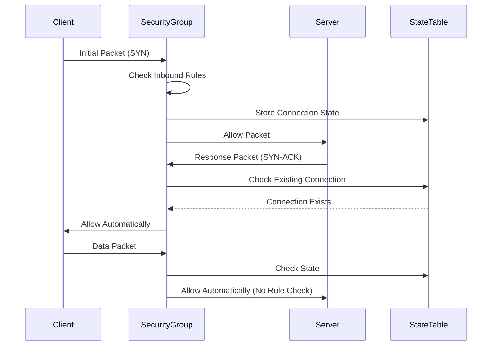
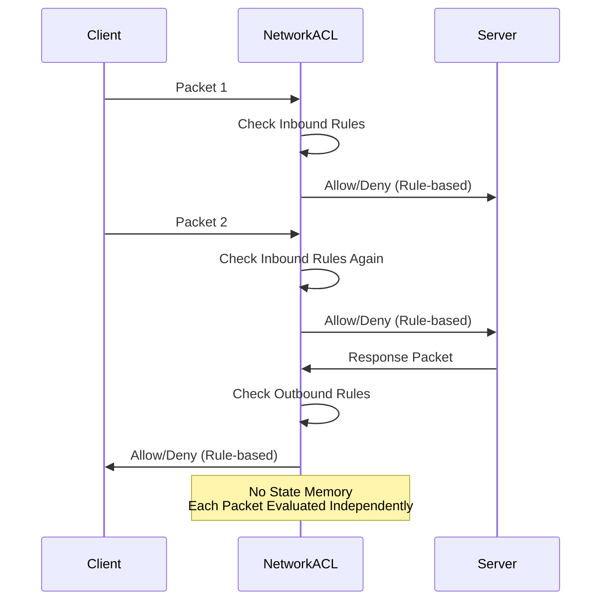
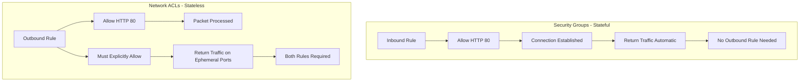
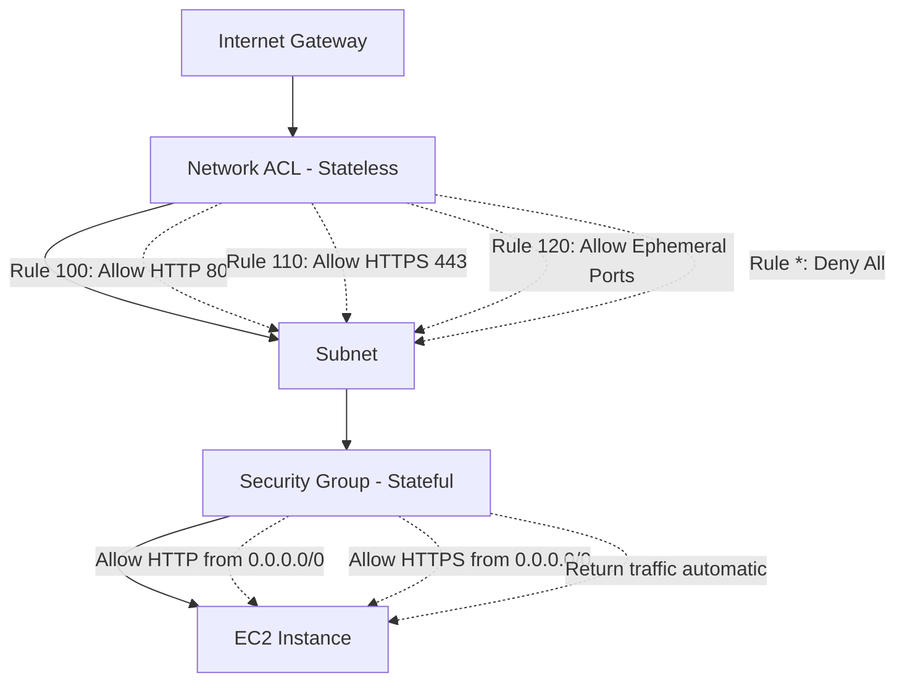

*Amazon Web Services (AWS)* provides *Virtual Private Clouds (VPCs)*, allowing users to create a virtual network environment that resembles a traditional network infrastructure. In a VPC, users can launch *Amazon Elastic Compute Cloud (EC2)* instances, virtual machines running on AWS infrastructure, and other resources such as databases, load balancers, and storage devices. When creating VPCs, users must decide whether to use *stateful* or *stateless* connections.

> **Key Insight**: Understanding the difference between stateful and stateless connections is crucial for designing secure and efficient network architectures in AWS.

## Stateful Connections

A *stateful connection* is a type of connection in which the system keeps track of the state of each connection. The system remembers the context of each packet that passes through it, including information about the source, destination, and port numbers. This information is stored in the system's memory and is used to manage the flow of packets. Stateful connections are used for protocols such as *TCP*, which require a reliable connection.

### Security Groups: Stateful Firewalls

AWS VPCs support stateful connections through the use of *Security Groups*. Security Groups are rules that control inbound and outbound traffic to and from resources in a VPC. Users can define inbound and outbound rules based on protocol, port, and source or destination IP addresses when creating a Security Group.

**How Stateful Connections Work:**

When a packet enters a VPC, the system:
1. Checks the *Security Group rules* to determine whether to allow or block the packet
2. If the packet matches an allowed rule, the system **adds the packet's state to its memory**
3. Subsequent packets in the same connection **automatically bypass the Security Group rules**



### Advantages of Stateful Connections

Stateful connections have several advantages over stateless connections:

| **Advantage** | **Description** |
|---------------|-----------------|
| **Enhanced Security** | Keeps track of connection state, allowing detection and prevention of malicious traffic like *DoS attacks* |
| **Improved Performance** | Subsequent packets bypass Security Group rules, reducing processing overhead |
| **Simplified Configuration** | Only need to define inbound rules; return traffic is automatically allowed |
| **Connection Tracking** | Maintains context for entire communication session |

> **Security Benefit**: Stateful connections automatically handle return traffic, making it harder for attackers to inject malicious packets.

### Stateful Connection Example: E-Commerce Website

An e-commerce website requires a secure and reliable connection for processing transactions. Since transactions involve multiple packets being exchanged between the client and the server, a stateful connection can help ensure that all packets are correctly received and processed in the correct order. Additionally, Security Groups can be used to restrict access to the server to only authorized IP addresses, providing an additional layer of security.

```
 +------------------+ +------------------+
 | | | |
 | Client Machine | | Server Machine |
 | | | |
 +--------+---------+ +--------+---------+
 | |
 | TCP Connection |
 +----------------------------------->|
 | |
 | |
 | Packets (with state information) |
 +----------------------------------->|
 | |
 | Packets (with state information) |
 +----------------------------------->|
 | |
 | |
 | TCP Connection Close |
 +----------------------------------->|
```

**TCP connection** is established between the client machine and the server machine. The packets are then transmitted with state information, and subsequent packets in the same connection bypass the Security Group rules. Finally, the TCP connection is closed.

## Stateless Connections

A *stateless connection* is a type of connection in which the system does not keep track of the state of each connection. In other words, each packet is treated as an independent unit and is processed based solely on its contents. Stateless connections are commonly used for protocols such as *UDP*, which do not require a reliable connection.

### Network ACLs: Stateless Firewalls

AWS VPCs support stateless connections using *Network Access Control Lists (ACLs)*. ACLs are similar to Security Groups in that they control inbound and outbound traffic to and from resources in a VPC. However, ACLs are **stateless**, meaning they do not keep track of the state of each connection.

**How Stateless Connections Work:**

When a packet enters a VPC:
1. The system checks the *ACL rules* to determine whether to allow or block the packet
2. Each packet is processed **independently**
3. Return traffic must have **explicit allow rules**



### Advantages of Stateless Connections

Stateless connections have several advantages over stateful connections:

| **Advantage** | **Description** |
|---------------|-----------------|
| **Simplicity** | No state management overhead |
| **Scalability** | Ideal for high-traffic applications requiring rapid packet processing |
| **Protocol Flexibility** | Better suited for protocols that don't require reliable connections (*UDP*) |
| **Predictability** | Behavior is deterministic based solely on rules |

> **Performance Benefit**: Stateless connections excel in high-throughput scenarios where connection tracking would create bottlenecks.

### Stateless Connection Example: Video Streaming Service

A video streaming service that requires high bandwidth and low latency. Since video streaming involves many packets being sent at high speed, a stateless connection can help ensure that each packet is processed as quickly as possible without the overhead of keeping track of the state of each connection. Additionally, Network ACLs can allow traffic from any IP address, providing a more open and scalable network environment.

```
 +------------------+ +------------------+
 | | | |
 | Client Machine | | Server Machine |
 | | | |
 +--------+---------+ +--------+---------+
 | |
 | UDP Packets |
 +----------------------------------->|
 | |
 | UDP Packets |
 +----------------------------------->|
 | |
 | UDP Packets |
 +----------------------------------->|
 | |
 | UDP Packets |
 +----------------------------------->|
```

**UDP packets** are sent from the client machine to the server machine without any state information being stored in the system. Each packet is processed independently and forwarded to the server machine.

## Security Groups vs Network ACLs Comparison



| **Feature** | **Security Groups (Stateful)** | **Network ACLs (Stateless)** |
|-------------|-------------------------------|------------------------------|
| **State Tracking** | Yes - tracks connection state | No - each packet evaluated independently |
| **Return Traffic** | Automatically allowed | Must be explicitly allowed |
| **Rule Evaluation** | All rules evaluated | Rules processed in order (numbered) |
| **Level** | Instance level | Subnet level |
| **Support** | Allow rules only | Allow and Deny rules |
| **Default Behavior** | Deny all inbound, allow all outbound | Allow all inbound and outbound |
| **Rules Applied** | Before instance reaches | Before subnet traffic |
| **Performance** | Faster for subsequent packets | Must check every packet |

## Architecture Decision Guide

### When to Use Stateful Connections (Security Groups)

 **Best for:**
- Applications requiring reliable connections (*TCP-based*)
- Scenarios with lower traffic volume
- Services needing simplified rule management
- Web applications and APIs
- Database connections
- SSH/RDP remote access

**Example Use Cases:**
- Web servers handling HTTP/HTTPS traffic
- Application servers processing transactions
- Database servers with client connections
- Email servers (SMTP, IMAP)

### When to Use Stateless Connections (Network ACLs)

 **Best for:**
- High-traffic applications
- Protocols not requiring reliable connections (*UDP-based*)
- Subnet-level security boundaries
- Defense in depth strategies
- Explicit deny requirements

**Example Use Cases:**
- Video/audio streaming services
- DNS servers
- Gaming servers
- IoT sensor data collection
- Log aggregation services

> **Best Practice**: Use both Security Groups and Network ACLs together for layered security—Security Groups for instance-level control and Network ACLs for subnet-level boundaries.

## Layered Security Approach



### Implementing Defense in Depth

1. **Network ACL (First Layer - Subnet Level)**:
 - Broad filtering at subnet boundary
 - Deny known malicious IPs/ranges
 - Allow only necessary protocols

2. **Security Group (Second Layer - Instance Level)**:
 - Fine-grained access control
 - Application-specific rules
 - Source-based restrictions

## Configuration Best Practices

### Security Groups Best Practices

```yaml
# Example Security Group Configuration
SecurityGroup:
 InboundRules:
 - Protocol: TCP
 Port: 443
 Source: 0.0.0.0/0
 Description: "Allow HTTPS from internet"
 
 - Protocol: TCP
 Port: 22
 Source: 10.0.1.0/24
 Description: "Allow SSH from management subnet only"
 
 # Outbound rules automatically allow return traffic
 OutboundRules:
 - Protocol: -1 # All protocols
 Destination: 0.0.0.0/0
 Description: "Allow all outbound traffic"
```

### Network ACL Best Practices

```yaml
# Example Network ACL Configuration
NetworkACL:
 InboundRules:
 - RuleNumber: 100
 Protocol: TCP
 Port: 443
 Source: 0.0.0.0/0
 Action: ALLOW
 
 - RuleNumber: 110
 Protocol: TCP
 PortRange: 1024-65535 # Ephemeral ports
 Source: 0.0.0.0/0
 Action: ALLOW
 
 - RuleNumber: "*"
 Protocol: -1
 Action: DENY
 
 OutboundRules:
 - RuleNumber: 100
 Protocol: TCP
 Port: 443
 Destination: 0.0.0.0/0
 Action: ALLOW
 
 - RuleNumber: 110
 Protocol: TCP
 PortRange: 1024-65535
 Destination: 0.0.0.0/0
 Action: ALLOW
 
 - RuleNumber: "*"
 Protocol: -1
 Action: DENY
```

> **Important**: Network ACLs require explicit rules for both directions and ephemeral port ranges for return traffic.

## Performance Considerations

### Stateful (Security Groups)

**Advantages:**
- Faster processing for established connections
- Lower rule complexity
- Automatic return traffic handling

**Limitations:**
- Memory overhead for state tables
- Connection limit per instance

### Stateless (Network ACLs)

**Advantages:**
- Consistent processing time per packet
- Better for high-volume traffic
- No connection limits

**Limitations:**
- More complex rule management
- Must configure bidirectional rules

## Conclusion

AWS VPCs support both *stateful* and *stateless* connections through *Security Groups* and *Network ACLs*. Stateful connections keep track of the state of each connection and provide an additional layer of security and improved network performance. Stateless connections treat each packet as an independent unit and are more straightforward, scalable, and better suited for high-traffic applications and protocols that do not require a reliable connection.

When designing a VPC, it's vital to carefully consider the type of connection to use based on the requirements of the application or service being deployed. *Stateful connections* are best suited for applications that require a reliable connection and have lower traffic volume. In contrast, *stateless connections* are ideal for high-traffic applications that do not require a reliable connection.

It's also worth noting that *Security Groups* and *Network ACLs* can be used together to provide a **layered approach to network security**, with Security Groups providing stateful protection at the instance level and Network ACLs providing stateless protection at the subnet level.

> **Final Takeaway**: Understanding the differences between stateful and stateless connections in AWS VPCs is essential for designing a secure and efficient network environment. With the right choice of connection type and security measures in place, users can enjoy the benefits of AWS VPCs while ensuring the safety and reliability of their applications and services.

## References

- [AWS Security Groups Documentation](https://docs.aws.amazon.com/vpc/latest/userguide/VPC_SecurityGroups.html)
- [AWS Network ACLs Documentation](https://docs.aws.amazon.com/vpc/latest/userguide/vpc-network-acls.html)
- [AWS Network Firewall Rule Groups](https://docs.aws.amazon.com/network-firewall/latest/developerguide/rule-groups.html)
- [AWS VPC Best Practices](https://docs.aws.amazon.com/vpc/latest/userguide/vpc-security-best-practices.html)
