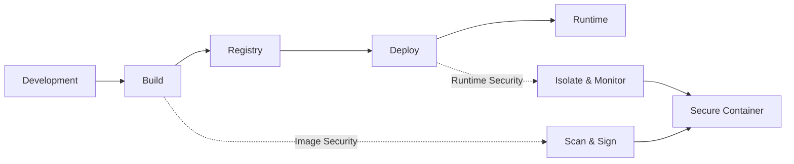
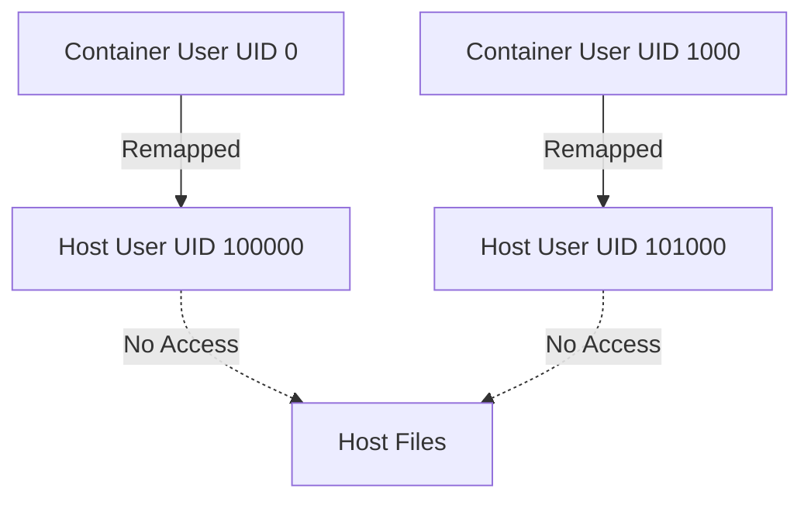
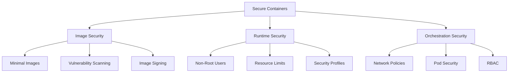

With *container security*, it's vital to focus on two main aspects: **Container Image Security** and **Container Runtime Security**. Each aspect addresses different stages of the container lifecycle and potential threats.

> **Key Insight**: Container security is a shared responsibility—secure images at build time and secure runtime at deployment time.

## Container Security Lifecycle



## Container Image Security

*Container Image Security* focuses on ensuring that the container images that are built and deployed are free from vulnerabilities and constructed securely. The primary goal is to **minimize the attack surface** and prevent attackers from exploiting weaknesses within the image.

### 1. Use Minimal Base Images

Start with **minimal base images** that include only the necessary components to run the application. This reduces the number of potential vulnerabilities that an attacker could exploit.

**Recommended Base Images:**
- **Alpine Linux** - ~5MB, minimal attack surface
- **Distroless** - Google's minimal images with no shell
- **ChainGuard** - Secure, minimal base images designed specifically for security
- **Scratch** - Empty base for static binaries

```dockerfile
# Example: Using minimal base image
FROM alpine:3.18
# or
FROM gcr.io/distroless/static-debian11
```

> **Pro Tip**: Distroless images contain only your application and runtime dependencies, nothing else—no shell, no package manager.

### 2. Exclude Unnecessary Components

During the image build process, ensure that the Dockerfile excludes components that are not required for the application to run in production. This not only reduces the image size but also **removes potential vulnerabilities**.

**What to Exclude:**
- Development tools (compilers, debuggers)
- Package managers (apt, yum) in final image
- Documentation and man pages
- Temporary files and caches

### 3. Utilize Multi-Stage Builds

*Multi-stage builds* allow components needed only during the build process (such as development tools) to be included but excluded from the final runtime image. This results in a **cleaner, more secure production image**.

```dockerfile
# Build stage
FROM node:18 AS builder
WORKDIR /app
COPY package*.json ./
RUN npm ci --only=production
COPY . .
RUN npm run build

# Production stage
FROM node:18-alpine
WORKDIR /app
COPY --from=builder /app/dist ./dist
COPY --from=builder /app/node_modules ./node_modules
USER node
EXPOSE 3000
CMD ["node", "dist/index.js"]
```

**Benefits:**
- Smaller final image size
- Fewer attack vectors
- No build tools in production
- Faster deployment times

### 4. Vulnerability Scanning

Regularly scan the container images for known vulnerabilities using tools like *Snyk* (which is integrated with Docker) or *Trivy* (from Aqua Security). These tools can identify and alert for vulnerabilities, allowing one to address them before deploying the image.

**Scanning Tools Comparison:**

| **Tool** | **Provider** | **Integration** | **Best For** |
|-----------|---------------|-----------------|------------------------|
| **Trivy** | Aqua Security | CLI, CI/CD | Comprehensive scanning |
| **Snyk** | Snyk | Docker, K8s | Developer-friendly |
| **Clair** | CoreOS | Registry | Continuous monitoring |
| **Grype** | Anchore | CLI | Fast scanning |

```bash
# Example: Scanning with Trivy
trivy image myapp:latest

# Example: Scanning with Snyk
snyk container test myapp:latest
```

### 5. Run Containers as Non-Root

Running containers as a **non-root user** with minimal permissions is a critical security measure. By avoiding root access, attackers can limit the damage they can do if they compromise the container.

```dockerfile
# Create non-root user
RUN addgroup -S appgroup && adduser -S appuser -G appgroup

# Switch to non-root user
USER appuser

# Application runs as appuser, not root
CMD ["./app"]
```

> **Security Principle**: Never run containers as root unless absolutely necessary. If compromised, root containers can potentially break out to the host.

### 6. Treat Images as Public

Avoid embedding sensitive information (like passwords, API keys, or private certificates) within your container images. Instead, this data can be injected at runtime using *environment variables* or *secrets management tools*. This practice ensures that no sensitive information is compromised, even if an image is exposed.

**Bad Practice:**
```dockerfile
# DON'T DO THIS
ENV DATABASE_PASSWORD=secretpassword123
ENV API_KEY=sk-1234567890abcdef
```

**Good Practice:**
```dockerfile
# Use runtime injection
# No secrets in image

# At runtime, inject via:
# - Kubernetes Secrets
# - Docker Secrets
# - HashiCorp Vault
# - AWS Secrets Manager
```

### 7. Cryptographic Signing

Signing your container images using cryptographic techniques ensures their **integrity and authenticity**. This process proves the origin of the image and helps prevent tampering.

**Signing Options:**
- **Docker Content Trust (DCT)** - Built-in Docker signing
- **Notary** - CNCF project for content signing
- **Cosign** - Sigstore project for container signing

```bash
# Enable Docker Content Trust
export DOCKER_CONTENT_TRUST=1

# Sign and push image
docker push myregistry/myapp:v1.0

# Verify signature
cosign verify myregistry/myapp:v1.0
```

### 8. Pin Base Images to Specific Versions

Pinning your base images to at least the **minor version number** helps incorporate bug fixes while avoiding unexpected breaking changes. This practice ensures consistency and security across your environments.

**Versioning Strategy:**

| **Practice** | **Example** | **Risk Level** |
|----------------------|---------------------------------|----------------------------------|
| **Latest tag** | `FROM node:latest` | High - unpredictable changes |
| **Major version** | `FROM node:18` | Medium - minor updates can break |
| **Minor version** | `FROM node:18.16` | Low - predictable updates |
| **SHA digest** | `FROM node:18@sha256:abc123...` | Lowest - immutable |

```dockerfile
# Best practice: Pin to specific version and digest
FROM node:18.16-alpine@sha256:a1b2c3d4e5f6...

# Good practice: Pin to minor version
FROM node:18.16-alpine

# Bad practice: Using latest
FROM node:latest # Don't do this in production!
```

## Container Runtime Security

*Container Runtime Security* addresses the security concerns that arise when a container runs. The focus is on **minimizing the potential damage** an attacker can do if they compromise a running container and **preventing lateral movement** within your environment.

### 1. Enable User Namespace Remap

User namespace remapping in Docker (enabled via the `--userns-remap` option) isolates container user namespaces from the host system. This separation ensures that a user inside a container cannot interact with or gain access to resources on the host, even if they break out of the container.

```bash
# Enable user namespace remapping
dockerd --userns-remap=default

# Or in daemon.json
{
 "userns-remap": "default"
}
```

**How it Works:**


### 2. Read-Only File System

Configure the file system to be **read-only** for containers that do not require write access. This restriction significantly reduces the potential for attackers to modify the file system, plant malicious files, or persist changes that could be used in future attacks.

```yaml
# Docker Compose example
services:
 webapp:
 image: myapp:latest
 read_only: true
 tmpfs:
 - /tmp
 - /var/run
```

```bash
# Docker run example
docker run --read-only --tmpfs /tmp myapp:latest
```

### 3. Cap_Drop and Cap_Add

By default, containers run with a set of capabilities that may not all be necessary. Use the `--cap-drop` option to remove all capabilities, then selectively add back only the required ones using the `--cap-add` option. This fine-grained control limits the scope of what a compromised container can do.

```yaml
# Docker Compose with capability management
services:
 webapp:
 image: myapp:latest
 cap_drop:
 - ALL
 cap_add:
 - NET_BIND_SERVICE # Only if binding to ports < 1024
```

**Common Linux Capabilities:**

| **Capability** | **Purpose** | **Risk if Granted** |
|------------------------|-------------------------|-------------------------------|
| `CAP_SYS_ADMIN` | System admin operations | HIGH - Can mount filesystems |
| `CAP_NET_ADMIN` | Network administration | MEDIUM - Network manipulation |
| `CAP_NET_BIND_SERVICE` | Bind to ports < 1024 | LOW - Limited scope |
| `CAP_CHOWN` | Change file ownership | MEDIUM - Privilege escalation |

> **Best Practice**: Start with `cap_drop: ALL` and only add back what you absolutely need.

### 4. Resource Limits

Setting **CPU and memory limits** for your containers is essential to prevent *denial-of-service (DoS)* attacks. These limits ensure that no single container can consume all the host's resources, which could otherwise disrupt service availability or lead to resource starvation.

```yaml
# Docker Compose with resource limits
services:
 webapp:
 image: myapp:latest
 deploy:
 resources:
 limits:
 cpus: '0.5'
 memory: 512M
 reservations:
 cpus: '0.25'
 memory: 256M
```

```bash
# Docker run with limits
docker run -m 512m --cpus=0.5 myapp:latest
```

### 5. Security Profiles

Leverage security profiles like *Seccomp (Secure Computing Mode)* or *AppArmor* to enforce additional security layers. *Seccomp* restricts the system calls that a container can make, while *AppArmor* profiles define what a container can and cannot do at the kernel level. These profiles help to contain the potential damage from a compromised container.

**Seccomp Profile Example:**

```json
{
 "defaultAction": "SCMP_ACT_ERRNO",
 "architectures": ["SCMP_ARCH_X86_64"],
 "syscalls": [
 {
 "names": ["read", "write", "open", "close", "stat"],
 "action": "SCMP_ACT_ALLOW"
 }
 ]
}
```

```bash
# Apply Seccomp profile
docker run --security-opt seccomp=profile.json myapp:latest

# Apply AppArmor profile
docker run --security-opt apparmor=docker-default myapp:latest
```

**Security Profile Comparison:**

| **Profile Type** | **Scope** | **Complexity** | **Use Case** |
|------------------|--------------------------|----------------|--------------------------|
| **Seccomp** | System calls | Medium | Limit syscall access |
| **AppArmor** | File/network access | Medium | File system restrictions |
| **SELinux** | Mandatory Access Control | High | Enterprise Linux |

## Complete Security Strategy



## Security Checklist

### Image Security Checklist

- [ ] Use minimal base images (Alpine, Distroless)
- [ ] Implement multi-stage builds
- [ ] Scan images for vulnerabilities
- [ ] Sign images cryptographically
- [ ] Pin base images to specific versions
- [ ] Remove unnecessary components
- [ ] Never embed secrets in images
- [ ] Run containers as non-root user
- [ ] Use .dockerignore to exclude sensitive files
- [ ] Regularly update base images

### Runtime Security Checklist

- [ ] Enable user namespace remapping
- [ ] Use read-only filesystems where possible
- [ ] Drop all unnecessary capabilities
- [ ] Set CPU and memory limits
- [ ] Apply Seccomp/AppArmor profiles
- [ ] Use security scanning in CI/CD
- [ ] Implement network segmentation
- [ ] Enable container logging
- [ ] Monitor runtime behavior
- [ ] Regular security audits

## Tools and Resources

### Scanning Tools
- **Trivy** - Comprehensive vulnerability scanner
- **Snyk** - Developer-friendly security platform
- **Clair** - Static analysis for vulnerabilities
- **Grype** - Fast vulnerability scanner

### Security Platforms
- **Aqua Security** - Full container security platform
- **Sysdig Secure** - Runtime security and compliance
- **Twistlock/Prisma Cloud** - Comprehensive security suite
- **StackRox** - Kubernetes-native security

### Best Practices Resources
- **CIS Docker Benchmark** - Security configuration guide
- **NIST Container Security** - Government standards
- **OWASP Container Security** - Web app container security

## Conclusion

Securing containerized environments requires a **defense-in-depth approach** that addresses both *image security* and *runtime security*. By implementing these strategies—from using minimal base images and scanning for vulnerabilities to enforcing runtime restrictions and security profiles—organizations can significantly reduce their attack surface and protect against container-based threats.

Remember that container security is not a one-time effort but an **ongoing process** that requires continuous monitoring, updating, and improvement. As container technologies evolve, so do the threats and security best practices.

> **Final Takeaway**: The most secure container is one that runs with the minimum necessary permissions, contains only what's needed, and is monitored continuously throughout its lifecycle.

## References

- [Docker Security Best Practices](https://docs.docker.com/develop/security-best-practices/)
- [CNCF Container Security Whitepaper](https://www.cncf.io/reports/)
- [CIS Docker Benchmark](https://www.cisecurity.org/benchmark/docker)
- [NIST Application Container Security Guide](https://nvlpubs.nist.gov/nistpubs/SpecialPublications/NIST.SP.800-190.pdf)
- [Kubernetes Security Best Practices](https://kubernetes.io/docs/concepts/security/)
