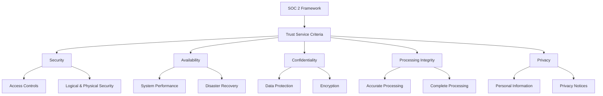
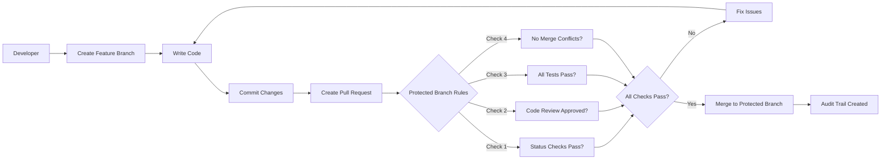
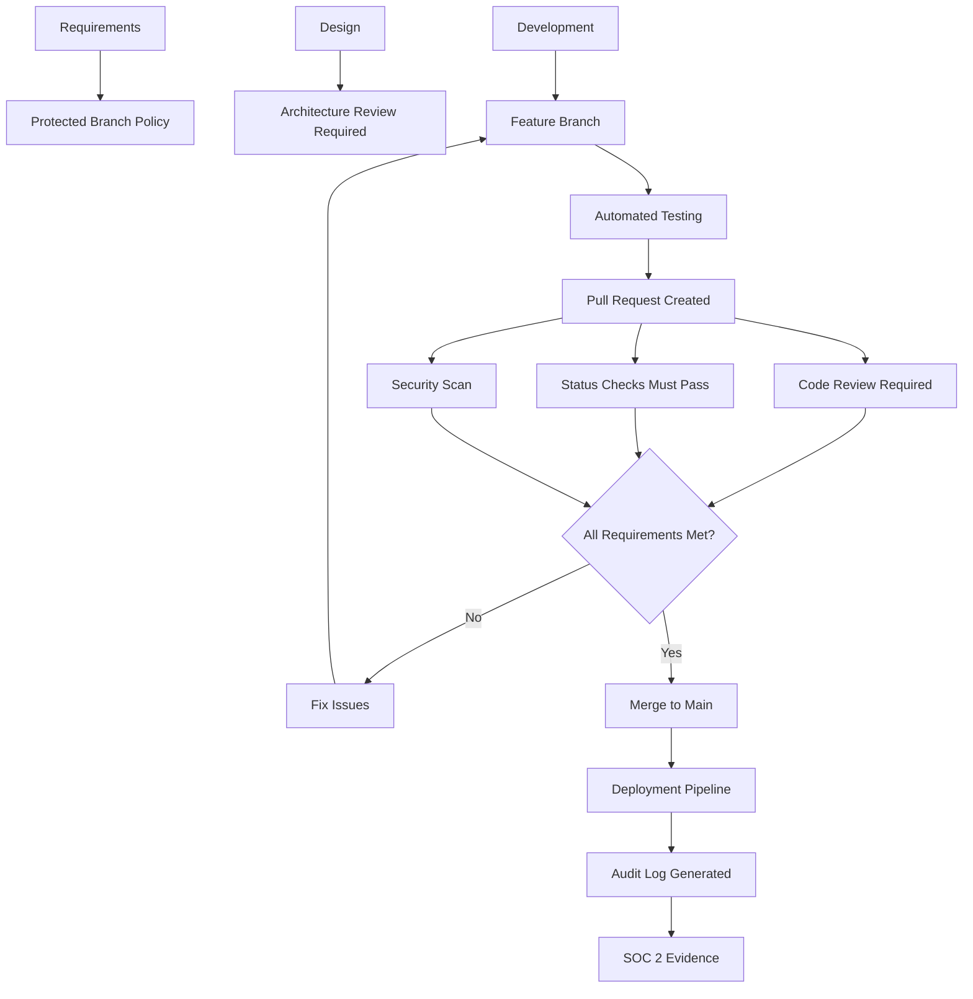
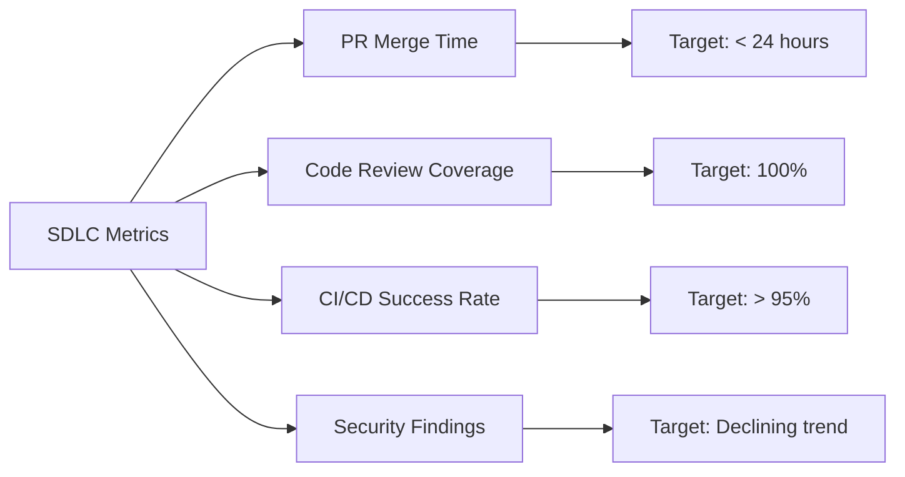

Security should no more be an afterthought for a company. With the rise of data breaches, companies need to take the necessary steps to handle sensitive customer data and protect themselves from security risks and threats. *SOC 2 (Service Organization Control)* is a framework developed by *AICPA* and is used to audit, assess, and attest a company's compliance and security practices against the five security principles: *Security*, *Availability*, *Confidentiality*, *Integrity*, and *Privacy*.

> **Key Insight**: SOC 2 compliance shouldn't slow down development—when properly integrated into your SDLC, it actually improves software quality and security posture.

## Understanding SOC 2

A *SOC 2* audit builds a robust security & compliance culture within the organization. It provides the ability to:

- Create new and improve existing **customer confidence**
- **Speed up sales cycles** by eliminating security & compliance as a sales objection
- Demonstrate **commitment to security** and data protection
- Gain **competitive advantage** in enterprise sales

### SOC 2 Report Components

A *SOC 2 report* includes:

**Organizational Information:**
- Descriptions of systems and processes
- Roles and responsibilities
- Performance reviews and metrics
- Organizational structure

**Technical Data:**
- Data encryption methods
- Employee device management
- Version control systems
- Access control mechanisms
- Incident response procedures



## How SOC 2 Impacts the SDLC

A *software development lifecycle* is an integral part of SOC 2 examinations. Auditors are concerned about details related to each software modification:

### Auditor Requirements

Auditors need to see:

| **Requirement** | **What Auditors Look For** | **Evidence Needed** |
|-----------------|---------------------------|---------------------|
| **Formal Documentation** | Comments on Pull Requests, Jira tickets | Change logs, ticket history |
| **Code Reviews** | Who reviewed the change or Pull Request | PR approval records |
| **Approval Process** | Was the change approved and by whom? | Approval workflows, signatures |
| **Testing** | Was the change/difference tested? | Test results, QA sign-offs |
| **Change Tracking** | Complete audit trail of modifications | Version control logs |

> **Reality Check**: These concerns may seem significant obstructions to collaboration and speed for the software dev team. Still, it is essential to adhere to compliance requirements to maintain a secure and healthy codebase.

## GitHub Protected Branches: The Solution

If your company uses a source code management tool such as *GitHub*, facilitating *protected branches* and enforcing native security policies on these branches will make audit experiences sustainable.

### What are Protected Branches?

According to GitHub documentation:

> "You can protect important branches by setting branch protection rules, which define whether collaborators can delete or force push to the branch and set requirements for any pushes to the branch, such as passing status checks or a linear commit history. You can enforce certain workflows or requirements before a collaborator can push changes to a branch in your repository, including merging a pull request into the branch, by creating a branch protection rule. By default, each branch protection rule disables force pushes to the matching branches and prevents the matching branches from being deleted. You can optionally disable these restrictions and enable additional branch protection settings."



## Essential Protected Branch Rules & Configurations

### 1. Require Status Checks to Pass Before Merging

*Required status checks* ensure that all *continuous integration (CI)* tests pass before branches can be merged into the protected branch by collaborators.

**How It Works:**
- CI tools provide a status check update on each prospective change
- Any person or integration with write permissions to a repository can set the state of any status check in the repository
- You may only want to accept a status check from a specific GitHub App in some cases

**SOC 2 Benefit:**
- Demonstrates **testing requirements** for every change made
- Reduces evidence gathering during SOC 2 audits
- Automated proof of quality assurance

```yaml
# Example GitHub Actions Workflow
name: CI Pipeline
on: [pull_request]

jobs:
 test:
 runs-on: ubuntu-latest
 steps:
 - uses: actions/checkout@v2
 - name: Run Tests
 run: npm test
 
 - name: Security Scan
 run: npm audit
 
 - name: Linting
 run: npm run lint
```

> **Pro Tip**: Make status checks required for all protected branches to ensure no code bypasses your quality gates.

### 2. Require Pull Request Reviews Before Merging

*Code reviews* are essential for any software development lifecycle. This check requires **at least one approved review** before merging a pull request.

**Benefits:**
- Demonstrates the **separation of duties principle**
- Prevents engineers from merging their pull requests without a secondary review
- Creates an audit trail of who reviewed what

**Implementation:**

```yaml
# Protected Branch Settings
protected_branches:
 main:
 required_pull_request_reviews:
 required_approving_review_count: 1
 dismiss_stale_reviews: true
 require_code_owner_reviews: true
```

If a collaborator attempts to merge a pull request with pending or rejected reviews into the protected branch, the collaborator will receive an error message.

> **Compliance Note**: This setting directly addresses SOC 2's requirement for segregation of duties in the change management process.

### 3. Require Code Owners Review

*Code owners*, a predetermined set of users, are automatically requested for a review and must approve the change before merging a pull request.

**How Code Owners Work:**

```
# CODEOWNERS file example
# Global owners
* @security-team

# Frontend code
/frontend/** @frontend-team @security-team

# Backend code
/backend/** @backend-team @security-team

# Infrastructure as Code
/terraform/** @devops-team @security-team

# Database migrations
/migrations/** @database-team @backend-team

# Security-sensitive files
/auth/** @security-team
/.github/workflows/** @devops-team @security-team
```

**SOC 2 Benefits:**
- Ensures **subject matter experts** review relevant changes
- Provides **clear ownership** and accountability
- Creates **documented approval chain**

### 4. Additional Recommended Settings

| **Setting** | **Purpose** | **SOC 2 Value** |
|-------------|-------------|-----------------|
| **Require branches to be up to date** | Ensures changes are tested against latest code | Prevents integration issues |
| **Require signed commits** | Verifies commit authenticity | Non-repudiation |
| **Restrict who can push** | Limits direct pushes to protected branches | Access control |
| **Require linear history** | Prevents merge commits, ensures clean history | Audit trail clarity |
| **Include administrators** | Even admins follow the rules | Demonstrates consistent policy enforcement |

## Complete Protected Branch Configuration

```yaml
# Complete example for main branch
protected_branches:
 main:
 # Prevent deletion and force pushes
 allow_deletions: false
 allow_force_pushes: false
 
 # Require pull request reviews
 required_pull_request_reviews:
 required_approving_review_count: 2
 dismiss_stale_reviews: true
 require_code_owner_reviews: true
 require_last_push_approval: true
 
 # Require status checks
 required_status_checks:
 strict: true # Must be up to date with base branch
 contexts:
 - "CI / Unit Tests"
 - "CI / Integration Tests"
 - "Security / SAST Scan"
 - "Security / Dependency Check"
 
 # Additional restrictions
 restrictions:
 users: []
 teams: ["senior-engineers"]
 
 # Enforce for administrators
 enforce_admins: true
 
 # Require signed commits
 required_signatures: true
```

## SDLC Integration Points for SOC 2



## Evidence Collection Made Easy

Enabling these security rules and configurations makes **acquiring and maintaining evidence** for SOC 2 and other compliance assessments **easier and less complicated** during audits.

### Automatic Evidence Generation

| **SOC 2 Requirement** | **GitHub Evidence** | **Where to Find It** |
|----------------------|--------------------|--------------------|
| Change management process | Pull requests with reviews | PR history |
| Code review requirements | Approval records | PR approvals tab |
| Testing procedures | CI/CD pipeline results | Actions tab |
| Access control | Branch protection rules | Repository settings |
| Audit trail | Git commit history | Commit log |
| Segregation of duties | CODEOWNERS file | Repository root |

### Audit Preparation Checklist

Before your SOC 2 audit:

- [ ] Enable branch protection on all production branches
- [ ] Require at least 1-2 approving reviews
- [ ] Enable required status checks for all CI/CD pipelines
- [ ] Create and maintain CODEOWNERS file
- [ ] Enable signed commits
- [ ] Document your SDLC process
- [ ] Export PR and commit logs for audit period
- [ ] Prepare evidence of security training for developers
- [ ] Document exception handling procedures
- [ ] Review and update access control policies

> **Auditor Tip**: Auditors love automated evidence. The more you can show from your systems automatically, the faster and smoother your audit will be.

## Beyond GitHub: Other Tools

While this article focuses on GitHub, similar principles apply to other version control platforms:

| **Platform** | **Similar Feature** |
|--------------|-------------------|
| **GitLab** | Protected branches with merge request approvals |
| **Bitbucket** | Branch permissions and merge checks |
| **Azure DevOps** | Branch policies and required reviewers |
| **AWS CodeCommit** | Approval rule templates |

## Common Pitfalls to Avoid

### Don't Do This

1. **Allowing emergency bypasses without documentation**: Always log and review emergency changes
2. **Having admin accounts that bypass rules**: Everyone should follow the same process
3. **Not testing your CI/CD pipeline**: Broken checks defeat the purpose
4. **Inconsistent enforcement**: Apply rules uniformly across all projects
5. **Lack of documentation**: Document your process and exceptions

### Do This Instead

1. **Document emergency procedures**: Have a clear process for urgent changes with post-facto review
2. **Regular policy reviews**: Quarterly reviews of branch protection rules
3. **Developer training**: Ensure all developers understand why these rules exist
4. **Audit the auditors**: Periodically review that controls are working as intended
5. **Continuous improvement**: Update policies based on lessons learned

## Measuring Success

### Key Metrics to Track



**Track These Metrics:**
- **Pull request cycle time**: Time from PR creation to merge
- **Review participation**: Percentage of PRs with timely reviews
- **CI/CD pass rate**: Percentage of builds that pass all checks
- **Security vulnerability detection**: Number of issues found pre-merge
- **Audit preparation time**: Time spent preparing for audits (should decrease)

## Conclusion

*SOC 2 compliance* doesn't have to slow down your development process. By leveraging native features in platforms like *GitHub*—such as *protected branches*, *required reviews*, and *status checks*—you can build compliance into your everyday workflow.

The key is to make **compliance automatic and transparent**. When your tools automatically generate the evidence auditors need, you spend less time preparing for audits and more time building great products. This approach not only satisfies auditors but also improves your overall code quality, security posture, and team collaboration.

> **Final Takeaway**: The best SOC 2 controls are the ones developers don't have to think about—they're just part of how good software gets built.

## References

- [GitHub Protected Branches Documentation](https://docs.github.com/en/repositories/configuring-branches-and-merges-in-your-repository/defining-the-mergeability-of-pull-requests/about-protected-branches)
- [About Code Owners](https://docs.github.com/en/repositories/managing-your-repositorys-settings-and-features/customizing-your-repository/about-code-owners)
- [AICPA SOC 2 Framework](https://www.aicpa.org/interestareas/frc/assuranceadvisoryservices/aicpasoc2report.html)
- [SOC 2 Compliance Checklist](https://www.vanta.com/resources/soc-2-compliance-checklist)
