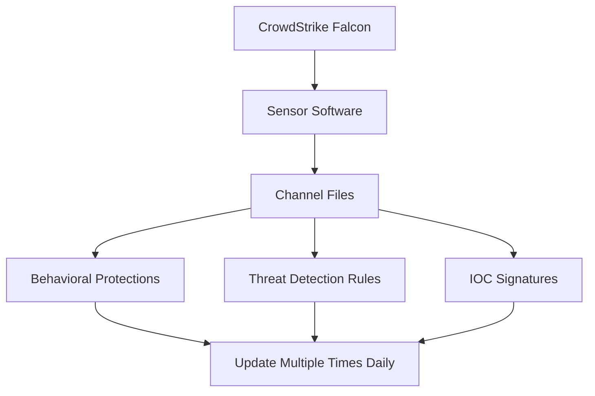
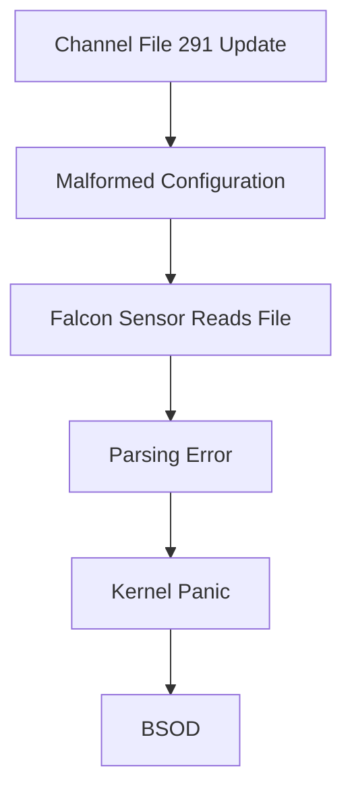
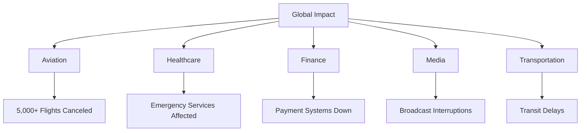
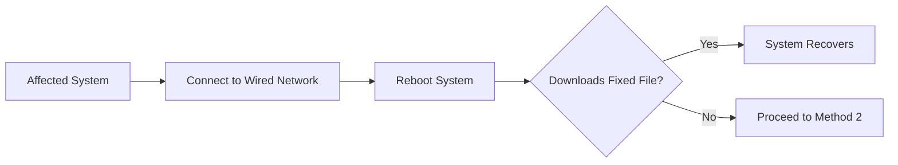
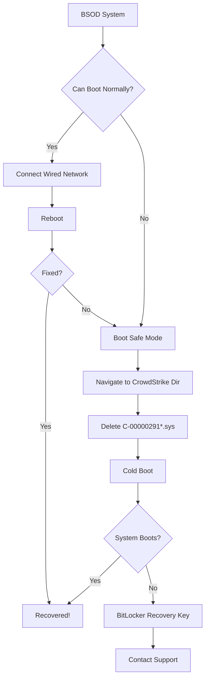
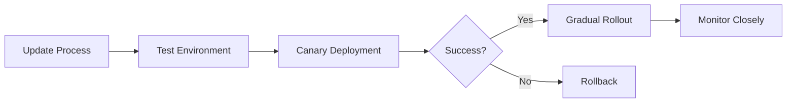
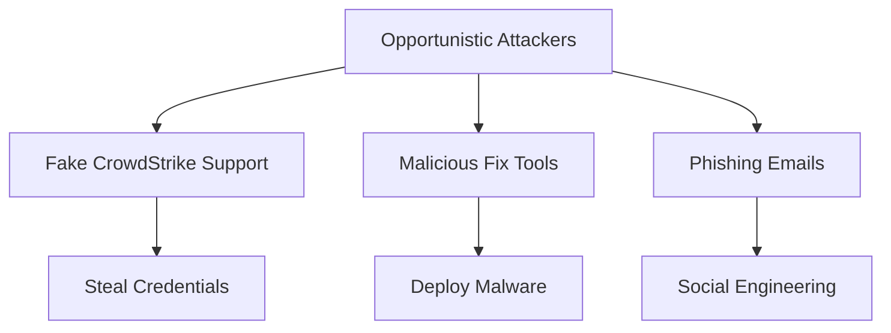
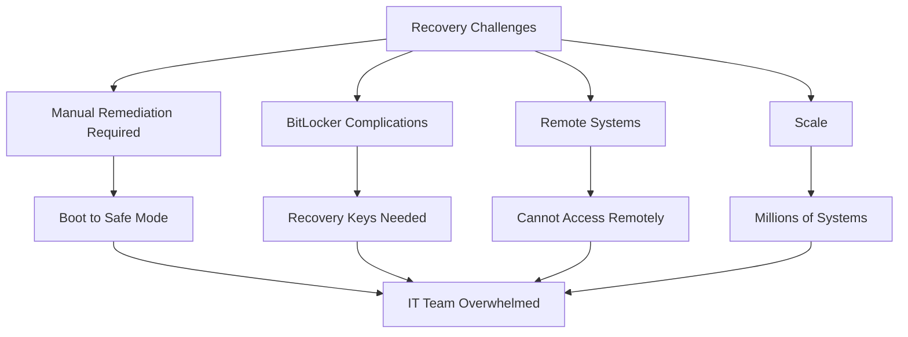

On July 19, 2024, *CrowdStrike* and *Microsoft* experienced a significant global outage that lasted multiple hours and impacted vital services worldwide. The disruption, caused by a configuration error during routine maintenance, affected authentication and data processing systems, resulting in the infamous **"Blue Screen of Death" (BSOD)** on millions of Windows systems globally.

> **Key Impact**: This incident affected approximately 8.5 million Windows devices globally, disrupting airlines, hospitals, banks, and critical services—one of the largest IT outages in history.

## Incident Overview

### Timeline

| **Time (UTC)**    | **Event**                        |
|-------------------|----------------------------------|
| **04:09**         | Faulty Channel File 291 deployed |
| **04:09 - 05:27** | Impact window (78 minutes)       |
| **05:27**         | Issue remediated, file reverted  |
| **All Day**       | Global recovery efforts          |

**Impact Window**: Friday, July 19, 2024, **04:09 UTC** to **05:27 UTC**

**Affected Systems**: Customers running *Falcon sensor for Windows version 7.11 and above* that were online during the impact window.

**Timeline of Events:**

| **Time (UTC)** | **Event**                                 | **Duration**         |
|----------------|-------------------------------------------|----------------------|
| 04:09          | Faulty Update Deployed (Channel File 291) | Initial deployment   |
| 04:10-05:27    | Systems Crash Worldwide (BSODs)           | 78 minutes of impact |
| 05:27          | Update Reverted and Fix Deployed          | Issue remediated     |
| 05:30+         | Global Recovery Efforts Begin             | Ongoing recovery     |

## Root Cause Analysis

### The Configuration Error

The outage's root cause was identified as a **misconfiguration** resulting from a system update error in *Channel File 291*.

### What are Channel Files?

**Channel Files** are configuration files that are part of the **behavioral protection mechanisms** used by the Falcon sensor.



**Key Characteristics:**
- **Purpose**: Behavioral protection mechanisms
- **Updates**: Occur **several times daily**
- **Reason**: Respond to novel tactics, techniques, and procedures (TTPs)
- **Normal Operation**: Part of regular Falcon sensor updates

> **Important Note**: Channel File updates are a **normal part** of Falcon sensor operations, designed to keep protection current against emerging threats.

## Technical Analysis

### Channel File Location

On Windows systems, Channel Files reside in:

```
C:\Windows\System32\drivers\CrowdStrike\
```

**File Naming Convention:**
- Starts with `C-`
- Followed by unique identifier number
- Ends with `.sys` extension

**The Problematic File:**

```
File: C-00000291-*.sys
Identifier: 291
Extension: .sys
```

> **Technical Note**: Although Channel Files end with the `.sys` extension, they are **not kernel drivers**.

### What Went Wrong



The faulty Channel File 291 caused:
1. **Parsing error** in Falcon sensor
2. **Kernel-level exception**
3. **System crash** (BSOD)
4. **Boot loop** on affected systems

## Global Impact

### Affected Sectors

The outage impacted critical services worldwide:

**Major Disruptions:**
- **Airlines**: Grounded flights (Delta, United, American Airlines)
- **Healthcare**: Hospital systems down, surgeries delayed
- **Banking**: ATMs and payment systems affected
- **Broadcasting**: TV stations off-air (Sky News, ABC)
- **Transportation**: Railway systems disrupted
- **Enterprises**: Business operations halted



**Estimated Impact:**
- **8.5 million Windows devices** affected globally
- **Billions of dollars** in economic losses
- **Thousands of organizations** disrupted
- **Multiple days** for full recovery

## Triage & Remediation Steps

Per *CrowdStrike*, here are the recommended workarounds:

### Method 1: Simple Reboot (If Lucky)

**Reboot the host** to allow it to download the reverted channel file.

**Best Practice:**
> We strongly recommend putting the host on a **wired network** (as opposed to WiFi) before rebooting, as the host will acquire internet connectivity considerably faster via Ethernet.



### Method 2: Safe Mode Recovery (If Reboot Fails)

If the host crashes again after reboot:

#### Step 1: Boot into Safe Mode

**Options:**
- **Safe Mode**
- **Windows Recovery Environment (WinRE)**

> **NOTE**: Putting the host on a **wired network** (as opposed to WiFi) and using **Safe Mode with Networking** can help remediation.

#### Step 2: Navigate to CrowdStrike Directory

**Path:**
```
%WINDIR%\System32\drivers\CrowdStrike
```

**Windows Recovery Default:**
```
X:\windows\system32
```

**Navigate to partition first:**
```cmd
C:
cd windows\system32\drivers\crowdstrike
```

> **Note**: On WinRE/WinPE, navigate to the `Windows\System32\drivers\CrowdStrike` directory of the OS volume

#### Step 3: Delete the Problematic File

**Locate and delete:**
```cmd
# Find file matching pattern
dir C-00000291*.sys

# Delete the file
del C-00000291*.sys
```

 **CRITICAL WARNING**: 
- **Do NOT delete or change any other files or folders**
- Only delete files matching `C-00000291*.sys`
- Other deletions may cause additional issues

#### Step 4: Cold Boot the Host

**Proper shutdown sequence:**

1. **Shut down** the host completely
2. **Wait** for full power-off
3. **Start** host from the off-state

> **Note**: BitLocker-encrypted hosts may require a **recovery key**

### Remediation Flowchart



## Advanced Search Query for Affected Hosts

CrowdStrike provided a **LogScale/Humio query** to identify affected hosts:

```javascript
// Get ConfigStateUpdate and SensorHeartbeat events
#event_simpleName=/^(ConfigStateUpdate|SensorHeartbeat)$/ event_platform=Win 

// Narrow search to Channel File 291 and extract version number
| case{
 #event_simpleName=ConfigStateUpdate | regex("\|1,123,(?<CFVersion>.*?)\|", field=ConfigStateData, strict=false) | parseInt(CFVersion, radix=16);
 #event_simpleName=SensorHeartbeat | rename([[@timestamp, LastSeen]]);
}

// Check if events occurred during impact window
| case{
 #event_simpleName=ConfigStateUpdate | @timestamp>1721362140000 AND @timestamp < 1721366820000 | CSUcounter:=1;
 #event_simpleName=SensorHeartbeat | LastSeen>1721362140000 AND LastSeen<1721366820000 | SHBcounter:=1;
 *;
}

| default(value="0", field=[CSUcounter, SHBcounter])

// Ensure both ConfigState update and SensorHeartbeat occurred
| selfJoinFilter(field=[cid, aid, ComputerName], where=[{ConfigStateUpdate}, {SensorHeartbeat}])

// Aggregate results
| groupBy([cid, aid], function=([
 {selectFromMax(field="@timestamp", include=[CFVersion])}, 
 {selectFromMax(field="@timestamp", include=[@timestamp]) | rename(field="@timestamp", as="LastSeen")}, 
 max(CSUcounter, as=CSUcounter), 
 max(SHBcounter, as=SHBcounter)
 ]), limit=max)

// Verify data exists
| CFVersion=* LastSeen=*

// Calculate time since last seen
| LastSeenDelta:=now()-LastSeen

// Flag hosts not seen in past hour (optional threshold: 3600000ms = 1 hour)
| LastSeenDelta>3600000

// Format for readability
| LastSeenDelta:=formatDuration("LastSeenDelta", precision=2)
| LastSeen:=formatTime(format="%F %T", field="LastSeen")

// Enrich with asset data
| aid=~match(file="aid_master_main.csv", column=[aid])
| aid=~match(file="aid_master_details.csv", column=[aid], include=[FalconGroupingTags, SensorGroupingTags])

// Format FirstSeen timestamp
| FirstSeen:=formatTime(format="%F %T", field="FirstSeen")

// Enrich ProductType
| $falcon/helper:enrich(field=ProductType)

// Cleanup and defaults
| drop([Time])
| default(value="-", field=[MachineDomain, OU, SiteName, FalconGroupingTags, SensorGroupingTags], replaceEmpty=true)

// Categorize endpoints
| case{
 CSUcounter=0 AND SHBcounter=0 | Details:="OK: Endpoint did not receive channel file during impacted window. Endpoint was offline.";
 CSUcounter=0 AND SHBcounter=1 | Details:="OK: Endpoint did not receive channel file during impacted window. Endpoint was online.";
 CSUcounter=1 AND SHBcounter=1 | Details:="CHECK: Endpoint received channel file during impacted window. Endpoint was online. Endpoint has not been seen online in past hour.";
}
```

**Query Purpose:**
- Identify which endpoints received the faulty update
- Determine online/offline status during impact window
- Prioritize systems needing attention
- Provide actionable categorization

## Lessons Learned

This outage underscored the importance of several critical operational practices:

### 1. Robust Contingency Planning

**Organizations need:**
- Backup and recovery procedures
- Alternative operational modes
- Business continuity plans
- Disaster recovery testing

### 2. Rigorous Testing of System Changes

**Before deployment:**
- Canary deployments (small percentage first)
- Staged rollouts (not all at once)
- Testing in production-like environments
- Automated testing pipelines
- Rollback capabilities



### 3. Transparent Customer Communication

**During disruptions:**
- Timely status updates
- Clear remediation steps
- Regular progress reports
- Post-incident analysis
- Honest acknowledgment

### 4. Change Management Procedures

**In response, CrowdStrike and Microsoft are:**
- Enhancing monitoring capabilities
- Reinforcing change management procedures
- Implementing additional safeguards
- Improving testing processes
- Reducing risk of similar incidents

## Security Considerations

### Phishing Exploitation

**Watch for malicious actors** leveraging the CrowdStrike-related event to phish organizations.



**Malicious Domain Example:**
- `crowdstrike-bsod.com` - [VirusTotal Analysis](https://www.virustotal.com/gui/domain/crowdstrike-bsod.com)

**Warning Signs:**
- Unsolicited "fix" tools
- Emails asking for credentials
- Fake support websites
- Social media scams

> **Security Alert**: Only follow official CrowdStrike guidance from verified sources. Attackers will exploit this incident for phishing and malware distribution.

## Best Practices for EDR/Security Software

### For Vendors

**Deployment Best Practices:**

| **Practice**              | **Description**                       | **Benefit**        |
|---------------------------|---------------------------------------|--------------------|
| **Staged Rollout**        | Deploy to small percentage first      | Limit blast radius |
| **Canary Testing**        | Test on subset of production systems  | Early detection    |
| **Automated Rollback**    | Detect failures, auto-revert          | Rapid recovery     |
| **Kill Switch**           | Ability to halt deployments instantly | Damage control     |
| **Blue-Green Deployment** | Parallel environments for testing     | Safe updates       |

### For Organizations

**Protection Strategies:**

- **Staged updates**: Don't auto-update all systems simultaneously
- **Test systems**: Have canary systems update first
- **Backup and recovery**: Maintain offline backups
- **Incident response plan**: Include vendor-caused incidents
- **Alternative access**: Out-of-band management for emergencies
- **Communication plan**: Coordinate response efforts

## Recovery Statistics

### Recovery Challenges



**Challenges:**
- Manual intervention required for each system
- BitLocker recovery keys needed
- Remote systems inaccessible
- IT teams overwhelmed
- Critical systems prioritized

## Industry Response

### Microsoft's Role

**Microsoft reported:**
- Approximately **8.5 million Windows devices** affected
- While small percentage (<1%) of Windows machines globally
- Demonstrates how critical services rely on CrowdStrike

### CrowdStrike's Actions

**Immediate Response:**
- Reverted faulty Channel File within 78 minutes
- Published remediation guidance
- Provided advanced search queries
- 24/7 support for affected customers
- Public incident postmortem

## Long-Term Implications

### For the Industry

**Industry Changes and Improvements:**

| **Area**       | **Improvements**                                                            |
|----------------|-----------------------------------------------------------------------------|
| **Testing**    | More rigorous processes, production-like environments, automated validation |
| **Deployment** | Staged rollouts, canary deployments, rollback capabilities                  |
| **Monitoring** | Real-time detection, automated alerts, health checks                        |
| **Governance** | Change management, risk assessment, vendor oversight                        |

**Expected Changes:**
1. **Enhanced testing** for security software updates
2. **Graduated rollouts** instead of global deployments
3. **Better monitoring** for update-related issues
4. **Improved vendor accountability**
5. **Industry-wide** update practices review

### For CrowdStrike

**Committed Improvements:**
- Enhanced quality assurance processes
- Additional testing layers
- Improved monitoring capabilities
- Reinforced change management
- More conservative rollout strategies

## Prevention Checklist

### For Security Software Vendors

- [ ] Implement staged deployment (1% → 10% → 50% → 100%)
- [ ] Automated health checks post-deployment
- [ ] Rapid rollback capabilities
- [ ] Multiple testing environments
- [ ] Canary systems in production
- [ ] Real-time monitoring of deployments
- [ ] Kill switch for problematic updates
- [ ] Customer communication plan

### For Organizations Using EDR

- [ ] Test updates on non-critical systems first
- [ ] Maintain system recovery procedures
- [ ] Document BitLocker recovery keys
- [ ] Have out-of-band management access
- [ ] Backup critical systems regularly
- [ ] Incident response plan for vendor issues
- [ ] Alternative security tool strategy
- [ ] Recovery time objectives defined

## Conclusion

The *CrowdStrike-Microsoft outage* of July 19, 2024, serves as a stark reminder that even the tools designed to protect us can become sources of disruption when things go wrong. While the incident was caused by a **configuration error** in a routine update rather than a cyberattack, its global impact was unprecedented.

The outage affected critical services worldwide—from airlines to hospitals—demonstrating our deep dependence on interconnected IT systems and security software. The fact that a **78-minute deployment window** could impact 8.5 million systems highlights both the scale of modern cybersecurity infrastructure and the potential for cascading failures.

**Key Takeaways:**
- Software updates, even from trusted vendors, can cause catastrophic failures
- Staged deployments and canary testing are essential
- Organizations need robust backup and recovery procedures
- Vendor-caused incidents should be part of incident response planning
- The balance between rapid threat protection and stability is delicate

> **Final Takeaway**: This incident will likely reshape how security software updates are deployed industry-wide. The lessons learned—rigorous testing, staged rollouts, rapid rollback capabilities—will influence practices for years to come. Trust, but verify. And always have a Plan B.

## References

- [CrowdStrike: Statement on Falcon Content Update](https://www.crowdstrike.com/blog/statement-on-falcon-content-update-for-windows-hosts/)
- [HP Support: CrowdStrike BSOD Issue](https://support.hp.com/lv-en/document/ish_5000477-5000532-16)
- [Reddit: CrowdStrike Community Discussion](https://www.reddit.com/r/crowdstrike/comments/1e6vmkf/bsod_error_in_latest_crowdstrike_update/)
- [Azure Status Updates](https://azure.status.microsoft/en-gb/status)
- [Microsoft: Technical Analysis](https://blogs.microsoft.com/blog/2024/07/20/helping-our-customers-through-the-crowdstrike-outage/)
