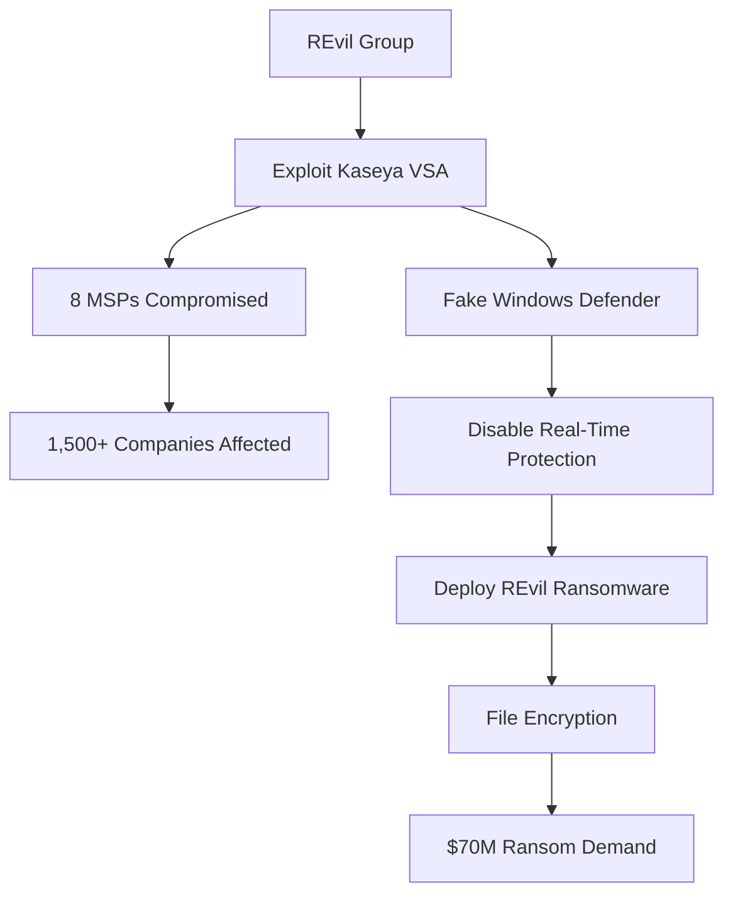
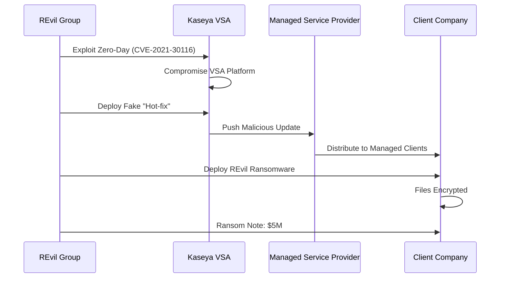
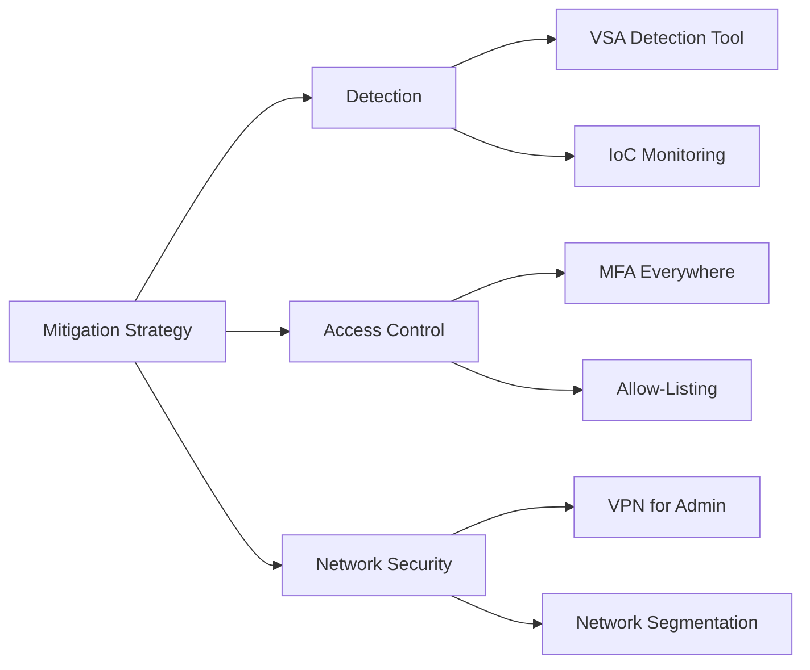

The I.T. firm **Kaseya**, dated July 2, 2021, has been attacked by a *supply chain attack* conducted by a Russian hacker group *REVIL*. The Kaseya *VSA* I.T. management software commonly used by *managed service providers (MSPs)* who work I.T. Services at many companies was compromised by these attackers, shipping ransomware to all the endpoint companies. The Russian-based group REVIL has so far reportedly hacked eight managed service providers; in turn, these 8 MSPs managed hundreds of other companies, and as a consequence, the ransomware has been shipped out to all the companies affected by this onslaught.

> **Key Impact**: This attack represents one of the largest and most successful supply chain ransomware attacks in history, affecting over 1,500 businesses globally.

## Attack Overview

### The Exploit

According to *Sophos Malware Analyst Mark Loman*, the industry-wide supply-chain attack leverages *Kaseya VSA* to deploy a variant of the *REvil ransomware* into a victim's environment.

**Attack Mechanism:**
- The malicious binary side-loaded via a **fake Windows Defender app**
- Files encrypted in return for a ransom demand of **$5 million** per company
- The attack chain involves attempts to **disable Microsoft Defender Real-Time Monitoring** via *PowerShell*
- The trojan software was distributed in the form of a **"Kaseya VSA Agent Hot-fix"** according to *Huntress Labs*

### Timeline and Impact

**Attack Timing:**
- **Date**: July 2, 2021 (Friday)
- **Strategic Timing**: Right before the 4th of July holiday weekend
- **Immediate Impact**: Over 1,500 businesses affected

**Ransom Demands:**
- **Per-company**: $5 million
- **Universal decryptor**: $70 million in Bitcoin
- **Federal estimate**: Thousands of affected companies

> **Strategic Note**: The timing right before a major U.S. holiday was likely intentional, reducing the likelihood of immediate response from security teams.

## Global Impact

### Affected Industries and Regions

**Industries Impacted:**
- Financial services
- Travel and leisure 
- Public-sector computer systems
- Retail and grocery

**Geographic Spread (17 Countries):**

| **Region** | **Countries** |
|------------|--------------|
| **Europe** | U.K., Sweden, Netherlands, Spain, Turkey |
| **Americas** | USA, Canada, Colombia, Argentina, Mexico |
| **Africa** | South Africa, Kenya, Mauritius |
| **Asia-Pacific** | Indonesia, Japan, Germany, New Zealand |

### Notable Case: Swedish Grocery Chain Coop

**Swedish grocer Coop** reported that it was forced to **close 800 of its stores for more than two days** because the attack impacted its cash register software supplier.

> **Business Impact**: This demonstrates how supply chain attacks can have immediate, tangible effects on business operations and customer service.

## Technical Analysis

### Zero-Day Vulnerability

The *Dutch Institute for Vulnerability Disclosure (DIVD)* on Sunday revealed it had alerted Kaseya to several **zero-day vulnerabilities** in its VSA software (*CVE-2021-30116*) that were being exploited as a conduit to deploy ransomware.

### Attack Flow

### ESET Telemetry Data

Based on **ESET's telemetry**, they identified victims in:
- U.K., South Africa, Canada, Germany, USA
- Colombia, Sweden, Kenya, Argentina, Mexico
- Netherlands, Indonesia, Japan, Mauritius
- New Zealand, Spain, Turkey

## Critical Questions

The Kaseya incident raises several important security questions:

### Intelligence and Attribution

1. **How did REvil learn of the VSA exploit?**
 - Did they have access to Kaseya's vulnerability disclosure systems?
 - Were they provided the exploit by a 3rd-party?
 - Was that 3rd-party a Russian intelligence agency or exploit broker?

2. **Was the timing strategic?**
 - Was the July 4 weekend timing a decision made for political reasons?
 - Or was it REvil's typical modus operandi to hit over big western holiday breaks?

### Operational Questions

3. **Why request a universal decrypter?**
 - Did they realize that negotiating ransoms with thousands of companies simultaneously is not worth the effort?
 - Will that universal decrypter even work, or will companies encounter bugs with large files?

4. **Will Kaseya consider paying?**
 - What are the legal and ethical implications?

### Political and Strategic Implications

5. **Why such a brazen attack?**
 - Why would REvil pull such a brazen attack right after the *Colonial Pipeline* and *JBS* attacks and the political fallout from those incidents?
 - Wouldn't this attack confirm that REvil had some sort of approval from a Russian intelligence agency before doing something this destructive?

> **Geopolitical Context**: This attack occurred amid heightened tensions between the U.S. and Russia over state-sponsored cybercrime, shortly after the Biden-Putin summit.

## Response and Recovery

### Kaseya's Response

Kaseya, which enlisted the help of *FireEye* to assist with its investigation, announced its recovery plan:

**Recovery Strategy:**
- Bring SaaS data centers back online on a **one-by-one basis**
- **Priority regions**: E.U., U.K., and Asia-Pacific data centers
- **Followed by**: North American data centers
- **On-premises VSA servers**: Require installing a patch before restart
- **Patch release**: Targeted for July 5, 2021

### Social Media Evidence

From Twitter (Catalin Cimpanu @campuscodi, July 5, 2021):

> "Scoop/breaking: The REvil ransomware gang is asking for $70 million to publish a universal decryptor that can unlock all computers locked during the Kaseya incident"

## CISA Mitigation Recommendations

The *Cybersecurity and Infrastructure Security Agency (CISA)* posted the following mitigation recommendations:

### Immediate Actions

1. **Download the Kaseya VSA Detection Tool**
 - Analyzes systems (VSA server or managed endpoint)
 - Determines whether any compromise indicators (IoCs) are present

2. **Enable Multi-Factor Authentication (MFA)**
 - Enforce MFA on **every single account** under organizational control
 - Extend MFA to customer-facing services to the maximum extent possible

3. **Implement Allow-Listing**
 - Limit communication with *Remote Monitoring and Management (RMM)* capabilities
 - Restrict to known IP address pairs only

4. **Network Segmentation**
 - Place administrative interfaces of RMM behind a *VPN* or firewall
 - Use a dedicated administrative network

## Lessons Learned

### For MSPs and Software Vendors

- **Supply chain security is critical**: Your security is your customers' security
- **Zero-day vulnerability management**: Need rapid response capabilities
- **Holiday weekend protocols**: Maintain security staffing during holidays
- **Patch management**: Have emergency patching procedures ready

### For Organizations

- **Vendor risk management**: Assess third-party software security
- **Backup strategy**: Maintain offline, immutable backups
- **Incident response**: Have plans for supply chain compromise
- **MFA implementation**: Deploy everywhere, especially for admin access

### For the Industry

- **Vulnerability disclosure**: Need faster coordination between researchers and vendors
- **Information sharing**: Rapid sharing of IoCs across industry
- **Ransomware policy**: International cooperation needed
- **Supply chain audits**: Regular security assessments of critical vendors

## Long-Term Security Recommendations

| **Area** | **Recommendation** |
|----------|-------------------|
| **Access Control** | Implement Zero Trust Architecture |
| **Monitoring** | Deploy EDR/XDR solutions |
| **Segmentation** | Isolate critical systems |
| **Backup** | 3-2-1 backup rule with offline copies |
| **Testing** | Regular disaster recovery drills |
| **Training** | Ransomware response simulations |
| **Intelligence** | Subscribe to threat intelligence feeds |
| **Insurance** | Review cyber insurance coverage |

## Conclusion

The *Kaseya-REvil* ransomware attack represents a watershed moment in cybersecurity, demonstrating the devastating potential of supply chain attacks. By compromising a single software vendor, attackers were able to impact over 1,500 businesses across 17 countries within hours.

The attack's timing (holiday weekend), scale (thousands of victims), and sophistication (zero-day exploitation) highlight the evolving tactics of ransomware groups. For MSPs, software vendors, and organizations that depend on them, this incident serves as a stark reminder that **supply chain security is not optional—it's essential**.

The questions raised about state sponsorship, timing, and tactics remain partially unanswered, but the impact is clear: modern cyber threats require defense in depth, robust vendor risk management, and rapid incident response capabilities.

> **Final Takeaway**: In a connected world, your security is only as strong as your weakest supply chain link. Invest in vendor security assessments, maintain robust backups, and prepare for the possibility of supply chain compromise.

## References

- [The Hacker News: Kaseya REvil Ransomware Attack](https://thehackernews.com/2021/07/kaseya-revil-ransomware-attack.html)
- [Twitter - Catalin Cimpanu (@campuscodi)](https://twitter.com/campuscodi/status/1412008644108038147?s=20)
- [Kaseya Helpdesk](https://helpdesk.kaseya.com/hc/en-gb/articles/4403440684689)
- [DIVD: Kaseya Case Update](https://csirt.divd.nl/2021/07/04/Kaseya-Case-Update-2/)
- [CISA-FBI Guidance for MSPs](https://us-cert.cisa.gov/ncas/current-activity/2021/07/04/cisa-fbi-guidance-msps-and-their-customers-affected-kaseya-vsa)
