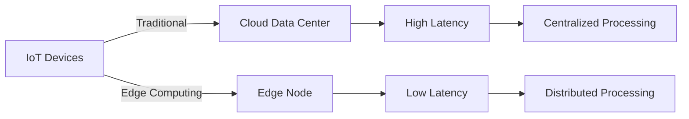
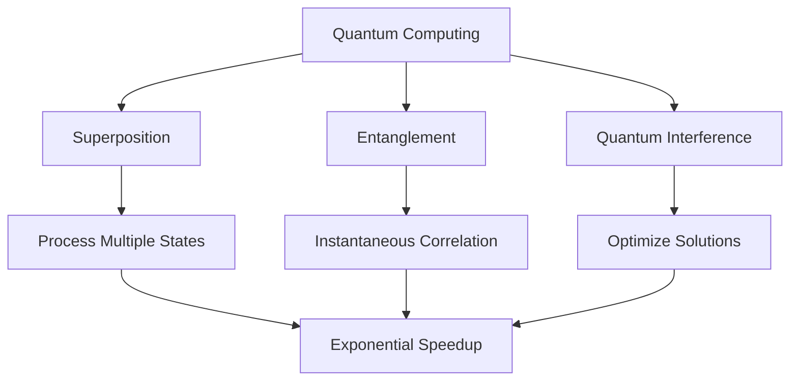
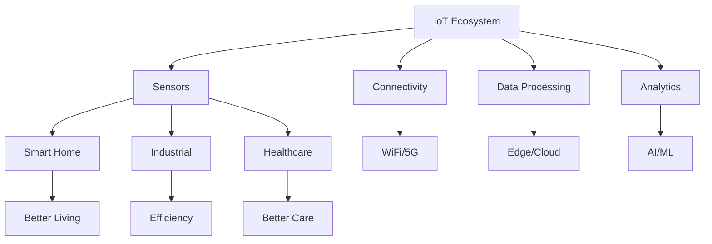
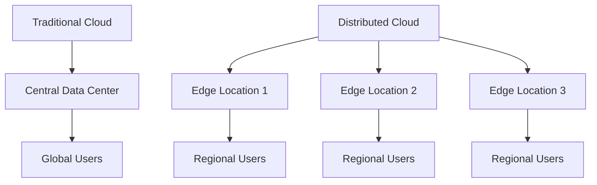

The technology landscape is constantly evolving, bringing new innovations that reshape how we work, live, and interact with the world. Here are the **top 10 technology trends** you should keep an eye on in 2021 and beyond.

> **Key Insight**: These emerging technologies are not isolated—they interconnect and amplify each other, creating unprecedented opportunities and challenges.

## Technology Trends Overview

```mermaid
mindmap
root((Tech Trends<br/>2021+))
AI & ML
Automation
Predictive Analytics
Natural Language
Edge Computing
Low Latency
IoT Support
Distributed Processing
Cybersecurity
Zero Trust
AI-Powered Defense
Privacy Tech
Blockchain
Decentralization
Smart Contracts
Transparency
5G
High Speed
Low Latency
Massive Connectivity
Quantum Computing
Cryptography
Optimization
Drug Discovery
VR & AR
Immersive Experience
Training
Entertainment
IoT
Smart Devices
Automation
Data Collection
RPA
Process Automation
Efficiency
Cost Reduction
Distributed Cloud
Edge Services
Geographic Distribution
Reduced Latency
```

## 1. Artificial Intelligence & Machine Learning

*A.I.* has received much buzz over the years. The A.I. market is predicted to grow to a whopping **$190 billion USD** industry by 2025. The industry has received such recognition that its effects on how we work, live, and play is notable.

### Applications

**Current AI Applications:**
- Enhanced navigation apps
- Personal assistants (Siri, Alexa, Google Assistant)
- Speech recognition
- Ride-sharing optimization
- Healthcare diagnostics
- Financial forecasting

### AI Capabilities

A.I.'s functionalities can be further used to:
- Allow insights by examining underlying connections
- Make sound decisions about resource utilization for hospitals and businesses
- Examine real-time data and predict changes in customer behavior
- Personalize user experiences

**Machine Learning**, a subset of A.I., is generating many opportunities for skillful professionals across multiple industries. As per a prediction made by *Forrester*, AI, machine learning and automation would create **9% of new jobs** in the U.S. by 2025.

> **Job Market**: AI/ML skills are among the most in-demand in tech, with average salaries exceeding $120K.

## 2. Edge Computing

*Cloud computing* became mainstream with high-tech players such as *AWS (Amazon Web Services)*, *Google Cloud*, and *Microsoft Azure*. Nevertheless, since the arrival of *Edge*, traditional cloud is no longer the only solution.

### Why Edge Computing?

The tech industry has realized certain obvious shortcomings of cloud computing. *Edge* is being designed to offer a solution to the **lag caused by cloud computing** in collecting data to a data center for processing.



**Best Use Cases:**
- Remote locations with poor connectivity
- Time-sensitive data processing
- Bandwidth-constrained environments
- Privacy-sensitive applications

The worldwide edge computing market is projected to reach approximately **$6.72 billion USD by 2022**.

## 3. Cybersecurity

You might think: why has *Cyber Security* made this list when it has been around for a while? The reason is that it has been **developing at an accelerated pace**.

### Why Cybersecurity is Trending

- New threats emerge constantly
- Ethical hackers must continuously enhance their knowledge
- New tech additions focus on heightened security
- **$6 trillion USD** will be spent globally on cybersecurity by 2021

**The Reality:**
> "The malicious actors will try their best to get their way through our most stringent security measures. However, if the bad guys do not give up, why should we?"

As long as we have to fight this battle against hackers, *Cyber Security* will be a trending technology.

## 4. Blockchain

Most people think *Blockchain* is related to Bitcoin. This is true, but the tech also offers many other benefits.

### Understanding Blockchain

To understand Blockchain in the purest form: **it is data that one can add to but cannot change or take away**. Therefore, it contains the word "chain" because it forms a chain of data.

**Key Features:**
- **Immutability**: Previous blocks cannot be altered, making it secure
- **Decentralization**: No single entity controls the data
- **Consensus-Driven**: Majority agreement required for changes
- **Transparency**: All transactions are visible (on public blockchains)


**Benefits**: With this tech, you do not need to validate or manage transactions using trusted third-party services.

## 5. 5G Technology

The Internet has offered us many benefits through 3G and 4G services. However, the game is getting more prominent with the introduction of **5G services**.

### 5G Capabilities

**What 5G Enables:**
- Enhanced mobile broadband
- Cloud gaming (NVIDIA GeForce NOW, Google Stadia)
- Smart factories and Industry 4.0
- Autonomous vehicles
- Remote surgery and telemedicine
- Smart city infrastructure

### 5G Impact on Security

5G can enhance:
- Security through HD camera networks
- Traffic management systems
- Smart retail operations
- Grid control and monitoring

**Major Players**: Apple, Verizon, T-Mobile, Nokia Corp, Qualcomm, and more are heavily invested in developing 5G applications.

## 6. Quantum Computing

*Quantum computing* is a tech that utilizes quantum phenomena like **entanglement** and **superposition** to process data. These computers are **several times faster** than conventional computers for specific types of problems.

### Applications

**Current Use Cases:**
- **Healthcare**: Preventing the spread of coronavirus, drug discovery
- **Finance**: Fraud detection, high-frequency trading, credit risk analysis
- **Cryptography**: Breaking and creating encryption
- **Research**: Molecular modeling, optimization problems

**Major Investors**: Honeywell, Microsoft, AWS, Splunk, and Google are making significant innovations in Quantum Computing.



> **Future Impact**: Quantum computing will revolutionize cryptography, potentially breaking current encryption methods while enabling new secure communication protocols.

## 7. Virtual Reality (VR) & Augmented Reality (AR)

*Virtual Reality* and *Augmented Reality* are prominent tech trends that have helped many industries improve their service or product offerings.

### The Difference

- **VR**: Engages the user in a completely simulated environment
- **AR**: Adds digital elements to the current environment

### Applications

| **Industry** | **Use Case** | **Technology** |
|--------------|--------------|----------------|
| **Gaming** | Immersive experiences | VR |
| **Real Estate** | Virtual property tours | VR |
| **Retail** | Virtual try-on (LensKart) | AR |
| **Military** | Training simulations | VR |
| **Healthcare** | Surgical training | VR/AR |
| **Marketing** | Interactive campaigns | AR |
| **Education** | Immersive learning | VR/AR |

**Market Growth**: 14 million VR and AR devices were sold in 2019. The AR and VR market is forecast to grow to **$209 billion USD by 2022**.

## 8. Internet of Things (IoT)

Today, many "things" or "devices" are being created with built-in WiFi technology. You can see it being applied to cars, home appliances like TVs, air conditioners, refrigerators, and more.

### Consumer IoT

**Examples:**
- Smartwatches for fitness tracking
- Home automation (smart locks, thermostats)
- Kitchen appliances (smart ovens)
- Climate control systems

### Enterprise IoT

**Business Benefits:**
- Improved efficiency and safety
- Better decision-making through data analysis
- Enhanced customer service
- Predictive maintenance
- Advanced medical care



## 9. Robotic Process Automation (RPA)

Speaking of automation, *Robotic Process Automation (RPA)* is another forthcoming tech you should look out for.

### What RPA Automates

**Business Processes:**
- Responding to emails
- Distributing data
- Processing transactions
- Interpreting applications
- Repetitive tasks

**Impact**: As per *Forrester's* research, RPA automation will affect approximately **9% of global workers** or **230 million or more knowledge workers**.

> **Workforce Transformation**: RPA doesn't just replace jobs—it augments human capabilities, allowing workers to focus on higher-value tasks.

## 10. Distributed Cloud

*Distributed Cloud* will take cloud computing to another level—distributing public cloud services to **remote geographical locations**.

### Benefits

**Advantages of Distributed Cloud:**
- Reduced latency for global users
- Cost reduction through local processing
- Minimized data loss risk
- Improved performance for real-time applications

**Use Cases**: Technologies requiring massive data processing in real-time such as *IoT* and *A.I.* will benefit significantly from distributed cloud services.



## Technology Interconnections

These technologies don't exist in isolation—they amplify each other:

| **Combination** | **Result** | **Example** |
|-----------------|-----------|-------------|
| **5G + IoT** | Massive device connectivity | Smart cities |
| **AI + Edge** | Real-time intelligent processing | Autonomous vehicles |
| **Blockchain + IoT** | Secure device networks | Supply chain tracking |
| **VR/AR + 5G** | Immersive mobile experiences | Cloud gaming |
| **Quantum + Cybersecurity** | Next-gen encryption | Post-quantum cryptography |
| **RPA + AI** | Intelligent automation | Smart business processes |

## Conclusion

These **10 technology trends** represent the cutting edge of innovation in 2021 and beyond. From *Artificial Intelligence* transforming decision-making to *Quantum Computing* solving previously impossible problems, from *5G* enabling massive connectivity to *Blockchain* ensuring transparency and trust—each technology offers unique opportunities.

For professionals, understanding these trends is crucial for:
- **Career development** - Skills in these areas are highly valued
- **Business strategy** - Companies must adapt or risk obsolescence
- **Investment decisions** - Knowing where technology is headed
- **Security planning** - New tech brings new vulnerabilities

The future belongs to those who embrace these technologies, understand their implications, and leverage them responsibly.

> **Final Takeaway**: Technology trends are not just about innovation—they're about transformation. Stay curious, keep learning, and position yourself at the forefront of these exciting changes.

## References

- [Gartner Hype Cycle for Emerging Technologies](https://www.gartner.com/en/research/methodologies/gartner-hype-cycle)
- [Forrester Technology Predictions](https://www.forrester.com/predictions/)
- [McKinsey Technology Trends](https://www.mckinsey.com/capabilities/mckinsey-digital/our-insights)
- [IEEE Technology Forecast](https://spectrum.ieee.org/)
