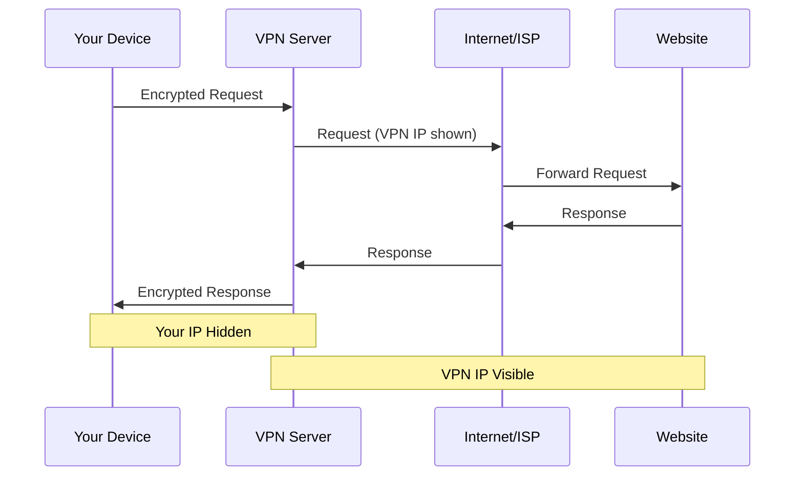
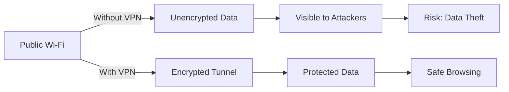
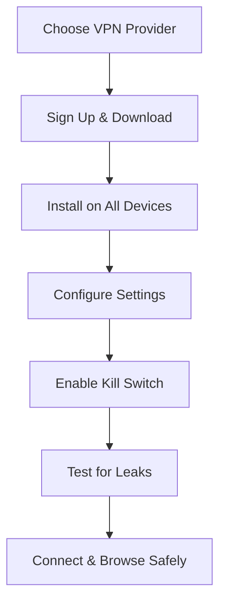

A *Virtual Private Network (VPN)* provides you online privacy and anonymity by forming a private network from a public internet connection. VPNs conceal your *internet protocol (IP) address*, so your online activities are practically untraceable. Most notable, VPN services establish secure and encrypted connections to provide greater privacy than even a secured Wi-Fi hotspot.

> **Key Insight**: A VPN creates an encrypted tunnel between your device and the internet, protecting your data from prying eyes.

## What is a VPN?

A VPN increases a private network across a public network. It enables users to send and receive data, enabling them to connect to a private network across the internet **securely and privately**. Moreover, VPN creates an encrypted connection, termed a *VPN tunnel*, in which all the internet traffic and communication is transferred by keeping the user data secure and safe.

### How VPNs Work

When a user accesses the internet via a VPN connection, the internet traffic gets routed through an **encrypted tunnel**. The user's internet traffic and data become invulnerable to cyber-attacks. VPNs use encryption to scramble data when it has been transmitted over a Wi-Fi network. Encryption makes the data obscure.

> **Security Benefit**: Without a VPN, your internet service provider can view your entire browsing history.

## Why You Need a VPN

### 1. Privacy is Your Right

It is a right to keep yourself private and secure your business or corporation. It sums up all the points below to use the VPN service. Today, it is increasing and is regarded as a necessary internet security application. VPN is the safeguard of all the personal information of an organization or a person because it is the **right to privacy**.

### 2. Prevent Browser Tracking

VPN defends against browsers tracking your data. Browsers like *Google Chrome*, no matter how many love its services, know each and everything about you. And sometimes, through this, many hackers or online-thieves misuse your information for malicious intent. With a VPN, you can **hide your IP address** and avoid such risks.

### 3. Secure Your Streaming

VPN provides full streaming content from anywhere. For example: Live in France, but want to watch U.S. content? Use a VPN that allows you to make it look like you are in the U.S and stream their series and content.

**Streaming Benefits:**
- Access geo-restricted content
- Bypass censorship
- Stream from anywhere
- Avoid ISP throttling

### 4. Safe Public Wi-Fi Usage

Public Wi-Fi hotspots like those found at most cafes or airports are **notorious for hackers**. Using a VPN adds security to your device to provide secure connections in public areas without any risk of cyber-attacks.

> **Warning**: Public Wi-Fi networks are one of the easiest ways for attackers to intercept your data. Always use a VPN on public networks.

### 5. Better VoIP Security

*VoIP* stands for Voice-over-IP. Services like *Zoom* or *Google Hangouts* provide free or inexpensive ways to call or connect with people. However, these services can be hacked. A VPN can prevent people from hacking and hijacking phone conversations, especially for business communications.

### 6. Enhanced Digital Security

Every organization wants to secure their data with supplementary digital protection, achievable with a VPN. From digital data such as pictures and personal information records to the company's finance records—all are safe and secure through a VPN.

**What VPNs Protect:**
- Personal documents
- Financial information
- Email communications
- Login credentials
- Mobile device data

### 7. Identity Theft Protection

*Identity theft* occurs when thieves hijack your personal information and use it to perpetrate crimes in your name, like taking over or opening new accounts, filing tax returns in your name, or renting or buying property.

A VPN can help protect against identity theft by securing your data. It creates an encrypted tunnel for the data you send and receive out of reach of cyberthieves. That is particularly important when using a public Wi-Fi network where a malicious actor could capture your login credentials and credit card details.

> **Reality Check**: One cannot completely prevent identity theft. However, a VPN can significantly safeguard the information you send and receive on your devices.

## Choosing the Right VPN

When selecting a VPN service, consider these critical factors:

### 1. Privacy Commitment

**Does it respect your privacy?**

The purpose of using a VPN is to preserve your privacy, so your VPN provider must value your privacy. They should have a **no-log policy**, which means that they would never track or log your online activities.

**Look for:**
- Strict no-logs policy
- Independent security audits
- Transparent privacy policy
- Jurisdiction in privacy-friendly country

### 2. Security Protocols

**Do they run the most up-to-date protocol?**

*OpenVPN* provides more robust security than other protocols, such as *PPTP*. OpenVPN is open-source software that supports all the primary operating systems.

**Protocol Comparison:**

| **Protocol** | **Security** | **Speed** | **Use Case** |
|--------------|--------------|-----------|--------------|
| **OpenVPN** | Excellent | Good | General use, most secure |
| **WireGuard** | Excellent | Excellent | Modern, fast, secure |
| **IKEv2/IPSec** | Very Good | Very Good | Mobile devices |
| **L2TP/IPSec** | Good | Fair | Legacy support |
| **PPTP** | Poor | Excellent | Avoid - insecure |

### 3. Data Limits

**Does the VPN set data limits?**

Your daily internet consumption and bandwidth may be a significant deciding factor. Ensure their services match your needs by checking if you will get complete, unmetered bandwidth without data limits.

### 4. Server Locations

**Where are the VPN servers?**

Determine which server locations are crucial to you. If you want to appear as if you are accessing the internet from a specific locale, make sure there is a server in that country.

**Considerations:**
- Number of countries covered
- Number of servers available
- Server load and speed
- Specialty servers (P2P, streaming, etc.)

### 5. Multi-Device Support

**Is VPN access available on multiple devices?**

If you are like the standard consumer, you will use between three and five devices. Ideally, you would be able to use the VPN on any of them at the same time.

**Device Coverage:**
- Windows, macOS, Linux
- iOS and Android
- Browser extensions
- Router support
- Smart TV compatibility

### 6. Price vs. Value

**Consider the price point:**

If price is important to you, you may think that a free VPN is the best option. However, some VPN services may not cost you money, but you might "pay" in other ways:
- Serving numerous advertisements
- Having your personal information gathered and sold to third parties
- Limited bandwidth or data caps
- Slower speeds
- Fewer server options

> **Warning**: Free VPNs often monetize by selling your data—defeating the purpose of using a VPN in the first place.

## Top VPN Recommendations

A virtual private network (VPN) is essential for:
- **Privacy** - Hide your online activity
- **Security** - Encrypt your connection
- **Encryption** - Protect your data

### Leading VPN Services

| **VPN Service** | **Best For** | **Key Feature** |
|-----------------|--------------|-----------------|
| **ExpressVPN** | Overall performance | Fast speeds, reliable |
| **NordVPN** | Encryption | Military-grade security |
| **Surfshark** | Torrenting | Unlimited devices |
| **IPVanish** | Android | User-friendly mobile app |
| **CyberGhost** | Mac | Optimized for macOS |
| **Private Internet Access** | Windows | Cost-effective |
| **Mullvad** | Privacy | Anonymous payment options |
| **ProtonVPN** | Free tier | Reliable free option |

## VPN Features to Look For

### Essential Features

- **Kill Switch** - Disconnects internet if VPN drops
- **DNS Leak Protection** - Prevents DNS queries from leaking
- **Split Tunneling** - Route some traffic through VPN, some direct
- **Multi-Hop** - Route through multiple servers
- **Obfuscation** - Hide VPN usage from ISPs
- **Ad Blocking** - Block ads and trackers

### Advanced Features

- **Port Forwarding** - Better for P2P
- **Dedicated IP** - Consistent IP address
- **Tor over VPN** - Extra anonymity layer
- **SmartDNS** - Streaming optimization

## When to Use a VPN

### Critical Use Cases

1. **Public Wi-Fi** - Always use VPN on public networks
2. **Sensitive Transactions** - Banking, shopping online
3. **Remote Work** - Accessing company resources
4. **Travel** - Avoiding geo-restrictions
5. **Privacy** - General browsing privacy
6. **Streaming** - Accessing content from other regions
7. **Torrenting** - Protecting your identity (where legal)

### VPN Limitations

**What VPNs Don't Protect Against:**
- Malware on your device
- Phishing emails
- Social engineering attacks
- Poor password hygiene
- Unencrypted websites (HTTP)

> **Important**: A VPN is one layer of security. Combine it with antivirus software, strong passwords, and smart online habits.

## VPN Setup Best Practices

### Quick Setup Guide

### Security Checklist

- [ ] Choose reputable VPN with no-logs policy
- [ ] Enable kill switch feature
- [ ] Configure DNS leak protection
- [ ] Use strong encryption (AES-256)
- [ ] Select optimal protocol (WireGuard/OpenVPN)
- [ ] Test for IP and DNS leaks
- [ ] Enable automatic connection
- [ ] Configure split tunneling if needed
- [ ] Regularly update VPN software
- [ ] Monitor connection status

## Testing Your VPN

After setup, verify your VPN is working:

1. **IP Leak Test**: Visit [ipleak.net](https://ipleak.net) to check your IP
2. **DNS Leak Test**: Ensure DNS requests go through VPN
3. **WebRTC Leak Test**: Check for WebRTC leaks
4. **Speed Test**: Compare speeds with/without VPN

## Conclusion

Before using a VPN, analyze it against competitors and pick the right VPN according to your specifications and needs. Most VPNs work similarly; what sets them apart is their **server availability**, **security features**, and the **service they provide**. Check out reviews before subscribing to any VPN.

A *Virtual Private Network* is an essential tool for:
- Maintaining **privacy** in an increasingly surveilled internet
- Ensuring **security** on untrusted networks
- Protecting **sensitive data** through encryption

In today's digital age, where data breaches and privacy violations are common, using a VPN is not just recommended—it's **essential** for anyone who values their online privacy and security.

> **Final Takeaway**: A VPN is your first line of defense for online privacy. Choose wisely, configure properly, and browse safely.

## References

- [Privacy Guides - VPN Overview](https://www.privacyguides.org/vpn/)
- [EFF - Choosing a VPN](https://ssd.eff.org/en/module/choosing-vpn-thats-right-you)
- [NIST Guide to VPNs](https://csrc.nist.gov/publications/)
- [OpenVPN Documentation](https://openvpn.net/community-resources/)
