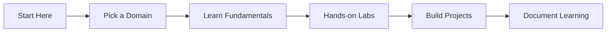

Cybersecurity is growing massively and globally. With all this demand, **what's the best way to get in?** The important thing to note here is that cybersecurity consists of *multiple domains* within itself. So if you're ever thinking of where to start from, the answer is **it does not matter**. Pick one and start expanding your scope of learning.

> **Key Insight**: You don't need a computer science degree to break into cybersecurity—you need curiosity, persistence, and a willingness to learn.

## Do You Need a Degree?

The traditional question here would be: **do you need a degree to enter the field?** The answer to that would be **No!** Some of the best security experts are from different technical and nontechnical backgrounds. The key is not your technical background or knowledge but your **willingness and desire** to learn different technologies, tools & tactics and never stop playing with them.

### What Matters Most

Cybersecurity is a field which at its core is fueled by:
- **Creativity** - Think like an attacker
- **Persistence** - Keep trying when you hit walls
- **Curiosity** - Always ask "how does this work?"

It focuses on **real-world problems** to solve. Passion and dedication to understand how the technology is built and how it works will go a long way.

> **Reality Check**: Many people think that cybersecurity is all about hacking and breaking into things. Well, that being one part of it, there are multiple pieces that go in solving this puzzle.

## Understanding the Field

Cybersecurity is really learning **how technology works** and, in particular, **who handles this technology**. The best part about this is you can **learn this from the comfort of your home**.

## Cybersecurity Domains

Let's talk about picking your niche. Cybersecurity can be divided into a few different categories which require different skills to begin with. Not everything is the same; as technology changes, so does the security needed to protect and maintain that technology.

```mermaid
mindmap
root((Cybersecurity<br/>Domains))
Network Security
Firewalls
IDS/IPS
Network Protocols
Application Security
Web Applications
Mobile Apps
API Security
Cloud Security
AWS/Azure/GCP
Cloud Architecture
Container Security
Endpoint Security
EDR/XDR
Device Management
Mobile Security
Incident Response
Threat Hunting
Forensics
Malware Analysis
Vulnerability Management
Scanning
Penetration Testing
Risk Assessment
Cryptography
Encryption
PKI
Hash Functions
```

### 1. Network Security

At its core, it is a set of rules and configurations designed to protect the *CIA triad* (Confidentiality, Integrity & Availability). It's often the **first line of defense** for a company and you would need to understand different networking protocols.

**Key Skills:**
- TCP/IP fundamentals
- Firewalls and VPNs
- Network monitoring
- Intrusion detection/prevention systems (IDS/IPS)

### 2. Application Security

This is a broad topic that covers software vulnerabilities in web & mobile applications and *APIs (Application Programming Interfaces)*.

**Key Skills:**
- OWASP Top 10 vulnerabilities
- Secure coding practices
- Code review
- Web application firewalls (WAF)

### 3. Cloud Security

It ensures the safe use of web applications and secure transmission of user data while hosting in cloud environments or third-party cloud applications.

**Key Skills:**
- AWS/Azure/GCP security services
- Cloud architecture
- Identity and Access Management (IAM)
- Container and serverless security

### 4. Endpoint Security

Ensuring that servers communicate securely with endpoints which include personal or corporate devices.

**Key Skills:**
- Endpoint Detection and Response (EDR)
- Mobile Device Management (MDM)
- Patch management
- Antivirus/anti-malware

### 5. Incident Response

Incident response monitors and investigates potential malicious behavior, responds to it and recovers from security incidents.

**Key Skills:**
- SIEM tools
- Log analysis
- Forensic investigation
- Threat hunting

### 6. Vulnerability Management

It is a process of scanning your environment for potential vulnerabilities and prioritizing remedies and mitigation tactics based on risks.

**Key Skills:**
- Vulnerability scanning
- Penetration testing
- Risk assessment
- Remediation planning

### 7. Cryptography

A process that provides secure communication by converting plaintext into cipher (unintelligible) text and vice versa. Cryptography is one of the **most important aspects** of security.

**Key Skills:**
- Encryption algorithms
- Public Key Infrastructure (PKI)
- Hash functions
- Digital signatures

## Getting Started: Your Roadmap

This might look quite overwhelming at first and the important thing is to **pick one niche** which interests you and makes you most curious and then blend your way into the others as they are interlinked in one way or the other. Take your time to understand it, play with it as much as you can.

### Phase 1: Foundation (Months 1-3)



**Action Steps:**
1. **Choose your primary domain** (Network, AppSec, Cloud, etc.)
2. **Learn the basics** through free resources
3. **Set up a home lab** (VirtualBox, AWS Free Tier)
4. **Practice daily** - even 30 minutes counts
5. **Join communities** (Reddit r/cybersecurity, Discord servers)

### Phase 2: Skill Development (Months 4-9)

**Practical Learning:**
- **Capture The Flag (CTF)** competitions - HackTheBox, TryHackMe
- **Home lab projects** - Build and break things
- **Blogging** - Document your learning journey
- **Networking** - Connect with professionals on LinkedIn
- **Certifications** - Consider entry-level certs (Security+, CEH)

### Phase 3: Job Readiness (Months 10-12)

**Portfolio Building:**
- GitHub with security projects
- Blog with technical write-ups
- CTF achievements and rankings
- Personal projects demonstrating skills
- Contributions to open-source security tools

## Learning Pathways by Domain

| **Domain** | **Starting Point** | **Beginner Certs** | **Free Resources** |
|------------|-------------------|-------------------|-------------------|
| **Network Security** | CompTIA Network+ | CCNA, Security+ | Professor Messer |
| **AppSec** | OWASP Top 10 | CEH, OSCP | PortSwigger Web Academy |
| **Cloud Security** | AWS Fundamentals | AWS Security Specialty | AWS Free Tier, A Cloud Guru |
| **Incident Response** | SIEM basics | BTL1, CySA+ | Security Blue Team |
| **Pentesting** | Linux fundamentals | eJPT, OSCP | HackTheBox, TryHackMe |

## Free Learning Resources

### Platforms

- **TryHackMe** - Beginner-friendly guided labs
- **HackTheBox** - More challenging CTF platform
- **PentesterLab** - Web application security
- **CyberDefenders** - Blue team challenges
- **OverTheWire** - Linux and command-line challenges

### YouTube Channels

- **IppSec** - HackTheBox walkthroughs
- **NetworkChuck** - Networking and security
- **John Hammond** - CTFs and malware analysis
- **LiveOverflow** - Deep technical content
- **The Cyber Mentor** - Pentesting and career advice

### Communities

- **Reddit**: r/cybersecurity, r/netsec, r/AskNetsec
- **Discord**: HackTheBox, TryHackMe, InfoSec Prep
- **Twitter**: Follow #InfoSec, #CyberSecurity
- **Local meetups**: OWASP chapters, BSides conferences

## The Mindset

Bottom line is cybersecurity in many ways is similar to **engineering** and **healthcare**. If you are a curious and passionate person **don't let anything hold you down** and limit your options.

### Key Principles

> **Never disqualify yourself** from learning and experimenting. The only thing stopping you from starting your journey would be **you**.

**Remember:**
- **Start where you are** - Use what you have
- **Progress over perfection** - Done is better than perfect
- **Community matters** - Don't learn in isolation
- **Document everything** - Your future self will thank you
- **Stay curious** - Technology never stops evolving

## Career Prospects

Cybersecurity is one of the **most fascinating and rewarding** fields or career paths. It also has one of the **most interactive and helpful communities** around.

**Statistics:**
- 3.5 million unfilled cybersecurity jobs globally
- Average salary: $75K-$150K+ depending on role and location
- High job security and growth potential
- Remote work opportunities
- Continuous learning and challenges

## Your First 90 Days

### Week 1-4: Choose & Explore
- Research different domains
- Watch YouTube videos on each area
- Try out TryHackMe beginner rooms
- Join cybersecurity Discord servers

### Week 5-8: Commit & Learn
- Pick your primary focus area
- Start a structured learning path
- Set up your home lab
- Begin daily practice routine

### Week 9-12: Build & Share
- Complete your first project
- Write about what you learned
- Join a CTF competition
- Connect with 5 professionals on LinkedIn

## Conclusion

**Never lose the desire to learn.** Once you start to develop your skills and begin networking with people, opportunities will come your way.

The path into cybersecurity is not linear, and there's no single "right way" to break in. What matters most is your **commitment to learning**, your **curiosity about how things work**, and your **persistence** when faced with challenges.

The field needs diverse perspectives and backgrounds. Whether you're a career changer, recent graduate, or self-taught enthusiast, there's a place for you in cybersecurity.

> **Final Encouragement**: You don't need to know everything to start. You just need to start, and the learning will come. The cybersecurity community is incredibly supportive—reach out, ask questions, and help others when you can. Your journey starts now.

## Next Steps

1. **Today**: Pick ONE domain that excites you
2. **This Week**: Create accounts on TryHackMe and HackTheBox
3. **This Month**: Complete 5 beginner-level challenges
4. **This Quarter**: Build your first security project
5. **This Year**: Land your first cybersecurity role or internship

Welcome to cybersecurity. Let's build a more secure digital world together! 

## Helpful Links

- [TryHackMe](https://tryhackme.com/)
- [HackTheBox](https://www.hackthebox.com/)
- [OWASP Top 10](https://owasp.org/www-project-top-ten/)
- [Cybersecurity Career Roadmap](https://roadmap.sh/cyber-security)
- [Professor Messer (Free Security+ Course)](https://www.professormesser.com/)
