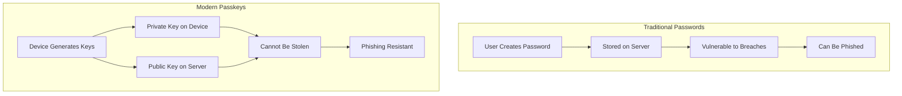
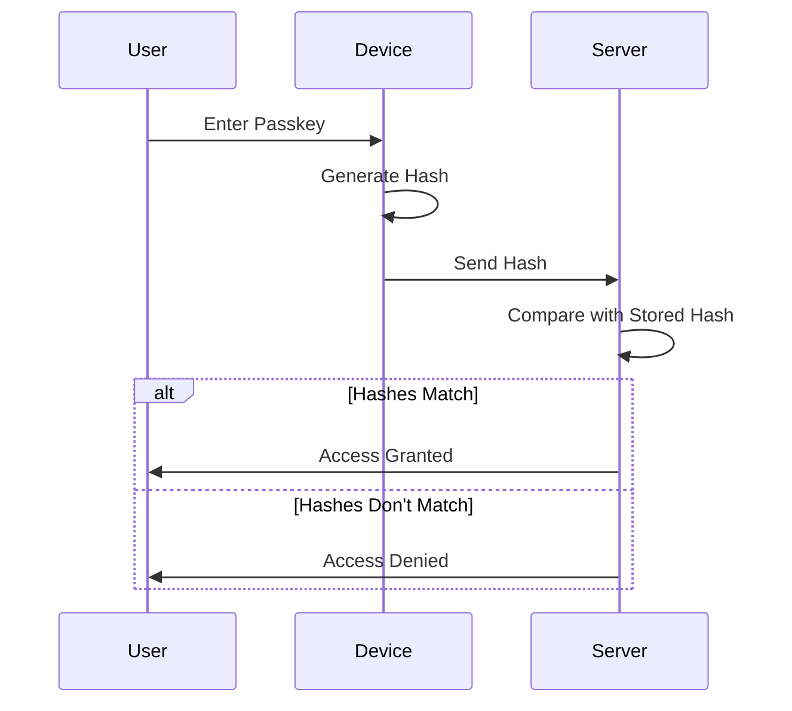
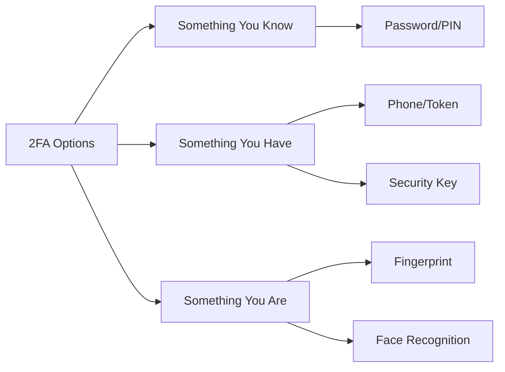
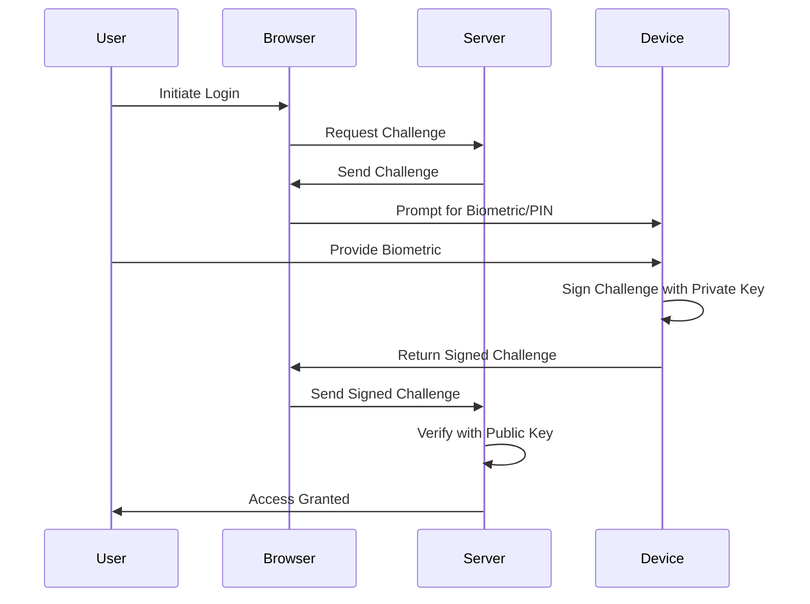
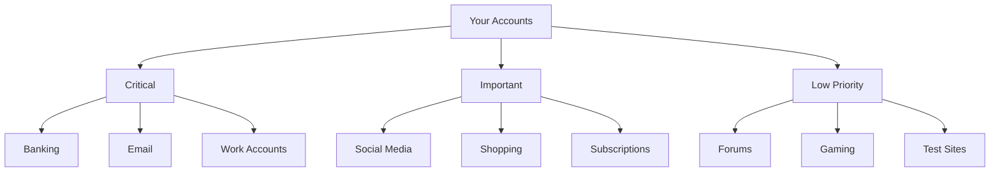

In today's digital age, where data breaches and cyber threats have become an unfortunate reality, safeguarding our online presence has become more crucial than ever. One effective way to enhance our digital security is by implementing *passkeys*—a modern authentication method that's replacing traditional passwords.

> **Key Insight**: Passkeys represent the future of authentication, offering stronger security than passwords while being easier to use.

## Understanding Passkeys

At its core, a *passkey* is a unique combination of characters or a passphrase that grants a user access to a protected system or resource. Unlike traditional passwords, passkeys offer greater security by relying on:
- Longer strings of characters
- Combination of various character types
- **Cryptographic keys** stored securely on your device

### Traditional Passwords vs. Modern Passkeys

## How Passkeys Work

When it comes to passkeys, **encryption** serves as a shield against unauthorized access. The encryption process transforms the passkey into an unreadable format using complex algorithms and mathematical computations. This ensures that even if an attacker gains access to the encrypted passkey, they will be unable to decipher its original value.

### Encryption Techniques

Modern encryption techniques provide robust security for passkeys:

| **Algorithm** | **Key Length** | **Security Level** | **Use Case** |
|---------------|----------------|-------------------|--------------|
| **AES** (Advanced Encryption Standard) | 128, 192, 256 bits | Military-grade | Symmetric encryption |
| **RSA** (Rivest-Shamir-Adleman) | 2048, 4096 bits | Very high | Asymmetric encryption |
| **ECDSA** | 256, 384 bits | Very high | Digital signatures |
| **bcrypt** | Variable | High | Password hashing |

> **Security Guarantee**: By utilizing encryption, we can trust that our passkeys remain well-guarded and keep our digital accounts and information safe from malicious entities.

## The Technical Process

Passkeys leverage encryption algorithms to convert user-provided information into an unreadable format known as a *hash*. This hash is then stored on the system, ensuring passwords are **never stored in their original form**.

### Authentication Flow

**The Process:**

1. User enters their passkey during login
2. System recreates the hash using the same algorithm
3. Compares it to the stored hash
4. **If they match** → access is granted
5. **Otherwise** → access is denied

## Implementing Secure Passkeys

### 1. Choosing a Strong Passkey

Creating a strong passkey is crucial to protect your digital presence.

**Requirements for Strong Passkeys:**

| **Requirement** | **Recommendation** | **Example** |
|-----------------|-------------------|-------------|
| **Length** | At least 12-16 characters | `MyP@ssK3y!2023Secure` |
| **Uppercase** | At least 1-2 letters | `A`, `B`, `C` |
| **Lowercase** | At least 1-2 letters | `a`, `b`, `c` |
| **Numbers** | At least 1-2 digits | `0-9` |
| **Special Characters** | At least 1-2 symbols | `!@#$%^&*` |

** Avoid:**
- Easily guessable phrases
- Personal information (birthdays, names)
- Common words or patterns
- Sequential characters (`123456`, `abcdef`)
- Repeated characters (`aaaaaa`)

** Do:**
- Use a passphrase: `Coffee-Morning-Sky-2023!`
- Mix character types: `Tr0pic@l$unset#42`
- Make it memorable but unique

> **Pro Tip**: Use the first letters of a memorable sentence: "I love to drink coffee at 7am every morning!" becomes `Iltdc@7aem!`

### 2. Implementing Two-Factor Authentication (2FA)

To further enhance the security provided by passkeys, consider enabling *two-factor authentication (2FA)*. This additional layer of security requires users to provide a secondary verification method.

**2FA Methods:**

**Popular 2FA Methods:**
- **SMS codes** - Sent to mobile phone (least secure)
- **Authenticator apps** - Google Authenticator, Authy
- **Hardware tokens** - YubiKey, Titan Security Key
- **Biometric** - Fingerprint, face scan
- **Passkeys (FIDO2)** - Device-based cryptographic keys

> **Security Recommendation**: 2FA significantly reduces the chances of unauthorized access—by up to 99.9% according to Microsoft.

### 3. Using Password Managers

To effectively manage passkeys across multiple platforms, consider using a trusted *password manager*.

**Benefits of Password Managers:**
- Generate strong and unique passkeys for each site
- Securely store all passkeys encrypted
- Auto-fill credentials
- Sync across devices
- Secure sharing with team members
- Audit weak or reused passwords

**Recommended Password Managers:**

| **Service** | **Pricing** | **Best For** | **Key Feature** |
|-------------|-------------|--------------|-----------------|
| **1Password** | Paid | Families & Teams | Watchtower security monitoring |
| **Bitwarden** | Free/Paid | Open-source fans | Self-hosting option |
| **LastPass** | Free/Paid | Beginners | User-friendly interface |
| **Dashlane** | Paid | Premium features | VPN included |
| **KeePass** | Free | Technical users | Completely offline |

> **Important**: Choose a reputable password manager with strong encryption protocols (AES-256).

### 4. Regularly Updating Your Passkeys

Periodically changing your passkeys is an essential practice to prevent hackers from gaining prolonged access to your accounts.

**Update Schedule:**

**Passkey Update Schedule:**

| **Account Type** | **Examples** | **Update Frequency** |
|------------------|--------------|---------------------|
| **Critical** | Banking, Email | Every 3 months (90 days) |
| **Important** | Social Media, Shopping | Every 6 months (180 days) |
| **General** | Forums, Gaming | Every 12 months (365 days) |

**Best Practices:**
- **High-risk accounts** (banking, email): Every 3-6 months
- **Medium-risk accounts** (social media): Every 6-12 months
- **After a breach**: Immediately if the service was compromised
- **Never reuse** passkeys across different platforms

### 5. Beware of Phishing Attempts

Even with a strong passkey, falling victim to *phishing attempts* can compromise your security.

**Phishing Warning Signs:**

| **Warning Sign** | **What to Look For** | **Action** |
|------------------|---------------------|------------|
| **Suspicious sender** | Unfamiliar email address | Verify sender |
| **Urgent language** | "Account will be closed!" | Don't panic, verify |
| **Misspelled URLs** | `paypa1.com` instead of `paypal.com` | Check carefully |
| **Generic greetings** | "Dear Customer" not your name | Be suspicious |
| **Unexpected attachments** | Files you didn't request | Don't open |

**Protection Steps:**
- Be cautious of suspicious emails or messages
- Never provide passkeys via email or phone
- Verify legitimacy by directly contacting the organization through official channels
- Check URLs carefully before entering credentials
- Use browser extensions that detect phishing sites

> **Golden Rule**: Legitimate companies will NEVER ask for your password via email or phone.

## Modern Passkey Technology: FIDO2 & WebAuthn

The future of authentication is *passwordless*. Technologies like *FIDO2* and *WebAuthn* enable passkey authentication without traditional passwords.

### How FIDO2 Passkeys Work

**Advantages:**
- **Phishing resistant** - Works only with registered sites
- **No passwords to steal** - Uses cryptographic keys
- **Multi-device support** - Sync across your devices
- **Fast authentication** - Biometric or PIN
- **Cross-platform** - Works everywhere

## Security Best Practices

### Passkey Hygiene Checklist

- [ ] Use passkeys of 12-16+ characters
- [ ] Include uppercase, lowercase, numbers, symbols
- [ ] Enable 2FA on all important accounts
- [ ] Use a password manager
- [ ] Never reuse passkeys across sites
- [ ] Update passkeys every 3-6 months
- [ ] Use unique passkeys for each service
- [ ] Enable biometric authentication where available
- [ ] Monitor accounts for suspicious activity
- [ ] Use passphrase instead of password when possible

### Account Priority Matrix

**Priority Levels:**
- **Critical**: Strongest passkeys, 2FA mandatory, frequent updates
- **Important**: Strong passkeys, 2FA recommended, regular updates
- **Low Priority**: Moderate passkeys, optional 2FA, yearly updates

## Stronger Security Ahead

Passkeys serve as a powerful tool in fortifying our digital security. By understanding how they work and following best practices for implementation, we can significantly reduce the risks associated with cyber threats and data breaches.

### The Future of Authentication

**Evolution of Authentication:**

| **Era** | **Method** | **Characteristics** |
|---------|------------|---------------------|
| 2000s | Simple Passwords | Single factor authentication |
| 2010s | Complex Passwords + 2FA | Multi-factor required |
| 2020s | Password Managers | Centralized management |
| 2025+ | Passwordless (Passkeys) | Biometric + cryptographic keys |

While passkeys offer enhanced protection, staying vigilant and adopting good cybersecurity habits are equally important. With these efforts combined, we can bridge the gap to a safer digital future.

> **Final Takeaway**: The strongest security combines strong passkeys, multi-factor authentication, and smart online habits. Don't rely on any single security measure.

## Conclusion

As we move toward a passwordless future, understanding and implementing strong passkey practices is more important than ever. Whether using traditional passphrases or modern FIDO2 passkeys, the goal remains the same: **protect your digital identity** from unauthorized access.

The shift to passkeys represents a fundamental improvement in online security—one that makes authentication both more secure and more convenient. Embrace these technologies, follow best practices, and stay informed about emerging security standards.

**Your digital security is in your hands. Make it strong. Make it unique. Make it a priority.**

## References

- [FIDO Alliance - Passkeys Overview](https://fidoalliance.org/passkeys/)
- [WebAuthn Guide](https://webauthn.guide/)
- [NIST Digital Identity Guidelines](https://pages.nist.gov/800-63-3/)
- [OWASP Authentication Cheat Sheet](https://cheatsheetseries.owasp.org/cheatsheets/Authentication_Cheat_Sheet.html)
- [Microsoft: Password Guidance](https://www.microsoft.com/en-us/security/business/security-101/what-is-a-passkey)
