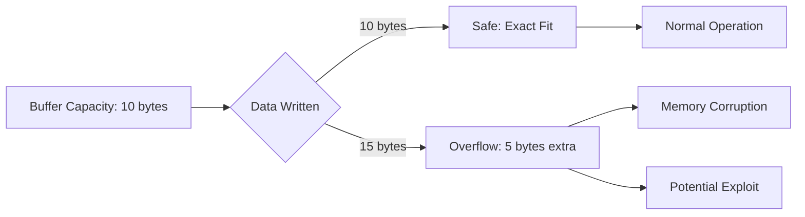
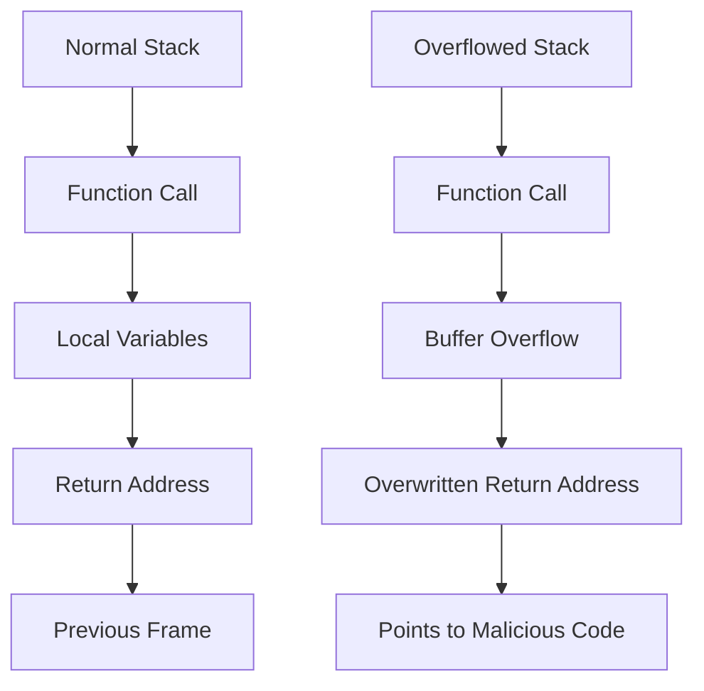
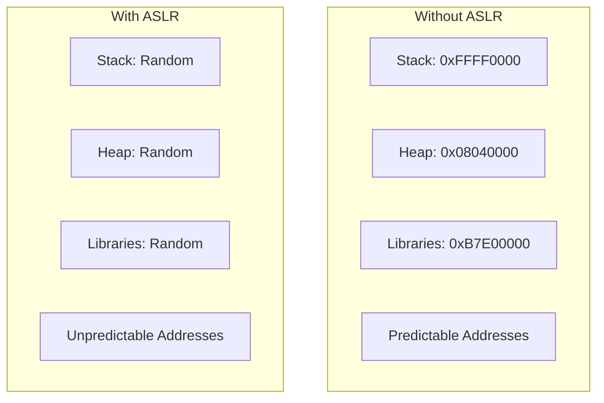
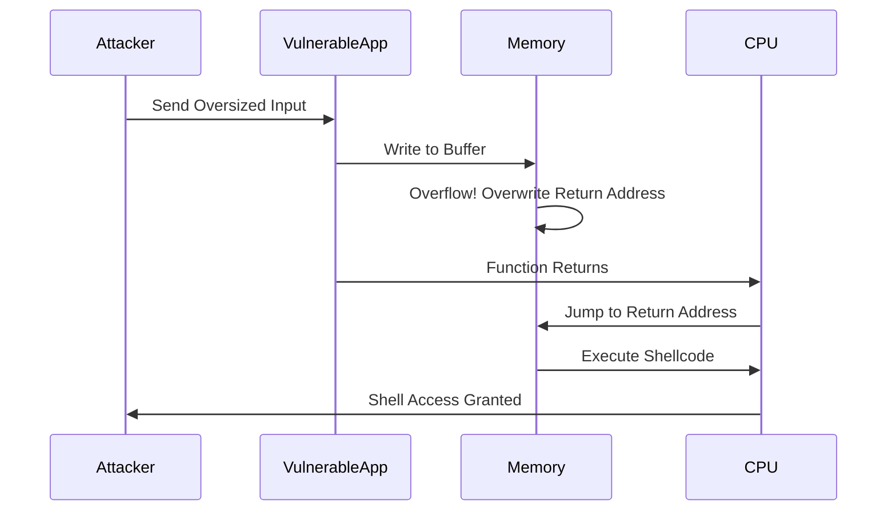
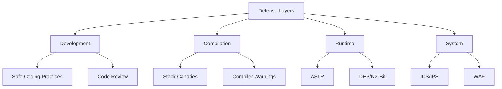

A *buffer overflow* occurs when the amount of data written to a memory location exceeds what's allocated. This could cause data corruption, program crashes, or perhaps the execution of malicious code that could offer an attacker control over the system.

> **Key Insight**: Buffer overflows are one of the oldest and most dangerous vulnerabilities, responsible for countless security breaches over the decades.

## Understanding Memory Allocation

*Buffer overflow vulnerabilities* typically exist in programming languages like *C*, *C++*, and *Objective-C* as these languages rely on the developer to manually allocate memory. Even if code is written in, for example, *Python*, if it calls on any libraries written in C or C++, it might still be at risk of a buffer overflow attack.

### What is a Buffer?

A **buffer** is a temporary storage area in memory used to hold data while it's being transferred or processed. Think of it as a container with a fixed size.



## How Buffer Overflows Occur

A buffer overflow happens when a program tries to fill a block of memory (a *memory buffer*) with **more data than the buffer was designed to hold**. By sending carefully crafted user inputs to a vulnerable application, attackers can force the application to execute arbitrary code that could take control of the machine or crash the system.

### Stack vs Heap Overflows

Buffer overflows can occur in different memory regions:

| **Type** | **Location** | **Exploitation** | **Risk Level** |
|----------|--------------|------------------|----------------|
| **Stack Overflow** | Stack memory | More commonly exploited | High |
| **Heap Overflow** | Heap memory | Less commonly exploited | Medium-High |

#### Why Stack Overflows are More Dangerous

Stacks contain a sequence of nested functions, each returning the **return address** of the calling function to which the stack should return after the function has finished running. This return address can be replaced with the instruction to execute malicious code instead.



## Mitigation Techniques

These are proven ways to mitigate buffer overflow attacks:

### 1. Use Safe Languages

**Use an interpreted language** instead of a compiled language with manual memory management.

**Memory-Safe Languages:**
- Python, Java, JavaScript, Go, Rust
- C, C++ (without proper safeguards)

### 2. Non-Executable Stack

**Make a stack non-executable** by setting the No-Execute (NX) bit, preventing the attacker from inserting shellcode directly into the stack and executing it there.

```bash
# Linux: Check if NX is enabled
readelf -l /path/to/binary | grep GNU_STACK

# Output should show:
# GNU_STACK 0x000000 0x00000000 0x00000000 0x00000 0x00000 RW 0x10
# ^^
# No 'E' = NX enabled
```

### 3. Address Space Layout Randomization (ASLR)

**Randomize the memory layout** of the address space. When malicious code is placed in a buffer, the attacker cannot predict its address, making exploitation significantly harder.

**How ASLR Works:**



### 4. Input Validation

**Validate and sanitize** all user inputs:
- Check input length before copying to buffers
- Use safe string functions (`strncpy` instead of `strcpy`)
- Bounds checking on array access

### 5. Compiler Protections

**Modern compilers offer protection:**
- **Stack Canaries**: Detect stack corruption
- **SafeSEH**: Prevent SEH overwrites
- **Control Flow Guard**: Prevent control flow hijacking

## Buffer Overflow Exploit Example

### Fuzzing Process

*Fuzzing* helps with sending Linux commands and redirecting payloads to our application.

**Steps:**

1. **Create test input** - Generate a text file with varying input sizes
2. **Debug the application** - See what's happening at a fine-grained level
3. **Identify the crash point** - Determine when overflow occurs

### Exploitation Walkthrough

#### Step 1: Identify the Overflow

```bash
# Generate pattern
python -c "print('A' * 5000)" > input.txt

# Run vulnerable program
./vulnerable_app < input.txt

# Result: Segmentation fault
```

#### Step 2: Examine Registers

**Use GDB to examine the crash:**

```bash
# Start debugger
gdb ./vulnerable_app

# Run with input
run < input.txt

# Examine instruction pointer
info registers rip

# Output: rip = 0x4141414141414141 (AAAA in ASCII)
```

The **RIP register** (instruction pointer) has been overwritten with our input!

#### Step 3: Find Offset

```bash
# Use pattern_create to find exact offset
/usr/share/metasploit-framework/tools/exploit/pattern_create.rb -l 5000

# Run program with pattern
# Find offset where RIP is overwritten
/usr/share/metasploit-framework/tools/exploit/pattern_offset.rb -q 0x4141414141
```

#### Step 4: Examine Stack

```gdb
# Set breakpoint on vulnerable function
break read

# Run program
run

# Examine stack
x/100x $rsp
```

This prints out 120 subsequent hexadecimal addresses from the `$rsp` register, allowing you to view the entire stack.

#### Step 5: Find Return Address

Check registers for the return address location:

```
Register: 0x00007fffffffe404
```

**Note**: Intel uses **Little Endian**, so the least significant byte comes first.

#### Step 6: Craft Exploit

Using the *Metasploit framework*, create a Python script to generate a payload:

```python
#!/usr/bin/env python3

# Payload structure
padding = b"A" * offset # Fill buffer
return_address = b"\x04\xe4\xff\xff\xff\x7f\x00\x00" # Overwrite RIP
shellcode = b"\x90" * 16 + malicious_code # NOP sled + shellcode

payload = padding + return_address + shellcode

# Send payload to vulnerable application
```

> **Exploitation Note**: Adding padding to the payload is necessary to reach and overwrite the return address register.

## Attack Flow Visualization



## Real-World Impact

### Famous Buffer Overflow Attacks

- **Morris Worm (1988)**: First major internet worm exploiting buffer overflow
- **Code Red (2001)**: Infected 359,000 systems in 14 hours
- **Slammer Worm (2003)**: Doubled infection every 8.5 seconds
- **Heartbleed (2014)**: OpenSSL buffer over-read vulnerability

## Defense in Depth Strategy



## Conclusion

A *buffer overflow* is a critical vulnerability that can have devastating consequences, from data corruption to complete system compromise. Understanding how buffer overflows work, how they're exploited, and how to prevent them is essential for developers and security professionals.

While modern systems have numerous protections (ASLR, DEP, stack canaries), buffer overflows remain a significant threat, especially in legacy systems and improperly secured applications. The best defense is a **combination of secure coding practices**, **compiler protections**, and **runtime safeguards**.

> **Final Takeaway**: Buffer overflows are preventable. Use memory-safe languages when possible, implement proper input validation, enable all compiler protections, and regularly audit code for vulnerabilities.

## References

- [OWASP: Buffer Overflow](https://owasp.org/www-community/vulnerabilities/Buffer_Overflow)
- [CWE-120: Buffer Copy without Checking Size of Input](https://cwe.mitre.org/data/definitions/120.html)
- [Smashing The Stack For Fun And Profit](http://phrack.org/issues/49/14.html)
- [NIST: Buffer Overflow Protection](https://samate.nist.gov/)
