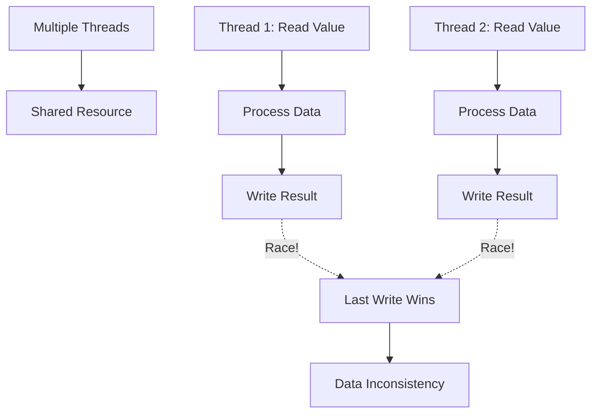
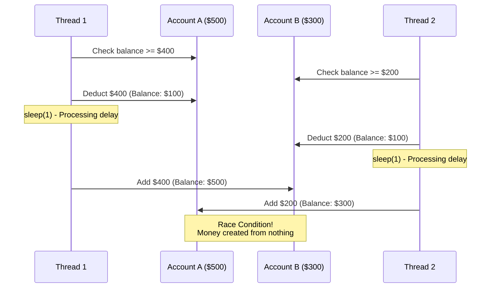
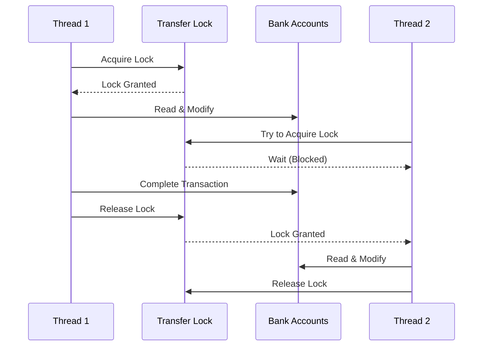
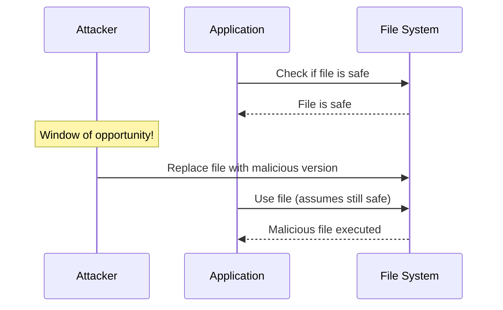

Technology constantly evolves in the vast realm of cybersecurity, unveiling new challenges for developers and organizations worldwide. A *race condition* is one such vulnerability that has been a cause for concern. With its ability to evade and exploit security measures, understanding this vulnerability is crucial for safeguarding sensitive data and systems.

> **Key Insight**: Race conditions are timing-dependent vulnerabilities that occur when multiple processes access shared resources concurrently without proper synchronization.

## Defining the Race Condition Vulnerability

A *race condition* is a software flaw that arises when multiple processes or threads access shared resources concurrently, leading to **unpredictable and unintended consequences**. It occurs when the outcome of a program depends on the **relative timing of events** rather than the logical order in which they are meant to be executed.



## Root Causes and Mechanisms

Several factors contribute to the emergence of race conditions:

| **Cause** | **Description** | **Impact** |
|-----------|-----------------|------------|
| **Poor Synchronization** | Lack of locks, semaphores, or mutexes | Multiple threads access same resource |
| **Shared Resource Mismanagement** | Improper handling of concurrent access | Data corruption |
| **Missing Concurrency Controls** | No protection for critical sections | Unpredictable behavior |
| **Timing Dependencies** | Relying on execution order | Inconsistent results |

A race condition can occur when multiple processes contend for access to shared resources or critical code sections **without proper synchronization mechanisms**. This can lead to:

- Data inconsistencies
- Data corruption
- Security breaches
- System crashes

## Vulnerable Code Example

A race condition security vulnerability can occur when multiple processes or threads simultaneously access and alter shared resources. Consider this hypothetical banking example:

### The Vulnerability

```python
def transfer_funds(sender_account, receiver_account, amount):
 if sender_account.balance >= amount:
 
 # Deduct the amount from sender's account
 sender_account.balance -= amount
 
 # Simulate some processing time (to highlight the vulnerability)
 time.sleep(1)
 
 # Credit the amount to the receiver's account
 receiver_account.balance += amount
 print("Funds transferred successfully!")
 else:
 print("Insufficient funds!")
```

### Example Usage

```python
import threading

# Create two bank accounts
account_A = BankAccount(balance=500)
account_B = BankAccount(balance=300)

# Create two threads, each simulating a transaction
thread1 = threading.Thread(target=transfer_funds, args=(account_A, account_B, 400))
thread2 = threading.Thread(target=transfer_funds, args=(account_B, account_A, 200))

# Start the threads
thread1.start()
thread2.start()
```

### The Problem



In this scenario, **both threads execute concurrently** and simultaneously access shared resources (account_A and account_B). If thread1 is interrupted after deducting from account_A but before crediting account_B, thread2 can deduct funds from account_B even though account_A doesn't have sufficient funds anymore.

**Result**: Inconsistent account state, unauthorized transactions, and potential financial fraud.

## Secure Code Example

To mitigate this vulnerability, use **synchronization mechanisms** like locks or semaphores:

```python
import threading

# Create a lock for thread synchronization
transfer_lock = threading.Lock()

def transfer_funds_secure(sender_account, receiver_account, amount):
 # Acquire lock before accessing shared resources
 with transfer_lock:
 if sender_account.balance >= amount:
 # Deduct the amount from sender's account
 sender_account.balance -= amount
 
 # Simulate processing time
 time.sleep(1)
 
 # Credit the amount to the receiver's account
 receiver_account.balance += amount
 print("Funds transferred successfully!")
 else:
 print("Insufficient funds!")
```

**How This Helps:**



## Implications of Race Condition Vulnerabilities

Race conditions can have severe consequences, from security breaches to data corruption and financial losses.

### 1. Data Integrity Violation

If multiple processes attempt to write to the same location in memory simultaneously, the data may become corrupt, diminish integrity, or result in inconsistent output.

**Example**: Corrupted database records, incorrect financial calculations

### 2. Privilege Escalation

In the presence of a race condition vulnerability, an attacker may exploit it to manipulate the system's behavior, escalate privileges, and execute unauthorized actions.

**Example**: Exploiting file permission checks to gain root access

### 3. Denial of Service (DoS)

When a race condition occurs, resource contention among processes can overwhelm the system, rendering it unresponsive, leading to a DoS condition.

### 4. Time of Check to Time of Use (TOCTOU) Attack

A *TOCTOU attack* exploits the gap between security checks and resource utilization, utilizing the fleeting window of opportunity created by race conditions to subvert intended security measures.



**Example Vulnerable Code:**

```c
// Check if file exists and is safe
if (access("/tmp/file", R_OK) == 0) {
 // TIME GAP - File can be replaced here!
 FILE* f = fopen("/tmp/file", "r");
 // Use file...
}
```

## Preventive Measures

Mitigating the risks associated with race conditions requires a **multifaceted approach**:

### 1. Synchronization Mechanisms

Applying adequate synchronization techniques ensures proper coordination of shared resources:

| **Mechanism** | **Use Case** | **Pros** | **Cons** |
|---------------|--------------|----------|----------|
| **Locks (Mutex)** | Exclusive access | Simple to use | Can cause deadlocks |
| **Semaphores** | Limited concurrent access | Flexible | More complex |
| **Monitors** | Object-level synchronization | Encapsulated | Language-specific |
| **Atomic Operations** | Simple operations | Fast, lock-free | Limited use cases |

**Example with Lock:**

```python
from threading import Lock

class BankAccount:
 def __init__(self, balance):
 self.balance = balance
 self.lock = Lock()
 
 def withdraw(self, amount):
 with self.lock:
 if self.balance >= amount:
 self.balance -= amount
 return True
 return False
```

### 2. Thread-Safe Libraries and Frameworks

Utilizing libraries and frameworks with **built-in thread-safety mechanisms** can significantly reduce the likelihood of race conditions.

**Thread-Safe Options:**
- Use `concurrent.futures` in Python
- Java's `java.util.concurrent` package
- Thread-safe collections (ConcurrentHashMap, etc.)

### 3. Code Auditing and Testing

Thorough code reviews and rigorous testing help identify potential race conditions before deployment:

**Testing Strategies:**
- **Stress testing** - High load scenarios
- **Concurrency testing** - Multiple threads/processes
- **Race condition detection tools** - ThreadSanitizer, Helgrind
- **Formal verification** - Mathematical proof of correctness

### 4. Concurrency Control Best Practices

**Advanced Techniques:**
- **Fine-grained locking** - Lock only what's necessary
- **Lock-free algorithms** - Use atomic operations
- **Transactional memory** - Database-style transactions for memory
- **Immutable data structures** - Prevent modification issues

## Detection Tools

| **Tool** | **Language** | **Purpose** |
|----------|--------------|-------------|
| **ThreadSanitizer** | C/C++ | Detect data races |
| **Helgrind** | C/C++ | Valgrind tool for threading bugs |
| **RacerD** | Java | Facebook's race detection |
| **Go Race Detector** | Go | Built-in race detection |

```bash
# Using ThreadSanitizer with GCC
gcc -fsanitize=thread -g program.c -o program
./program

# Using Go race detector
go run -race program.go
```

## Conclusion

Race conditions pose significant threats to the security and stability of software systems. Understanding their root causes, mechanisms, and implications is crucial to fortifying defenses against cybersecurity risks.

By following best practices, applying robust synchronization techniques, and leveraging thread-safe libraries, we can **narrow the window of vulnerability** and safeguard systems against this covert threat. Proactive measures, continuous education, and staying informed are essential in maintaining the security of the digital landscape.

> **Final Takeaway**: Race conditions are subtle but deadly. Always protect shared resources with proper synchronization, test concurrent access scenarios, and use thread-safe libraries whenever possible.

## References

- [OWASP: Race Condition](https://owasp.org/www-community/vulnerabilities/Race_Conditions)
- [CWE-362: Concurrent Execution using Shared Resource](https://cwe.mitre.org/data/definitions/362.html)
- [TOCTOU Attacks Explained](https://en.wikipedia.org/wiki/Time-of-check_to_time-of-use)
- [ThreadSanitizer Documentation](https://github.com/google/sanitizers/wiki/ThreadSanitizerCppManual)
