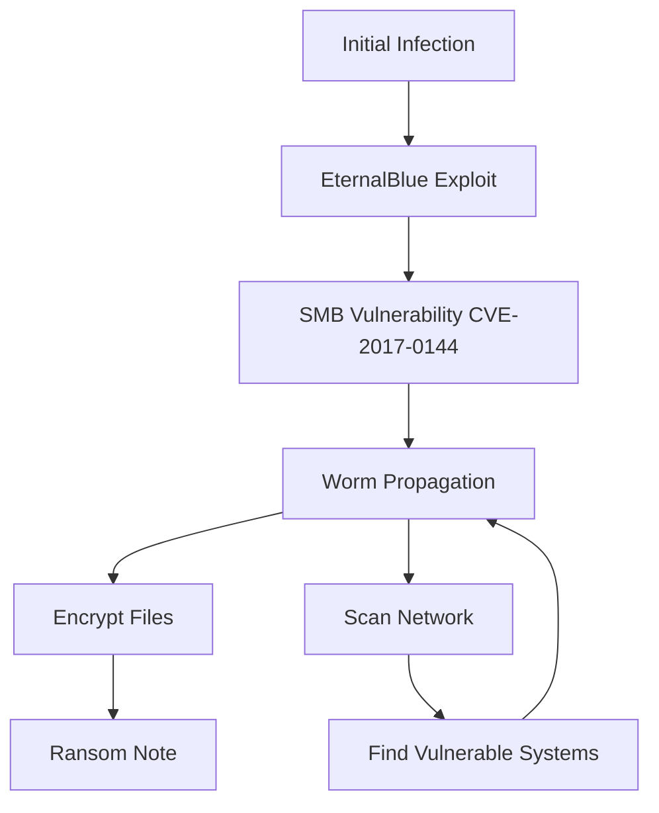
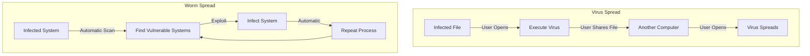
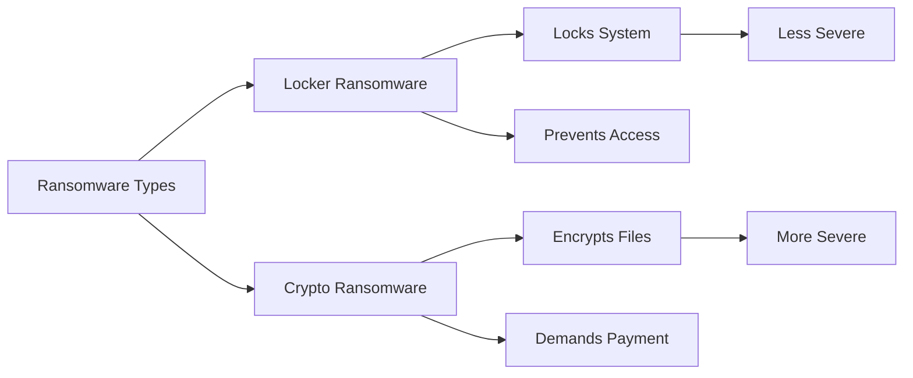
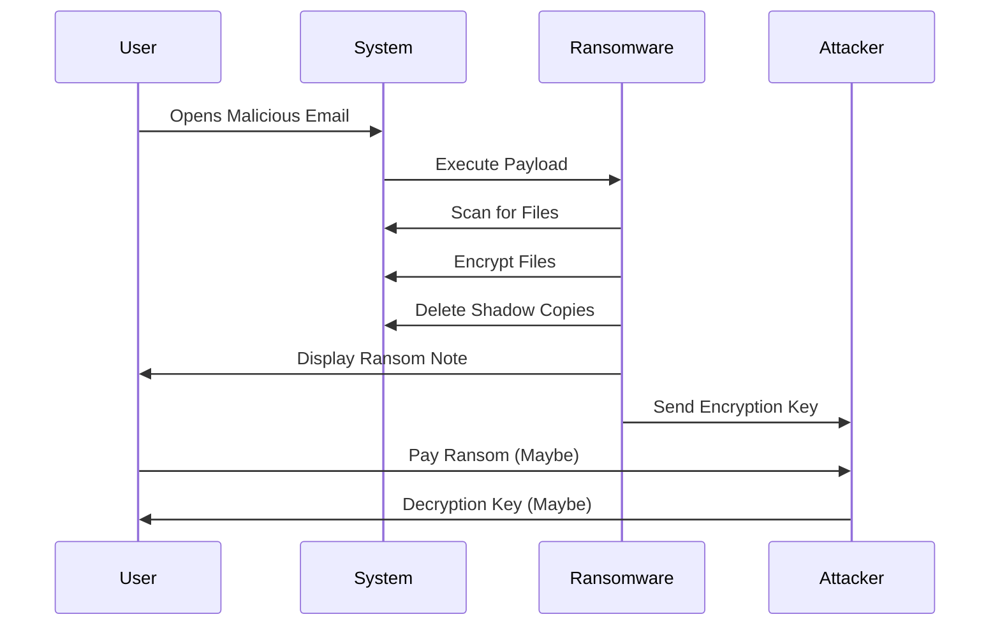
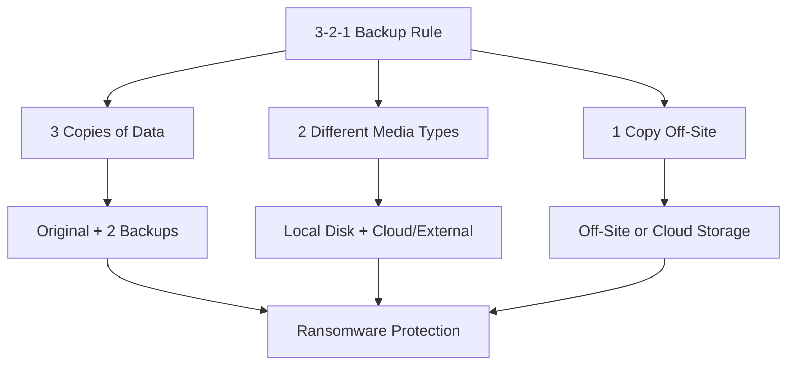
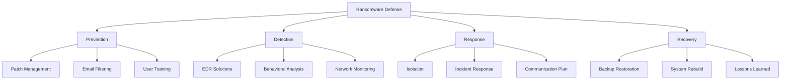

*Ransomware* infects your computer or mobile devices, locking you out until you pay a ransom. Ransomware is a form of *malicious software* or *malware* which restricts access to your computer or mobile device or encrypts data until you pay a ransom in exchange for accessing your devices or data again.

> **Key Insight**: Ransomware is not just a technical problem—it's a business model for cybercriminals, causing billions in damages annually.

## The WannaCry Attack: A Case Study

A very well-known ransomware attack that gained international attention was the **"WannaCry"** ransomware attack that happened in May 2017. It is now considered one of the **largest ransomware attacks in history**.

### WannaCry Statistics

| **Metric** | **Impact** |
|------------|-----------|
| **Computers Infected** | 300,000+ |
| **Countries Affected** | 150+ |
| **Time to Spread** | Less than 4 days |
| **Financial Damage** | ~$4 Billion USD |
| **Exploit Used** | EternalBlue (NSA-developed) |
| **Target OS** | Microsoft Windows |
| **Ransom Method** | Bitcoin payments |

### How WannaCry Spread

**The Exploit**: *EternalBlue* was developed by the NSA. Even though Microsoft had released patches for the exploit, the worm spread to organizations that had **not applied these patches** to their systems.

> **Critical Lesson**: The WannaCry attack could have been prevented with proper patch management.

## Notable Ransomware Attacks

### 1. GandCrab

This ransomware attack threatened to reveal victims' porn-watching habits. GandCrab cybercriminals demanded ransom by claiming to hijack the victim's webcam and release embarrassing footage.

**Tactics:**
- Webcam hijacking claims (often fake)
- Psychological manipulation
- Sextortion techniques

### 2. CryptoLocker

*CryptoLocker* was spread through infected email attachments and was first seen in 2007. Once on the victim's computer, it searched for valuable files to encrypt and hold for ransom.

**Impact:**
- Affected around **500,000 computers**
- Targeted law enforcement, security companies
- Seized a worldwide network of hijacked computers

**Resolution**: An online portal was later developed where victims could get a decryption key to unlock their data **for free without paying criminals**.

## Understanding Malware: Viruses vs Worms

To understand ransomware, we first need to know the difference between viruses and worms:

### Virus

A *virus* is a type of malware that:
- **Needs a host** to survive
- Multiplies by inserting copies into other programs
- Remains **dormant** until the infected file is opened
- Requires **user action** to spread

**Spread Methods:**
- File sharing
- Email attachments
- Network file access
- Removable media

### Worm

A *worm* is malware that:
- **Self-replicates** without needing a host
- Spreads **automatically** without user action
- Exploits security vulnerabilities
- Can spread exponentially

## How Ransomware Works

*Ransomware* is an attack technique that **encrypts the victim's files** and makes them inaccessible. The victim's files can then only be accessed after payment of a ransom (which often involves a deadline) is made to the attacker for a decryption key.

### Infection Vectors

**Common Spread Methods:**
- **Phishing emails** - Malicious attachments
- **Malvertising** - Malicious ads
- **Security flaws** - Exploiting vulnerabilities (like WannaCry)
- **Drive-by downloads** - Infected websites
- **Social engineering** - Tricking users

## Types of Ransomware

### 1. Locker Ransomware

**Locks you out** of basic computer functions, forcing you to pay a ransom to regain control.

**Characteristics:**
- Locks screen
- Prevents access to OS
- Timer countdown
- Demands payment

### 2. Crypto Ransomware

**Encrypts sensitive data** like documents and important files, threatening to destroy them unless you pay a fee.

**Characteristics:**
- Encrypts files (documents, photos, databases)
- Leaves ransom note
- Deadline for payment
- Threatens permanent deletion

## Ransomware Attack Flow

## Prevention Strategies

### 1. Security Guidelines

First and foremost, practice standard security guidelines:

- **Don't click** on links or email attachments from unknown users
- **Only download** applications from trusted sources
- **Avoid browsing** sites that are not HTTPS-encrypted
- **Keep systems updated** - Apply patches promptly
- **Use antivirus/anti-malware** software

### 2. Backup Strategy

The virus can affect not only your root drive but any connected hard drive. It's always a good idea to **backup your data**—in case of ransomware, it can be your salvation.

**3-2-1 Backup Rule:**

**Backup Best Practices:**
- **Regular backups** - Daily or weekly
- **Offline backups** - Disconnect after backup
- **Cloud backups** - Geographic redundancy
- **Test restores** - Verify backups work
- **Encrypt backups** - Protect backup data

### 3. Security Software

**Ensure your system has:**
- Antivirus software (updated regularly)
- Anti-malware protection
- Firewall enabled
- Email filtering
- Web filtering

### 4. Network Segmentation

**Isolate critical systems:**
- Separate networks for different departments
- Limit lateral movement
- Restrict administrative access

### 5. User Training

**Educate users about:**
- Phishing recognition
- Suspicious email indicators
- Safe browsing practices
- Reporting procedures

## What to Do If Infected

### Immediate Actions

1. **Disconnect from network** - Prevent spread
2. **Don't pay the ransom** - No guarantee of decryption
3. **Report to authorities** - FBI, local law enforcement
4. **Identify the ransomware** - Use ID Ransomware
5. **Check for decryptors** - No More Ransom Project
6. **Restore from backups** - If available
7. **Scan all systems** - Ensure complete removal

### Should You Pay?

**Reasons NOT to Pay:**
- No guarantee you'll get your files back
- Encourages more attacks
- May be illegal in some jurisdictions
- Funds criminal operations
- You may be targeted again

**When Organizations Consider Paying:**
- Critical business operations at stake
- No viable backups exist
- Downtime cost exceeds ransom
- Legal and compliance implications

> **FBI Recommendation**: The FBI discourages paying ransoms, as it doesn't guarantee file recovery and encourages future attacks.

## Ransomware Defense Architecture

## Conclusion

*Ransomware* represents one of the most significant cybersecurity threats facing organizations and individuals today. From the devastating *WannaCry* attack that caused $4 billion in damages to countless smaller incidents affecting businesses daily, ransomware demonstrates how a single security lapse can have catastrophic consequences.

The key to ransomware defense is **prevention through multiple layers**:
- Keep systems patched and updated
- Maintain robust, tested backups
- Train users to recognize threats
- Deploy advanced security tools
- Have an incident response plan

Remember: **The best defense against ransomware is not paying the ransom—it's preventing the infection in the first place.**

> **Final Takeaway**: Ransomware is preventable. With proper security hygiene, regular backups, and user awareness, you can protect yourself from becoming the next victim.

## References

- [CISA: Ransomware Guide](https://www.cisa.gov/stopransomware)
- [No More Ransom Project](https://www.nomoreransom.org/)
- [Ransomware Task Force](https://securityandtechnology.org/ransomwaretaskforce/)
- [Microsoft: Ransomware Protection](https://www.microsoft.com/en-us/security/business/threat-protection/ransomware-protection)
