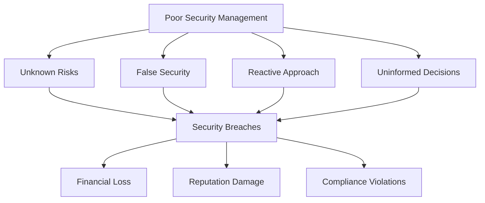
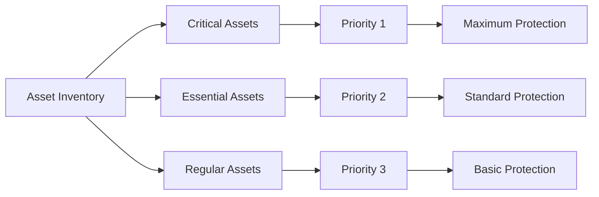
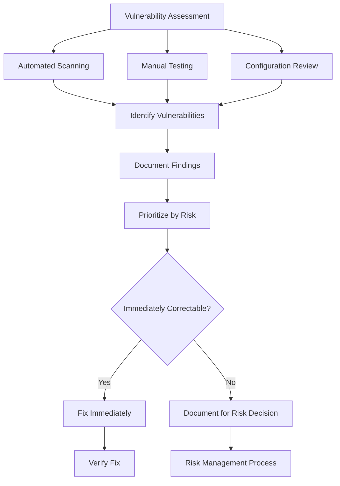
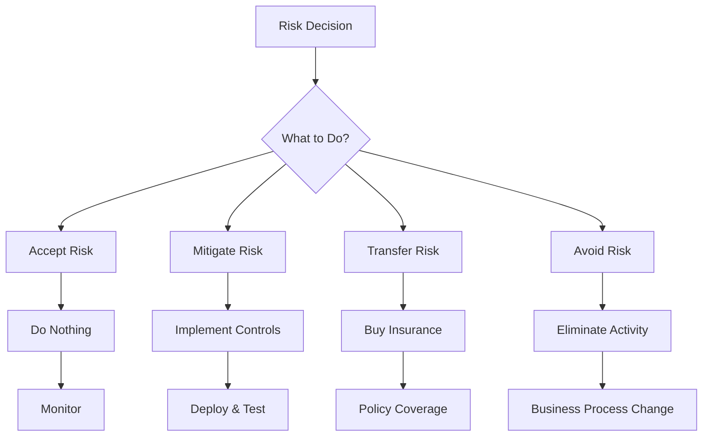
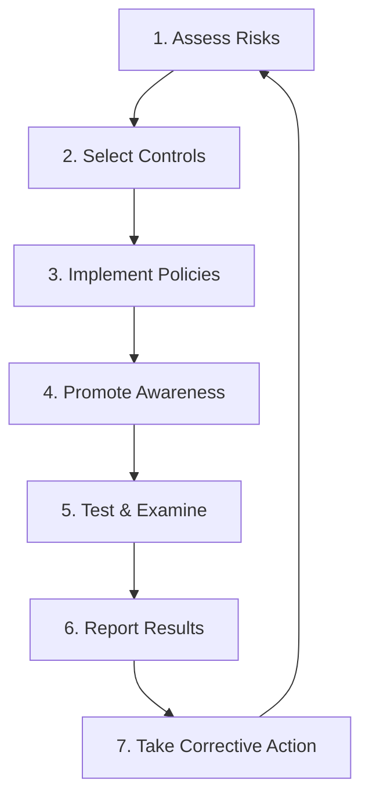
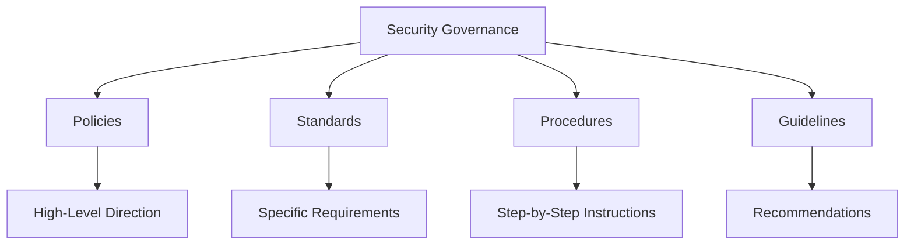
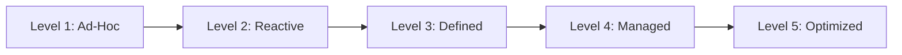

An organization depends on information technology to access critical information and promote communications and coordination among groups inside and outside the organization. In other words, *information technology* is a **strategic asset vital to your organization's viability**. It's essential to build a secure information technology infrastructure and manage it with well-deployed processes and tools.

> **Key Insight**: Security Program Management is not just about tools and technology—it's about creating a systematic approach to identifying, assessing, and mitigating risks.

## The Cost of Poor Security Management

Poor security management leads to organizations that:

- Are **not fully aware** of the information security risks to their operations
- Accept an **unknown level of risk** by default rather than consciously deciding what level of risk is tolerable
- Have a **false sense of security** because they rely on ineffective controls
- Deal with security on an **ad-hoc reactive basis**
- **Cannot make informed judgments** about security spending



## Security Risk Management Phases

A comprehensive security program follows a **six-phase lifecycle**:

### Phase 1: Systems Inventory

Begin with the most critical assets to the continued accomplishment of the organization's mission.

#### Asset Classification

| **Classification** | **Definition** | **Impact of Loss** |
|-------------------|----------------|-------------------|
| **Critical** | Cannot operate without, even for a short period | Immediate business stoppage |
| **Essential** | Could work around loss for days or a week | Significant disruption |
| **Regular** | Can operate without for a finite period | Minor inconvenience |



**Examples by Category:**

**Critical Assets:**
- Core payment processing systems
- Customer database
- Authentication servers
- Primary domain controllers

**Essential Assets:**
- Email servers
- File sharing systems
- Development environments
- Internal applications

**Regular Assets:**
- Testing environments
- Archive systems
- Non-production databases

### Phase 2: Threat Analysis

Identify potential threats that are critical to systems. It must involve **business process owners** and **business process users**. They are the ones who can recognize and appreciate the threats that could adversely affect their ability to accomplish critical functions.

#### Common Threats

```mermaid
mindmap
root((Threat<br/>Landscape))
External Threats
Hackers
Nation States
Competitors
Criminals
Internal Threats
Malicious Insiders
Negligent Users
Contractors
Environmental
Natural Disasters
Power Outages
Hardware Failure
Technical
Software Bugs
Misconfigurations
Legacy Systems
```

**Threat Analysis Questions:**
- Who might attack our systems?
- What are their motivations?
- What capabilities do they have?
- What are the likely attack vectors?
- What is the probability of each threat?

### Phase 3: Infrastructure Vulnerability Assessment

Identifying technology vulnerabilities that can be exploited. The target system has been identified, and **internal and external experts** should examine IT systems for weaknesses.

#### Assessment Process



**This should lead to:**
- List of vulnerabilities to correct
- Many corrected on the spot (documented)
- Some not immediately correctable (tracked for risk decisions)

**Assessment Methods:**
- Network vulnerability scans
- Application security testing
- Configuration reviews
- Penetration testing
- Code reviews

### Phase 4: Developing Security Recommendations

The first three phases give you a measure of **risk**, **threats**, and **vulnerabilities** and an understanding of how these impact the organization's business.

#### Risk Control Strategies

The risk-analysis process should lead an organization to:
- **Control risk** through appropriate security controls
- **Define residual risk** - risks that remain after controls

**Implementation Considerations:**

| **Factor** | **Consideration** |
|------------|------------------|
| **Cost** | Operations and maintenance expenses |
| **Usability** | Impact on user experience |
| **Scalability** | Growth accommodation |
| **Performance** | System speed impact |

> **Key Principle**: Implementation is a risk/value proposition because all controls have costs. Evaluate controls based on business risk to establish a coherent mitigation plan.

### Phase 5: Decision Making

A strategic and tactical action plan should be provided. **Business owners** must be responsible for the decision phase with IT and security personnel.

#### Decision Options



**Possible Decisions:**

1. **Accept the Risk** - Do nothing (documented decision)
2. **Mitigate the Risk** - Implement security controls
3. **Transfer the Risk** - Buy cyber insurance
4. **Avoid the Risk** - Don't engage in risky activity

**Decision Criteria:**
- Business value added by the control
- Cost vs. benefit analysis
- Regulatory requirements
- Risk tolerance level

> **Important**: Risk management is not a goal in itself; information should be protected only in support of a business need or requirement.

### Phase 6: Communication and Monitoring

User and management **buy-in** are critical to the successful implementation of controls.

**Final Stages:**
- Communicate risk-assessment results to business-process owners and end-users
- Monitor results (both positive and negative)
- Assess net effect of implemented controls
- Adjust and improve continuously

## Risk Management Cycle

The security program operates in a continuous cycle:



### 1. Assess Risks

Determine necessary protection requirements based on:
- Asset criticality
- Threat landscape
- Vulnerability exposure
- Business impact

### 2. Select and Implement Controls

Choose cost-effective policies and controls to meet identified needs:
- Technical controls (firewalls, encryption)
- Administrative controls (policies, procedures)
- Physical controls (locks, cameras)

### 3. Promote Awareness

Ensure those responsible for compliance understand:
- Why controls are necessary
- What risks prompted their adoption
- How to properly implement controls
- Consequences of non-compliance

### 4. Routine Testing

Implement a program of routine tests and examinations to evaluate the **effectiveness of policies and related controls**:

- Vulnerability scanning
- Penetration testing
- Compliance audits
- Security exercises
- Incident response drills

### 5. Report Results

Report findings and conclusions to those who can take appropriate corrective action:
- Executive leadership
- Board of directors
- Department heads
- Security team

### 6. Continuous Improvement

Use findings to improve the security program:
- Update policies
- Enhance controls
- Adjust resource allocation
- Refine processes

## Security Program Components

### Governance



### Key Elements

| **Element** | **Purpose** | **Owner** |
|-------------|-------------|-----------|
| **Policies** | Define security objectives | Executive Leadership |
| **Standards** | Specify technical requirements | Security Team |
| **Procedures** | Provide implementation steps | Operations Team |
| **Guidelines** | Offer best practice recommendations | Subject Matter Experts |

## Metrics and KPIs

### Security Program Effectiveness Metrics

**Track These Indicators:**

| **Metric** | **Measurement** | **Target** |
|------------|----------------|-----------|
| **Mean Time to Detect (MTTD)** | Time to identify incidents | < 1 hour |
| **Mean Time to Respond (MTTR)** | Time to contain incidents | < 4 hours |
| **Vulnerability Remediation Time** | Time to patch critical vulns | < 30 days |
| **Security Training Completion** | % of staff trained | 100% |
| **Phishing Test Success Rate** | % who report phishing | > 80% |
| **Compliance Score** | % of controls implemented | > 95% |

## Maturity Model



**Maturity Levels:**

1. **Ad-Hoc**: No formal security program
2. **Reactive**: Respond to incidents as they occur
3. **Defined**: Documented processes and procedures
4. **Managed**: Metrics-driven, continuous improvement
5. **Optimized**: Proactive, predictive, industry-leading

## Conclusion

*Security Program Management* is a structured approach to protecting organizational assets through systematic risk assessment, control implementation, and continuous improvement. It transforms security from a reactive, technology-focused activity into a **strategic, business-aligned function**.

Effective security programs:
- Start with understanding assets and threats
- Make risk-based decisions with business involvement
- Implement appropriate controls based on value
- Continuously monitor and improve
- Align with business objectives

> **Final Takeaway**: A mature security program is not about implementing every possible control—it's about making informed, risk-based decisions that protect what matters most to your organization.

## References

- [SANS: Introduction to Risk Assessment](https://www.sans.org/cyber-security-courses/intro-risk-assessment/)
- [NIST Cybersecurity Framework](https://www.nist.gov/cyberframework)
- [ISO 27001: Information Security Management](https://www.iso.org/isoiec-27001-information-security.html)
- [CIS Controls](https://www.cisecurity.org/controls/)
