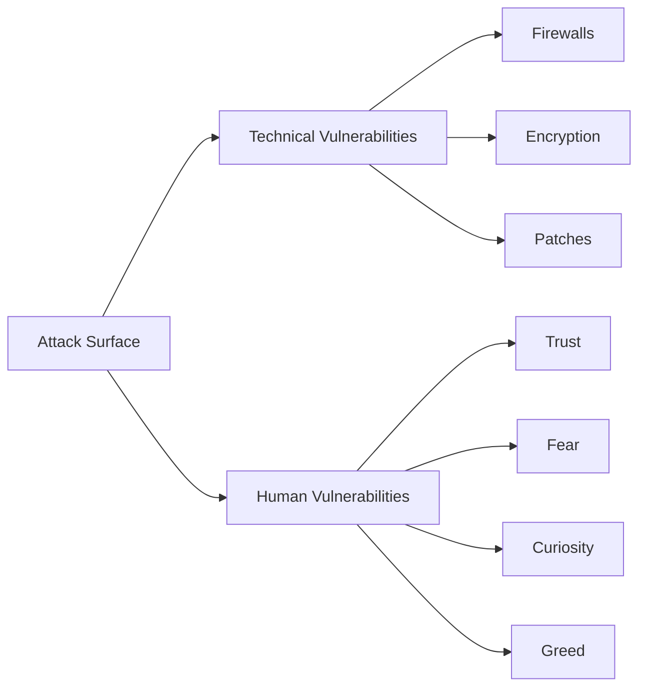
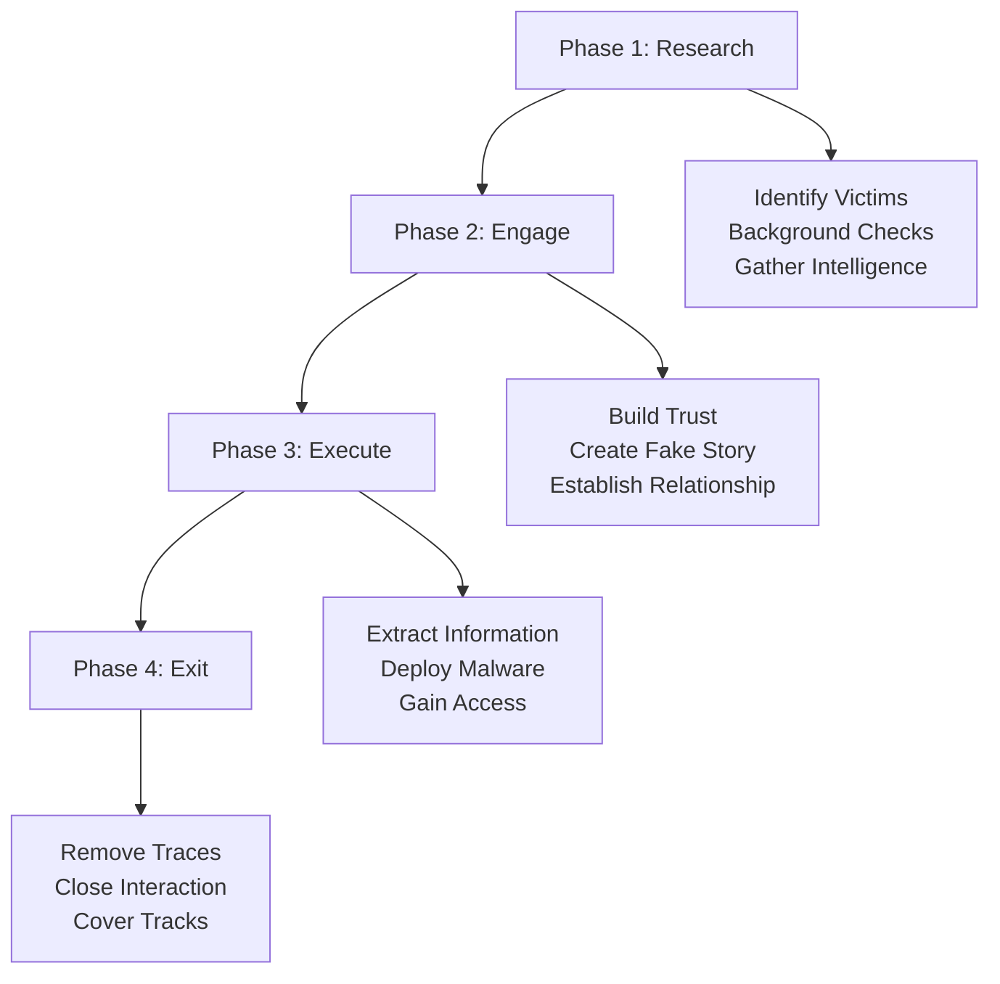
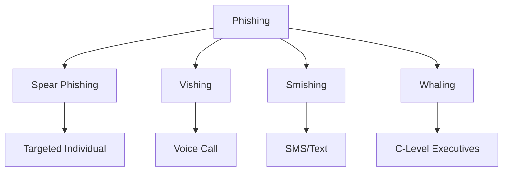
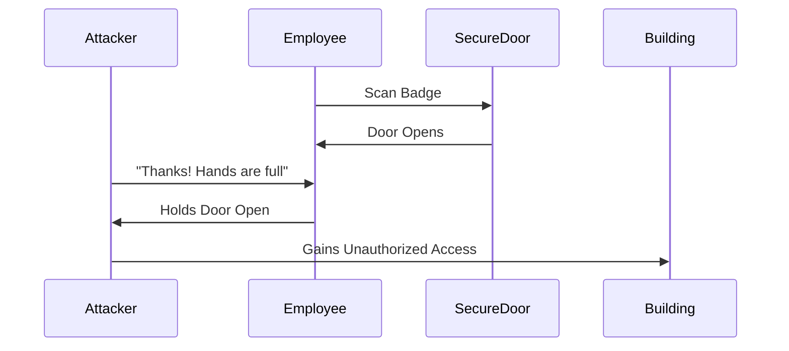
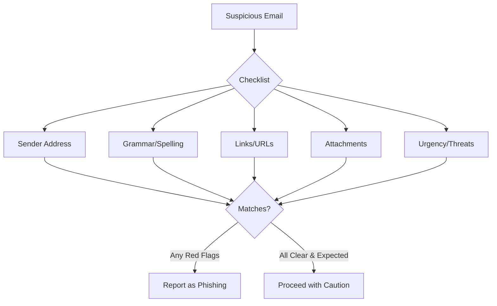
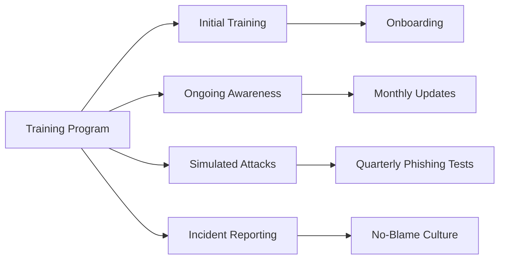
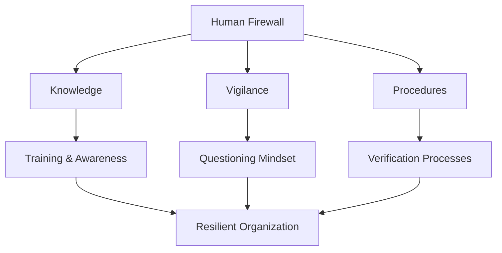

Traditionally, cybercriminals take advantage of system vulnerabilities to infiltrate and conduct malicious activities. Apart from technical exploits, another technique that has gained popularity is *Social Engineering*. Cyberattacks from crypto-jacking to ransomware attacks are increasingly common, and most involve some form of social engineering which **exploits a victim's psychological vulnerability**.

> **Key Insight**: Social engineering attacks target the weakest link in security—human psychology—not technical systems.

## What is Social Engineering?

*Social Engineering* techniques rely on **human vulnerabilities**, not on the technical ability of a threat actor, to gain unauthorized access to sensitive data. Since it requires a victim's interaction, social engineering attacks are not straightforward—they require extensive research and careful planning.



> **Reality Check**: You can have the best technical security in the world, but one employee clicking a malicious link can compromise everything.

## Social Engineering Lifecycle

A social engineering attack works in this particular order:



### Phase 1: Research and Reconnaissance

**Malicious actors identify victims** and carry out a comprehensive background check to exploit the victim psychologically.

**Information Gathered:**
- Social media profiles
- Company structure
- Job responsibilities
- Personal interests
- Recent activities
- Relationships

### Phase 2: Engagement

The attacker will try to **engage the victim using a fake story** (pretext):

- Impersonating IT support
- Pretending to be a colleague
- Posing as a vendor
- Acting as authority figure

### Phase 3: Execution

After the victim performs what was intended, the attacker **executes the attack** using the information gained:

- Download malware
- Reveal credentials
- Transfer funds
- Provide access

### Phase 4: Exit

After successfully infiltrating the system, the attacker **removes all traces** and closes all interactions:

- Delete logs
- Remove backdoors
- Cover digital footprints
- Disappear without suspicion

## Types of Social Engineering Attacks

### 1. Phishing

During a *phishing attack*, a threat actor tries to impersonate a credible authoritative figure or organization to trick a victim into disclosing personal, sensitive, or proprietary information.



#### Phishing Variants

| **Type** | **Medium** | **Target** | **Example** |
|----------|------------|------------|-------------|
| **Phishing** | Email | General users | Fake bank emails |
| **Spear Phishing** | Email | Specific individuals | CEO impersonation |
| **Vishing** | Voice/Phone | Anyone | Fake tech support calls |
| **Smishing** | SMS/Text | Mobile users | Fake delivery notifications |
| **Whaling** | Email | Executives | Board member impersonation |

**Spear Phishing Example:**

```email
From: ceo@company.com [Actually: ceo@c0mpany.com]
To: finance@company.com
Subject: URGENT: Wire Transfer Needed

Hi Sarah,

I'm in a meeting with our new vendor and need you to wire 
$50,000 to the account below immediately. This is time-sensitive.

Account: 123456789
Routing: 987654321

Thanks,
John (CEO)
```

> **Red Flags**: Urgency, unusual requests, slight email differences, requests to bypass normal procedures.

### 2. Baiting

*Baiting attacks* exploit a victim's **greed** or **curiosity** for a quick payout.

**Examples:**
- Free software downloads
- USB drives left in parking lot
- "You've won!" pop-ups
- Free gift cards
- Malicious ads

Once clicked or inserted:
- Malware-infected program downloads
- Redirect to malicious site
- Keylogger installed
- Ransomware deployed

### 3. Tailgating / Piggybacking

*Tailgating* or *Piggybacking* involves getting **physical access** to a building or restricted area that contains secure and confidential information.

**How it Works:**



**Common Scenarios:**
- Following employee through secure door
- Pretending to be delivery person
- Claiming forgotten badge
- Smoking area entry
- Loading dock access

### 4. Pretexting

Creating a fabricated scenario (pretext) to steal information:

**Examples:**
- Fake IT support asking for credentials
- "HR" requesting personal information
- "Vendor" needing system access
- "Auditor" requesting sensitive data

### 5. Quid Pro Quo

Offering a service in exchange for information or access:

**Examples:**
- "Tech support" offering to fix non-existent problem
- Free services requiring login
- Survey with gift card reward
- Software upgrade requiring credentials

## Identifying Social Engineering Attacks

### Red Flags

**Indications of a scam include:**

| **Indicator** | **What to Look For** |
|---------------|---------------------|
| **Poor Grammar** | Spelling errors, awkward phrasing |
| **Unusual Formatting** | Strange fonts, colors, layout |
| **Irregular URLs** | Misspelled domains, extra characters |
| **Typos** | Frequent spelling mistakes |
| **Inconsistencies** | Logo doesn't match, wrong branding |
| **Urgency** | "Act now!" pressure tactics |
| **Authority** | Claims of being executive or law enforcement |
| **Fear** | Threats of account closure, legal action |

### Email Analysis



> **Golden Rule**: Refrain from giving out passwords or sensitive data over the phone. Legitimate organizations will NEVER ask for passwords.

## Protection Strategies

### For Individuals

**Basic Security Precautions:**

1. **Email Safety**
 - Avoid downloading attachments from unknown sources
 - Be suspicious of attachments from known sources that seem unusual
 - Verify sender through alternative communication channel

2. **Phone Calls**
 - Never give passwords over the phone
 - Hang up and call official number
 - Verify caller identity

3. **Physical Security**
 - Challenge unknown individuals
 - Don't hold doors for strangers
 - Escort visitors
 - Wear and check ID badges

### For Organizations

**Countermeasures:**

| **Control** | **Implementation** |
|-------------|-------------------|
| **Technical** | Antivirus, email filtering, endpoint protection |
| **Authentication** | MFA/2FA on all accounts |
| **Updates** | Keep OS and applications current |
| **Spam Filters** | High sensitivity settings |
| **Awareness** | Regular training programs |
| **Policies** | Clear security policies and procedures |
| **Verification** | Multiple approvals for sensitive actions |

### Employee Training Program



**Training Topics:**
- Recognizing phishing emails
- Verifying unusual requests
- Reporting suspicious activity
- Password hygiene
- Physical security awareness
- Incident response procedures

## Authority and Fear Tactics

Social engineering attacks often target **lower-level employees** who can be tricked into believing managers or executives are requesting certain actions.

**Common Tactics:**
- "CEO needs this immediately!"
- "IT is doing emergency maintenance"
- "Compliance audit requires your credentials"
- "Account will be closed unless you verify"

**Defense**: Proper security protocols should be followed for all requests, especially those involving:
- Money transfers
- Credential disclosure
- System access
- Sensitive data

> **Verification Protocol**: Always verify unusual requests through a separate communication channel (call the person directly, don't reply to the email).

## Countermeasures Checklist

### Technical Controls

- [ ] Active and updated antivirus software
- [ ] Anti-malware protection
- [ ] Email filtering and scanning
- [ ] Web filtering
- [ ] Endpoint Detection and Response (EDR)
- [ ] Multi-Factor Authentication (MFA)
- [ ] Security Information and Event Management (SIEM)

### Administrative Controls

- [ ] Security awareness training (mandatory, regular)
- [ ] Phishing simulation exercises
- [ ] Incident reporting procedures
- [ ] Verification processes for sensitive requests
- [ ] Clear security policies
- [ ] Background checks for employees
- [ ] Access control policies

### Physical Controls

- [ ] Badge access systems
- [ ] Visitor management
- [ ] Security cameras
- [ ] Reception desk screening
- [ ] Secure disposal of documents
- [ ] Clean desk policy

## The Human Firewall



**Building a Human Firewall:**
- Regular training and awareness programs
- Create a security-conscious culture
- Encourage questioning and verification
- No-blame reporting environment
- Recognize and reward good security behavior

## Conclusion

*Social engineering* is the art of manipulating people into divulging confidential information or performing actions that compromise security. It remains one of the **most effective attack vectors** because it exploits human nature rather than technical vulnerabilities.

The most important countermeasure against social engineering is **education and awareness**. Technical controls like antivirus software and MFA provide layers of defense, but informed, vigilant users are your **strongest protection**.

Remember: attackers prey on:
- **Trust** - Impersonating trusted entities
- **Fear** - Creating urgency and panic
- **Curiosity** - Tempting with interesting content
- **Greed** - Offering rewards or benefits

By understanding these tactics and maintaining skepticism, verifying unusual requests, and following security protocols, individuals and organizations can significantly reduce their risk of falling victim to social engineering attacks.

> **Final Takeaway**: Your employees are either your weakest link or your strongest defense. Invest in security awareness training to turn your workforce into a human firewall.

## References

- [SANS: Social Engineering](https://www.sans.org/security-awareness-training/resources/social-engineering)
- [CISA: Social Engineering Tips](https://www.cisa.gov/secure-our-world)
- [NIST: Security Awareness and Training](https://csrc.nist.gov/publications/detail/sp/800-50/final)
- [Social-Engineer.org](https://www.social-engineer.org/)
