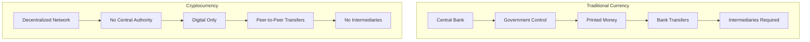
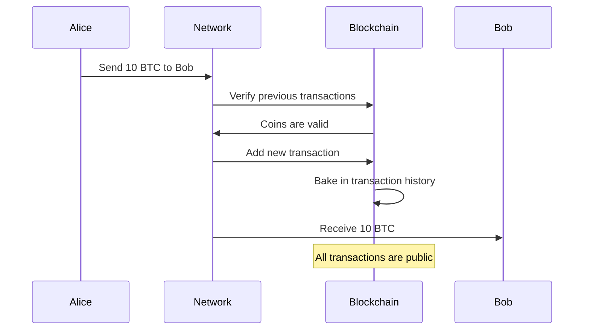
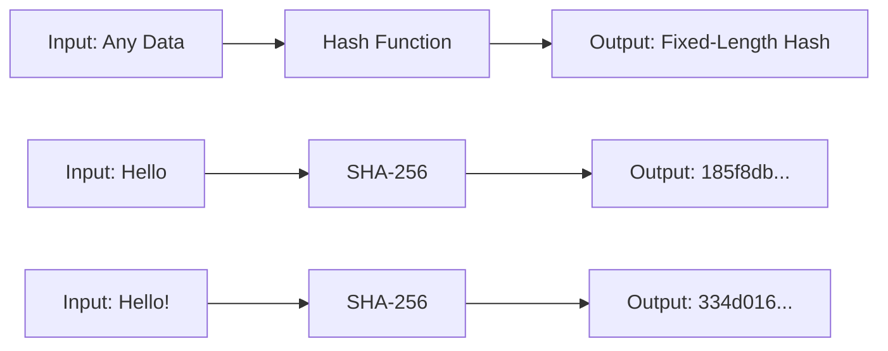
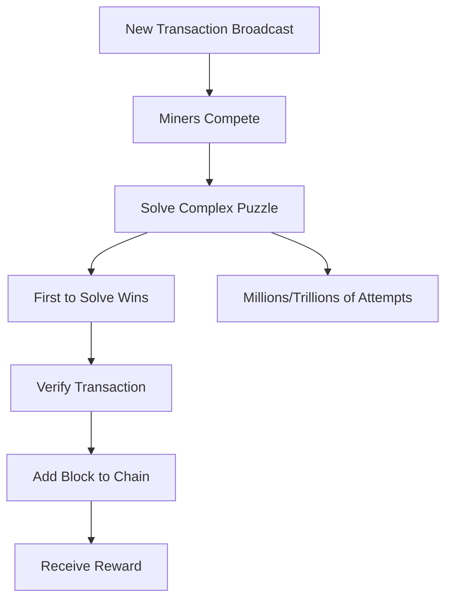
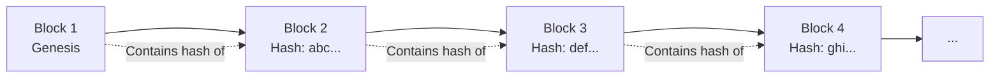
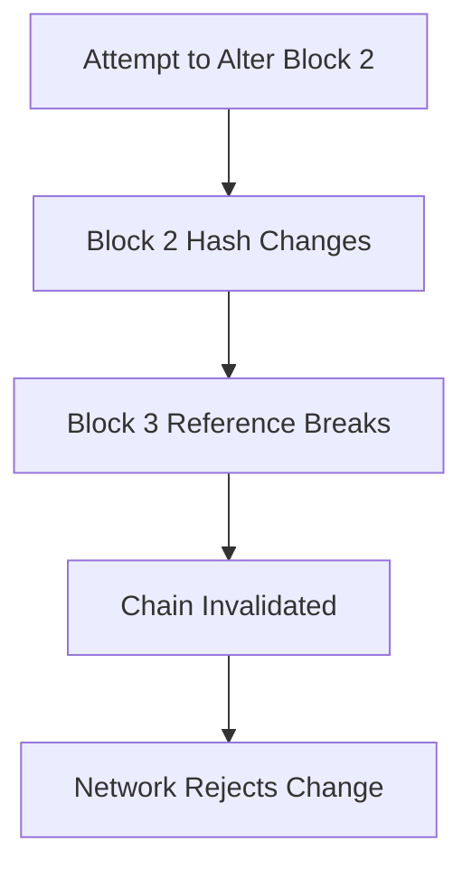
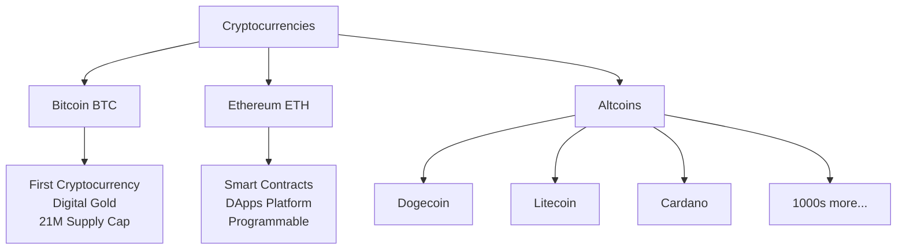
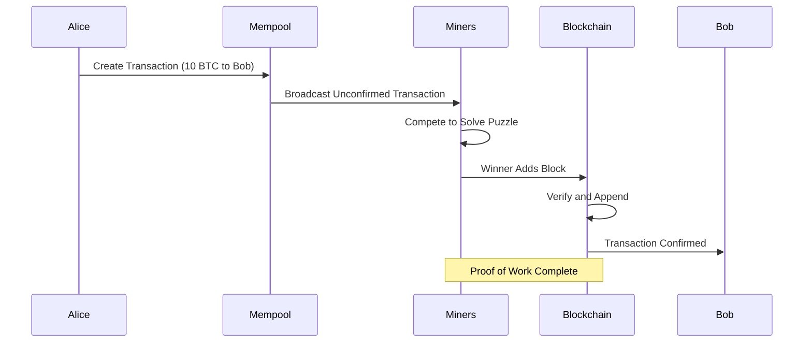

Crypto, Crypto, Crypto, **Currency**. Yes, I said it! The most hyped topic and the one you just cannot unsee when it comes to alternative forms of currency. In the past few years, cryptocurrency has gained massive attention, but the questions remain: **What is Cryptocurrency? What is Blockchain?** Let's break it down.

> **Key Insight**: Cryptocurrency represents a fundamental shift from centralized, government-backed currency to decentralized, cryptographically-secured digital money.

## Understanding Cryptocurrency

*Cryptocurrency* is a **decentralized virtual or digital currency**. So what does that mean?

### Traditional vs. Cryptocurrency



**Traditional Currency:**
- Regular bills and coins represent value
- Central location/authority (USD → USA, Rupee → India)
- Government-backed and controlled
- Physical and digital forms

**Cryptocurrency:**
- No physical form - purely digital
- No central authority
- Value represented by **transaction records**
- Cryptographically secured

## How Cryptocurrency Works

### Transaction Validation

For example, when you transfer money to Bob for building you a house or buying a car, you send him a payment in your cryptocurrency of choice, say **10 BTC (Bitcoin)**.

**What Happens:**



When you initiate this transaction, **the previous transactions of these 10 BTC get baked into this transaction** to show that:
- These coins exist
- They have been used in the past
- Providing validity of the coins

**Important**: All transactions are **public** and transparent on the blockchain.

## Hash Functions: The Foundation

Cryptocurrency is built on the basis of *hash functions*. A **hash function** is a mathematical function that encrypts a message.

### How Hash Functions Work



**Properties:**
1. **Deterministic**: Same input always produces same output
2. **Fast**: Quick to compute
3. **One-way**: Cannot reverse hash to get input
4. **Avalanche effect**: Small input change creates completely different hash
5. **Collision-resistant**: Nearly impossible to find two inputs with same hash

**Example:**
```javascript
// SHA-256 hash function
Input: "Hello World"
Output: "a591a6d40bf420404a011733cfb7b190d62c65bf0bcda32b57b277d9ad9f146e"

Input: "Hello World!" // Added just one character
Output: "7f83b1657ff1fc53b92dc18148a1d65dfc2d4b1fa3d677284addd200126d9069"
// Completely different!
```

## The Role of Miners

With cryptocurrency, it's important to validate the **authenticity of coins**, making sure that no two people get the same 10 BTC. This is where the term **"Miners"** comes in.

### What Miners Do

A *miner* is a person (or more accurately, a computer) that solves complex computational puzzles.

**Real-World Analogy:**
- If you ask Bob to build you a house, the **built house** acts as proof of work
- With cryptocurrency, **solving the puzzle** acts as proof of work



**The Process:**
- Puzzles are **really hard** to solve and take significant time
- Solution requires **millions or even trillions** of attempts
- Miners send inputs to a hashing function until the desired output is generated
- First miner to solve gets the reward

### Mining and Validation

Every time a transaction is made, a **new puzzle** is produced that miners can try to solve. The puzzle is based on:
- Input of past transactions
- If anything has been falsified, miners can verify that
- Reject the payment if fraud detected

**Security Through Consensus:**

All previously made transactions **validate and contribute** to each new transaction, making it **virtually impossible to rig the system**. This is the basis for **decentralization**.

## Blockchain: Putting It All Together

After the transaction is completed, it is integrated into a **block**. This block gets integrated into a **chain of blocks** that represents the cryptocurrency. This is where the term **"BlockChain"** is derived from.

### Blockchain Structure



**Each Block Contains:**
- **Transactions**: List of all transactions in the block
- **Timestamp**: When the block was created
- **Previous Hash**: Hash of the previous block
- **Nonce**: Number used to solve the puzzle
- **Block Hash**: Hash of current block

### Why Blockchain is Secure



**Immutability**: Changing any transaction in a previous block would:
1. Change that block's hash
2. Break the chain (next block's reference is invalid)
3. Be rejected by the network
4. Require re-mining all subsequent blocks
5. Need to convince 51% of network (nearly impossible)

## Cryptocurrency Features

### Key Characteristics

| **Feature** | **Description** | **Benefit** |
|-------------|-----------------|-------------|
| **Decentralization** | No central authority | Censorship-resistant |
| **Transparency** | All transactions public | Verifiable and auditable |
| **Immutability** | Cannot alter past transactions | Prevents fraud |
| **Pseudonymity** | Addresses not directly linked to identity | Privacy (with caveats) |
| **Security** | Cryptographic protection | Tamper-proof |
| **Global** | Works anywhere with internet | Borderless transactions |

## Popular Cryptocurrencies



## How a Transaction Works

### Step-by-Step Process



**Transaction Components:**
1. **Sender Address**: Alice's wallet address
2. **Receiver Address**: Bob's wallet address
3. **Amount**: 10 BTC
4. **Transaction Fee**: Payment to miner
5. **Digital Signature**: Proves Alice authorized this
6. **Previous Transaction References**: Proves coins exist

## Advantages of Cryptocurrency

### Benefits

- **No intermediaries**: Direct peer-to-peer transactions
- **Lower fees**: Especially for international transfers
- **Fast transactions**: Faster than traditional banking
- **24/7 availability**: No bank hours
- **Borderless**: Works globally
- **Transparent**: All transactions verifiable
- **Programmable money**: Smart contracts (Ethereum)

### Disadvantages

- **Volatility**: Price can fluctuate dramatically
- **Irreversible**: No chargebacks if scammed
- **Lost keys = lost funds**: No password recovery
- **Regulatory uncertainty**: Laws still evolving
- **Energy consumption**: Mining uses significant electricity
- **Scalability issues**: Transaction throughput limitations
- **Criminal use**: Used for illegal activities

## Security Considerations

### Wallet Security

**Types of Wallets:**

| **Type** | **Security** | **Convenience** | **Best For** |
|----------|--------------|-----------------|--------------|
| **Hardware Wallet** | Highest | Low | Long-term storage |
| **Paper Wallet** | High | Lowest | Cold storage |
| **Desktop Wallet** | Medium | Medium | Regular users |
| **Mobile Wallet** | Medium | High | Daily transactions |
| **Web Wallet** | Lowest | Highest | Small amounts only |

> **Security Rule**: "Not your keys, not your coins." Always control your private keys.

### Common Threats

- **Phishing**: Fake exchange websites
- **Malware**: Keyloggers stealing wallet credentials
- **Exchange hacks**: Mt. Gox, Coincheck incidents
- **Social engineering**: Impersonating support
- **Private key theft**: Compromised wallets

## The Future of Cryptocurrency

I hope this gave you some insight into what cryptocurrency is and how it works. As for the future, this technology has already gained significant popularity and has the potential to result in further **radical changes in the financial sector**.

**Potential Applications:**
- Cross-border payments
- Remittances
- Decentralized finance (DeFi)
- Non-Fungible Tokens (NFTs)
- Smart contracts
- Supply chain tracking
- Digital identity

However, it is not without its downsides and controversies, so **investors must be mindful of fraudulent transactions** and scams while dealing with it.

> **Investment Warning**: Only invest what you can afford to lose. Cryptocurrency is highly volatile and speculative.

## Conclusion

*Cryptocurrency* represents a revolutionary approach to money, removing intermediaries and putting control in the hands of individuals. Built on *blockchain technology* and secured through *cryptographic hash functions*, it offers transparency, security, and decentralization.

While the technology shows immense promise, it also comes with risks—volatility, regulatory uncertainty, and security challenges. Understanding how cryptocurrency works—from hash functions to miners to blockchain—is essential for anyone looking to participate in this digital financial revolution.

> **Final Takeaway**: Cryptocurrency is more than digital money—it's a technology that could reshape financial systems, contracts, and digital ownership. Approach it with knowledge, caution, and an understanding of both its potential and its risks.

## References

- [Bitcoin Whitepaper](https://bitcoin.org/bitcoin.pdf)
- [Blockchain Explained](https://www.blockchain.com/learning-portal)
- [CoinDesk: Crypto Education](https://www.coindesk.com/learn/)
- [MIT: Cryptocurrency Course](https://ocw.mit.edu/courses/sloan-school-of-management/)
