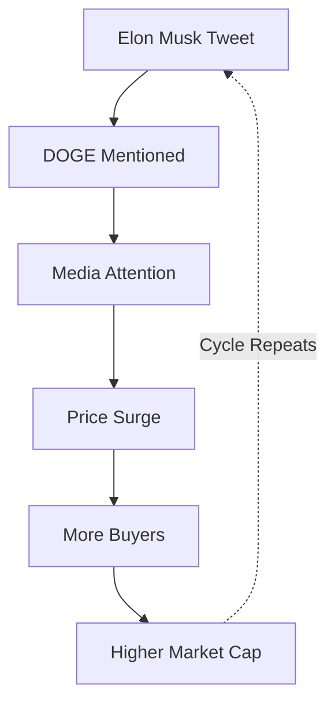
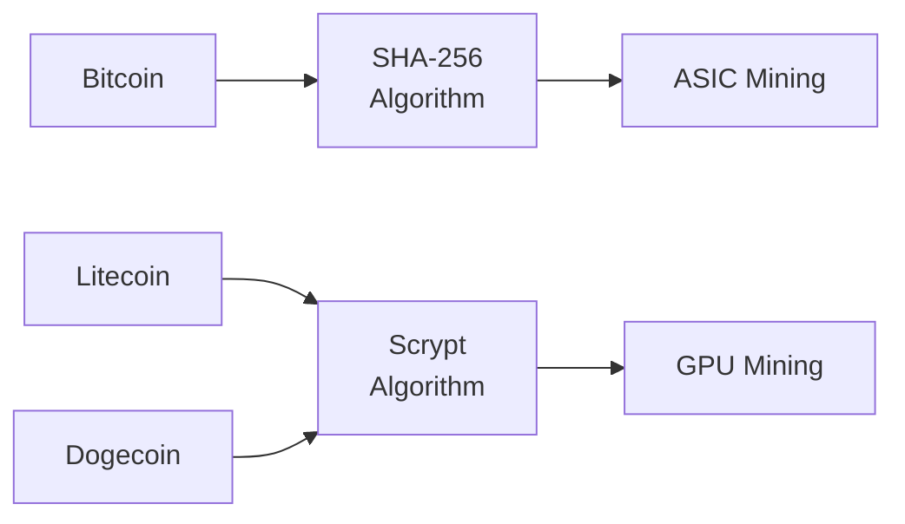
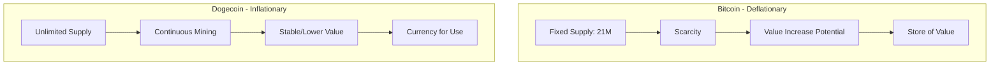
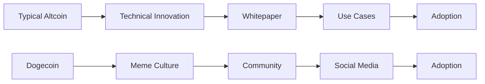

*Dogecoin (DOGE)* is considered more of a **meme** than a serious cryptocurrency—at least, that's how it started. It was created in 2013 from a *Litecoin fork* and owed its origin to a popular internet meme known as **"Doge."** Software engineers *Billy Marcus* and *Jackson Palmer* created Dogecoin in late 2013.

> **Key Insight**: Dogecoin started as a joke but evolved into a billion-dollar cryptocurrency with a passionate community, proving that meme culture can have real economic impact.

## The Doge Meme Origin

The meme features a cartoon representation of a **Shiba Inu** (the Japanese dog breed) with scattered text displayed in *Comic Sans font* and deliberately written in broken English.

### Meme Characteristics

The text (written in the dog's voice) commonly includes pseudo-phrases such as:
- "such wow"
- "very scare"
- "so amaze"
- "much crypto"
- "very currency"

```
 wow
 such cryptocurrency
 much decentralized
 very blockchain
 so finance
```

## From Joke to Phenomenon

*Dogecoin* is a cryptocurrency, like Bitcoin or Ethereum, although it's quite different from either of these coins. Dogecoin was created to **poke fun at Bitcoin** but, in early 2021, gained massive status in Reddit's *WallStreetBets* message board.

### The Transformation

**Dogecoin Journey:**

| **Period** | **Milestone** | **Significance** |
|------------|---------------|------------------|
| **2013** | Created as a joke | Parody of Bitcoin |
| **2014-2019** | Community building | Tipping culture, charitable donations |
| **2020** | TikTok campaign | Social media hype begins |
| **2021** | 5000%+ price increase | Mainstream attention, Elon Musk tweets |
| **2022+** | Established cryptocurrency | Real-world adoption growing |

**Today**, Dogecoin is not a joke anymore, having **exploded in value** and gained more than **5000% in 2021** at its peak.

## Social Media Influence

*Dogecoin* is vigorously impacted by the back-and-forth movement of social media. In particular, DOGE has received Twitter attention from big names.

### Notable Events

#### Elon Musk's Influence

For instance, *Elon Musk* playfully acknowledged an "appointment" as the **CEO of Dogecoin** due to a public survey on Twitter.



#### TikTok Campaign (July 2020)

A social media campaign on *TikTok* encouraged millions of users to buy DOGE tokens to push the price to **$1**.

**Results:**
- Missed the $1 target
- Built the price by over **600%**
- Highlighted the power of social media in crypto adoption

> **Social Media Power**: This event demonstrates how social media can drive massive crypto adoption and price movements.

## How Dogecoin Works

*Dogecoin* is a cryptocurrency that runs on *blockchain technology*, similar to Bitcoin and Ethereum.

### Technical Foundation

**Built on Litecoin:**
- Based on *Litecoin blockchain*
- Uses **Scrypt** mining algorithm
- Different from Bitcoin's **SHA-256** algorithm



### Consensus Mechanism

Like Bitcoin, Dogecoin uses **Proof-of-Work (PoW)** consensus for:
- Mining new blocks
- Validating transactions
- Securing the network

## Key Differences from Bitcoin

### Dogecoin vs Bitcoin Comparison

| **Feature** | **Dogecoin (DOGE)** | **Bitcoin (BTC)** |
|-------------|---------------------|-------------------|
| **Supply Cap** | ∞ Unlimited (Inflationary) | 21 million (Deflationary) |
| **Block Time** | ~1 minute | ~10 minutes |
| **Algorithm** | Scrypt | SHA-256 |
| **Purpose** | Payments, tips, fun | Store of value, digital gold |
| **Transaction Speed** | Faster | Slower |
| **New Coins** | 10,000 DOGE per block | 6.25 BTC per block (halving) |
| **Fees** | Very low | Variable, can be high |
| **Development** | Limited updates since 2015 | Active development |

### Inflationary vs Deflationary



**Dogecoin's Inflationary Model:**
- Makes it an **inflationary coin**
- No limit to how many DOGE coins can be mined
- Blockchain rewards miners by creating **millions of new Dogecoins every day**
- Makes it challenging for speculative price gains to hold over time

> **Economic Impact**: The unlimited supply means Dogecoin is better suited as a transactional currency rather than a store of value.

## Speed and Efficiency

When compared to Bitcoin, Dogecoin has some advantages:

**Faster Transactions:**
- It's faster and simpler for miners to complete mathematical equations
- Transactions complete and get recorded more quickly
- Makes Dogecoin more effective for **processing payments**

**Lower Fees:**
- Transaction costs are minimal
- Better for small transactions and tipping

## The Paradox of Dogecoin

### No Whitepaper, No Problem?

As far as most altcoins go, there's usually a competitive edge or unique structural advantage in areas where Bitcoin has perceived limitations. Most altcoins gain traction with particularly valuable use cases.

**Dogecoin is Different:**
- No technical whitepaper
- No specific use cases at launch
- Limited development since 2015
- Strong community
- Social media momentum
- Meme culture power



> **Unique Status**: Dogecoin managed to achieve a **billion-dollar market cap** without a whitepaper or specific use cases, establishing its paradoxical status in the cryptocurrency community.

## Dogecoin Use Cases

### Actual Applications

Despite its meme origins, Dogecoin has found real uses:

- ** Tipping**: Rewarding content creators
- ** Payments**: Some merchants accept DOGE
- ** Donations**: Charitable giving
- ** Gaming**: In-game currency
- ** Remittances**: Low-fee international transfers

### Community Projects

- Sponsored NASCAR driver
- Funded Jamaican bobsled team for Olympics
- Helped build wells in Kenya
- Supported various charities

## Investment Considerations

### Pros

- Low transaction fees
- Fast confirmation times
- Active community
- Widespread recognition
- Easy to use

### Cons

- Inflationary supply (value dilution)
- Limited development activity
- Highly speculative
- Extreme price volatility
- Driven by social media, not fundamentals

> **Investment Warning**: Dogecoin's price is heavily influenced by social media and celebrity endorsements rather than technical fundamentals. Invest responsibly.

## Conclusion

*Dogecoin* is a fascinating case study in how **internet culture**, **community**, and **social media** can transform a parody into a legitimate cryptocurrency with real economic value. What started as a joke about Bitcoin has become a widely recognized digital currency with a market capitalization in the billions.

While Dogecoin may not have the technical sophistication of Ethereum or the scarcity of Bitcoin, it has something unique: a **passionate community** and **mainstream cultural relevance**. Whether this is enough to sustain its value long-term remains to be seen, but Dogecoin has already secured its place in cryptocurrency history.

The story of Dogecoin teaches us that in the world of cryptocurrency, **community and adoption** can sometimes matter more than technical superiority. "Much wow" indeed.

> **Final Takeaway**: Dogecoin proves that technology adoption isn't always about being the best—sometimes it's about being the most fun, accessible, and community-driven. To the moon! 

## References

- [Dogecoin Official Website](https://dogecoin.com/)
- [Dogecoin GitHub](https://github.com/dogecoin/dogecoin)
- [An Introduction to Dogecoin](https://www.investopedia.com/terms/d/dogecoin.asp)
- [The Meme Cryptocurrency Explained](https://www.coindesk.com/learn/what-is-dogecoin/)
