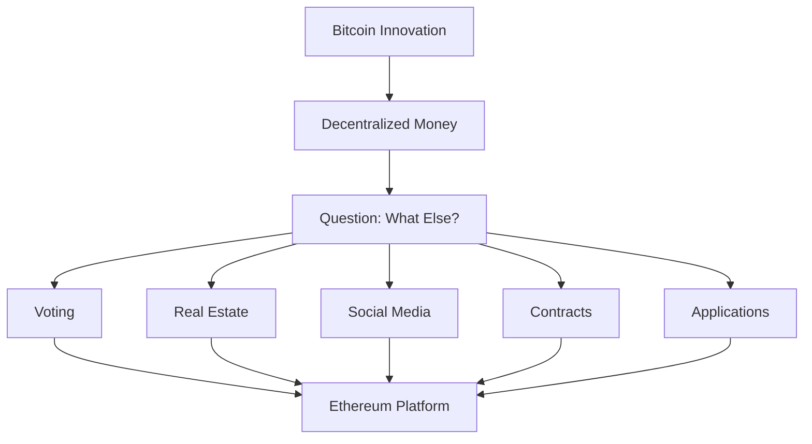
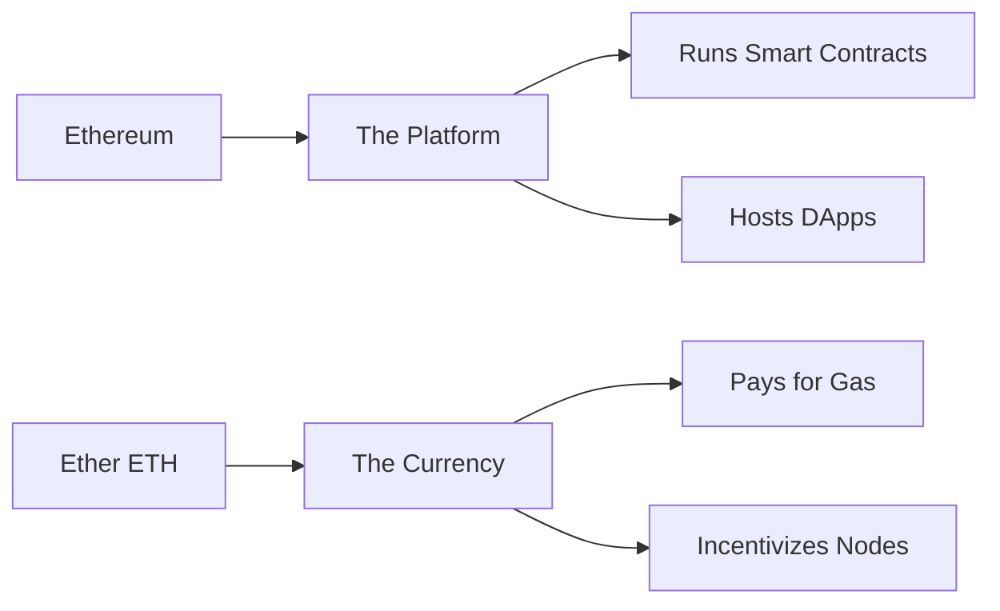
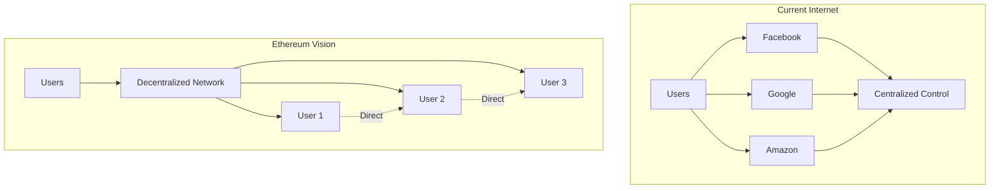
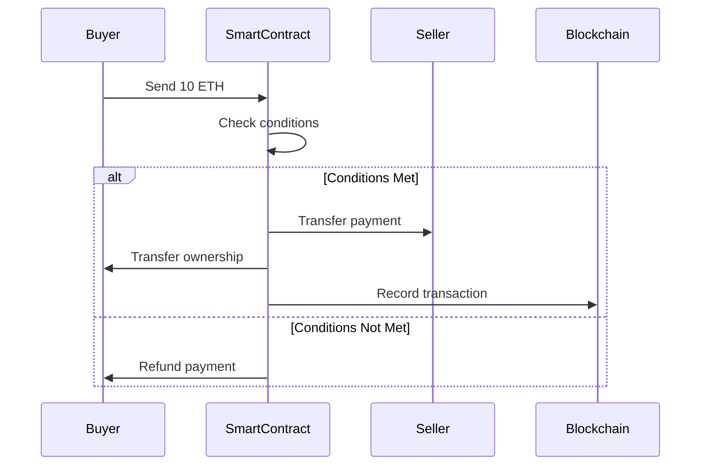
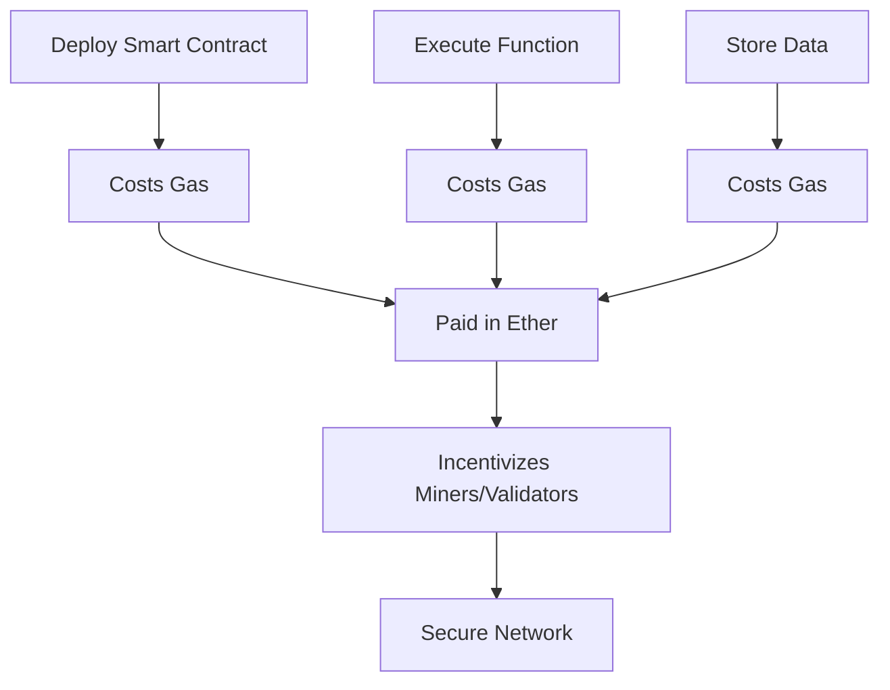
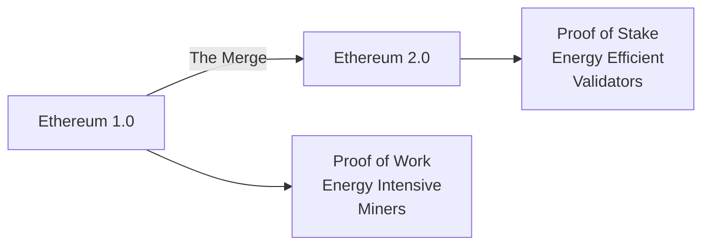

What is *Ethereum* after all? We can see it is the **second-largest cryptocurrency** by market cap, but the term seems confusing. Is it as revolutionary as Bitcoin? Can this technology really change the workings of the world? It seems to be complex technical jargon—let's make it easy.

> **Key Insight**: Ethereum isn't just a cryptocurrency—it's a programmable blockchain platform that enables decentralized applications and smart contracts.

## Before Ethereum: The Bitcoin Foundation

Before Bitcoin, the only way to use money digitally was via an intermediary—for example, through a bank or PayPal. Even then, the money was still government-issued and controlled currency.

**Bitcoin changed that** by creating a **decentralized form of currency** wherein individuals can trade directly without the need for an intermediary.

### The Next Question

Now that you know money can be decentralized, the question becomes:

**What other functions of society can be served better with a decentralized system?**

- Voting systems?
- Real estate records?
- Decentralized social media?
- Supply chains?
- Legal contracts?



## The Ethereum Network

In order for a system to be truly decentralized, it needs a **large network of computers** to run it—and so the *Ethereum network* was born.

### History

- **Proposed**: 2013 by *Vitalik Buterin*
- **Launched**: 2014
- **Purpose**: Do-It-Yourself platform for decentralized programs (*DApps*)

**Core Technology:**
- Written in *Solidity* programming language
- Thousands of independent computers (nodes) running it
- Once deployed, programs execute **exactly as written**
- No central authority can shut it down

> **Revolutionary Concept**: Ethereum is a DIY platform for decentralized programs—anyone can build applications that run on a global, decentralized computer.

## Ethereum vs Ether: The Difference

**Common Confusion:**



| **Aspect** | **Ethereum** | **Ether (ETH)** |
|------------|--------------|-----------------|
| **What is it?** | Platform/Network | Currency/Token |
| **Purpose** | Run decentralized apps | Pay for transactions |
| **Analogy** | Operating system | Fuel/Electricity |
| **Goal** | Decentralize the internet | Incentivize the network |

**When people talk about the price of "Ethereum," they're actually referring to Ether**, which is used to incentivize people to run the Ethereum protocol on their computer.

## Decentralizing the Internet

Ethereum's goal is to truly **decentralize the Internet**.

### The Current Internet

When you use the internet, there's almost **no activity** that happens without some sort of **intermediary or 3rd party**:

- Social media → Facebook, Twitter control your data
- Cloud storage → Google, Dropbox manage your files
- Payments → PayPal, Stripe process transactions
- Domain names → ICANN controls DNS

### The Ethereum Vision

*Ethereum* allows people to connect **directly with each other** without a central authority. It is a network of computers that combine together into one powerful **decentralized supercomputer**.



## Smart Contracts

Ethereum's coding language *Solidity* is used to write **"Smart Contracts"**, which is the logic that runs DApps.

### What is a Smart Contract?

In reality, a contract is a set of **'ifs' and 'thens'**—a set of conditions and actions.

**Traditional Contract Example:**
> If you pay $10 to a shopkeeper for chocolate, he lets you buy it.

**Smart Contract:**
```solidity
// Simplified smart contract example
contract ChocolateShop {
 uint price = 10; // $10 in wei
 
 function buyChocolate() public payable {
 if (msg.value >= price) {
 // Transfer chocolate ownership
 // Automatically executed
 }
 }
}
```

### Smart Contract Features

Ethereum programmers write the conditions for their DApps, and the Ethereum network executes them. These smart contracts deal with every aspect:

- **Enforcement**: Automatically executed
- **Management**: Self-managing
- **Performance**: Guaranteed execution
- **Payment**: Built-in value transfer



### The Downside: Immutability

A smart contract is **not intelligent** at all. It is uncompromisingly literal and strictly follows every rule written in it.

**Critical Limitation:**

Once a smart contract is deployed on the Ethereum network, it **cannot be edited or corrected**, even by its original author—making it **immutable**.

**Consequences:**
- **Bugs are permanent** - Code errors can't be fixed
- **Exploits are catastrophic** - The DAO hack ($60M stolen)
- **Trust through code** - Code is law
- **Requires perfection** - Must be right the first time

> **Security Warning**: With any contract, the more complex it is, the harder it is to secure. Smart contracts require perfect accuracy to ensure they only perform intended functions.

## Gas: The Fuel of Ethereum

All these complex procedures **cost money**. Money to get the machines, power them, store them securely, and cool them if needed—hence **'Ether'** (or 'Gas') was invented.

### How Gas Works



**Gas Mechanics:**
- Each operation costs a specific amount of gas
- Gas is paid in **Ether (ETH)**
- More complex operations = more gas
- Miners/validators receive gas fees

**Why Charge Gas?**

This is done so that people will write **optimized and efficient code** and won't waste the network's computing power on unnecessary tasks.

### Gas Analogy

| **Aspect** | **Car Analogy** | **Ethereum** |
|------------|-----------------|--------------|
| **Vehicle** | Car | Smart Contract |
| **Fuel** | Gasoline | Gas (paid in ETH) |
| **Distance** | Miles to travel | Computation complexity |
| **Fuel Cost** | $ per gallon | Gas price (Gwei) |
| **Trip Cost** | Distance × Price | Gas used × Gas price |

## Ethereum vs Bitcoin

| **Feature** | **Bitcoin** | **Ethereum** |
|-------------|-------------|--------------|
| **Primary Purpose** | Digital currency | Programmable platform |
| **Scripting** | Limited | Turing-complete |
| **Block Time** | ~10 minutes | ~12-15 seconds |
| **Supply Cap** | 21 million BTC | No fixed cap |
| **Consensus** | Proof of Work | Proof of Stake (post-Merge) |
| **Use Case** | Store of value, payments | Smart contracts, DApps |

## Decentralized Applications (DApps)

### What Can You Build?

**Popular DApp Categories:**

```mermaid
mindmap
root((Ethereum<br/>DApps))
DeFi
Lending
Borrowing
Trading
Yield Farming
NFTs
Digital Art
Collectibles
Gaming Items
Gaming
Play-to-Earn
Virtual Worlds
In-Game Assets
DAOs
Governance
Voting
Treasury Management
Identity
Self-Sovereign ID
Credentials
Authentication
```

## The Ethereum Ecosystem

The use of the Ethereum network has grown immensely over the years, and we are seeing new technologies being built on Ethereum that may introduce us to:

- **Decentralized Finance (DeFi)**: Banking without banks
- **NFTs**: Digital ownership and art
- **DAOs**: Decentralized organizations
- **Web3**: The decentralized internet
- **Metaverse platforms**: Virtual worlds
- **Supply chain solutions**: Transparent tracking

> **Growth Metric**: Ethereum hosts over 3,000 DApps and has processed billions in transaction volume.

## Ethereum 2.0 and Beyond

### The Merge (2022)

Ethereum transitioned from *Proof of Work* to *Proof of Stake*:

**Benefits:**
- **99.95% less energy** consumption
- **More secure** through economic incentives
- **Faster** transaction finality
- **Lower barriers** to participation



## Real-World Impact

**Use Cases Today:**
- Uniswap: Decentralized exchange ($1B+ daily volume)
- Aave: Decentralized lending protocol
- OpenSea: NFT marketplace
- ENS: Decentralized domain names
- MakerDAO: Decentralized stablecoin (DAI)

## Challenges and Limitations

### Current Issues

- **Scalability**: Limited transactions per second
- **High gas fees**: Can be expensive during congestion
- **Complexity**: Difficult for non-technical users
- **Smart contract risks**: Code bugs can be exploited
- **Regulatory uncertainty**: Legal status evolving

### Solutions in Development

- **Layer 2 solutions**: Polygon, Arbitrum, Optimism
- **Sharding**: Parallel processing
- **Better tools**: Improved development frameworks
- **User experience**: Wallet improvements

## Conclusion

*Ethereum* is far more than just a cryptocurrency—it's a **programmable blockchain platform** that enables a new generation of decentralized applications. By providing a global, decentralized computer powered by smart contracts, Ethereum is working toward a vision of a truly decentralized internet where users have complete autonomy.

From its inception in 2014 to today's thriving ecosystem of DeFi, NFTs, and Web3 applications, Ethereum has proven that **blockchain technology extends far beyond digital currency**. While challenges remain—scalability, fees, complexity—the Ethereum community continues to innovate and evolve.

We may indeed be witnessing the birth of a **new type of internet** where every user has complete autonomy over their data, identity, and digital interactions.

> **Final Takeaway**: Ethereum represents the next evolution of the internet—from read-only (Web1) to read-write (Web2) to read-write-own (Web3). The question isn't whether decentralization will happen, but how quickly it will transform our digital lives.

## References

- [Ethereum Official Website](https://ethereum.org/en/what-is-ethereum/)
- [Ethereum Whitepaper](https://ethereum.org/en/whitepaper/)
- [Vitalik Buterin's Blog](https://vitalik.ca/)
- [Solidity Documentation](https://docs.soliditylang.org/)
- [EthHub](https://docs.ethhub.io/)
