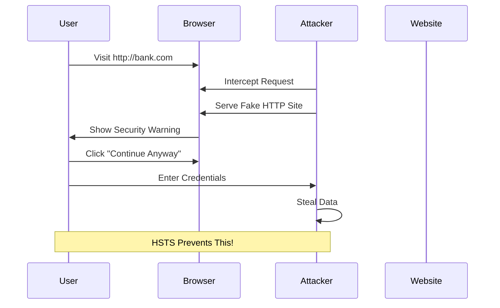
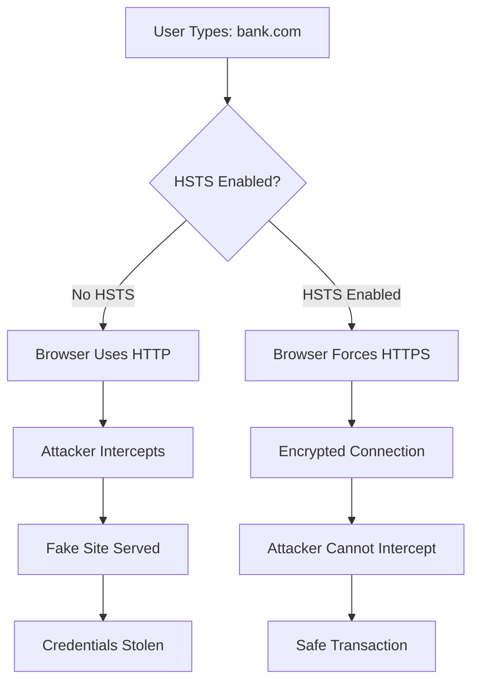
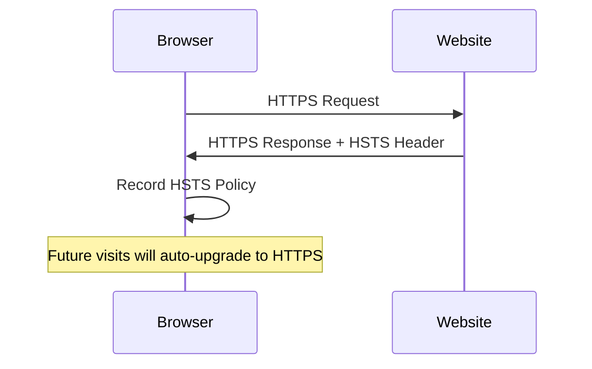
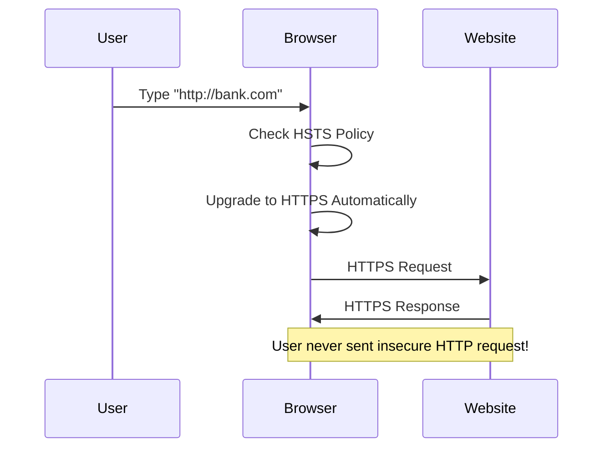
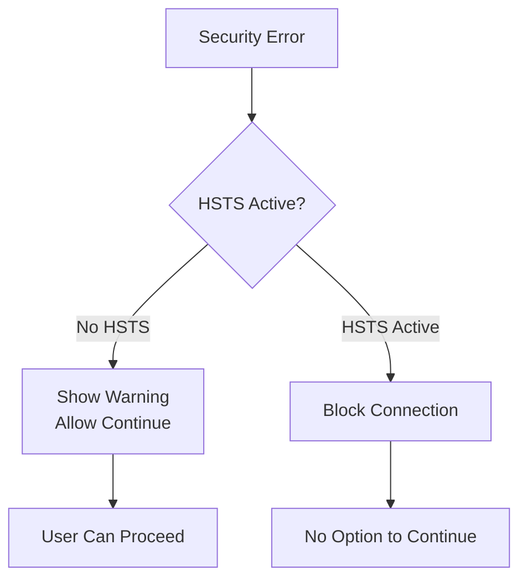
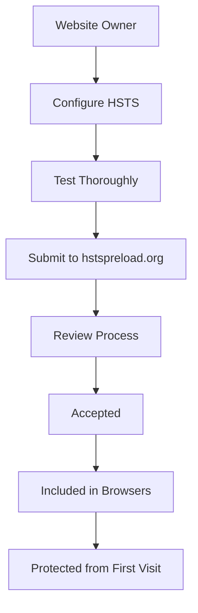

*HTTP Strict Transport Security (HSTS)* is a security mechanism that helps shield websites against attacks such as *cookie hijacking* and *downgrade attacks*. It enables browsers and complying user agents to interact automatically with web resources using **HTTPS over TLS/SSL**, ensuring secure communications.

> **Key Insight**: HSTS forces browsers to always use HTTPS, preventing man-in-the-middle attacks that try to downgrade connections to insecure HTTP.

## The Problem HSTS Solves

User-Agents are needed to send secure cookies to a host only over a secure transport layer. In a secure interaction, if any issues arise with the secure connection establishment, the user-agent will flag these issues. However, user-agents often **prompt users to continue** interacting with web resources despite warnings.

### Click-Through Insecurity

This introduces a vulnerability known as **"click-through insecurity"** that leads to:
- Leaking of session cookies
- Exposure of authentication tokens
- Man-in-the-middle attacks
- Data interception



## How HSTS Works

To prevent this vulnerability, *HSTS* was introduced. Instead of using a cookie to convey the policy, it defines an **HTTP response header field**.

### HSTS Header

```http
Strict-Transport-Security: max-age=63072000; includeSubDomains
```

**Header Components:**

| **Directive** | **Purpose** | **Example Value** |
|---------------|-------------|-------------------|
| **max-age** | Time in seconds to remember policy | `31536000` (1 year) |
| **includeSubDomains** | Apply policy to all subdomains | Optional flag |
| **preload** | Include in browser preload list | Optional flag |

### Time Limit Example

```http
Strict-Transport-Security: max-age=63072000; includeSubDomains

# Time limit: 63072000 seconds = 2 years
```

## HSTS in Action: Real-World Example

### Scenario: Coffee Shop Attack

**You step into your favorite cafe** to grab a cup of coffee and get a text from your landlord: *"Hey, your rent for this month is due."* You immediately open your laptop and connect to the free WiFi offered by the cafe to pay the rent.

**The Threat:**

Unfortunately, a hacker is accessing the same free WiFi access point:
- Trying to intercept user HTTP traffic
- Redirecting users to a fake clone banking site
- Capturing private, confidential data

**HSTS Protection:**



**How HSTS Protects You:**

As long as you have accessed your bank's website using HTTPS and the bank's website uses *Strict Transport Security*, the browser will **automatically use only HTTPS**, preventing the hacker from performing the attack.

## HSTS Operation

### First Visit



When a site is accessed using HTTPS, it returns the `Strict-Transport-Security` header. The browser:
1. **Records this information**
2. **Remembers for the specified time period**
3. **Automatically uses HTTPS** for future attempts

### Subsequent Visits



**Important**: When the expiration time elapses, the next time the site loads, HTTP will proceed as usual instead of automatically using HTTPS.

## Core Requirements for HSTS

For HSTS to work efficiently:

### 1. Website Declarations

 Websites should declare to User Agents that they should be accessed using a strict security policy

### 2. Secure Instructions

 Websites must be able to instruct User-Agents that interact with them securely

### 3. Persistent Data

 User-Agents must retain persistent data about websites that signal strict security policy enablement for periods declared by the websites

 User-Agents must cache the "freshest" strict security policy information to allow websites to update the information

### 4. URI Rewriting

 User-Agents must rewrite all insecure "HTTP" URI loads to use the "HTTPS" secure scheme for websites with enabled security policy

### 5. Subdomain Policy

 Website admins should signal strict security policy application to subdomains of higher-level domains

**Example Subdomain Coverage:**

```
healthybyte.net (HSTS enabled)
├── security.healthybyte.net (covered by parent)
└── help.security.healthybyte.net (covered by includeSubDomains)
```

### 6. Policy Restrictions

 User-Agents should disallow security policy applications to peer and higher-level domains

### 7. No Click-Through

 User-Agents should **prevent users from "clicking through" security warnings**



## Implementation Best Practices

### Basic HSTS Header

```http
# Basic implementation
Strict-Transport-Security: max-age=31536000
```

### With Subdomains

```http
# Include all subdomains
Strict-Transport-Security: max-age=31536000; includeSubDomains
```

### With Preloading

```http
# Include in browser preload list
Strict-Transport-Security: max-age=63072000; includeSubDomains; preload
```

### Recommended Settings

| **Setting** | **Value** | **Reason** |
|-------------|-----------|-----------|
| **max-age** | `31536000` (1 year) minimum | Balance security vs. flexibility |
| **includeSubDomains** | Recommended | Protect entire domain tree |
| **preload** | For production sites | Maximum security |

> **Pro Tip**: Start with a short max-age during testing (e.g., 300 seconds), then increase to 1-2 years for production.

## HSTS Preload List

For maximum security, websites can be added to the **HSTS Preload List**, which is hardcoded into browsers.

**Benefits:**
- Protection on **first visit** (even before HSTS header seen)
- Built into Chrome, Firefox, Safari, Edge
- Maximum security guarantee

**How to Preload:**
1. Serve HSTS header with `preload` directive
2. Ensure all subdomains support HTTPS
3. Submit domain at [hstspreload.org](https://hstspreload.org/)



## Attacks HSTS Prevents

### 1. SSL Stripping Attack

**Without HSTS:**
```
User → http://bank.com → Attacker intercepts → serves HTTP version → steals data
```

**With HSTS:**
```
User → http://bank.com → Browser auto-upgrades → https://bank.com → safe
```

### 2. Man-in-the-Middle (MitM)

**Prevented Scenarios:**
- WiFi network attacks
- DNS spoofing combined with SSL stripping
- Proxy-based downgrade attacks

### 3. Cookie Hijacking

HSTS ensures cookies are only sent over secure connections, preventing interception.

## Implementation Checklist

### For Website Owners

- [ ] Ensure entire site works over HTTPS
- [ ] Obtain valid SSL/TLS certificate
- [ ] Redirect all HTTP to HTTPS
- [ ] Add HSTS header to all HTTPS responses
- [ ] Start with short max-age for testing
- [ ] Verify includeSubDomains doesn't break anything
- [ ] Gradually increase max-age to 1-2 years
- [ ] Consider HSTS preload submission
- [ ] Monitor for certificate expiration
- [ ] Test thoroughly before production

### For Users

- [ ] Use modern browsers (support HSTS)
- [ ] Keep browsers updated
- [ ] Don't click through security warnings
- [ ] Verify HTTPS padlock before entering credentials
- [ ] Use HTTPS Everywhere browser extension

## Testing HSTS

### Check if HSTS is Enabled

```bash
# Using curl
curl -I https://example.com

# Look for header:
Strict-Transport-Security: max-age=31536000; includeSubDomains
```

### Online Tools

- [securityheaders.com](https://securityheaders.com/)
- [hstspreload.org](https://hstspreload.org/)
- [SSL Labs](https://www.ssllabs.com/ssltest/)

## Conclusion

*HTTP Strict Transport Security (HSTS)* is a simple yet powerful security mechanism that forces browsers to use HTTPS connections, protecting users from downgrade attacks and man-in-the-middle attacks. By automatically upgrading insecure connections and preventing click-through on security warnings, HSTS provides a critical layer of defense for web security.

For website owners, implementing HSTS is straightforward—add a single HTTP header. For users, HSTS works silently in the background, automatically protecting them from common attacks on public WiFi and compromised networks.

> **Final Takeaway**: HSTS is a must-have security header for any website handling sensitive information. Combined with proper HTTPS implementation, it provides robust protection against common web attacks.

## References

- [RFC 6797: HTTP Strict Transport Security](https://tools.ietf.org/html/rfc6797)
- [OWASP: HTTP Strict Transport Security Cheat Sheet](https://cheatsheetseries.owasp.org/cheatsheets/HTTP_Strict_Transport_Security_Cheat_Sheet.html)
- [HSTS Preload](https://hstspreload.org/)
- [MDN: Strict-Transport-Security](https://developer.mozilla.org/en-US/docs/Web/HTTP/Headers/Strict-Transport-Security)
