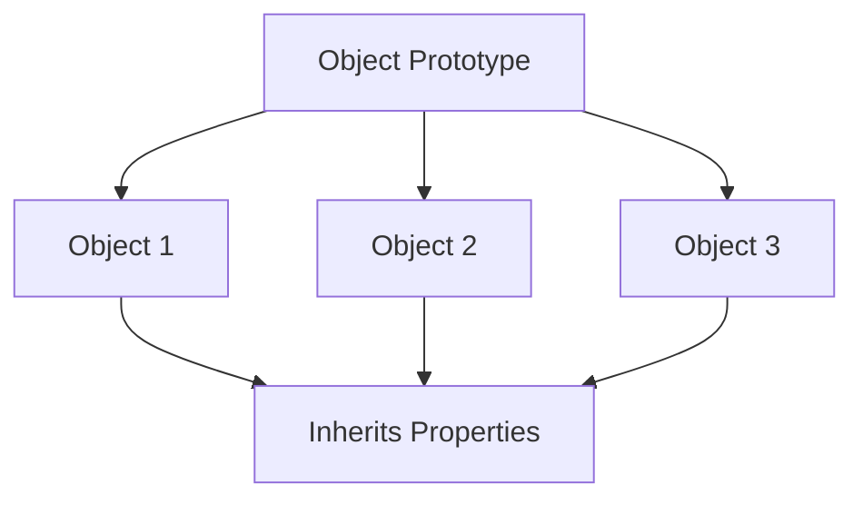
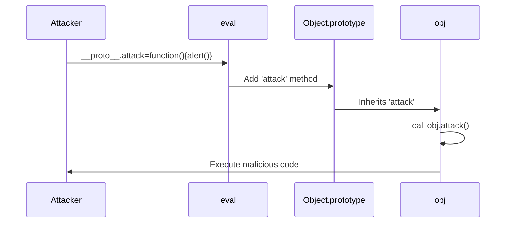
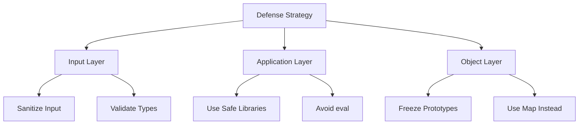

*Prototype pollution* is a vulnerability that can occur in JavaScript programs when an attacker can modify an object's prototype in such a way that it causes unintended behavior. This can potentially lead to security issues such as *code injection*, *cross-site scripting (XSS)*, and *denial of service (DoS)* attacks.

> **Key Insight**: Prototype pollution exploits JavaScript's prototype inheritance mechanism to inject properties that affect all objects, potentially compromising entire applications.

## Understanding JavaScript Prototypes

The **prototype** of an object in JavaScript is a property that refers to another object. When a new object is created, it automatically inherits the properties and methods of its prototype.

### Prototype Inheritance



**This helpful feature** allows developers to create new objects based on existing ones without defining all the properties and methods from scratch.

```javascript
// Example of prototype inheritance
const person = {
 greet: function() {
 console.log("Hello!");
 }
};

const john = Object.create(person);
john.greet(); // Outputs: "Hello!"
// john inherits greet() from person prototype
```

## The Vulnerability

However, if an attacker can modify an object's prototype, they can **inject malicious code** into the program. For example, they might add a new method to the object's prototype that executes arbitrary code.

### Vulnerable Code Example

```javascript
let userInput = '__proto__.attack=function(){alert("Code injected!")};'

let obj = {}
eval(userInput)

obj.attack() // Code injected!
```

**What Happens:**



In this example, the `eval` function executes the string stored in `userInput`. This string contains a statement that modifies the prototype of the `obj` object by adding a new method called `attack`. When this method is called, it displays an alert message (or executes malicious code).

> **Security Risk**: This is prototype pollution because the attacker modified the prototype through user input, potentially leading to code injection or XSS attacks.

## How Prototype Pollution Works

### Attacking __proto__

JavaScript objects have a special property called `__proto__` that provides access to the prototype:

```javascript
// Normal object
const user = {name: "John"};

// Prototype pollution
user.__proto__.isAdmin = true;

// Now ALL objects have isAdmin property!
const attacker = {};
console.log(attacker.isAdmin); // true (inherited from polluted prototype)
```

### Attack Vectors

#### 1. JSON Parsing

```javascript
// Vulnerable code
function merge(target, source) {
 for (let key in source) {
 target[key] = source[key];
 }
}

// Attack
const malicious = JSON.parse('{"__proto__": {"isAdmin": true}}');
merge(obj, malicious);

// Now all objects have isAdmin = true!
```

#### 2. Object Property Assignment

```javascript
// Vulnerable recursive merge
function deepMerge(target, source) {
 for (let key in source) {
 if (typeof source[key] === 'object') {
 deepMerge(target[key], source[key]);
 } else {
 target[key] = source[key]; // Dangerous!
 }
 }
}
```

#### 3. Query Parameters

```http
GET /api/user?__proto__[isAdmin]=true
```

If not properly sanitized, this can pollute the prototype.

## Impact of Prototype Pollution

### 1. Property Injection

```javascript
// Pollute prototype
Object.prototype.isAdmin = true;

// Later in application
if (user.isAdmin) {
 // Grant admin access to ALL users!
}
```

### 2. Denial of Service

```javascript
// Cause application crash
Object.prototype.toString = null;

// Later
someObject.toString(); // TypeError!
```

### 3. Remote Code Execution

```javascript
// Pollute prototype with malicious function
Object.prototype.exec = function(cmd) {
 eval(cmd); // Execute arbitrary code
};
```

### 4. Cross-Site Scripting (XSS)

```javascript
// Inject XSS payload
Object.prototype.innerHTML = '<script>alert("XSS")</script>';
```

## Real-World Attack Example

### Lodash Vulnerability (CVE-2018-3721)

The popular `lodash` library had a prototype pollution vulnerability:

```javascript
const _ = require('lodash');

// Malicious payload
const payload = {
 "constructor": {
 "prototype": {
 "polluted": "Yes"
 }
 }
};

_.defaultsDeep({}, payload);

// Now all objects have 'polluted' property
console.log({}.polluted); // "Yes"
```

## Prevention Techniques

### 1. Input Sanitization

**Sanitize user input** to ensure it does not contain malicious code:

```javascript
// Using sanitization functions
const sanitized = encodeURI(userInput);
const escaped = escape(userInput);

// Remove dangerous properties
function sanitize(obj) {
 const dangerous = ['__proto__', 'constructor', 'prototype'];
 
 for (let key in obj) {
 if (dangerous.includes(key)) {
 delete obj[key];
 }
 }
 return obj;
}
```

### 2. Input Validation

**Validate user input** to ensure it conforms to expected format:

```javascript
function validateInput(input) {
 // Check type
 if (typeof input !== 'string') {
 throw new Error('Invalid input type');
 }
 
 // Check for dangerous properties
 if (input.includes('__proto__') || 
 input.includes('constructor') || 
 input.includes('prototype')) {
 throw new Error('Dangerous input detected');
 }
 
 return input;
}
```

### 3. Use Safe Libraries

**Lodash (Fixed Versions):**

```javascript
const _ = require('lodash');

// Use safe merge function
_.merge({}, userInput, {
 // Callback to filter dangerous properties
 customizer: (objValue, srcValue, key) => {
 if (['__proto__', 'constructor', 'prototype'].includes(key)) {
 return objValue; // Reject pollution attempt
 }
 }
});
```

### 4. Object.freeze()

**Freeze critical prototypes:**

```javascript
// Freeze Object prototype to prevent pollution
Object.freeze(Object.prototype);
Object.freeze(Array.prototype);

// Now pollution attempts will fail silently (or throw in strict mode)
Object.prototype.isAdmin = true; // No effect
```

### 5. Object.create(null)

**Create objects without prototypes:**

```javascript
// Object without prototype chain
const safeObj = Object.create(null);

// No __proto__ property
console.log(safeObj.__proto__); // undefined

// Safe from prototype pollution
safeObj.__proto__ = {admin: true}; // Creates regular property, doesn't pollute
```

### 6. Use Map Instead of Objects

```javascript
// Use Map for dynamic key-value pairs
const safeMap = new Map();

// No prototype pollution risk
safeMap.set('__proto__', 'value'); // Just a regular entry
```

## Secure Code Patterns

### Safe Object Merging

```javascript
function safeMerge(target, source) {
 // List of dangerous properties
 const blacklist = ['__proto__', 'constructor', 'prototype'];
 
 for (let key in source) {
 // Skip dangerous properties
 if (blacklist.includes(key)) {
 continue;
 }
 
 // Skip inherited properties
 if (!source.hasOwnProperty(key)) {
 continue;
 }
 
 // Type validation
 if (typeof source[key] === 'object' && source[key] !== null) {
 target[key] = safeMerge(target[key] || {}, source[key]);
 } else {
 target[key] = source[key];
 }
 }
 
 return target;
}
```

### Property Assignment Validation

```javascript
function setProperty(obj, key, value) {
 // Validate key
 if (['__proto__', 'constructor', 'prototype'].includes(key)) {
 throw new Error('Forbidden property name');
 }
 
 // Validate key is own property
 if (!obj.hasOwnProperty(key)) {
 // Additional validation for new properties
 }
 
 obj[key] = value;
}
```

## Detection and Testing

### Testing for Prototype Pollution

```javascript
// Test if your application is vulnerable
function testPrototypePollution() {
 const testObj = {};
 
 // Attempt pollution
 yourVulnerableFunction({
 "__proto__": {"polluted": true}
 });
 
 // Check if pollution occurred
 if (testObj.polluted === true) {
 console.error("VULNERABLE to prototype pollution!");
 } else {
 console.log("Protected against prototype pollution");
 }
}
```

### Security Tools

| **Tool** | **Purpose** | **Type** |
|----------|-------------|----------|
| **eslint-plugin-security** | Static analysis | Linter |
| **npm audit** | Dependency scanning | CLI tool |
| **Snyk** | Vulnerability scanning | SaaS |
| **RetireJS** | Library vulnerability check | Browser extension |

## Defense in Depth Strategy



## Conclusion

Overall, *prototype pollution* is a serious issue that can have severe consequences for the security of a JavaScript program. By taking steps to **sanitize and validate user input** and using libraries or frameworks that provide built-in protection, developers and security engineers can help prevent this type of vulnerability.

**Key Prevention Strategies:**
- Always sanitize user input
- Validate property names before assignment
- Use safe object merging libraries
- Freeze critical prototypes when possible
- Prefer `Map` over plain objects for dynamic keys
- Keep dependencies updated
- Regular security audits

> **Final Takeaway**: Prototype pollution is preventable through careful input validation, safe coding practices, and using modern JavaScript patterns. Treat all user input as potentially malicious and implement multiple layers of defense.

## References

- [OWASP: Prototype Pollution](https://cheatsheetseries.owasp.org/cheatsheets/Prototype_Pollution_Prevention_Cheat_Sheet.html)
- [Snyk: Prototype Pollution Explained](https://learn.snyk.io/lessons/prototype-pollution/javascript/)
- [PortSwigger: Prototype Pollution](https://portswigger.net/web-security/prototype-pollution)
- [HackerOne: Prototype Pollution Reports](https://hackerone.com/reports/)
