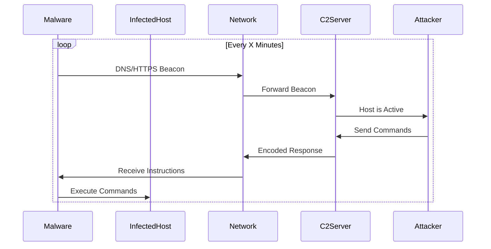
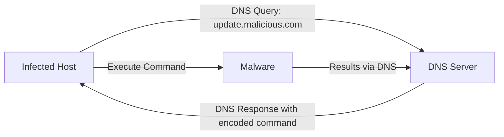
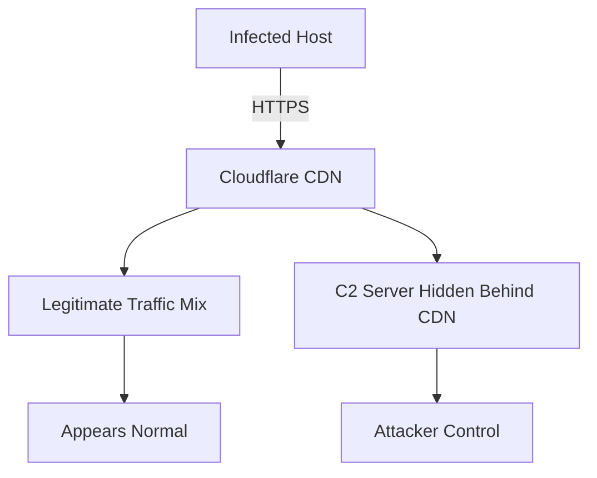
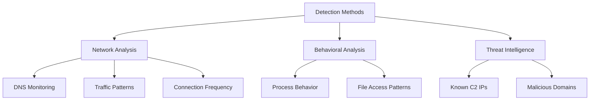
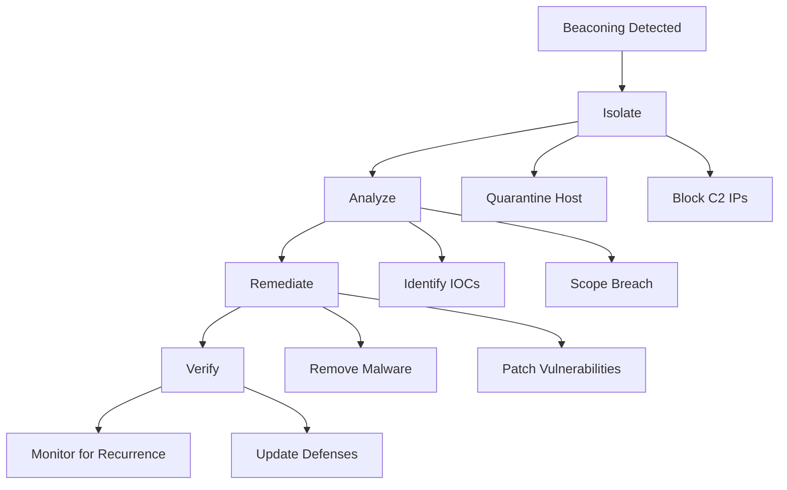

*Beaconing* is a term used within the realm of malware for sending brief and periodic messages from an infected host to a host controlled by an attacker. This communication confirms that the infected host malware is **active and operational**, awaiting further instructions.

> **Key Insight**: Malware beaconing is how compromised systems "phone home" to attackers, enabling persistent access and data exfiltration.

## Understanding Beaconing

*Beaconing* enables malware to communicate with the *Command & Control (C2) server* for instructions and to exfiltrate data periodically while remaining anonymous.

### How Beaconing Works



**The Process:**

1. **Malware installed** on victim's system
2. **Periodic beacons** sent to C2 server (every few minutes/hours)
3. **C2 server responds** with commands or instructions
4. **Malware executes** commands on infected machine
5. **Results sent back** to C2 server

## Command & Control (C2) Servers

A *C2 server* hosts instructions for malware which can be executed on an infected machine after it "checks in."

### C2 Capabilities

**What C2 Servers Can Do:**

| **Capability** | **Description** | **Impact** |
|----------------|-----------------|------------|
| **Command Execution** | Run arbitrary commands | Full system control |
| **Data Exfiltration** | Steal sensitive information | Data breaches |
| **Deploy Additional Malware** | Install ransomware, spyware | Escalated compromise |
| **Lateral Movement** | Spread to other systems | Network-wide infection |
| **DDoS Orchestration** | Coordinate attacks | Service disruption |

C2 servers can orchestrate various malicious attacks such as:
- Ransomware deployment
- Distributed Denial of Service (DDoS) attacks
- Data exfiltration
- Credential harvesting
- Surveillance

## Beaconing Techniques

### 1. DNS Beaconing

A compromised host makes frequent **DNS requests** to a domain belonging to an attacker-controlled DNS server, allowing the attacker to:
- Respond to the request
- Obscure commands within DNS responses
- Evade traditional HTTP monitoring



**Example DNS Beacon:**
```
Query: a3f8b2c1d4e5.updates.malicious-c2.com
 └─────┘
 Encoded data
```

### 2. HTTPS Beaconing

Disguising C2 communications within **HTTPS** makes it more challenging to detect because:
- Many security tools cannot decrypt HTTPS traffic
- Appears as legitimate web browsing
- Blends with normal encrypted traffic

### 3. Cloud Service Hijacking

Communications can be **completely camouflaged** as genuine traffic if a trusted cloud service is hijacked for the C2 server:

- Using compromised AWS S3 buckets
- Google Cloud Storage
- Azure Blob Storage
- Legitimate CDNs



## Famous Example: SunBurst Attack

A famous example of malware beaconing is the **Sunburst Attack** (SolarWinds breach).

### SunBurst Beaconing Tactics

**Sunburst** used an intermediary C2 to instruct the backdoor to:
- Continue beaconing
- Suspend beaconing (go dormant)
- Execute specific commands

**Stealth Techniques:**

The backdoor was initiated in a **passive mode** where it did nothing other than:
1. Check blocklists (avoid security researcher IPs)
2. Sleep for random periods
3. Beacon via DNS queries

**SunBurst Beaconing Timeline:**

| **Phase** | **Duration** | **Activity** |
|-----------|--------------|--------------|
| Day 1-14 | Dormant Period | No activity (evade detection) |
| Day 15 | Initial DNS Beacon | Check if blocked |
| Day 16-30 | Periodic Beaconing | Low-frequency communication |
| Day 31+ | Command Execution | Active exploitation |

> **Advanced Evasion**: SunBurst waited up to 2 weeks before initiating any beaconing to evade detection.

## Detection Challenges

### Why Beaconing is Hard to Detect

**Evasion Techniques:**
- **Encrypted traffic**: HTTPS hides communications
- **Legitimate services**: Uses trusted cloud providers
- **Random intervals**: Irregular timing patterns
- **Low volume**: Small, infrequent beacons
- **Domain generation**: DGA creates new C2 domains
- **Blends with normal traffic**: Appears as regular web browsing

## Prevention Strategies

These are steps to **prevent malware** from infecting your system:

### Basic Security Hygiene

- **Keep your computer and software updated**
- **Use a non-administrative account** whenever possible
- **Do not click on suspicious links** or ads
- **Be careful about opening email attachments** or images
- **Don't trust pop-up windows** that ask you to download software
- **Limit your file-sharing**

> **Foundation First**: Basic security practices prevent most infections from occurring in the first place.

## Detection Methods

Even after following best practices, malware can still breach your systems, making it crucial to have **multiple lines of defense**.

### Beaconing Detection Techniques



### Network Indicators

| **Indicator** | **What to Look For** | **Tools** |
|---------------|---------------------|-----------|
| **Regular intervals** | Connections every X minutes | Wireshark, Zeek |
| **Unusual domains** | Random-looking domain names | DNS logs, Pi-hole |
| **High entropy** | Encrypted/encoded traffic | Network analysis |
| **Known bad IPs** | Threat intelligence matches | SIEM, IDS/IPS |
| **Persistent connections** | Long-duration connections | NetFlow analysis |

### Tools for Detection

- **Wireshark**: Packet analysis
- **Zeek (Bro)**: Network security monitoring
- **RITA**: Real Intelligence Threat Analytics
- **Splunk**: SIEM with beaconing detection
- **Elastic Security**: Threat hunting
- **Frequency analysis**: Detect periodic patterns

## Remediation Steps

If beaconing is detected, here are steps you can take to **remediate C2 activities**:

### Immediate Actions



### 1. Disable External Services

**Any external services or applications should be:**
- Disabled immediately
- Completely terminated
- Network access blocked

### 2. Isolate/Quarantine

**Isolate infected devices** to:
- Check for Indicators of Compromise (IOCs)
- Prevent lateral movement
- Contain the breach

```bash
# Example: Block host at firewall
iptables -A OUTPUT -s infected_host_ip -j DROP

# Disconnect from network
ifconfig eth0 down
```

### 3. Block Suspicious Traffic

**Block any suspicious** inbound or outbound traffic:
- Add C2 domains/IPs to blocklist
- Update firewall rules
- Implement DNS sinkholing

### 4. Apply Least Privilege

**Follow the principle of least privilege** to minimize damage to compromised machines:
- Limit user permissions
- Restrict network access
- Segment critical systems

## Beaconing Analysis

### Frequency Analysis

```python
# Pseudo-code for detecting beaconing
def detect_beaconing(connection_logs):
 for destination in unique_destinations:
 connections = filter_by_destination(connection_logs, destination)
 timestamps = extract_timestamps(connections)
 intervals = calculate_intervals(timestamps)
 
 # Check for regular intervals
 if is_periodic(intervals):
 alert(f"Potential beaconing to {destination}")
```

### Beacon Characteristics

**Look for:**
- **Regular intervals**: Connections every 5, 10, 60 minutes
- **Consistent size**: Similar packet sizes
- **Same destination**: Always contacts same domain/IP
- **Persistent**: Continues over days/weeks
- **Pattern**: Mathematical regularity in timing

## Conclusion

*Malware beaconing* is a critical indicator of compromise that security teams must monitor for continuously. By maintaining communication with C2 servers, malware can:
- Receive updated instructions
- Exfiltrate stolen data
- Download additional payloads
- Maintain persistent access

Detection requires a combination of **network monitoring**, **behavioral analysis**, and **threat intelligence**. Prevention starts with basic security hygiene but must be backed by robust detection and response capabilities.

> **Final Takeaway**: Beaconing is the heartbeat of malware. Detect it early through network analysis, and you can stop attacks before significant damage occurs. Invest in network monitoring and behavioral analytics—they're your early warning system.

## References

- [MITRE ATT&CK: Command and Control](https://attack.mitre.org/tactics/TA0011/)
- [CISA: Understanding C2](https://www.cisa.gov/uscert/)
- [RITA: Real Intelligence Threat Analytics](https://github.com/activecm/rita)
- [SANS: Detecting DNS Tunneling](https://www.sans.org/blog/)
- [SunBurst Technical Analysis](https://www.fireeye.com/blog/threat-research/2020/12/sunburst-additional-technical-details.html)
