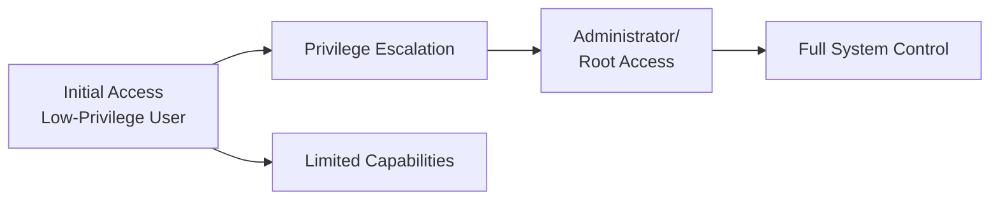
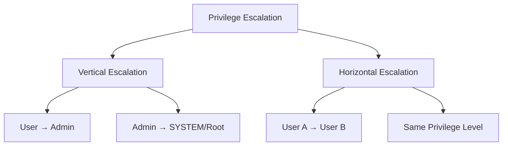
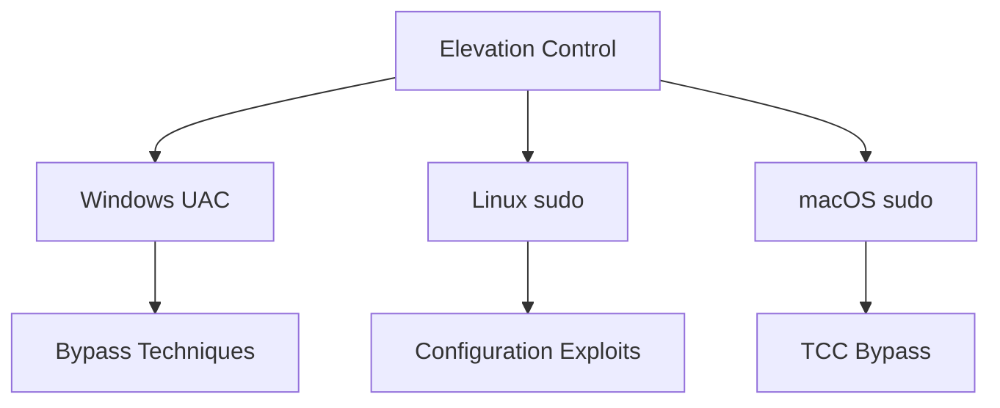
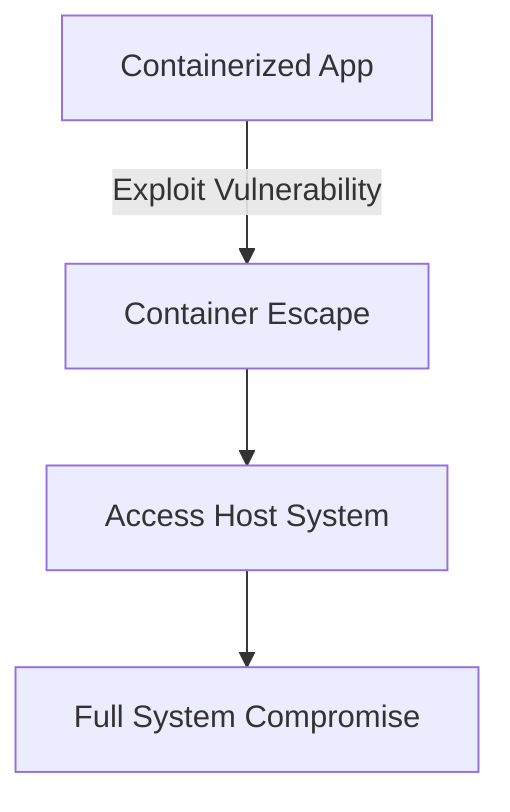
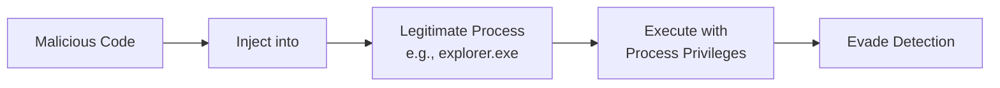
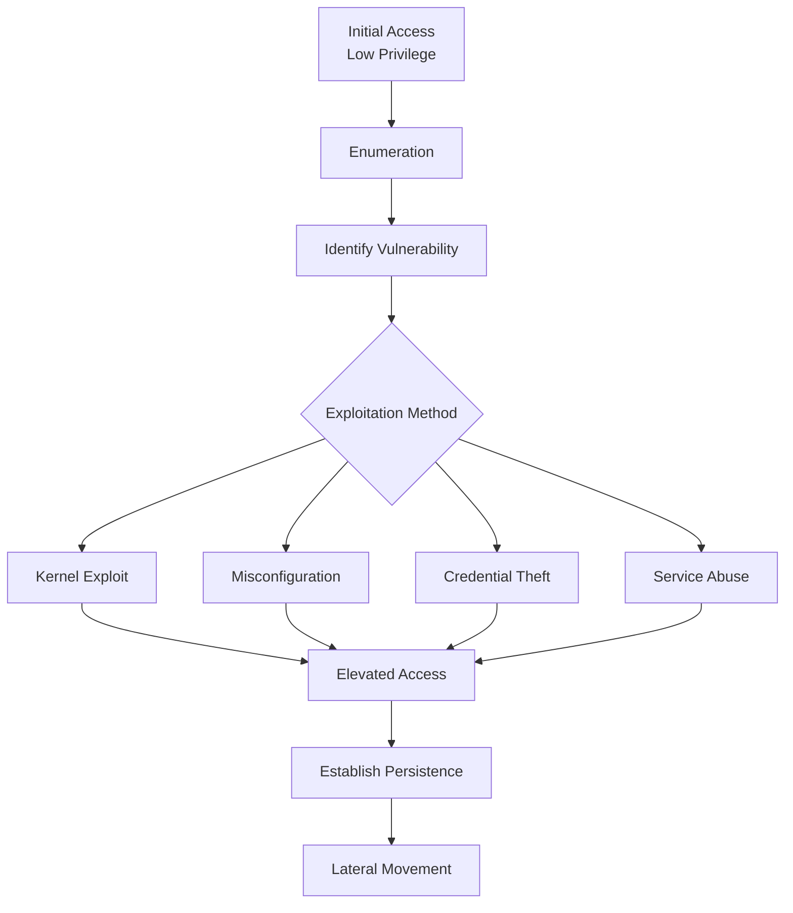
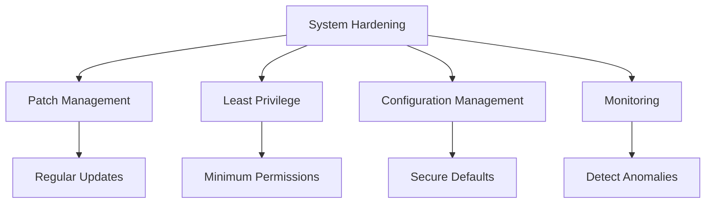
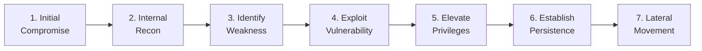

What is the big deal about *privilege escalation*? Why is it a crucial step in the hacking process? Once attaining an initial foothold (access) to an environment, one of the key steps followed by most hackers is to **elevate their current privileges** and either become an administrator or a superuser. This expands the attack vectors the attacker can deploy and also helps in creating **persistence** in the environment.

> **Key Insight**: Privilege escalation is the critical step that transforms limited user access into full system control—it's what separates casual intrusion from complete compromise.

## What is Privilege Escalation?

The process and steps taken to gain higher privileges and become a superuser are known as **'Privilege Escalation'**.



**Why Attackers Need It:**
- Expand attack capabilities
- Access sensitive data
- Install rootkits
- Create persistence mechanisms
- Move laterally across network
- Deploy ransomware or wipers

## Types of Privilege Escalation



| **Type** | **Description** | **Example** |
|----------|-----------------|-------------|
| **Vertical** | Gain higher privileges | User → Administrator |
| **Horizontal** | Access another user's account at same level | User A → User B |

## Common Privilege Escalation Techniques

Typically, the technique used for privilege escalation depends on the **operating system** and **architecture**. Here are the most common techniques:

### 1. Abuse of Elevation Control Mechanism

Adversaries may exploit the operating system mechanism used to control and assign privileges. Most modern operating systems use a built-in control mechanism that manages permissions and defines user actions.

**Windows Examples:**
- UAC bypass
- Token manipulation
- Impersonation attacks

**Linux Examples:**
- sudo misconfigurations
- SUID bit exploitation
- Capability abuse



### 2. Access Token Tampering

Each running process in Windows has an **access token** associated with it. The access tokens determine the ownership of the process. Attackers can impersonate or modify these access tokens to perform tasks as a different user.

```powershell
# Example: Token manipulation
# Attacker finds privileged token
# Duplicates and impersonates it
# Gains elevated privileges
```

### 3. Boot/Autostart Execution

Attackers can modify/re-configure system settings to execute programs and processes on boot or logon.

**Common Locations:**

| **Operating System** | **Autostart Location** |
|---------------------|----------------------|
| **Windows** | `HKEY_CURRENT_USER\Software\Microsoft\Windows\CurrentVersion\Run` |
| **Linux** | `/etc/rc.local`, `.bashrc`, cron jobs |
| **macOS** | `~/Library/LaunchAgents`, `/Library/LaunchDaemons` |

### 4. Create/Modify System Processes

Attackers can modify or create **system-level processes** (services):

**Benefits for Attackers:**
- Elevated privileges
- Persistence across reboots
- Stealth (appears as legitimate service)
- Automatic execution

```bash
# Linux: Create malicious systemd service
[Unit]
Description=Legitimate Sounding Service

[Service]
ExecStart=/path/to/malicious/script

[Install]
WantedBy=multi-user.target
```

### 5. Domain Policy Modification

In a domain environment, adversaries can modify configuration settings to:
- Evade defenses
- Perform privilege escalation
- Manage how computer resources interact
- Control network behavior

**Active Directory Attacks:**
- GPO modification
- ACL manipulation
- Kerberos attacks (Golden/Silver tickets)

### 6. Escape to Host

Each operating system has a container (sandbox) for each user. Attackers may **break out of this container** and gain access to the host system.

**Examples:**
- Container escape (Docker, Kubernetes)
- VM escape (hypervisor exploits)
- Sandbox escape (browser, applications)



### 7. Event-Triggered Execution

Most operating systems have mechanisms that trigger execution based on specific events. Attackers can exploit these to run malicious code.

**Examples:**
- Windows Event Triggers
- Linux udev rules
- macOS LaunchAgents
- Cron jobs
- WMI Event Subscriptions

### 8. Software Exploitation

Adversaries may attack **third-party software** installed on the system to gain higher privileges.

**Vulnerable Software:**
- Outdated applications
- Unpatched services
- Misconfigured software
- Development tools left installed

### 9. Hijack Execution Flow

Attackers can hijack the way the operating system runs programs:

**Techniques:**
- DLL hijacking
- Path interception
- Search order hijacking
- LD_PRELOAD exploitation

### 10. Process Injection

Executes arbitrary code in the address space of a **separate live process**.

**Benefits:**
- Evades process-based defenses
- Appears as legitimate process
- Bypasses application control
- Deceives EDR tools



### 11. Scheduled Tasks/Jobs

**Windows**: Scheduled Tasks 
**Linux**: Cron jobs

Attackers can create or modify scheduled tasks to:
- Execute payloads at specific times
- Maintain persistence
- Escalate privileges

```bash
# Linux: Malicious cron job
# Add to root's crontab
* * * * * /tmp/malicious_script.sh
```

### 12. Valid Accounts

It's possible for an attacker to simply **log in as a legitimate user** with valid credentials.

**Credential Sources:**
- Internal system enumeration
- External data breaches
- Dark web purchases
- Password spraying
- Credential stuffing

## Privilege Escalation Tools

Various tools can be used to identify and perform privilege escalation:

### Enumeration Tools

| **Tool** | **Platform** | **Purpose** | **Link** |
|----------|--------------|-------------|----------|
| **WinPEAS** | Windows | Enumerate escalation vectors | [GitHub](https://github.com/carlospolop/PEASS-ng) |
| **LinPEAS** | Linux | Enumerate escalation vectors | [GitHub](https://github.com/carlospolop/PEASS-ng) |
| **Mimikatz** | Windows | Extract credentials, hashes, tickets | [GitHub](https://github.com/gentilkiwi/mimikatz) |
| **BeRoot** | Linux | Identify misconfigurations | [GitHub](https://github.com/AlessandroZ/BeRoot) |
| **JAWS** | Windows | PowerShell enumeration script | [GitHub](https://github.com/411Hall/JAWS) |
| **PowerSploit** | Windows | PowerShell framework | [GitHub](https://github.com/PowerShellMafia/PowerSploit) |

### Tool Descriptions

**PEAS (WinPEAS & LinPEAS):**
- Scrapes system for admin/root passwords
- Identifies misconfigurations
- Finds vulnerable services
- Checks file permissions

**Mimikatz:**
- Extracts plaintext passwords
- Dumps password hashes
- Retrieves PIN codes
- Steals Kerberos tickets

**BeRoot:**
- Linux-focused enumeration
- Identifies system misconfigurations
- Provides privilege escalation paths

**JAWS (Just Another Windows Script):**
- PowerShell-based enumeration
- Determines escalation vectors
- Windows-specific checks

**PowerSploit:**
- Collection of PowerShell modules
- Variety of post-exploitation tasks
- Privilege escalation capabilities

## Privilege Escalation Workflow



## Defense Strategies

### Prevention

**System Hardening:**



**Key Controls:**

| **Control** | **Implementation** | **Impact** |
|-------------|-------------------|-----------|
| **Patch Management** | Regular security updates | Eliminates known vulnerabilities |
| **Least Privilege** | Minimum necessary permissions | Limits escalation potential |
| **AppLocker/AppArmor** | Application whitelisting | Blocks unauthorized executables |
| **Credential Management** | Secure password storage | Prevents credential theft |
| **Audit Logging** | Monitor privilege changes | Detects escalation attempts |
| **EDR/XDR** | Endpoint detection | Identifies malicious behavior |

### Detection

**Monitor for Privilege Escalation Indicators:**

- New administrative accounts created
- Permission changes on sensitive files
- Unusual process creation (especially as SYSTEM/root)
- Token manipulation activities
- Service creation or modification
- Scheduled task creation
- Credential dumping attempts
- Unusual PowerShell activity

## Privilege Escalation Kill Chain



## Mitigation Checklist

### Windows Systems

- [ ] Enable and configure Windows Defender
- [ ] Use AppLocker to control executables
- [ ] Disable unnecessary services
- [ ] Apply latest security patches
- [ ] Implement Local Administrator Password Solution (LAPS)
- [ ] Enable audit logging
- [ ] Restrict PowerShell execution
- [ ] Use Credential Guard
- [ ] Implement Device Guard
- [ ] Regular permission audits

### Linux Systems

- [ ] Keep kernel and packages updated
- [ ] Configure sudo properly (no NOPASSWD)
- [ ] Remove unnecessary SUID binaries
- [ ] Use SELinux or AppArmor
- [ ] Disable unused services
- [ ] Implement proper file permissions
- [ ] Monitor for capability abuse
- [ ] Use package signatures
- [ ] Regular security audits
- [ ] Implement auditd logging

## Conclusion

*Privilege escalation* is a critical phase in cyberattacks, transforming limited access into full system control. Understanding the various techniques—from token manipulation to service abuse—is essential for both attackers (red team) and defenders (blue team).

For **defenders**, the key is implementing **defense in depth**:
- Keep systems patched and updated
- Apply least privilege principles
- Monitor for suspicious activity
- Use endpoint protection
- Regular security audits

For **penetration testers**, familiarity with privilege escalation techniques and tools is essential for realistic security assessments.

> **Final Takeaway**: The best defense against privilege escalation is prevention through proper system hardening, combined with detection through continuous monitoring. No single control is sufficient—layered security is essential.

## References

- [MITRE ATT&CK: Privilege Escalation](https://attack.mitre.org/tactics/TA0004/)
- [HackTricks: Privilege Escalation](https://book.hacktricks.xyz/linux-hardening/privilege-escalation)
- [PayloadsAllTheThings: Privilege Escalation](https://github.com/swisskyrepo/PayloadsAllTheThings)
- [Windows Privilege Escalation Guide](https://www.absolomb.com/2018-01-26-Windows-Privilege-Escalation-Guide/)
- [Linux Privilege Escalation Guide](https://blog.g0tmi1k.com/2011/08/basic-linux-privilege-escalation/)
