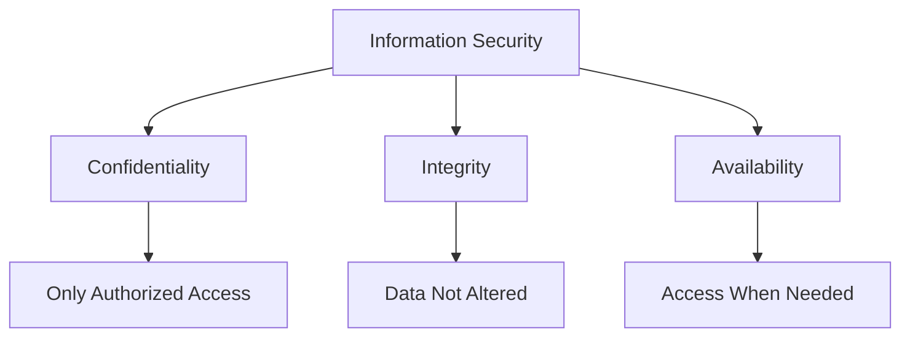
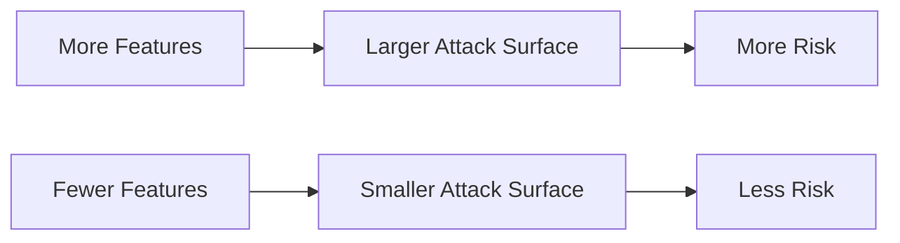
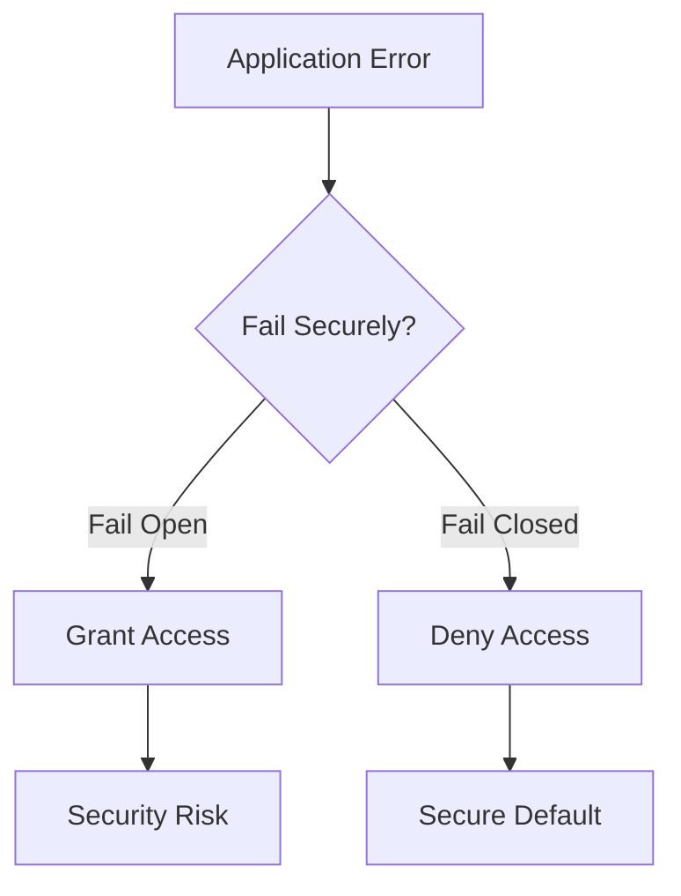
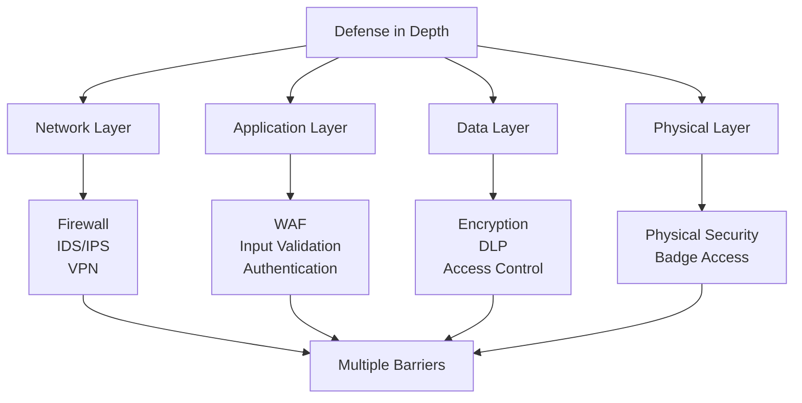
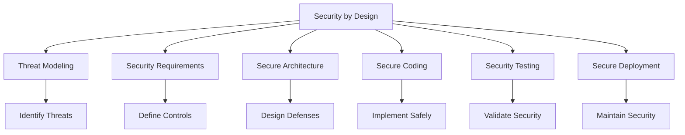

*Security by Design* is an approach that enables businesses and organizations to build and automate infrastructure so that security can be **structured from the bottom up**. Security by Design helps organizations mitigate data breaches and hacking attempts **before they are hit** by a cyber-attack rather than repairing issues and restoring systems afterward.

> **Key Insight**: Security by Design shifts security from a reactive afterthought to a proactive foundation—building protection into the DNA of your systems.

## The CIA Triad Foundation

Information security relies on three core pillars:



| **Pillar** | **Definition** | **Controls** |
|------------|----------------|--------------|
| **Confidentiality** | Only authorized users can access data and resources | Encryption, access controls, MFA |
| **Integrity** | Data should not be altered by unauthorized users | Hashing, digital signatures, version control |
| **Availability** | Authorized users can access data when required | Redundancy, backups, DDoS protection |

Security By Design always refers to these **fundamental pillars** whenever a new product is created.

## The Security Mindset

Whenever a new solution is created, here are critical questions you need to ask:

### 1. The Evil Mindset

**"If I were evil, how would I exploit this feature or solution?"**

- Think like an attacker
- Identify potential abuse cases
- Consider unintended uses
- Map attack surfaces

### 2. Necessity Assessment

**"Does this solution need to be running by default? If so, how could I limit any risk related to it?"**

- Principle of least functionality
- Disable unnecessary features
- Minimize attack surface
- Default-deny approach

### 3. Security Validation

**"Is this solution safe, or is this a flawed process?"**

- Threat modeling
- Security review
- Penetration testing
- Code review

> **Best Practice**: The best security designs contain brainstorming and security discussions on **every single feature** and how risks will be handled and mitigated.

## Security is a Marathon, Not a Sprint

**Security Journey Phases:**

| **Phase** | **Activities** |
|-----------|----------------|
| Design Phase | Threat Modeling, Security Requirements |
| Development | Secure Coding, Code Reviews |
| Testing | Security Testing, Penetration Testing |
| Deployment | Secure Configuration, Monitoring Setup |
| Operations | Continuous Monitoring, Incident Response |
| Improvement | Lessons Learned, Updates & Patches |

## OWASP Security Design Principles

These are security principles based on the *OWASP development guide* that must be considered when dealing with Security by Design:

### 1. Minimize the Attack Surface Area

Every single feature added to a solution or application adds a level of **risk** to the overall solution. The aim is to reduce this risk as much as possible.

**Examples:**
- Limiting the number of input parameters where not needed
- Reducing dynamic content capabilities
- Disabling unnecessary services
- Removing debug endpoints in production

**Benefits:**
- Reduces likelihood of SQL injection attacks
- Limits potential entry points
- Simplifies security management



### 2. Establish Principle of Least Privilege

**Limit the number of users** having permissions to data and resources.

This principle focuses on accounts having the **least amount of privilege** to perform their business duties:
- User rights
- Resource permissions
- API scopes
- Network access

**Implementation:**

| **Level** | **Permissions** | **Example** |
|-----------|-----------------|-------------|
| **Read-Only User** | View data only | Customer service |
| **Standard User** | Read + limited write | Regular employees |
| **Power User** | Extended permissions | Department managers |
| **Administrator** | Full control | IT staff only |

> **Golden Rule**: Users should only have the minimum permissions necessary to do their jobs—nothing more.

### 3. Create Secure Defaults

A user's experience should always be secure, **irrespective** of whether they are a first-time user or a long-time user.

**Examples:**
- Strong password complexity requirements by default
- HTTPS enabled by default
- Encryption on by default
- Logging enabled by default
- Secure session timeouts

**Bad Default:**
```javascript
// DON'T: Insecure default
const config = {
 encryption: false, // User must enable
 logging: false,
 sessionTimeout: Infinity
};
```

**Good Default:**
```javascript
// DO: Secure default
const config = {
 encryption: true, // Secure by default
 logging: true,
 sessionTimeout: 1800 // 30 minutes
};
```

### 4. Fail Securely

There are many instances where an application fails—during production, testing, faulty configurations, etc.

**The application must fail securely.** How an application fails determines whether it is secure.

**Insecure Failure:**
```python
# BAD: Fails open
try:
 check_permission(user)
 grant_access()
except:
 grant_access() # Error = Access granted!
```

**Secure Failure:**
```python
# GOOD: Fails closed
try:
 check_permission(user)
 grant_access()
except:
 deny_access() # Error = Access denied
 log_error()
```



### 5. Keep Security Simple

Developers must keep security **simple and grounded**.

**Simplicity Principles:**
- Avoid complex architectures
- Use standard, proven security mechanisms
- Don't create custom cryptography
- Prefer simple, auditable code
- Use established frameworks

> **KISS Principle**: Keep It Simple, Stupid. Complex security is brittle security.

### 6. Do Not Trust 3rd Party Services

External systems and services with policies and security posture **not aligned with your own** should not be trusted if possible.

**Challenges:**
- No influence or control over external services
- Different security standards
- Potential data exposure
- Dependency vulnerabilities

**Mitigation:**
- Vendor security assessments
- Contractual security requirements
- API security controls
- Regular audits
- Data minimization

### 7. Separation of Duties

**Someone who requests a laptop should not be the one assigning it, nor should they directly receive it.**

There should be a **clear separation of levels and duties**.


**Examples:**
- Code author ≠ code reviewer
- Change requestor ≠ change approver
- Developer ≠ production deployer
- Financial requestor ≠ financial approver

**Benefits:**
- Prevents fraud
- Reduces errors
- Ensures accountability
- Meets compliance requirements

### 8. Defense in Depth

When a developer adds one additional feature, the risk is reasonable, but when several features are added, **the risks associated with them also add up**.

When controls and defenses are used **in-depth**, it makes the exploitation of solutions **that much more difficult**.



**Layered Security:**

| **Layer** | **Controls** | **Purpose** |
|-----------|--------------|-------------|
| **Perimeter** | Firewall, WAF | Block external threats |
| **Network** | Segmentation, IDS | Detect and contain |
| **Host** | Antivirus, EDR | Protect endpoints |
| **Application** | Input validation, auth | Secure applications |
| **Data** | Encryption, DLP | Protect sensitive data |

> **Principle**: If one layer fails, others should still provide protection.

## Security by Design Framework



## Implementation Checklist

### Design Phase

- [ ] Conduct threat modeling sessions
- [ ] Define security requirements
- [ ] Document security architecture
- [ ] Review design with security team
- [ ] Consider abuse cases
- [ ] Plan for secure failure modes

### Development Phase

- [ ] Follow secure coding guidelines
- [ ] Implement input validation
- [ ] Use parameterized queries
- [ ] Apply least privilege
- [ ] Enable security features by default
- [ ] Peer code reviews
- [ ] Static analysis scanning

### Testing Phase

- [ ] Security unit tests
- [ ] Penetration testing
- [ ] Vulnerability scanning
- [ ] Security regression testing
- [ ] Abuse case testing

### Deployment Phase

- [ ] Secure configuration
- [ ] Remove debug features
- [ ] Enable monitoring and logging
- [ ] Security hardening
- [ ] Access control verification

## Conclusion

*Security by Design* is not just a methodology—it's a **mindset** that permeates every aspect of software development and system architecture. By building security in from the beginning rather than bolting it on later, organizations can:

- Reduce vulnerabilities
- Lower remediation costs
- Improve user trust
- Meet compliance requirements
- Build more resilient systems

The eight principles—minimize attack surface, least privilege, secure defaults, fail securely, keep it simple, don't trust third parties, separation of duties, and defense in depth—provide a comprehensive framework for building secure systems.

Remember: **Security is a marathon, not a sprint.** It requires continuous effort, regular review, and constant vigilance. But when security is designed in from the start, it becomes part of the solution rather than an obstacle.

> **Final Takeaway**: Security by Design isn't about adding security features—it's about building systems that are inherently secure. Design for failure, plan for attacks, and build in layers. Your future self (and your users) will thank you.

## References

- [OWASP Security by Design Principles](https://owasp.org/www-project-security-by-design-principles/)
- [NIST Secure Software Development Framework](https://csrc.nist.gov/Projects/ssdf)
- [Microsoft Security Development Lifecycle](https://www.microsoft.com/en-us/securityengineering/sdl)
- [OWASP Development Guide](https://owasp.org/www-project-web-security-testing-guide/)
