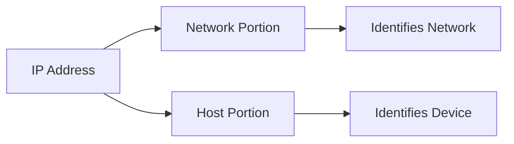
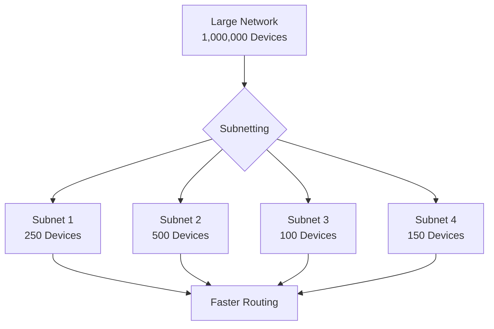
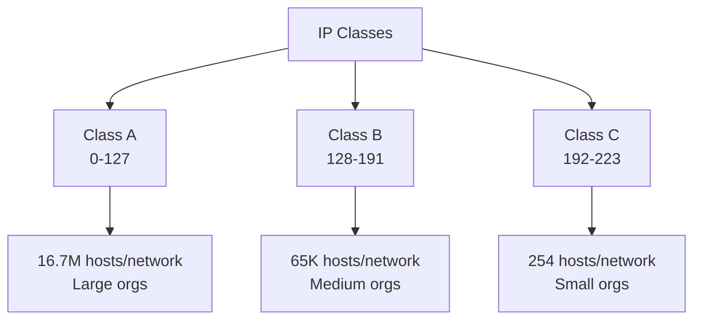
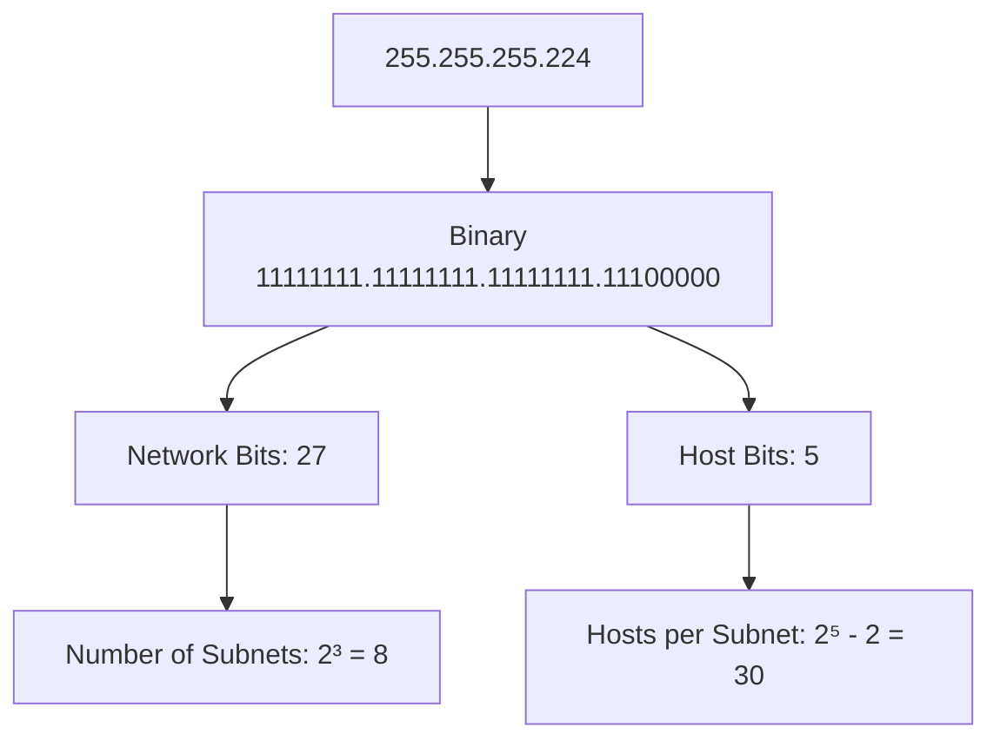
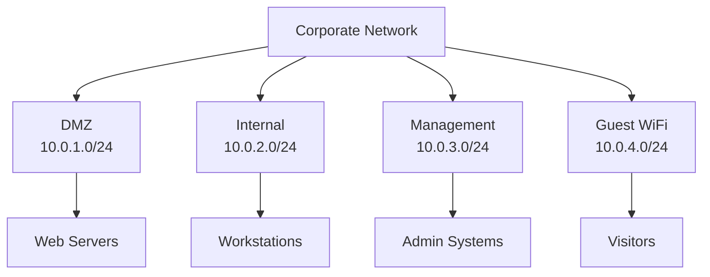
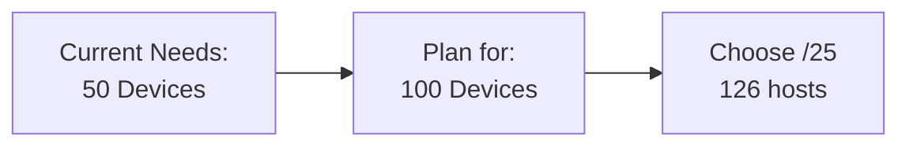

When connected to the internet, every device is assigned a unique *IP address*. A network is more efficient when a message travels with **as few hops as possible**. When data packets travel between networks, they are routed through subnets so that packets take the most efficient route to their final destination.

> **Key Insight**: Subnetting divides large networks into smaller, manageable segments, improving performance, security, and IP address utilization.

## Understanding IP Addresses

An *IP address* determines the address of a data packet, whether at the source or destination. Every IP address has **two parts**:

1. **Network portion**: Indicates which network the address belongs to
2. **Host portion**: Shows the specific device within that network



> **Question**: If an IP address makes it simple for routers to find the right network, why do we need subnetting?

## Why Subnetting is Necessary

A million devices could be connected to a particular network. It could take **several hops and significant time** for data to reach the correct address. This is where *subnetting* becomes essential.

### Benefits of Subnetting

**Subnetting helps in:**

| **Benefit** | **Description** | **Impact** |
|-------------|-----------------|------------|
| **Organization** | Logical network segmentation | Easier management |
| **Performance** | Reduce network congestion | Faster data delivery |
| **Security** | Isolate network segments | Contain breaches |
| **Efficiency** | Prevent IP address waste | Better resource utilization |
| **Traffic Control** | Limit broadcast domains | Reduced network noise |



When network traffic increases within parts of the network, subnetting **groups these parts** into one section so that traffic doesn't unnecessarily hop across the entire network.

## IP Address Structure

### Binary to Decimal Conversion

An IP address is made of **32 binary bits** divisible into a network piece and host piece with the help of a subnet mask.

**32 bits are divided into four octets**, each separated by a period (`.`):

```
Binary Representation:
 1 1 1 1 1 1 1 1
 128 64 32 16 8 4 2 1

Example IP Address: 30.40.200.120

Decimal: 30. 40. 200. 120 

Binary: 00011110. 00101000. 11001000. 01111000
```

### IP Address Classes

IP addresses are divided into three main classes:

| **Class** | **Range** | **Default Subnet Mask** | **Use Case** |
|-----------|-----------|------------------------|--------------|
| **Class A** | 0.0.0.0 - 127.255.255.255 | 255.0.0.0 | Large networks |
| **Class B** | 128.0.0.0 - 191.255.255.255 | 255.255.0.0 | Medium networks |
| **Class C** | 192.0.0.0 - 223.255.255.255 | 255.255.255.0 | Small networks |



### Default Subnet Masks

Based on classes A, B, C, here are the default masks:

- **Class A**: `255.0.0.0` or `/8`
- **Class B**: `255.255.0.0` or `/16`
- **Class C**: `255.255.255.0` or `/24`

## Subnetting Example

Subnetting creates several **logical networks** that live within a single class network. When a major network is separated into smaller subnets, it establishes an interconnecting subnetwork.

### Practical Example

**Given**: A Class C network of `215.20.9.0`

**Natural subnet mask**: `255.255.255.0`

```
215.20.9.0 - 11010111.00010100.00001001.00000000

255.255.255.224 - 11111111.11111111.11111111.11100000

 --------------------------|sub|----
 ^^^
 3 subnet bits
```

### Subnet Calculation

With **three bits** borrowed from the host portion, we create **8 subnets**:

| **Subnet** | **Network Address** | **Subnet Mask** | **Host Range** | **Usable Hosts** |
|------------|-------------------|-----------------|----------------|------------------|
| **1** | 215.20.9.0 | 255.255.255.224 | 1 - 30 | 30 |
| **2** | 215.20.9.32 | 255.255.255.224 | 33 - 62 | 30 |
| **3** | 215.20.9.64 | 255.255.255.224 | 65 - 94 | 30 |
| **4** | 215.20.9.96 | 255.255.255.224 | 97 - 126 | 30 |
| **5** | 215.20.9.128 | 255.255.255.224 | 129 - 158 | 30 |
| **6** | 215.20.9.160 | 255.255.255.224 | 161 - 190 | 30 |
| **7** | 215.20.9.192 | 255.255.255.224 | 193 - 222 | 30 |
| **8** | 215.20.9.224 | 255.255.255.224 | 225 - 254 | 30 |

**Calculation Details:**
- Borrowed bits: 3
- Number of subnets: 2³ = 8
- Remaining host bits: 5
- Hosts per subnet: 2⁵ = 32
- **Usable hosts**: 32 - 2 = 30 (network & broadcast addresses excluded)

> **Important**: Host IDs of all zeros (network address) or all ones (broadcast address) are not allowed for assignment to devices.

## Subnet Mask Visualization



## CIDR Notation

*Classless Inter-Domain Routing (CIDR)* provides a more flexible subnetting method:

| **CIDR** | **Subnet Mask** | **Hosts per Subnet** | **Use Case** |
|----------|-----------------|---------------------|--------------|
| `/24` | 255.255.255.0 | 254 | Small office |
| `/23` | 255.255.254.0 | 510 | Medium office |
| `/22` | 255.255.252.0 | 1,022 | Large office |
| `/21` | 255.255.248.0 | 2,046 | Campus |
| `/20` | 255.255.240.0 | 4,094 | Large campus |

```bash
# Examples in CIDR notation
192.168.1.0/24 # 254 usable hosts
10.0.0.0/8 # 16,777,214 usable hosts
172.16.0.0/12 # 1,048,574 usable hosts
```

## Subnetting for Security

### Network Segmentation



**Security Benefits:**
- **Isolation**: Contain breaches within subnets
- **Access Control**: Firewall rules between subnets
- **Monitoring**: Easier to detect anomalies
- **Compliance**: Separate sensitive data

### Subnet Design Example

**Enterprise Network Design:**

| **Subnet** | **Purpose** | **Network** | **Security Level** |
|------------|-------------|-------------|-------------------|
| **DMZ** | Public-facing servers | 10.0.1.0/24 | Medium (restricted in/out) |
| **Internal** | Employee workstations | 10.0.2.0/22 | High (restricted out) |
| **Servers** | Internal applications | 10.0.6.0/24 | High (whitelist only) |
| **Management** | Admin access | 10.0.7.0/28 | Highest (MFA required) |
| **Guest** | Visitor WiFi | 10.0.8.0/23 | Low (isolated) |

## Subnetting Calculations

### Quick Reference

**Formula for Number of Subnets:**
```
Number of Subnets = 2^(borrowed bits)
```

**Formula for Hosts per Subnet:**
```
Usable Hosts = 2^(host bits) - 2
```

**Example:**
```
Subnet Mask: 255.255.255.240 (/28)

Network bits: 28
Host bits: 32 - 28 = 4

Number of Subnets: 2^4 = 16
Usable Hosts: 2^4 - 2 = 14 hosts per subnet
```

### Common Subnet Sizes

| **CIDR** | **Subnet Mask** | **Usable Hosts** | **Typical Use** |
|----------|-----------------|------------------|-----------------|
| `/30` | 255.255.255.252 | 2 | Point-to-point links |
| `/29` | 255.255.255.248 | 6 | Small teams |
| `/28` | 255.255.255.240 | 14 | Department |
| `/27` | 255.255.255.224 | 30 | Small office |
| `/26` | 255.255.255.192 | 62 | Medium office |
| `/25` | 255.255.255.128 | 126 | Large office |
| `/24` | 255.255.255.0 | 254 | Standard network |

## Practical Subnetting Tips

### 1. Plan for Growth



**Always allocate more addresses than currently needed:**
- Account for growth
- Leave room for future expansion
- Consider IoT devices
- Plan for redundancy

### 2. Document Your Subnets

Keep a clear record of:
- Subnet assignments
- Purpose of each subnet
- IP ranges
- Gateway addresses
- VLAN mappings

### 3. Consistent Addressing Scheme

**Example Convention:**
```
10.0.X.0/24 where X =
- 1-10: DMZ servers
- 11-20: Application servers 
- 21-30: Database servers
- 31-50: Workstations
- 51-60: WiFi
- 100+: Management
```

## Tools for Subnetting

### Online Calculators
- [subnet-calculator.com](https://www.subnet-calculator.com/)
- [ipcalc](http://jodies.de/ipcalc)

### Command-Line Tools
```bash
# Linux: ipcalc
ipcalc 192.168.1.0/24

# Output shows:
# Network, Broadcast, Netmask, Hosts, etc.
```

## Conclusion

**The more bits one uses for the subnet, the more subnets will be available**—but fewer hosts per subnet.

*Subnetting* is a fundamental networking concept that:
- Improves network performance by reducing congestion
- Enhances security through network segmentation
- Optimizes IP address utilization
- Simplifies network management

Understanding subnetting is essential for:
- Network administrators managing infrastructure
- Security professionals implementing network segmentation
- Cloud engineers designing VPC architectures
- Anyone working with TCP/IP networks

> **Final Takeaway**: Subnetting is not just about math—it's about designing efficient, secure, and scalable networks. Master the basics, use tools to verify your calculations, and always plan for growth.

## References

- [Cisco: IP Subnetting](https://www.cisco.com/c/en/us/support/docs/ip/routing-information-protocol-rip/13788-3.html)
- [RFC 1918: Private Address Space](https://tools.ietf.org/html/rfc1918)
- [Subnetting Practice](https://subnettingpractice.com/)
- [Visual Subnet Calculator](https://www.davidc.net/sites/default/subnets/subnets.html)
