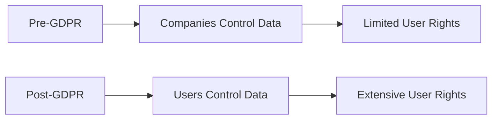
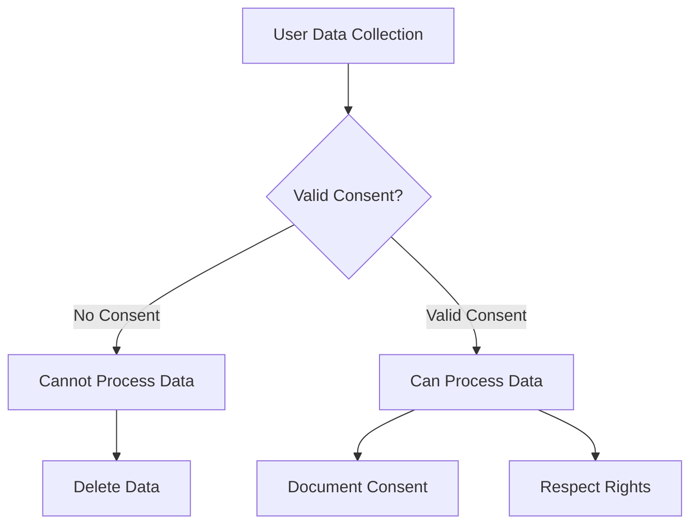
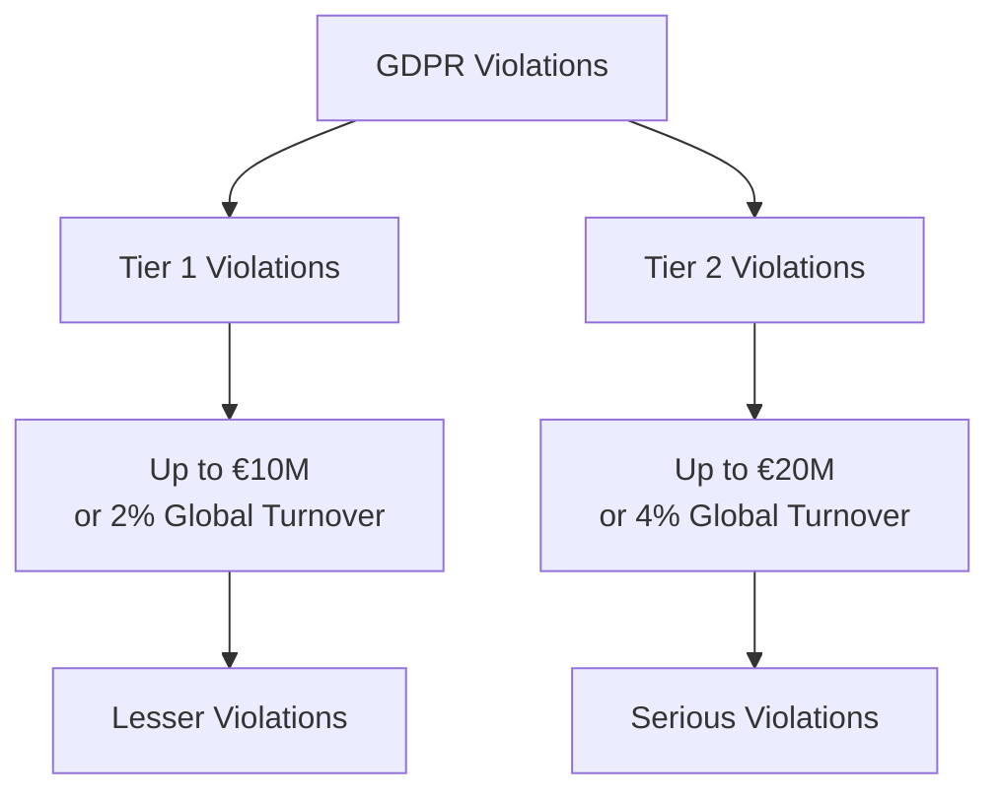
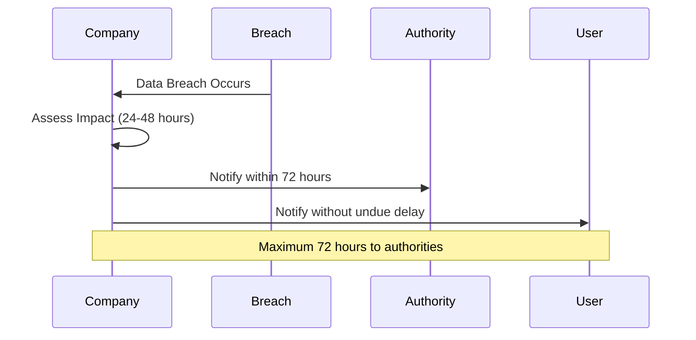
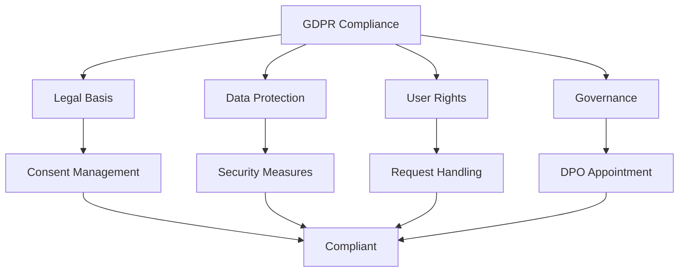
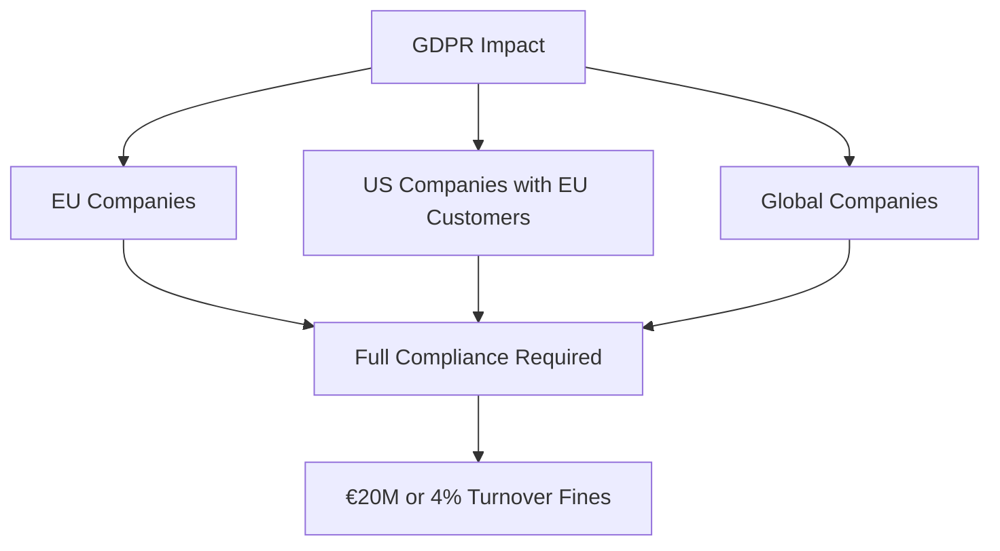

*General Data Protection Regulation (GDPR)* is legislation that gives ordinary people **power and control** over the data that companies hold about them. The GDPR is *E.U. legislation* but massively affects companies and businesses **worldwide**.

> **Key Insight**: GDPR is the most comprehensive data protection law in the world, setting the standard for privacy rights in the digital age.

## The Email Revolution

Ever wondered about the emails you get from companies asking your consent for your information to be part of their system or to be on their weekly newsletter? Those emails are **not** some kind of public relations strategy—instead, it's because of the **massive change in E.U. data protection rules**.



## The Digital Age Reality

In the modern era, every part of an individual's life can be **digitized, logged, and monitored**:

**What Gets Tracked:**
- Pictures you take
- Movies you watch on streaming platforms
- Purchases you make
- Journeys you document
- Websites you visit
- Emails you send
- Messages you exchange

Every day, more and more of your *Personal Information* is collected, stored, and traded by companies and governments.

## What is PII (Personally Identifiable Information)?

The GDPR regulations cover *PII* (Personally Identifiable Information)—information that can identify individuals.

### PII Categories

```mermaid
mindmap
root((Personal<br/>Data))
Identity
Full Name
Date of Birth
Photographs
Government IDs
Social Security Number
Driver's License
Passport Number
Financial
Bank Account
Credit Cards
Tax Information
Contact
Email Address
Phone Number
Physical Address
Digital
IP Address
Cookie Data
Device IDs
```

**Examples of PII:**

| **Category** | **Examples** |
|--------------|--------------|
| **Identification** | Full name, date of birth, photographs |
| **Government IDs** | Social Security number, driver's license, passport |
| **Financial** | Bank account number, credit card numbers |
| **Contact** | Email address, phone number, physical address |
| **Digital** | IP address, cookie identifiers, device IDs |

## GDPR Requirements

With the GDPR in place, organizations must:

### 1. Lawful Basis for Processing

**Prove they have a lawful reason** for holding an individual's data:

| **Lawful Basis** | **Description** | **Example** |
|------------------|-----------------|-------------|
| **Consent** | User explicitly agreed | Newsletter signup |
| **Contract** | Necessary for service | Customer orders |
| **Legal Obligation** | Required by law | Tax records |
| **Vital Interests** | Life or death situation | Medical emergency |
| **Public Task** | Official government function | Public records |
| **Legitimate Interest** | Business needs (balanced test) | Fraud prevention |

### 2. Data Security

**Prove they are keeping the data safe:**
- Encryption at rest and in transit
- Access controls
- Security measures
- Data breach procedures
- Regular security audits

### 3. Consent Management

If you are receiving emails from companies, they need to **confirm your consent** before storing your information (e.g., your name and email address).

**Consent Requirements:**
- **Freely given**: Not forced or coerced
- **Specific**: Clear what you're consenting to
- **Informed**: Understand how data will be used
- **Unambiguous**: Positive action required
- **Withdrawable**: Easy to revoke consent



### 4. Previous Consent

If you signed up for a company's newsletter and gave them permissions in the past, it **could probably still be valid**. In some cases, companies contacting you to ask for your consent could be **illegal** because:
- If a company cannot initially prove consent
- They should not be emailing you to confirm details

In most cases, **if you do not reply**, the company should **delete your information** from their system.

## GDPR Penalties

For companies that fail to comply with GDPR, the penalties are **massive**.

### Fine Structure



| **Tier** | **Maximum Fine** | **Violation Type** |
|----------|-----------------|-------------------|
| **Tier 1** | €10 million or 2% of annual global turnover | Data processing violations, insufficient security |
| **Tier 2** | €20 million or 4% of annual global turnover | No legal basis for processing, violating core principles |

**Notable Fine Example:**

> **"E.U. regulator hits Amazon with record $887 million fine for data protection violations"**

The penalty could be as much as **4% of the annual turnover** of the company. It is serious legislation designed to empower people who give their information to companies.

## Your Rights Under GDPR

### 1. Right to Information

Companies must be **upfront when asking for consent**:
- Clear privacy policy
- Explain data usage
- Identify data recipients
- Specify retention period

### 2. Right to Breach Notification

If a company that stores your data is hacked or breached, they must **inform you within 72 hours** (3 days).



### 3. Right of Access

A user has the **right to see their own personal data**:
- Request copy of all data
- Understand how it's being used
- Know who has access
- See data retention period

### 4. Right to be Forgotten

If you suspect a company of being fraudulent, you can **demand they hand over all information** they have on you with a **right to be forgotten** from their systems.

**However**, the right to be forgotten is **not absolute**:

| **Can Exercise Right** | **Cannot Exercise Right** |
|----------------------|--------------------------|
| No longer needed | Legal obligation to retain |
| Withdraw consent | Public interest |
| Object to processing | Defending legal claims |
| | Freedom of expression |

### Additional Rights

- **Right to Rectification**: Correct inaccurate data
- **Right to Restrict Processing**: Limit how data is used
- **Right to Data Portability**: Transfer data to another service
- **Right to Object**: Object to certain processing

## GDPR Compliance Requirements

### For Companies



**Requirements:**

1. **Lawful basis for processing**
2. **Data protection measures**
3. **Privacy by design and by default**
4. **Data Protection Impact Assessments (DPIAs)**
5. **Data Protection Officer (DPO)** for certain organizations
6. **Breach notification procedures**
7. **International data transfer safeguards**
8. **Record of processing activities**

### Data Processing Principles

| **Principle** | **Meaning** |
|---------------|-------------|
| **Lawfulness, fairness, transparency** | Legal basis, honest, clear communication |
| **Purpose limitation** | Collect for specified purposes only |
| **Data minimization** | Collect only what's necessary |
| **Accuracy** | Keep data accurate and up to date |
| **Storage limitation** | Don't keep longer than needed |
| **Integrity and confidentiality** | Secure data appropriately |
| **Accountability** | Be able to demonstrate compliance |

## Building Trust Through GDPR

The GDPR is a way for companies to **build trust** with their users and customers. The primary goal is to **stop data breaches from happening in the first place**.

### Benefits for Users

- **Control**: Over personal data
- **Transparency**: How data is used
- **Protection**: Strong security requirements
- **Rights**: Legal recourse for violations
- **Security**: Better data protection

### Benefits for Companies

- **Trust**: Build customer confidence
- **Reputation**: Demonstrate commitment to privacy
- **Competitive advantage**: Privacy as differentiator
- **Risk reduction**: Better security practices
- **Global standard**: One framework for EU access

## GDPR Compliance Checklist

### Essential Steps

- [ ] Conduct data audit (what data you hold)
- [ ] Document lawful basis for processing
- [ ] Update privacy policy
- [ ] Implement consent management
- [ ] Establish data subject rights procedures
- [ ] Appoint DPO (if required)
- [ ] Conduct DPIAs for high-risk processing
- [ ] Implement security measures
- [ ] Create breach notification procedures
- [ ] Train staff on GDPR
- [ ] Review third-party processors
- [ ] Document everything

## Global Impact

While GDPR is European legislation, it affects companies **worldwide** that:
- Have EU customers
- Process EU residents' data
- Have offices in the EU
- Target EU market



**Global Privacy Laws Inspired by GDPR:**
- California Consumer Privacy Act (CCPA) - USA
- Lei Geral de Proteção de Dados (LGPD) - Brazil
- Personal Information Protection Law (PIPL) - China
- Privacy Act - Australia

## Conclusion

The *General Data Protection Regulation (GDPR)* represents a fundamental shift in how organizations must handle personal data. By giving individuals control over their information and holding companies accountable for data protection, GDPR has raised the global standard for privacy.

The regulation is not just about compliance and avoiding fines—it's about **respecting individuals' fundamental right to privacy** in an increasingly digital world. Companies that embrace GDPR principles build trust with their customers and position themselves as responsible stewards of personal data.

> **Final Takeaway**: GDPR is not a burden—it's an opportunity. Organizations that treat privacy as a fundamental right rather than a compliance checkbox will earn user trust, avoid costly breaches, and build better, more secure systems.

## References

- [Official GDPR Text](https://gdpr.eu/)
- [GDPR.eu - Complete Guide](https://gdpr.eu/what-is-gdpr/)
- [ICO: Guide to GDPR](https://ico.org.uk/for-organisations/guide-to-data-protection/guide-to-the-general-data-protection-regulation-gdpr/)
- [European Commission: Data Protection](https://ec.europa.eu/info/law/law-topic/data-protection_en)
