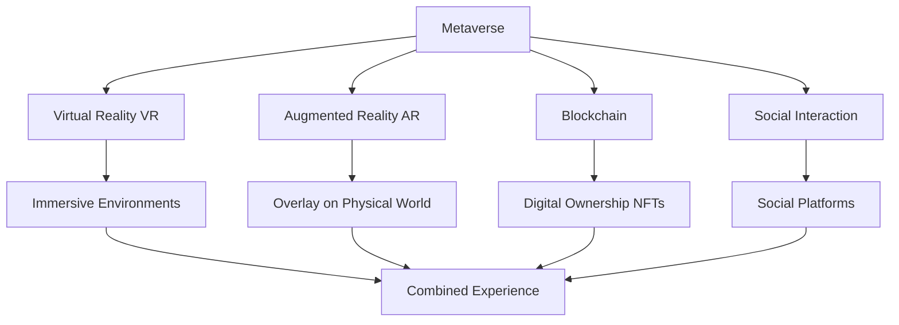
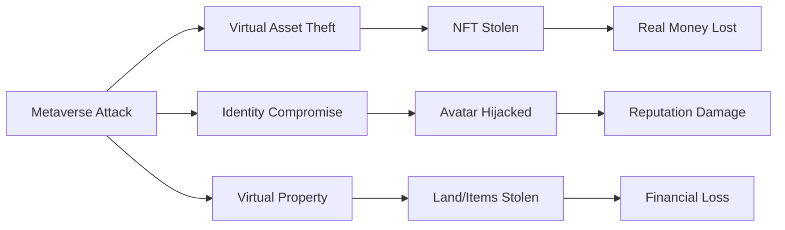
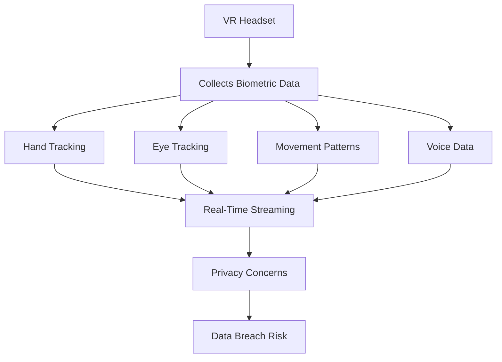
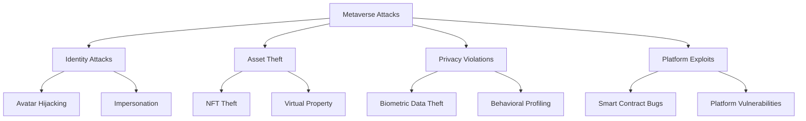
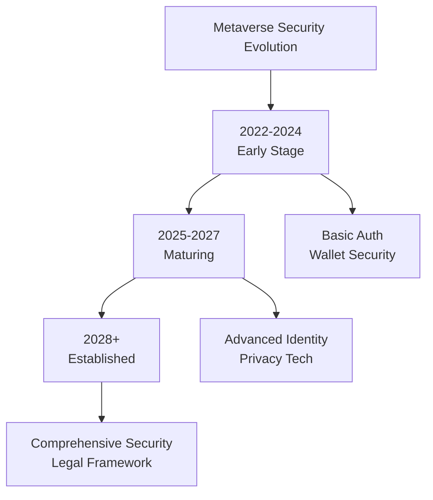

The *Metaverse* currently is in its early stages but is scaling and growing at a very rapid rate. It's a combination of *augmented reality* and *virtual reality* and is predicted to be the next big innovation after the rise of the Internet. It's a digital virtual space, just like an online simulator where you can create your digital avatars and interact with others.

> **Key Insight**: The Metaverse is not immune to cyber threats—in fact, it creates entirely new attack surfaces that blend digital and physical realities.

## What is the Metaverse?

The *Metaverse* represents a persistent, shared, 3D virtual space where:
- Users create digital avatars
- People interact in real-time
- Digital and physical worlds merge
- Virtual economies operate
- Real money is at stake



As the interactivity within the virtual world increases, people are **accountable for their actions** within the virtual space, and hence security would play a significant part.

## Security Requirements for the Metaverse

What would the Metaverse focus on in terms of security?

### Essential Security Components

| **Security Area** | **Requirement** | **Why It Matters** |
|-------------------|----------------|-------------------|
| **Privacy** | Protect user data | Biometric, behavioral data at risk |
| **Authentication** | Verify user identity | Prevent impersonation |
| **Access Control** | Well-defined policies | Protect virtual assets |
| **Encryption** | Strong standards | Secure communications |
| **DNS Security** | Prevent hijacking | Protect virtual addresses |
| **Web App Protection** | Guard against attacks | Prevent exploits |

```mermaid
mindmap
root((Metaverse<br/>Security))
Privacy Protection
Biometric Data
Behavioral Data
Location Data
Voice Data
Identity & Access
Multi-Factor Auth
Biometric Auth
Role-Based Access
Data Security
End-to-End Encryption
Data Minimization
Secure Storage
Platform Security
Anti-Cheat
Fraud Detection
Content Moderation
```

## The Real-World Connection

The Metaverse is a **virtual space** where data such as content, services, and products are supplied, and **transactions affect real-world capital**.

### Digital Meets Physical

**If a cyberattack infiltrates the digital world, it causes damage to the real world:**



**Examples:**
- Stolen NFTs worth thousands of dollars
- Virtual real estate fraud
- Cryptocurrency theft from virtual wallets
- Identity theft affecting real-world reputation

## New Types of Data

Complex services generate **new types of data** within the Metaverse:

### Emerging Data Categories

**Unique to Metaverse:**

| **Data Type** | **Collection Method** | **Privacy Risk** |
|---------------|---------------------|------------------|
| **Biometric** | Hand/body gesture tracking | HIGH - physical characteristics |
| **Behavioral** | Movement patterns, habits | HIGH - personality profiling |
| **Spatial** | Room mapping, environment scanning | MEDIUM - physical space exposure |
| **Gaze Tracking** | Eye movement, focus areas | HIGH - attention tracking |
| **Voice** | Real-time voice chat | MEDIUM - voice fingerprinting |
| **Physiological** | Heart rate, stress levels | HIGH - health data |

As this data is generated in **real-time**, it can be challenging to exercise control over it. Such services are still **susceptible to being breached**.



## Example: The Sandbox

An example of a metaverse project on the rise is **THE SANDBOX**.

### What is The Sandbox?

This project is a **virtual metaverse world** that allows users to:
- Create and play games within a game
- Build and design their avatars
- Access various environments, games, and hubs
- Monetize creations through NFTs

### SAND Token

A digital currency associated with this project, abbreviated as **"SAND"**, is linked to the *Ethereum blockchain*.

**Economic Activity:**
- Quadrupled in price in the past two weeks (at launch)
- Digital goods created can be **monetized through NFTs**
- Sold on the Sandbox Marketplace for SAND tokens
- Real money involved in virtual transactions


## Potential Cyberattacks in the Metaverse

### Attack Vectors



**Specific Threats:**

1. **Identity Theft**
 - Avatar hijacking
 - Digital identity fraud
 - Impersonation attacks

2. **Asset Theft**
 - NFT wallet draining
 - Virtual real estate scams
 - In-game item theft

3. **Privacy Breaches**
 - Biometric data leaks
 - Location tracking exploitation
 - Behavioral data harvesting

4. **Financial Fraud**
 - Cryptocurrency theft
 - Payment fraud
 - Investment scams

5. **Social Engineering**
 - Virtual phishing
 - Romance scams in virtual worlds
 - Fake virtual businesses

6. **Platform Exploits**
 - Smart contract vulnerabilities
 - Game engine exploits
 - API manipulation

## Security Challenges

### Why Metaverse Security is Complex

**Challenges:**

| **Challenge** | **Description** | **Impact** |
|---------------|-----------------|-----------|
| **Real-time data** | Continuous biometric collection | Hard to control |
| **Immersive environment** | Users less security-aware | Easier to deceive |
| **Multiple platforms** | No unified security standard | Fragmented protection |
| **Blockchain integration** | Irreversible transactions | Permanent losses |
| **Cross-platform identity** | Reused credentials | Cascade compromises |

## Future Security Considerations

In the future, it would not be easy to identify how to **protect and mitigate** against different types of cyberattacks as the concept of the Metaverse application is still in its infancy stage.

### Emerging Security Needs

**As the Metaverse Develops:**

- **Decentralized Identity (DID)**: Self-sovereign identity systems
- **Smart Contract Audits**: Prevent financial exploits
- **Privacy-Preserving Tech**: Zero-knowledge proofs, homomorphic encryption
- **AI-Powered Moderation**: Detect harassment, scams
- **Legal Frameworks**: Virtual world governance
- **Forensics Tools**: Investigate virtual crimes



## Protection Strategies

### For Users

**How to Stay Safe:**

- Use strong, unique passwords for metaverse accounts
- Enable MFA on all virtual wallets
- Be cautious of virtual strangers
- Don't share personal information
- Use hardware wallets for valuable NFTs
- Verify smart contracts before interacting
- Keep software/headsets updated
- Use reputable platforms

### For Platforms

**Security Imperatives:**

- Implement robust authentication
- Encrypt all communications
- Regular security audits
- Bug bounty programs
- Incident response plans
- Privacy by design
- Transparent data practices
- User education programs

## Conclusion

The *Metaverse* represents the next frontier of digital interaction, blending virtual and physical realities in unprecedented ways. While still in its early stages, it's clear that cybersecurity will play a **massive part** in addressing the rising security concerns.

As the Metaverse evolves, new types of attacks will emerge—from avatar hijacking to NFT theft, from biometric data breaches to virtual social engineering. The convergence of VR, AR, blockchain, and social platforms creates a complex security landscape that will require innovative solutions.

**Rest assured**: With the further development of the Metaverse, cybersecurity professionals are working to build security into these platforms from the ground up, rather than bolting it on later.

> **Final Takeaway**: The Metaverse is coming, and with it, a new dimension of cybersecurity challenges. The question isn't whether it can be cyberattacked—it absolutely can. The question is: how will we build security into this new digital frontier?

## References

- [Meta: Metaverse Security](https://about.fb.com/news/2021/10/facebook-company-is-now-meta/)
- [Decentraland Security](https://docs.decentraland.org/)
- [The Sandbox Security Practices](https://www.sandbox.game/en/)
- [NIST: Emerging Tech Security](https://www.nist.gov/topics/emerging-technologies)
