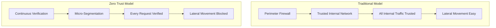
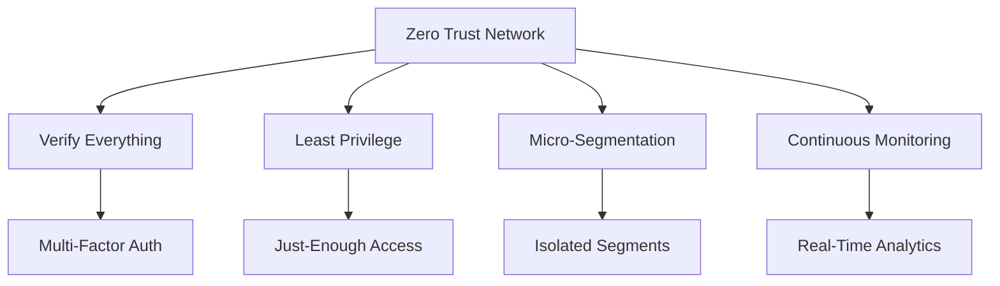
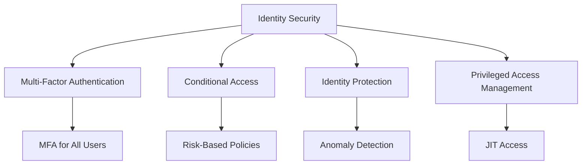
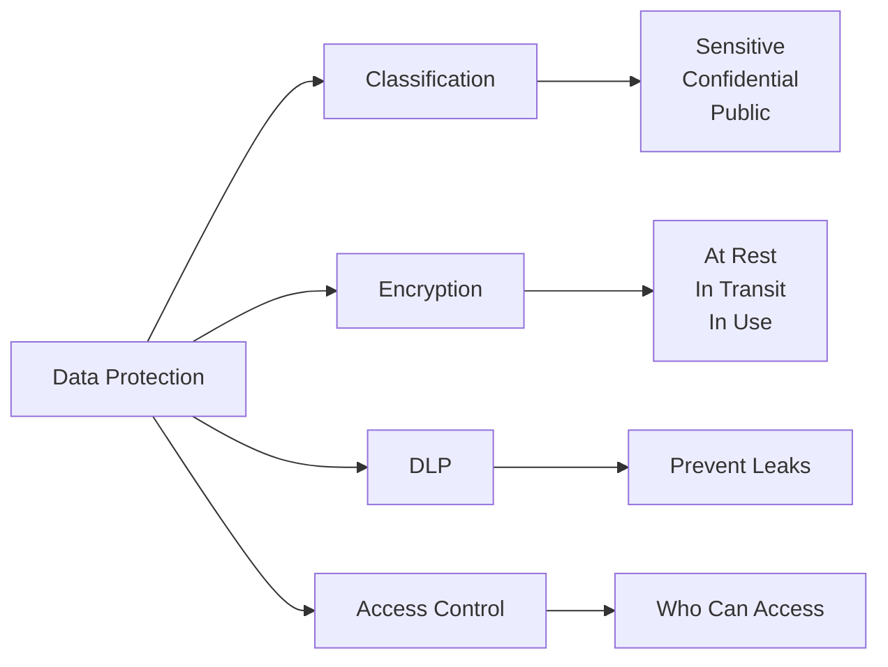
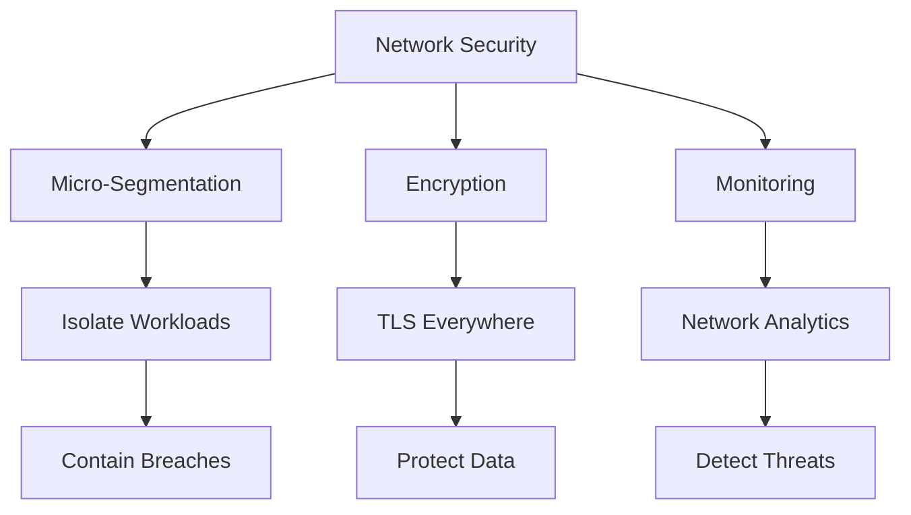
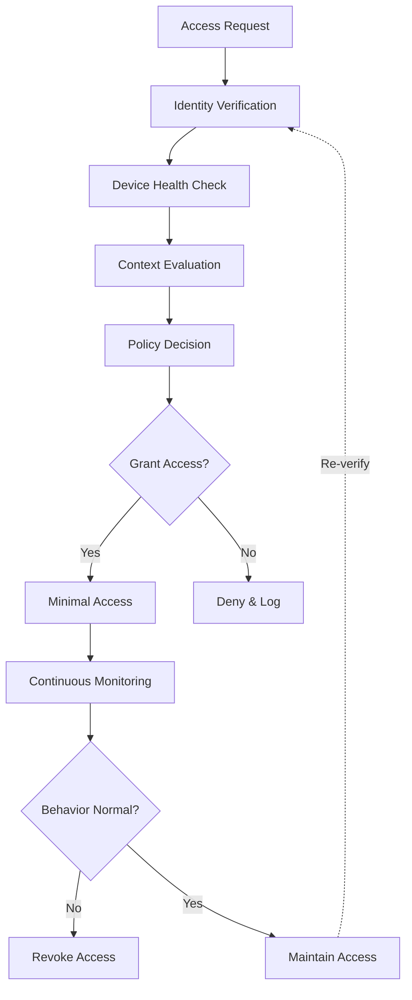
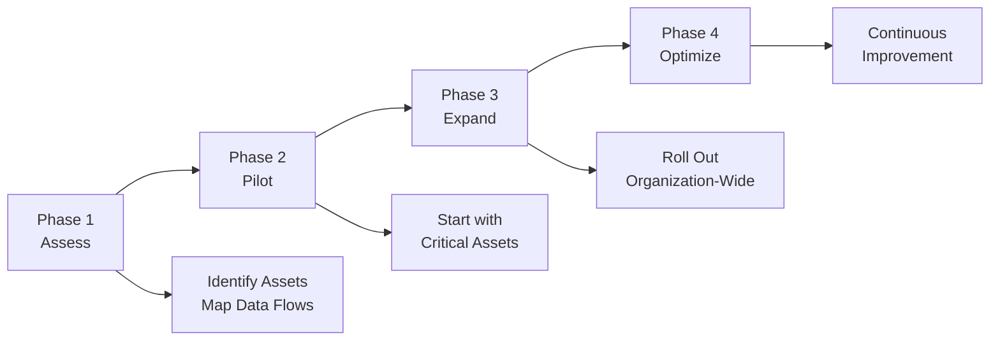

There is a growing need for *Zero-Trust security* as assets such as mobile phones connect uncontrollably to the network and business applications connect to the internet. *Zero-Trust* is a security model that moves defense away from static network-based environments and focuses instead on **users, assets, and resources**.

> **Key Insight**: Zero Trust operates on one simple principle: "Never trust, always verify." In a Zero Trust network, nothing and no one is trusted by default.

## The Traditional Security Model is Broken

In a traditional network, the threat model assumes that actors, systems, or services **within a security perimeter** can be trusted. This "castle-and-moat" approach is fundamentally flawed.

**Problems with Traditional Model:**
- Assumes internal network is safe
- Once inside, attackers move freely
- Trusts based on network location
- Single breach compromises everything

## Zero Trust Principles

*Zero-Trust* architecture is based on several core principles:

### Never Trust, Always Verify

Using Zero-Trust, assets (laptops, cellular devices, etc.) and user accounts **DO NOT receive implicit trust** based on their:
- Physical network location
- Previous authentication
- Device ownership
- Corporate status

**Every access request must be:**
- Authenticated
- Authorized
- Encrypted
- Verified continuously

### Assume Breach

Assume attackers are already inside your network:
- Design for containment
- Limit blast radius
- Monitor everything
- Plan for compromise

### Least Privilege Access

Grant users and systems:
- Minimum necessary permissions
- Just-in-time access
- Time-limited access
- Context-aware permissions

## Zero Trust Architecture Focus

The zero-trust architecture focuses on the **requirements and operations** of an organization's business. It implements a network-centric data security strategy that provides distinctive access to those who need it.

### Key Characteristics

**Zero Trust Network:**

| **Feature** | **Implementation** | **Benefit** |
|-------------|-------------------|-------------|
| **Positive Security Model** | Specific rulesets for access | Default-deny approach |
| **Least Privilege** | Minimum necessary access | Reduces attack surface |
| **Micro-Segmentation** | Isolated network zones | Limits lateral movement |
| **Environment Agnostic** | Works anywhere | On-prem, cloud, hybrid |

**Benefits:**
- Practical and facilitates the principle of least privilege
- Users given access only to services they need
- In attack scenarios, limits **lateral movement** within networks
- Minimizes **attack area and surface**

## Microsoft Zero Trust Architecture Components

According to *Microsoft*, Zero Trust Architecture has six pillars:

### 1. Identities

**Verify and secure the identification** of each user with reliable & robust authentication methods across an organization.

**Key Practices:**
- Implement MFA everywhere
- Use passwordless authentication
- Monitor for compromised credentials
- Apply conditional access policies
- Regular access reviews

### 2. Endpoints (Devices)

**Securing all endpoints** is crucial. It provides:
- Visibility into devices accessing the network
- Ensures compliance and health status
- Grants access only to compliant devices

**Device Security Requirements:**
- Up-to-date OS and patches
- Endpoint protection installed
- Compliant with policies
- Encrypted storage
- Managed and monitored

### 3. Applications

Shadow IT should be addressed to ensure IT systems, devices, assets, and applications can be:
- Discovered and inventoried
- Properly permissioned
- Monitored for anomalies
- Controlled for user actions

**Application Access:**
- Gate access based on **real-time analytics**
- Monitor user actions within apps
- Control permissions granularly
- Validate application security posture

### 4. Data

**Data is one of the most crucial assets** security teams need to focus on. Data should be kept safe when it leaves the devices, apps, infrastructure & networks of an organization.

**Data Security Practices:**
- Classification and labeling
- Encryption everywhere
- Data Loss Prevention (DLP)
- Access control based on classification
- Regular audits

### 5. Infrastructure

Infrastructure in the form of **on-prem servers, VMs (cloud-based), containers, micro-services**, etc., represents a critical attack vector for adversaries.

**Security Measures:**
- Use telemetry to **detect attacks and anomalies**
- Block and flag risky behavior
- Employ **least privilege access** principles
- Regular vulnerability scanning
- Patch management
- Configuration management

**Telemetry Usage:**

Large volumes of telemetry can be enriched and used to generate **high-quality risk assessments** for further investigation and triaging.

### 6. Network

**Devices and users must not be trusted** simply because they're on an internal network. Zero Trust should be accompanied by verification.

**Network Controls:**
- Enhanced visibility into all traffic
- **Encryption of all internal communications**
- Limiting access by policy optimization & enforcement
- Employment of **micro-segmentation**
- **Real-time threat detection**

## Zero Trust Implementation Model

### Decision Factors

**Policy Engine Considers:**

| **Factor** | **Examples** | **Impact on Access** |
|------------|--------------|---------------------|
| **Identity** | User, service account | Who is requesting? |
| **Device** | Laptop, phone, IoT | Managed? Compliant? |
| **Location** | Office, home, country | Expected location? |
| **Time** | Business hours, off-hours | Normal timing? |
| **Risk Score** | Past behavior, threat intel | Is this risky? |
| **Resource** | File, app, database | Sensitivity level? |

## Benefits of Zero Trust

### Security Benefits

- **Reduced attack surface**: Minimize exposure
- **Limited lateral movement**: Contain breaches
- **Granular control**: Per-resource permissions
- **Enhanced visibility**: Monitor everything
- **Faster incident response**: Quick containment

### Business Benefits

- **Enables cloud adoption**: Secure hybrid/multi-cloud
- **Supports remote work**: Secure from anywhere
- **Compliance**: Meets regulatory requirements
- **Reduces breach impact**: Limits damage
- **Digital transformation**: Secure modern architecture

## Implementation Roadmap

### Phase 1: Assess (Months 1-3)

- Identify all assets and resources
- Map data flows
- Identify users and devices
- Document current access patterns
- Define protection priorities

### Phase 2: Pilot (Months 4-6)

- Start with high-value assets
- Implement MFA
- Deploy micro-segmentation
- Enable monitoring
- Test and refine

### Phase 3: Expand (Months 7-12)

- Extend to all critical systems
- Implement across organization
- Integrate with existing tools
- Train users
- Refine policies

### Phase 4: Optimize (Ongoing)

- Continuous improvement
- Adapt to new threats
- Optimize policies
- Expand coverage
- Measure effectiveness

## Conclusion

*Zero Trust Architecture* represents a fundamental shift in how organizations approach security. By eliminating the concept of a "trusted internal network" and requiring **continuous verification** of every user, device, and resource, Zero Trust provides robust protection for modern, distributed environments.

The implementation of Zero Trust is not just about technology—it's about **people, processes, and technology** working together to create a security posture that assumes breach, verifies continuously, and limits impact.

As organizations embrace cloud computing, remote work, and digital transformation, Zero Trust is no longer optional—it's **essential** for protecting critical assets in today's threat landscape.

> **Final Takeaway**: Zero Trust is not a product you buy—it's a journey you undertake. Start with your most critical assets, implement controls incrementally, and continuously improve. Trust nothing, verify everything, and limit access to the absolute minimum necessary.

## References

- [NIST Zero Trust Architecture](https://www.nist.gov/publications/zero-trust-architecture)
- [Microsoft Zero Trust](https://www.microsoft.com/en-us/security/business/zero-trust)
- [Google BeyondCorp](https://cloud.google.com/beyondcorp)
- [CISA Zero Trust Maturity Model](https://www.cisa.gov/zero-trust-maturity-model)
