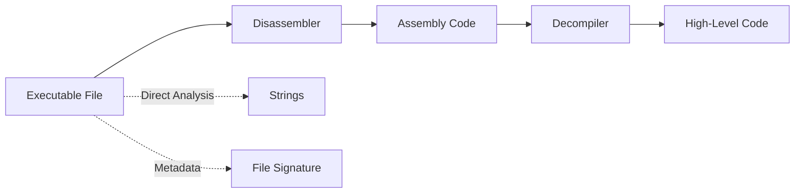
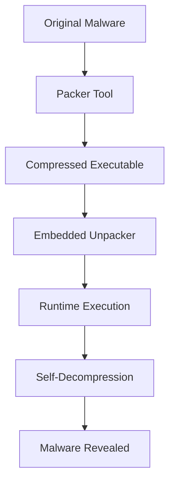
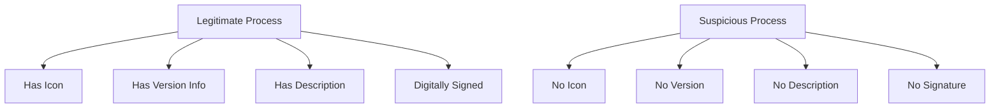
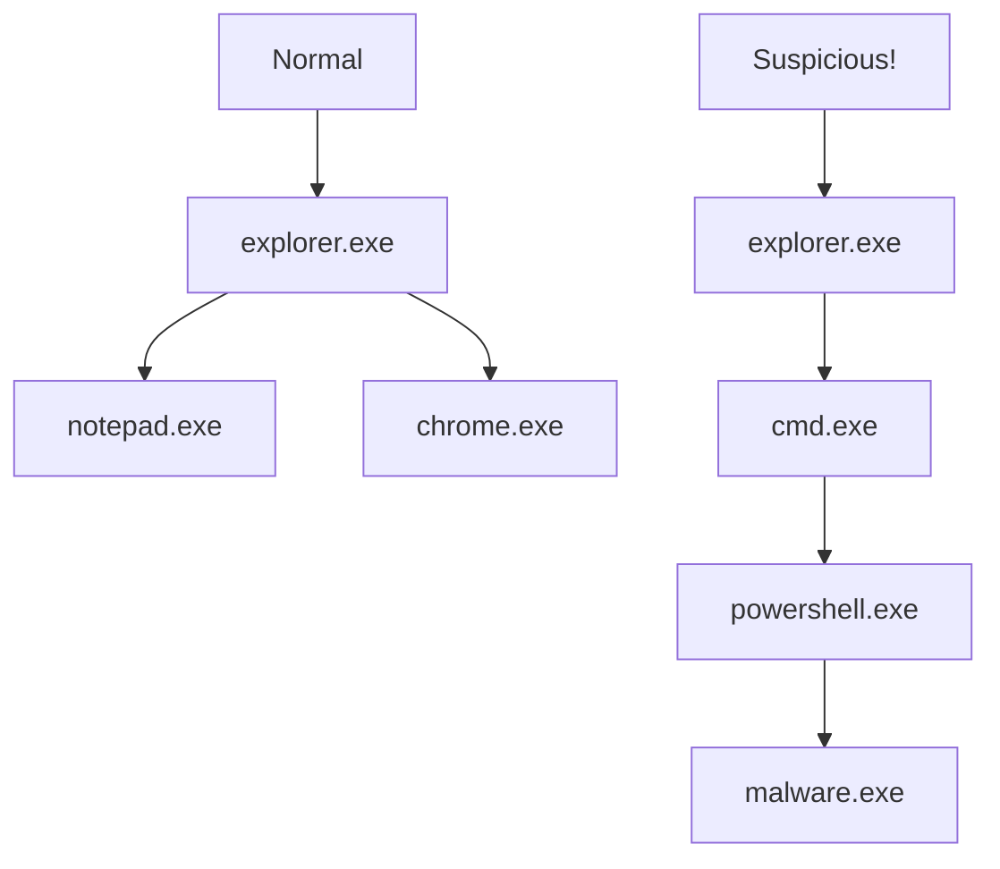
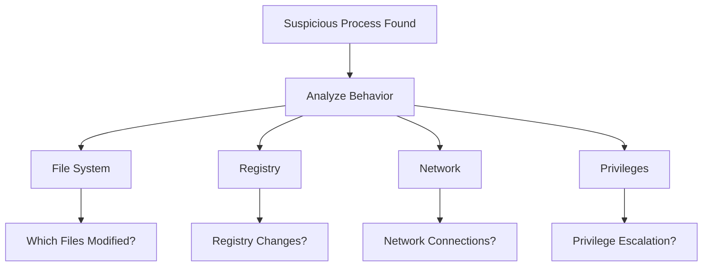
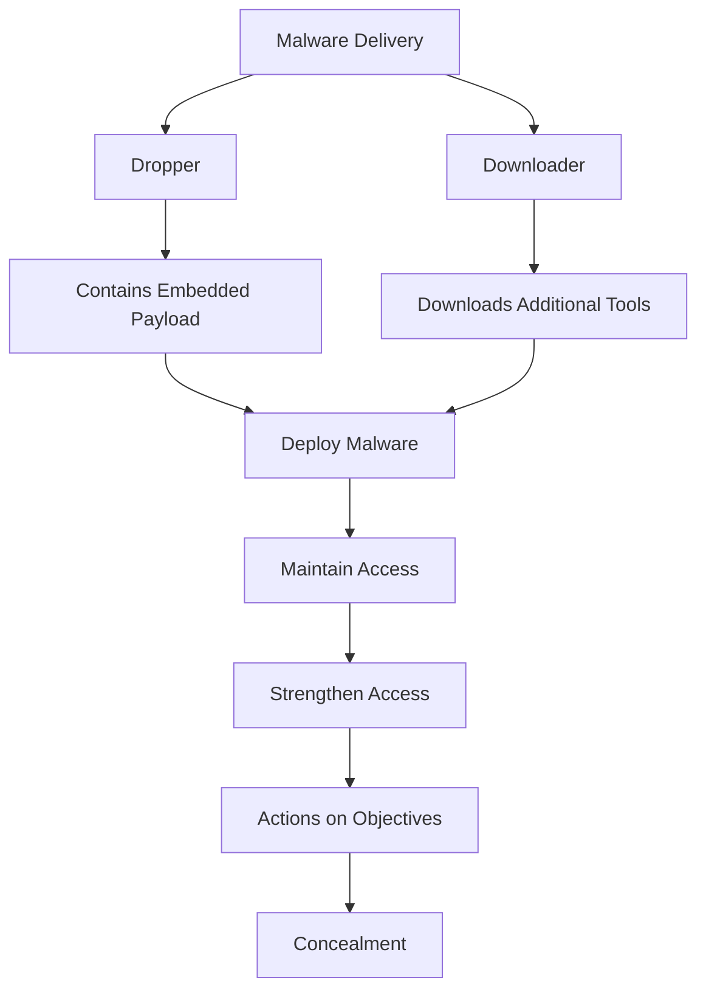
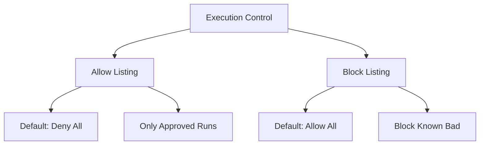

The process of analyzing hardware and software structure reveals its functions and gives the ability to learn patterns. An attacker who writes malware often **obfuscates code** to evade detection and analysis.

> **Key Insight**: Identifying suspicious processes is a critical skill for threat hunters and incident responders—knowing what "normal" looks like helps you spot the abnormal.

## Understanding Obfuscation & Reverse Engineering

### Methods Used for Obfuscation & Reverse Engineering

| **Term** | **Definition** | **Purpose** |
|----------|----------------|-------------|
| **Disassembler** | Translates machine language to assembly language | Understand compiled code |
| **Machine Code** | Binary code executed by the processor | Lowest-level instructions |
| **File Signature** | First bytes of a binary header | Identify file types (EXE, DLL, SYS, COM) |
| **Assembly Code** | Native processor instructions | Implement the program |
| **Decompiler** | Translates binary to high-level code | Easier analysis |
| **High-Level Code** | Human-readable pseudocode | Identify functions, variables |



### String Analysis

**Strings**: Encoded characters that appear within the executable file.

**Example:**
If malware contains:
- A string with a function called `InternalOpenURL`
- Another string that is a URL

It might be **downloading data from a web address**.

### Program Packers

**Program Packer**: Compression method where an executable is compressed, with code to decompress itself at runtime. The packed program is a type of **self-extracting archive**.

**Important Note:**
> Just because a program is packed does **not** mean it is malicious.

However, packed malware can:
- Mask string literals
- Modify its signature
- Avoid triggering signature-based scanners
- Remain hidden until unpacked



## What Makes a Process Look Suspicious?

### Red Flags for Suspicious Processes

#### 1. Process Name Anomalies

**The process name is similar to a legitimate system process but not exact:**

| **Legitimate** | **Malicious Lookalike** | **Difference** |
|----------------|------------------------|----------------|
| `svchost.exe` | `svch0st.exe` | Zero instead of 'o' |
| `explorer.exe` | `explore.exe` | Missing 'r' |
| `csrss.exe` | `cssrs.exe` | Letters swapped |
| `lsass.exe` | `lssas.exe` | Letters swapped |

#### 2. Missing Metadata

**Processes appear without:**
- Icon
- Version information
- Description
- Company name
- Digital signature



#### 3. Questionable Digital Signature

**Processes signed by:**
- Random/unknown companies
- Digital signature doesn't match identified publisher
- Expired certificates
- Self-signed certificates
- Revoked certificates

#### 4. Broken Parent/Child Relationships

**Suspicious parent-child relationships:**



**Red Flags:**
- `cmd.exe` spawning from unexpected processes
- PowerShell launched from Office applications
- Services spawning user applications

#### 5. Unusual Process Hosting

**Process hosted by:**
- `explorer.exe` - Should not host system services
- `notepad.exe` - Should not spawn child processes
- `task manager` - Should not be a parent
- Random user applications hosting system processes

## What to Do When You Find a Suspicious Process

### Investigation Checklist



### Key Questions to Ask

#### 1. Registry and File System Interaction

**Check how the process interacts with:**
- Registry keys (especially Run keys)
- File system (what files are created/modified)
- System directories
- User directories

```bash
# Windows: Monitor process activity
Get-Process -Name suspicious_process | Select-Object *
```

#### 2. Process Launch Method

**How is the process launched?**
- Startup folder
- Registry Run keys
- Scheduled task
- Service
- Manual execution
- DLL injection

#### 3. File Location

**Where is the image file located?**

| **Location** | **Suspicion Level** | **Notes** |
|--------------|-------------------|-----------|
| `C:\Windows\System32\` | Normal (if legitimate) | System processes |
| `C:\Program Files\` | Normal | Installed applications |
| `C:\Users\<user>\AppData\Local\Temp\` | **HIGH** | Temporary folder |
| `C:\Users\<user>\Downloads\` | **MEDIUM** | User downloads |
| Random folder names | **HIGH** | Likely malicious |

#### 4. File Manipulation

**What files are being manipulated?**
- Creating new files
- Modifying system files
- Deleting log files
- Accessing sensitive data

#### 5. Persistence Mechanisms

**Does the process restore itself?**
- Upon reboot
- After deletion
- Through scheduled tasks
- Via registry entries

**Does a system process get blocked after deletion?**
- May indicate rootkit
- Deep system integration
- Multiple persistence mechanisms

#### 6. Network Activity

**Is the process interacting with the network?**
- Which IPs/domains contacted
- Frequency of connections
- Data volume transferred
- Protocols used
- Encryption methods

```bash
# Monitor network connections
netstat -ano | findstr <PID>

# Linux equivalent
lsof -i -n -P | grep <PID>
```

#### 7. Privilege Usage

**Is there system privilege escalation happening?**
- Running as SYSTEM when should be user
- Requesting unnecessary permissions
- Token manipulation
- Privilege elevation attempts

## Malware Exploitation Techniques

### Exploit Methods

**How malware infects a target host:**



### How Adversaries Use Modern Malware

**Attack Progression:**

1. **Dropper or Downloader** - Initial infection
2. **Maintain Access** - Establish foothold
3. **Strengthen Access** - Escalate privileges
4. **Actions on Objectives** - Achieve goals
5. **Concealment** - Hide presence

### Malware Components

#### Dropper

Malware that **installs or runs** other types of malware embedded in a payload on an infected host.

**Characteristics:**
- Contains embedded malware
- Installs additional components
- Often self-deletes after deployment

#### Downloader

Malware that **connects to the internet** to retrieve additional tools after initial infection.

**Characteristics:**
- Small initial footprint
- Downloads payload from C2
- Stages the attack

#### Shellcode

**Lightweight code** designed to run an exploit on the target. May include any code format from scripting languages to binary code.

**Purpose**: Get a shell (command prompt) on target system.

#### Code Injection

Technique that runs malicious code with the **identity of a legitimate process**.

**Anti-Forensics Techniques:**
- **Masquerading**: Disguising as legitimate process
- **DLL Injection**: Injecting into running process
- **DLL Side-Loading**: Loading malicious DLL
- **Process Hollowing**: Replacing legitimate process memory

### Living Off the Land (LOL Bins)

Using **standard tools and packages** for intrusions makes detection more difficult when executing malware within common tools & processes.

**Examples:**
- `powershell.exe` - Scripting and automation
- `wmic.exe` - WMI command-line
- `certutil.exe` - Download files
- `mshta.exe` - Execute HTA files
- `regsvr32.exe` - Load malicious DLLs

## Behavioral Analysis

*Behavioral analyses* are used to identify infections through monitoring.

### SysInternals Tools

*SysInternals* tools assist in troubleshooting Windows issues and are ideal for investigating suspicious activity.

**Process Explorer** can filter out legitimate activity and highlight abnormal behavior.

### Expected Windows Process Behavior

#### System Idle (PID 0) and System (PID 4)

**Expected Behavior:**
- Kernel-level binary
- Parent of first user mode (Session Manager Subsystem - `smss.exe`)
- Always PID 0 and 4
- Always running

#### WININIT (wininit.exe)

**Expected Behavior:**
- Manages drivers & services
- Should have **only a single instance**
- Parent: `System`
- Children: `services.exe`, `lsass.exe`

#### Services.exe

**Expected Behavior:**
- Hosts non-boot drivers and background services
- Single instance running as child of `wininit.exe`
- Parent of `svchost.exe` instances
- Runs as SYSTEM

#### Local Security Authority Subsystem (lsass.exe)

**Expected Behavior:**
- Handles authentication & authorization
- **Single instance** running as child of `wininit.exe`
- Runs as SYSTEM
- Target of credential dumping attacks

> **Detection Tip**: Multiple `lsass.exe` processes are a major red flag!

#### WINLOGON (winlogon.exe)

**Expected Behavior:**
- Manages access to user desktop
- One instance per logged-in user
- Child process: `dwm.exe` (Desktop Window Manager)
- Runs with user privileges

#### USERINIT (userinit.exe)

**Expected Behavior:**
- Sets up shell at logon
- **Should quit after logon**
- If still running after logon: suspicious!

#### EXPLORER (explorer.exe)

**Expected Behavior:**
- Typical user shell
- Launched with user's account privileges (not SYSTEM)
- Parent of processes started by logged-in users
- User-initiated applications

## Remediation Strategies

### 1. EDR Configuration

**Deploy Endpoint Detection and Response:**
- Behavioral monitoring
- Process relationship tracking
- Anomaly detection
- Automated response

### 2. VirusTotal

**Signature-based detection:**
- Upload suspicious file hash
- Check against 60+ antivirus scanners
- Community insights
- Historical analysis

```bash
# Get file hash
Get-FileHash suspicious.exe -Algorithm SHA256

# Check on VirusTotal
```

### 3. MAEC (Malware Attribute Enumeration and Characterization)

**Standardized language** for sharing information about malware:
- Complementary to STIX and TAXII
- Improves threat intelligence
- Enables automated analysis

### 4. YARA Rules

**YARA rulesets** for matching string combinations with data sources.

**Example YARA Rule:**

```yara
rule Suspicious_Process
{
 meta:
 description = "Detects suspicious process behavior"
 author = "Security Team"
 
 strings:
 $string1 = "InternalOpenURL"
 $string2 = "http://" ascii wide
 
 condition:
 all of them
}
```

### 5. Allow Listing & Blocklisting

**Allow Listing:**
- Allow known apps, services, traffic
- **Default-deny**: Access denied unless on allowlist
- Highly restrictive but effective
- Prevents unknown malware execution

**Block Listing:**
- Block known malicious apps, services, traffic
- **Default-allow**: Access permitted unless on blocklist
- Risk of false positives
- Reactive approach



### 6. Execution Control

**Windows:**
- Software Restriction Policies
- AppLocker
- Windows Defender Application Control (WDAC)

**Linux:**
- Mandatory Access Control (MAC)
- Linux Security Modules (LSM)
 - SELinux
 - AppArmor

## Investigation Tools

| **Tool** | **Platform** | **Purpose** |
|----------|--------------|-------------|
| **Process Explorer** | Windows | Advanced process monitoring |
| **Process Monitor** | Windows | Real-time file/registry/network monitoring |
| **Autoruns** | Windows | Startup programs analysis |
| **TCPView** | Windows | Network connection monitoring |
| **ps** | Linux | Process listing |
| **lsof** | Linux | Open files and network connections |
| **htop** | Linux | Interactive process viewer |

## Suspicious Process Indicators

### Comprehensive Checklist

```mermaid
mindmap
root((Suspicious<br/>Indicators))
Process Name
Typosquatting
Random Characters
System Lookalike
Location
Temp Folders
Unusual Paths
User Directories
Behavior
Network Connections
File Modifications
Registry Changes
Attributes
No Signature
No Icon
No Version
Relationships
Wrong Parent
Unexpected Children
Orphaned Process
```

### Common Suspicious Patterns

**Network Behavior:**
- Unusual outbound connections
- Connections to known bad IPs
- Beaconing behavior
- Large data transfers
- Connections to unusual ports

**File System Behavior:**
- Creating files in Windows\System32
- Modifying startup locations
- Accessing sensitive files
- Encrypting user files
- Deleting shadow copies

**Registry Behavior:**
- Creating Run keys
- Modifying security settings
- Disabling security software
- Creating services

## Conclusion

Identifying suspicious processes requires a combination of **technical knowledge**, **behavioral analysis**, and **experience** with normal system operations. By understanding how legitimate processes should behave, where they should be located, and what their parent-child relationships should look like, security analysts can quickly identify anomalies that may indicate malware.

The key is to:
- Know your baseline normal behavior
- Monitor for deviations
- Investigate anomalies thoroughly
- Use multiple analysis tools
- Document findings
- Share threat intelligence

> **Final Takeaway**: Every suspicious process deserves investigation. Trust your instincts, verify with tools, and always ask: "Why is this process behaving this way?" The answer may reveal an active compromise.

## References

- [MITRE ATT&CK: Process Injection](https://attack.mitre.org/techniques/T1055/)
- [SysInternals Suite](https://docs.microsoft.com/en-us/sysinternals/)
- [YARA Documentation](https://yara.readthedocs.io/)
- [SANS: Investigating Suspicious Processes](https://www.sans.org/blog/)
