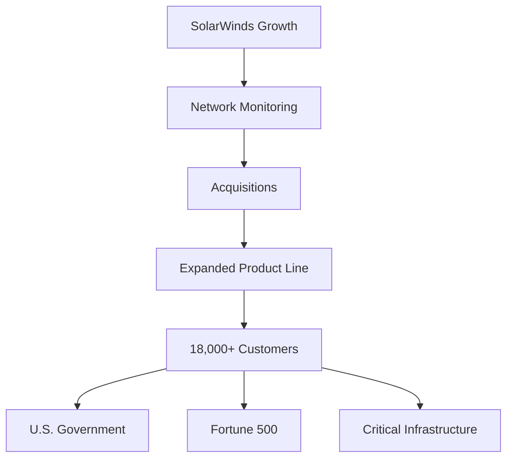
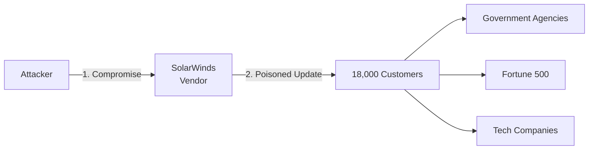
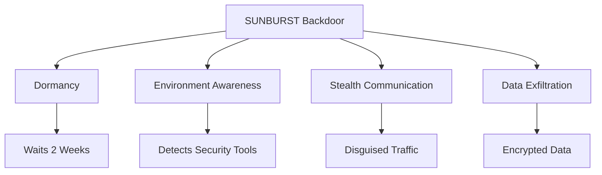
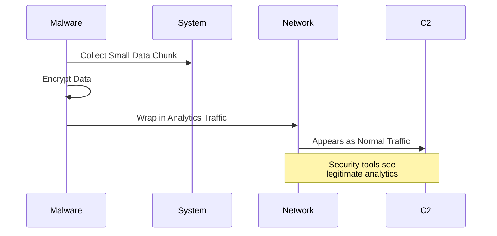
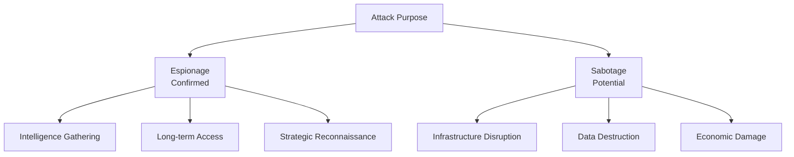
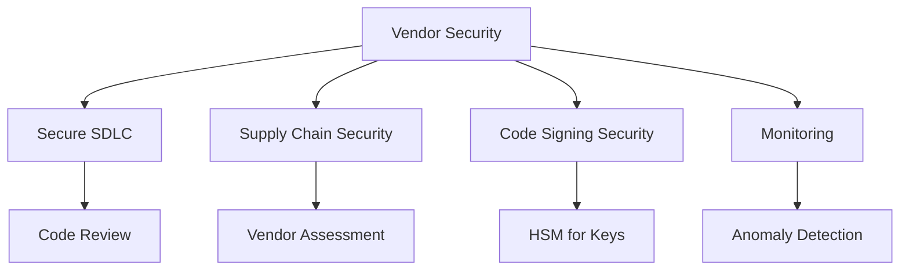

Let's dive into a topic which could possibly be **one of the largest cybersecurity breaches in the history of the US**. A little history into SolarWinds and the services they offer.

> **Key Insight**: The SolarWinds hack represents the gold standard of supply chain attacks—compromising one vendor to reach thousands of high-value targets.

## Understanding SolarWinds

*SolarWinds* is a **SaaS-based company** which helps other big companies:
- Monitor network performance
- Trace application behavior
- Log system activities
- Ensure optimal performance during peak times

These services are important for large organizations because they allow companies to make sure their software and applications run smoothly even during peak operating times and under heavy load or traffic.

### The Company's Growth

It wasn't long before SolarWinds started **acquiring companies** with adjacent products, expanding and growing their customer base, including:
- **U.S. Government agencies**
- **Fortune 500 companies**
- Critical infrastructure providers
- Major corporations worldwide

## The Attack: A Supply Chain Masterpiece

If you look at the hack itself, **it makes perfect sense**. Instead of targeting a particular agency or company, the threat actors went after *SolarWinds*—the company that sells software to these larger agencies.

This is formally known as a **supply chain attack**.

### What is a Supply Chain Attack?

A *supply chain attack* targets **vendors** and **suppliers** rather than the end targets directly.

**The Mechanism:**
- Application developers deploy code to a wide array of companies
- Inject malware into app updates
- Updates are **digitally signed** by the originating company (source of trust)
- Recipients don't notice anything wrong during updates

**The Irony:**
> What makes it even more harmful is that service consumers are **doing the right thing** by updating their applications and keeping them current. So if you compromise just one company, you can compromise them all.

## The Sophistication Required

Hacking into a company like SolarWinds is **not easy**. After all, software is their bread and butter. Such a highly skilled operation could only be executed with:

- Advanced technological resources
- Significant funding
- Elite skills and expertise
- Patience (months of development)
- Infrastructure for operations

**Attribution**: Only a **nation-state** (an Advanced Persistent Threat) could carry out such an attack.

## SUNBURST: The Malware

The hack is now referred to as **"SUNBURST"**. The code has been made public to alert the cybersecurity community and enable remediation.

### SUNBURST Capabilities

### Sophisticated Evasion Techniques

#### 1. Dormancy Period

The hack is programmed to **sit entirely dormant for two weeks** before any malicious activity begins.

**Why?**
- Evade initial security scans
- Appear as legitimate update
- Reduce suspicion
- Blend into normal operations

#### 2. Environment Awareness

Before doing anything, SUNBURST checks if the target system is running **security-related software**:

**Blocklisted Security Tools:**
- Antivirus software
- EDR solutions
- Network monitoring tools
- Forensic tools
- Reverse engineering tools

If detected, the malware **remains dormant** to avoid detection.

#### 3. Stealthy Data Exfiltration

Once it starts stealing data, SUNBURST:
- **Does NOT** copy mass amounts of data at once
- **Steals small amounts** at a time
- **Encrypts stolen data**
- **Wraps data in legitimate traffic** (analytics data)

**Result**: When analytics data leaves a company's network, **nobody notices** because it looks like normal, expected traffic.

## Timeline and Attribution

### Discovery and Deployment

**Timeline:**
- **Deployment**: March 2020 (potentially earlier)
- **Discovery**: December 2020
- **Dwell Time**: ~9 months undetected

**Attribution:**
- **Suspected Actor**: APT29 (Cozy Bear)
- **Attribution**: Russian Foreign Intelligence Service (SVR)
- **Sophistication**: Nation-state level

### Attack Objectives

Such a hack generally falls under two categories:

#### 1. Espionage (Information Gathering)

**Evidence suggests** the SolarWinds hack falls under **espionage**:
- Reconnaissance
- Intelligence gathering
- Long-term access
- Strategic information theft

#### 2. Sabotage (Potential Future Use)

**More dangerous scenario** (not confirmed):
- Disable critical infrastructure
- Exploit gathered information
- Cause billions in damages
- Disruption capabilities

## Impact Assessment

### Organizations Affected

**Known Victims:**
- U.S. Department of Treasury
- U.S. Department of Commerce
- Department of Homeland Security
- Department of State
- National Institutes of Health
- Multiple Fortune 500 companies
- Technology firms (Microsoft, Cisco, Intel)

**Total Impact:**
- ~18,000 organizations received trojanized updates
- Estimated hundreds to thousands actively compromised
- Months of forensic investigation required
- Billions in remediation costs

## The Technical Brilliance (and Horror)

### Engineering Excellence

The SUNBURST backdoor demonstrated:

**1. Patience:**
- Waited 2 weeks before activation
- Slow, methodical data theft
- Long-term persistent access

**2. Stealth:**
- Environment-aware (avoided security tools)
- Disguised as legitimate traffic
- Encrypted communications
- Minimal footprint

**3. Sophistication:**
- Supply chain compromise
- Signed with legitimate certificate
- Sophisticated C2 protocol
- Domain generation algorithm (DGA)

## Lessons Learned

### For Software Vendors

**Building a strong security culture:**

**Key Measures:**
- Build strong cybersecurity culture from the bottom up
- Implement at earliest stage possible
- Secure the build environment
- Protect code signing certificates
- Monitor for anomalies
- Incident response readiness

### For Customers

**Supply Chain Risk Management:**

| **Action** | **Purpose** | **Frequency** |
|------------|-------------|---------------|
| **Vendor Assessment** | Evaluate security posture | Annually |
| **Monitoring** | Detect unusual update behavior | Continuous |
| **Segmentation** | Limit blast radius | Ongoing |
| **Backup** | Enable recovery | Daily |
| **Incident Response** | Rapid containment | As needed |

## Defense Strategies

### Prevention

- Vendor security assessments
- Supply chain security requirements
- Code signing verification
- Network segmentation
- Principle of least privilege

### Detection

- Monitor software update behavior
- Anomaly detection on network traffic
- Behavioral analysis of applications
- Threat hunting for known SUNBURST IoCs

### Response

- Incident response plan for supply chain attacks
- Communication procedures
- Forensic capabilities
- Recovery procedures

## Conclusion

The *SolarWinds hack* represents a watershed moment in cybersecurity, demonstrating the devastating potential of **supply chain attacks** executed by nation-state actors. By compromising a single, trusted vendor, attackers gained access to thousands of high-value targets—government agencies, Fortune 500 companies, and critical infrastructure providers.

The sophistication of the SUNBURST malware—with its dormancy period, environment awareness, and stealthy exfiltration—showcases the level of capability possessed by advanced persistent threat groups.

For organizations, the lessons are clear:
- **Supply chain security is critical**
- **Trust must be verified**, even for vendors
- **Defense in depth** is essential
- **Detection capabilities** must improve
- **Incident response** must include supply chain scenarios

This hack should lead to more defensive measures taken to protect systems and **transform how we think about supply chain security**.

> **Final Takeaway**: In a connected world, your security is only as strong as your weakest supply chain link. The SolarWinds hack proved that compromising the supplier is often easier than attacking the target directly. Build security culture from the bottom up, verify everything, and prepare for supply chain compromise.

## References

- [SolarWinds Security Advisory](https://www.solarwinds.com/securityadvisory)
- [Microsoft: Analyzing Solorigate](https://www.microsoft.com/security/blog/2020/12/18/analyzing-solorigate-the-compromised-dll-file-that-started-a-sophisticated-cyberattack-and-how-microsoft-defender-helps-protect/)
- [FireEye: SUNBURST Backdoor](https://www.fireeye.com/blog/threat-research/2020/12/evasive-attacker-leverages-solarwinds-supply-chain-compromises-with-sunburst-backdoor.html)
- [CISA: SolarWinds Response](https://www.cisa.gov/news-events/news/joint-statement-federal-bureau-investigation-fbi-cybersecurity-and-infrastructure-security)
