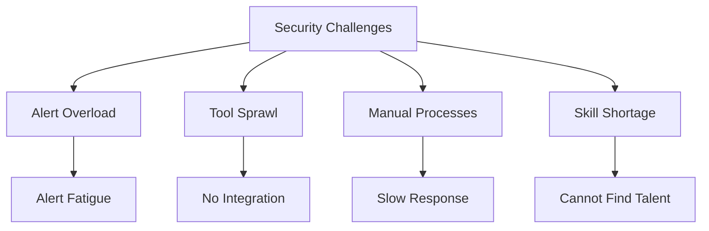
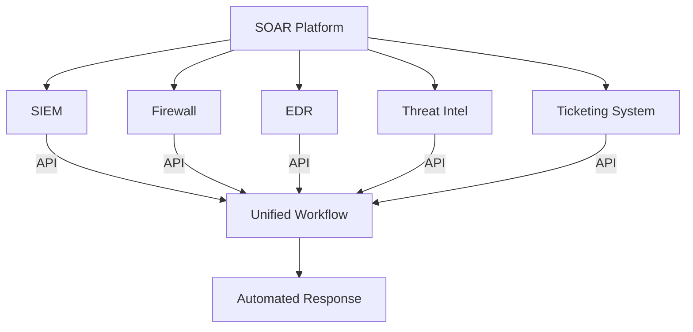
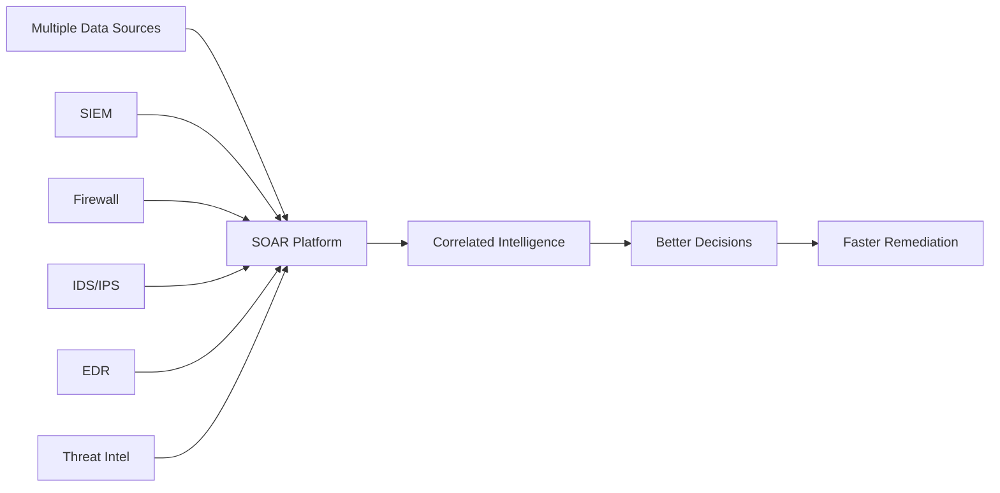
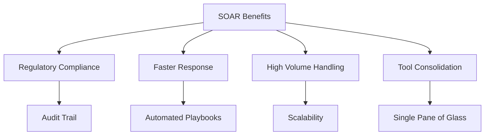
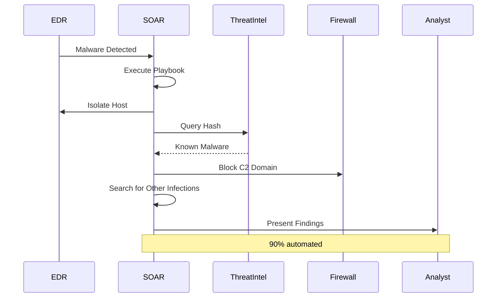
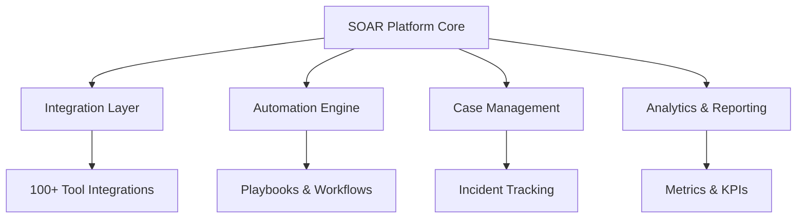
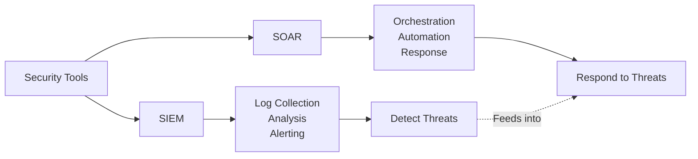
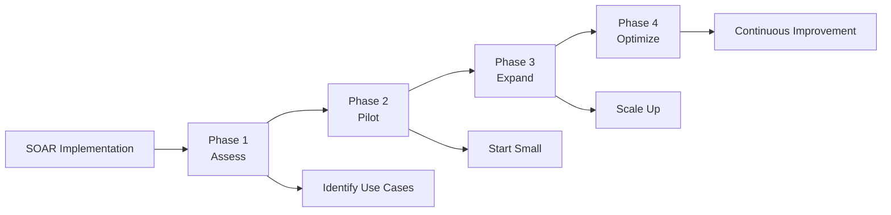

*SOAR* has been garnering significant interest in recent years. **SOAR** stands for **Security Orchestration, Automation & Response**. A SOAR platform allows organizations to collect large amounts of data and alerts from different detection sources, helping them execute, coordinate, and automate tasks, enabling organizations to **respond quickly to cyberattacks** and improve their overall security posture.

> **Key Insight**: SOAR transforms security operations from manual, reactive chaos into automated, proactive orchestration—multiplying your team's effectiveness.

## What is SOAR?

SOAR platforms or tools focus on key areas within security:

```mermaid
mindmap
root((SOAR))
Threat & Vulnerability Management
Vulnerability Scanning
Threat Intelligence
Risk Prioritization
Security Operations Automation
Playbook Automation
Workflow Orchestration
Tool Integration
Incident Response
Alert Triage
Investigation
Remediation
```

### Core Focus Areas

1. **Threat and Vulnerability Management**
2. **Security Operations Automation**
3. **Incident Response**

## The Challenges SOAR Solves

Organizations face numerous challenges that SOAR addresses:

### Common Security Operations Problems



| **Challenge** | **Description** | **Impact** |
|---------------|-----------------|------------|
| **Alert Overload** | Thousands of daily alerts | Alert fatigue, missed threats |
| **Complex Threats** | Sophisticated attack chains | Difficult to detect and respond |
| **Disconnected Tools** | Systems don't communicate | Manual correlation required |
| **Disparate Tools** | Analysts use many different tools | Slow investigation |
| **Manual Processes** | Poorly documented procedures | Inconsistent response |
| **Skills Shortage** | Cannot find qualified people | Overwhelmed teams |

> **Reality**: Security teams are drowning in alerts while attackers operate at machine speed. SOAR levels the playing field.

## SOAR Features & Benefits

### 1. Orchestration & Automation

*Orchestration & Automation* capabilities allow the security team to **plug into various security tools** through APIs.

#### How It Works



**Benefits:**
- Create **playbooks/runbooks** for specific alert types
- Automate daily repetitive tasks
- Save time by ensuring processes are addressed promptly
- Increase overall team efficiency
- Consistent incident handling

**Example Automated Workflow:**

```yaml
# Phishing Email Response Playbook
1. Receive phishing alert from email gateway
2. Automatically extract indicators (URLs, attachments)
3. Query threat intelligence for reputation
4. Check if other users received same email
5. Quarantine emails across organization
6. Block malicious URLs at firewall
7. Create ticket for analyst review
8. Notify affected users
9. Document incident
# All automated - seconds instead of hours
```

### 2. Intelligent Investigation

Once orchestration and automation are performed, analysts still need to **investigate alerts and incidents**. A SOAR helps security teams become more **intelligence-driven** by:

**Data Aggregation:**
- SIEM logs
- Firewall events
- Intrusion detection alerts
- Endpoint telemetry
- Threat intelligence feeds



**Results:**
- Better and quicker decisions
- Informed remediation strategies
- Appropriate escalation
- Context-rich investigations

### 3. Enhanced Incident Response

While investigating, **immediate response is vital** to minimize the spread of threats and disruption.

#### Metrics Improvement

| **Metric** | **Without SOAR** | **With SOAR** | **Improvement** |
|------------|------------------|---------------|-----------------|
| **Mean Time to Detect (MTTD)** | Hours | Minutes | 90%+ reduction |
| **Mean Time to Respond (MTTR)** | Hours/Days | Minutes | 95%+ reduction |
| **Alert Handling Capacity** | 10-20/day | 100s/day | 10x increase |
| **False Positive Rate** | 50-70% | 10-20% | Significantly reduced |

**How SOAR Helps:**
- Detect and remediate alerts in **minutes** instead of hours
- Visibility into analyst actions
- Historical data for pattern recognition
- Tool effectiveness analysis
- Process optimization

### 4. Centralized Solution with Standardized Processes

A **centralized solution** provides:



- Better regulatory and internal compliance
- Faster response times
- Ability to handle large volumes of alerts
- Consolidated security tools in one platform
- Prevent breaches from spreading

## SOAR Use Cases

### Use Case 1: Phishing Response

**Manual Process (30-60 minutes):**
1. Analyst receives alert
2. Opens email in sandbox
3. Extracts indicators manually
4. Checks each indicator in multiple tools
5. Searches for other instances
6. Creates firewall rules manually
7. Updates ticket
8. Notifies users

**SOAR Automated Process (2-3 minutes):**
1. Alert triggers playbook
2. Auto-extract indicators
3. Query threat intel (parallel)
4. Search mailboxes (automated)
5. Block indicators (automated)
6. Quarantine emails (automated)
7. Update ticket (automated)
8. Notify users (automated)

### Use Case 2: Malware Detection



### Use Case 3: Vulnerability Management

**Automated Workflow:**
1. Vulnerability scanner finds critical CVE
2. SOAR queries asset database
3. Identifies affected systems
4. Checks for available patches
5. Creates remediation tickets
6. Assigns to appropriate teams
7. Tracks remediation progress
8. Verifies patching completion

## SOAR Architecture



## Leading SOAR Platforms

| **Platform** | **Strengths** | **Best For** |
|--------------|---------------|--------------|
| **Splunk SOAR (Phantom)** | Deep SIEM integration | Splunk customers |
| **Palo Alto XSOAR** | Extensive integrations | Enterprise |
| **IBM Resilient** | Incident response focus | Large organizations |
| **Swimlane** | Low-code automation | Rapid deployment |
| **Cortex XSOAR** | Threat intelligence | SOC teams |
| **Siemplify** | User-friendly | Mid-size organizations |

## SOAR vs SIEM



| **Aspect** | **SIEM** | **SOAR** |
|------------|----------|----------|
| **Primary Function** | Detection & analysis | Orchestration & response |
| **Focus** | Log aggregation, correlation | Workflow automation |
| **Output** | Alerts, dashboards | Automated actions |
| **User** | Analysts investigate | System responds automatically |
| **Relationship** | Generates alerts | Acts on alerts |

> **Best Practice**: SIEM and SOAR work together—SIEM detects, SOAR responds.

## ROI of SOAR

### Cost Savings

**Efficiency Gains:**
- **Time savings**: 90%+ on repetitive tasks
- **Team productivity**: Handle 10x more alerts
- **Cost reduction**: Reduce analyst hours needed
- **Accuracy**: Fewer human errors
- **Scalability**: Handle growth without adding headcount

### Measurable Benefits

| **Metric** | **Before SOAR** | **After SOAR** | **Improvement** |
|------------|-----------------|----------------|-----------------|
| **Alerts Handled/Day** | 50 | 500+ | 10x |
| **Average Response Time** | 4 hours | 15 minutes | 16x faster |
| **False Positive Investigation** | 30 min/alert | 2 min/alert | 93% reduction |
| **Analyst Burnout** | High | Low | Improved morale |

## Implementation Best Practices

### Getting Started



**Phased Approach:**

1. **Assess** (Months 1-2)
 - Identify pain points
 - Document current processes
 - Select initial use cases

2. **Pilot** (Months 3-4)
 - Implement 2-3 playbooks
 - Integrate core tools
 - Train team
 - Measure results

3. **Expand** (Months 5-8)
 - Add more playbooks
 - Integrate additional tools
 - Expand use cases
 - Refine processes

4. **Optimize** (Ongoing)
 - Tune playbooks
 - Add advanced features
 - Continuous improvement
 - Share knowledge

### Key Success Factors

- **Start with high-value use cases**
- **Document existing processes first**
- **Get analyst buy-in early**
- **Iterate and improve continuously**
- **Measure and demonstrate ROI**
- **Invest in training**

## Conclusion

A *SOAR platform* is not just another security tool—it's a **force multiplier** for your security team. By automating repetitive tasks, orchestrating complex workflows, and enabling faster, intelligence-driven decision-making, SOAR allows security teams to:

- **Do more with less**: Handle exponentially more alerts
- **Respond faster**: Minutes instead of hours
- **Work smarter**: Focus on high-value analysis
- **Scale effectively**: Grow without proportional headcount increase
- **Reduce burnout**: Eliminate tedious manual work

In today's threat landscape where attackers operate at machine speed and security teams are overwhelmed with alerts, SOAR isn't a luxury—it's a **necessity**. The question isn't whether you need SOAR, but how quickly you can implement it to improve your security posture.

> **Final Takeaway**: SOAR doesn't replace your security team—it amplifies them. By handling the repetitive, time-consuming tasks, SOAR frees analysts to do what humans do best: think creatively, investigate deeply, and hunt proactively for threats.

## References

- [Gartner: Market Guide for SOAR](https://www.gartner.com/en/documents/3970866)
- [SANS: SOAR Buyer's Guide](https://www.sans.org/white-papers/)
- [Forrester: The SOAR Landscape](https://www.forrester.com/)
- [SOAR Playbook Library](https://github.com/phantomcyber/playbooks)
