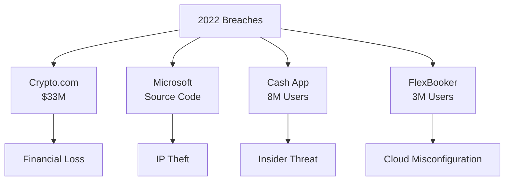
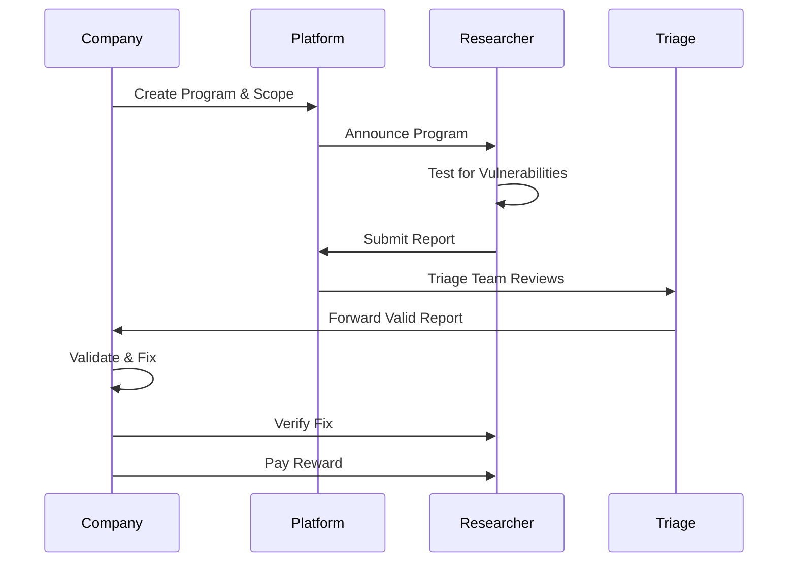
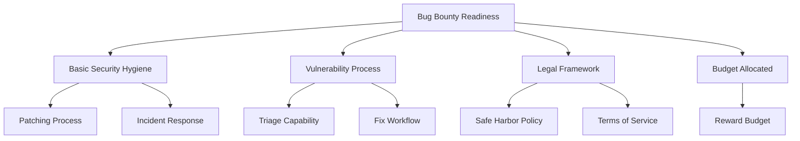
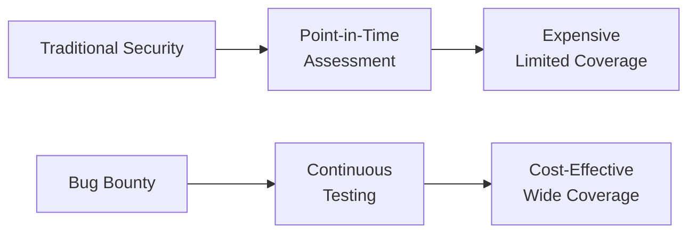
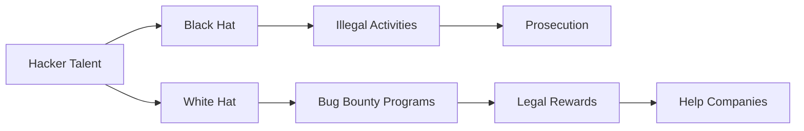

The global annual losses from cybercrimes amounted to nearly **$1 trillion in 2020** and are expected to rise in the coming years. Businesses operating in the USA, Germany, Japan, United Kingdom, France, and Singapore face the most significant damage. Sectors such as banking, utilities, software, automotive, insurance, and high-tech have suffered tremendous losses due to cyberattacks.

> **Key Insight**: Bug bounty programs transform hackers from adversaries into allies, turning the global security community into your extended security team.

## Top Data Breaches of 2022

### Notable Incidents

#### 1. Crypto.com (January 2022)

*Crypto.com* was subjected to a severe breach targeting nearly **500 cryptocurrency wallets**.

**Attack Details:**
- **Date**: January 17, 2022
- **Method**: Circumvented two-factor authentication (2FA)
- **Loss**: $18 million Bitcoin + $15 million Ethereum
- **Total**: $33 million stolen

> **Lesson**: Even blockchain-based platforms are vulnerable if authentication is weak.

#### 2. Microsoft (March 2022)

Computing giant *Microsoft* was targeted by hacking collective **Lapsus$**.

**Attack Details:**
- **Date**: March 20, 2022
- **Method**: Source code theft
- **Impact**: Compromised Cortana, Bing, and other products
- **Disclosure**: Group posted screenshot on Telegram

#### 3. Cash App (April 2022)

*Block* (formerly Twitter/Square) acknowledged that a **former employee** breached Cash App servers.

**Impact:**
- **Affected Users**: 8 million+ customers contacted
- **Data Exposed**: Customer information
- **Type**: Insider threat

#### 4. FlexBooker (Late 2021/Early 2022)

**FlexBooker** was hit by an attack affecting around **3 million users**.

**Attack Details:**
- **Attacker**: Hacking group "Uawrongteam"
- **Method**: Cracked AWS servers, installed malware
- **Sophistication**: Not particularly sophisticated
- **Impact**: 3 million users' data exposed

## What is a Bug Bounty Program?

The **bug bounty program** is a step toward adopting a **proactive stance** rather than a reactive one, giving companies the chance to use hackers' ethical talents to look for vulnerabilities and hidden gaps within software products.

### Bug Bounty Lifecycle

**The Process:**

1. **Company creates scope** - Define rules of engagement
2. **Program goes live** - On platforms like HackerOne, Bugcrowd, Intigriti
3. **Ethical hackers test** - Within defined scope
4. **Reports submitted** - Through platform
5. **Triage team verifies** - Platform's in-house team
6. **Security team receives report** - With remediation details
7. **Vulnerability fixed** - Agreeable timeline
8. **Researcher verifies** - Confirms fix
9. **Reward paid** - Based on severity

## Core Essentials of a Bug Bounty Program

### 1. Reliable Reporting Channel

Essential to have a **reliable channel** to ensure security reports reach the designated individuals or team.

**Communication Channels:**
- Dedicated email (security@company.com)
- Bug bounty platform interface
- Encrypted communication option
- Clear escalation path

### 2. Properly Defined Scope

**Make sure you define proper scope:**

| **Scope Type** | **Visibility** | **Best For** |
|----------------|----------------|--------------|
| **Private** | Invite-only | Initial launch, sensitive assets |
| **Limited** | Invite + applications | Controlled expansion |
| **Public** | Open to all | Mature programs, maximum coverage |

**In-Scope Examples:**
- Web applications
- Mobile applications
- APIs
- Specific infrastructure

**Out-of-Scope Examples:**
- Physical security testing
- Social engineering employees
- DDoS attacks
- Third-party services

### 3. Responsible Vulnerability Disclosure

**Clear guidelines for:**
- Reporting timeline
- Coordination with researchers
- Public disclosure rules
- Confidentiality requirements

### 4. Active Communication

**Actively communicate with researchers:**
- Respond to reports promptly (within 24-48 hours)
- Provide status updates
- Ask clarifying questions
- Thank researchers
- Build relationships

### 5. Bounty Tables

**Utilize bounty tables** based on severity levels:

| **Severity** | **CVSS Score** | **Typical Reward** | **Example** |
|--------------|----------------|-------------------|-------------|
| **Critical** | 9.0 - 10.0 | $5,000 - $50,000+ | Remote code execution |
| **High** | 7.0 - 8.9 | $1,000 - $5,000 | SQL injection |
| **Medium** | 4.0 - 6.9 | $500 - $1,000 | XSS, CSRF |
| **Low** | 0.1 - 3.9 | $100 - $500 | Information disclosure |
| **Informational** | N/A | Recognition | Minor issues |

### 6. Keep Best Practices Updated

**Essential to keep policies current:**
- Regular policy reviews
- Update based on lessons learned
- Incorporate new vulnerability types
- Adjust rewards competitively

## Is Your Business Ready for Bug Bounty?

### Readiness Assessment

In 2024, **every company with a digital asset** should have a vulnerability intake process.

**Prerequisites:**

**Before Launching:**

- [ ] Basic security measures in place
- [ ] Vulnerability management process
- [ ] Resources to triage and fix issues
- [ ] Legal safe harbor policy
- [ ] Budget for rewards
- [ ] Executive buy-in
- [ ] Clear scope definition
- [ ] Communication plan

### Benefits Analysis

**Bug Bounty Program Benefits:**

**Cost-Effectiveness:**
- Traditional security audit: $50,000 - $200,000+
- Bug bounty: Pay only for valid findings
- **24/7 coverage** vs. point-in-time assessment
- Continuous testing vs. annual pentests

**Coverage:**
- Expert security audits are pricey and one-time
- Bug bounty provides **24/7 non-stop security testing**
- Exceptional parallel coverage on vulnerabilities
- Diverse skillsets and perspectives

## Bug Bounty Platforms

| **Platform** | **Focus** | **Notable Programs** |
|--------------|-----------|---------------------|
| **HackerOne** | General purpose | Google, GitHub, PayPal |
| **Bugcrowd** | Crowdsourced security | Tesla, OpenAI |
| **Intigriti** | European focus | European companies |
| **YesWeHack** | European GDPR-compliant | European organizations |
| **Synack** | Vetted researchers | Government, enterprises |

## Success Metrics

### Program Health Indicators

| **Metric** | **Target** | **Indicates** |
|------------|-----------|---------------|
| **Time to First Response** | < 24 hours | Engagement level |
| **Time to Triage** | < 3 days | Process efficiency |
| **Time to Resolution** | < 30 days | Fix capacity |
| **Valid Reports %** | > 30% | Scope clarity |
| **Researcher Satisfaction** | > 4/5 | Program health |

## The Hacker Talent Advantage

With companies becoming more accepting of improving their ongoing processes and products, bug bounty programs are gaining velocity as one of the most **renowned preventive tools** in the context of data breaches.

### Changing the Narrative

**The Transformation:**
- Black hat hackers: Cutting-edge tech for illicit activities
- White hat hackers: Help companies stay two steps ahead
- Bug bounties: Channel talent to the bright side

Before leveraging an army of hackers, consider:
- **Define the reason** for implementing the program
- **Work with trusted partners** (HackerOne, Bugcrowd, etc.)
- **Ensure responsible research** is conducted
- **Build it into** security program strategy

## Conclusion

*Bug bounty programs* represent a fundamental shift in how organizations approach security—from reactive breach response to **proactive vulnerability discovery**. Instead of waiting for attackers to find and exploit vulnerabilities, companies crowdsource security testing to ethical hackers worldwide.

The benefits are clear:
- **Cost-effective**: Pay only for results
- **Continuous coverage**: 24/7 testing
- **Diverse expertise**: Global talent pool
- **Faster discovery**: More eyes, faster findings
- **Community building**: Positive hacker relationships

As a critical part of a modern security program, bug bounty programs are changing how we think about the hacker talent pool—transforming potential adversaries into partners in building a more secure digital world.

> **Final Takeaway**: Bug bounty programs aren't about distrust in your security team—they're about recognizing that no team can find everything. Harness the power of the global security community to find vulnerabilities before malicious actors do.

## References

- [HackerOne: Bug Bounty Resources](https://www.hackerone.com/resources)
- [Bugcrowd University](https://www.bugcrowd.com/resources/levelup/)
- [Top Data Breaches Tracker](https://www.identityforce.com/blog/biggest-data-breaches)
- [NIST: Coordinated Vulnerability Disclosure](https://csrc.nist.gov/)
