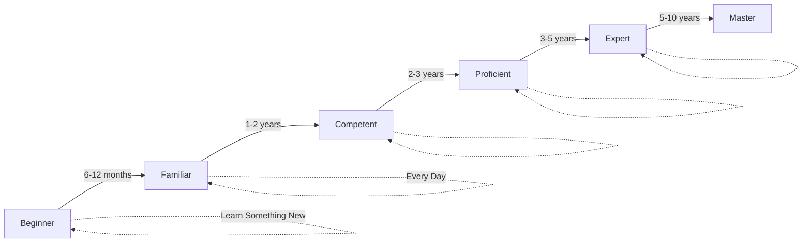
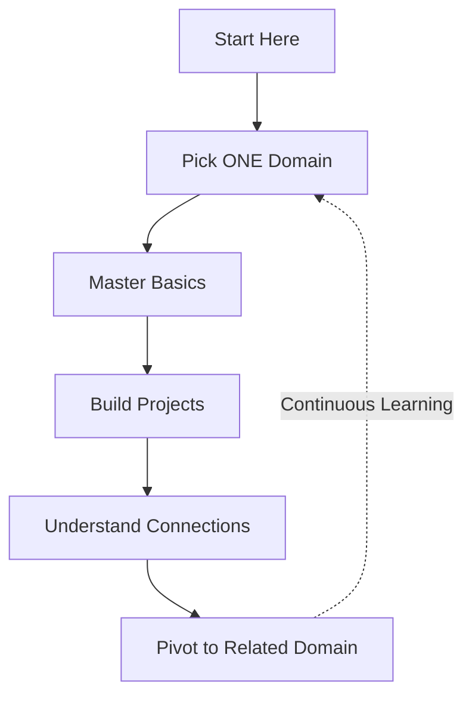
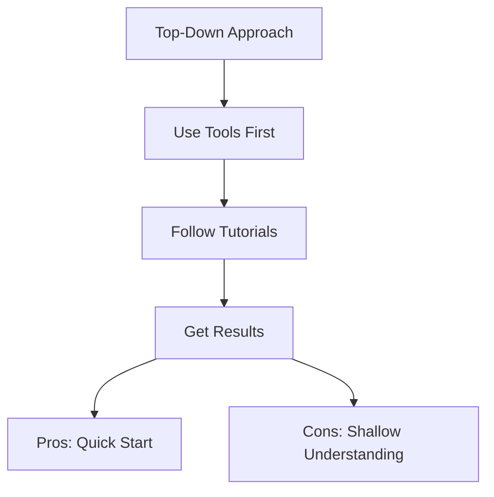
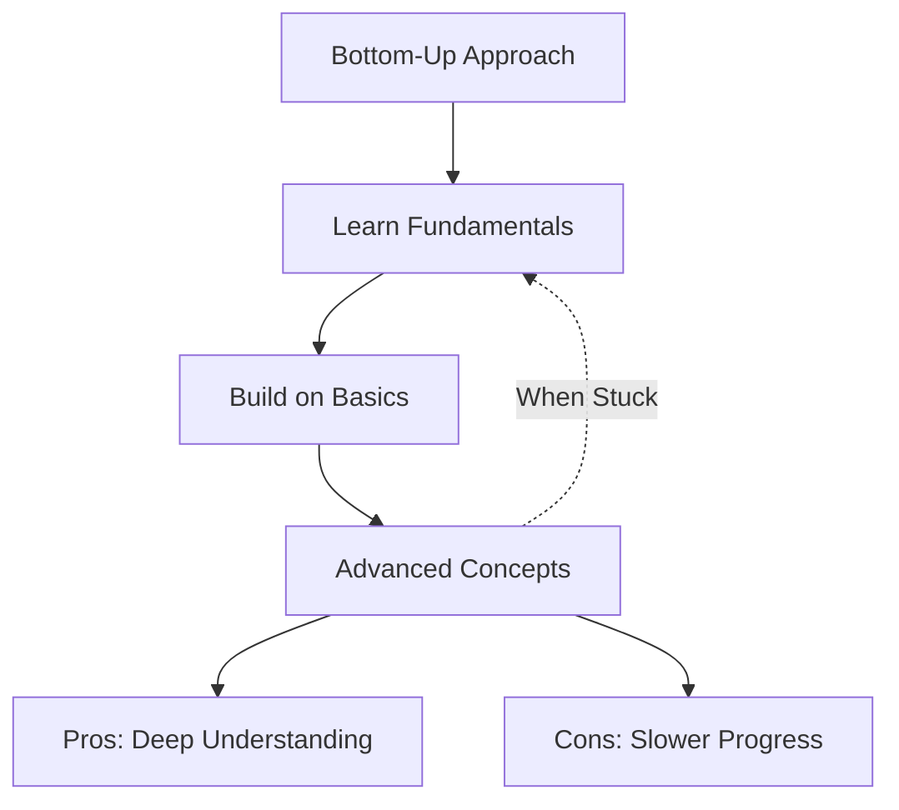
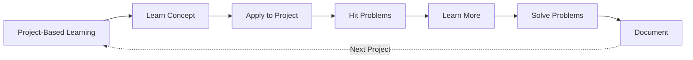
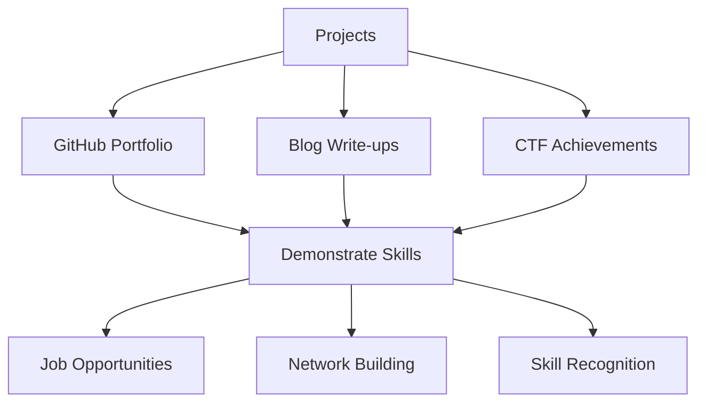
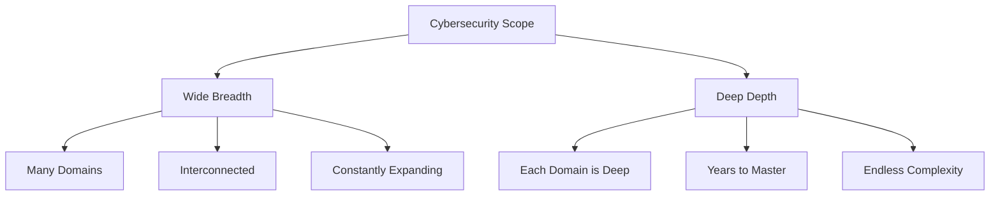
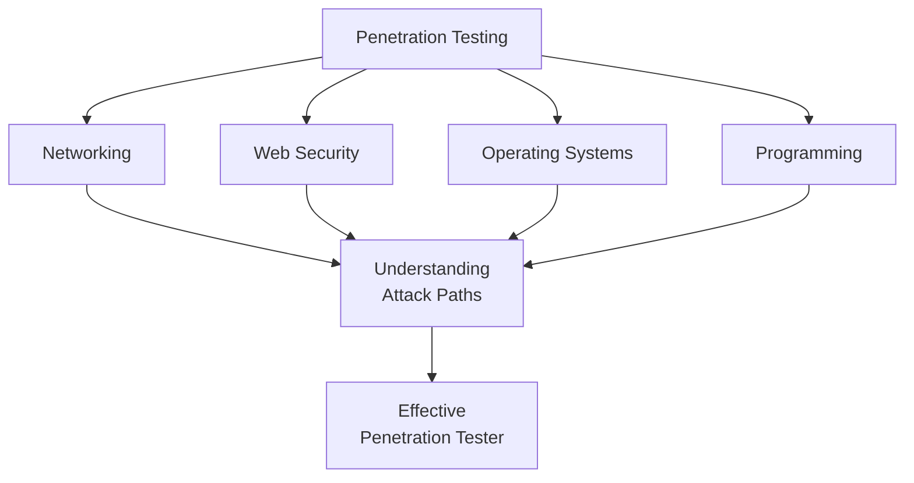

Cybersecurity is a technology domain that can be hard to learn and deep to understand. Depending on whom you ask, you're bound to get a different answer. A professional from the subdomain of *malware analysis* will have a different perspective on how to get started than someone in *networking*. **Why is this?**

> **Key Insight**: Cybersecurity is hard because it's not one field—it's dozens of interconnected disciplines, each requiring deep expertise, and the landscape changes daily.

## The Complexity of Cybersecurity

Cybersecurity consists of **multiple fields** ranging from networking to forensics to compliance, to name a few. Each area has its own set of skills that you need to learn and continuously improve.

### The Skill Requirement

```mermaid
mindmap
root((Cybersecurity<br/>Skills))
Technical Skills
Networking TCP/IP
Programming Python/JS
Operating Systems
Cryptography
Domain Knowledge
Malware Analysis
Forensics
Penetration Testing
Cloud Security
Tools
Wireshark
Metasploit
Burp Suite
Splunk
Soft Skills
Communication
Critical Thinking
Problem Solving
Continuous Learning
```

This set of skills can include:
- **Concepts**: "How do two systems communicate?"
- **Tools**: Learning Autopsy for forensics
- **Programming**: Coding scripts to automate processes
- And the list goes on...

**The Reality:**
> Every field or skill can be further broken down into bundles of concepts and knowledge. Sometimes it can be hard to keep track, but the best part about security is that **every subdomain is interlinked** in some shape or form.

## The Learning Challenge

To master a complex domain like *penetration testing* or *threat hunting*, one may need to master **multiple subdomains** to have a solid baseline understanding.

### Time Investment

**Mastering a subdomain** within cybersecurity can take **years**, depending on:
- Curiosity and passion
- Dedication and persistence
- Ability to absorb new information
- Daily learning commitment



> **Reality Check**: You learn something new every single day in cybersecurity. The learning truly never stops.

## How to Start Your Cybersecurity Journey

So how does one start? For starters:

**The Focused Approach:**

1. **Narrow the scope** of topics down
2. **Choose one topic**
3. **Get comfortable & good** at it
4. **Understand connections** to other subdomains
5. **Pivot** to related areas



> **Critical Advice**: If you take on the challenge of learning everything at once, you will probably be **overwhelmed**, get **burned out**, or **give up** from lack of understanding.

**It is imperative to**:
- Build on solid fundamentals
- Set a baseline for core concepts
- Progress systematically (like learning math)

## Different Learning Approaches

### Approach 1: Top-Down Learning

**Start from the top and go down** - Learn by doing first, understand theory later.

**Analogy**: Imagine a guitar player learning to play a song by listening to the melody and moving their fingers. It may seem effective initially, but without understanding the physics of guitar chords, it may not be easy to sustain long-term.

**In Cybersecurity:**
- Pursuing a certification first
- Booting up a VM and experimenting
- Following tutorials without deep understanding
- Learning to run tools without knowing how they work



**Pros:**
- Quick results
- Immediate gratification
- Practical experience

**Cons:**
- Shallow understanding
- Difficult to troubleshoot
- Hard to adapt to new scenarios

> **Assessment**: Easy to think it's that simple, but this is **not the optimal way**.

### Approach 2: Bottom-Up Learning

**Start with core concepts** and work your way to complex methods and skills.

**The Advantage**: Even when you struggle at a complicated stage, you can **fall back to core concepts**, better understand them, and find a solution to the problem.



**Benefits:**
- Deep understanding
- Better problem-solving
- Can troubleshoot effectively
- Active recall and spaced repetition

**Downsides:**
- Time-consuming
- Slower initial progress
- Requires patience

### Approach 3: Project-Based Learning (BEST)

**Learn through real-world scenarios and projects** - The optimal approach.

**How It Works:**

Combine the bottom-up approach and apply it to projects to:
- **a)** Show your skillset and knowledge
- **b)** Learn and expose yourself to new skill stacks
- **c)** Tackle new problems and find solutions



**Why This Works:**

Based on your knowledge, skillset, curiosity, and dedication, you can:
- **Build new things**
- **Fix things** that are broken (or you broke)
- **Learn at a rapid pace**
- **Document every step**

**Example Project:**
> Build a web application, secure it, and test it by trying to penetrate it.

An individual doing this will develop **far superior understanding** of security compared to passive learning.

## The Value of Projects

### Career Benefits

Getting hands-on with concepts and building projects:
- **Showcases understanding** to employers
- **Demonstrates practical skills**
- **Results in better opportunities**
- **Builds experience** with real use cases

If you're starting fresh, this is one of the **most effective ways to get noticed** in the security space.



## Why Cybersecurity is Particularly Hard

### 1. Breadth and Depth



**The Challenge:**
- **Wide**: Must understand many domains
- **Deep**: Each domain requires deep expertise
- **Connected**: Domains interconnect in complex ways

### 2. Asymmetric Warfare

| **Defenders** | **Attackers** |
|---------------|---------------|
| Must protect everything | Only need one vulnerability |
| Follow rules and regulations | No rules |
| Limited budget and time | Can invest unlimited time |
| Need to be right always | Only need to be right once |

### 3. Constantly Evolving Landscape

**Technology changes:**
- New vulnerabilities discovered daily
- New tools released constantly
- New attack techniques emerge
- New technologies to secure (cloud, IoT, AI)
- New platforms to protect

### 4. Multidisciplinary Requirements

**Must understand:**
- Networking and protocols
- Operating systems (Windows, Linux, macOS)
- Programming (Python, JavaScript, PowerShell)
- Web technologies (HTTP, HTML, JS)
- Databases (SQL, NoSQL)
- Cloud platforms (AWS, Azure, GCP)
- Compliance and regulations
- Business operations

## The Learning Path

### Recommended Approach

**After you start working in the field:**

1. **Pick a topic** to specialize in
2. **Dig deep** to enhance knowledge
3. **Consider certifications** (but not mandatory)
4. **Build expertise** through practice
5. **Share knowledge** through teaching/blogging

**Cybersecurity Career Journey:**

| **Year** | **Focus** | **Milestones** |
|----------|-----------|----------------|
| Year 1 | Learn Fundamentals | Pick primary focus, build first projects |
| Year 2-3 | Deepen Expertise | Get first job, earn basic certifications |
| Year 4-5 | Specialize Further | Advanced certifications, mentor others |
| Year 6+ | Subject Matter Expert | Lead projects, continuous innovation |

## The Interconnected Nature



Every subdomain connects to others:
- Network security connects to cloud security
- Web security connects to application security
- Malware analysis connects to forensics
- All connect to incident response

## Strategies for Success

### 1. Focus and Specialize

 **Don't**: Try to learn everything at once 
 **Do**: Master one area, then expand

### 2. Build Strong Fundamentals

 **Don't**: Jump to advanced tools without basics 
 **Do**: Understand the "why" behind the "how"

### 3. Practice Continuously

 **Don't**: Only read/watch tutorials 
 **Do**: Build, break, and fix things

### 4. Document Everything

 **Don't**: Move on after learning something 
 **Do**: Write it down, create tutorials, teach others

### 5. Join the Community

 **Don't**: Learn in isolation 
 **Do**: Engage with others, ask questions, help peers

## Conclusion

Cybersecurity is a **vast, complex, and challenging domain**—but also **incredibly fun** because the learning never stops. The field is hard because:

- It spans multiple technical domains
- Requires constant updating of knowledge
- Defenders face asymmetric challenges
- Technology evolves rapidly
- Each subdomain is deep and complex

However, with the right approach—**focused learning**, **project-based practice**, and **community engagement**—anyone can build a successful career in cybersecurity.

The key is accepting that:
- You won't know everything (nobody does)
- You'll always be learning (embrace it)
- Specialization is okay (master one, then expand)
- The community is here to help (lean on it)

> **Final Takeaway**: Cybersecurity is hard, yes. But hard doesn't mean impossible. Start with one domain, build solid fundamentals, create projects, document your journey, and engage with the community. The complexity is what makes it challenging—and the challenge is what makes it rewarding.

## References

- [Cybersecurity Career Roadmap](https://roadmap.sh/cyber-security)
- [SANS Cyber Aces Tutorials](https://www.cyberaces.org/)
- [NICCS: Cybersecurity Career Resources](https://www.niccs.cisa.gov/)
- [Krebs on Security: Learning Resources](https://krebsonsecurity.com/)
