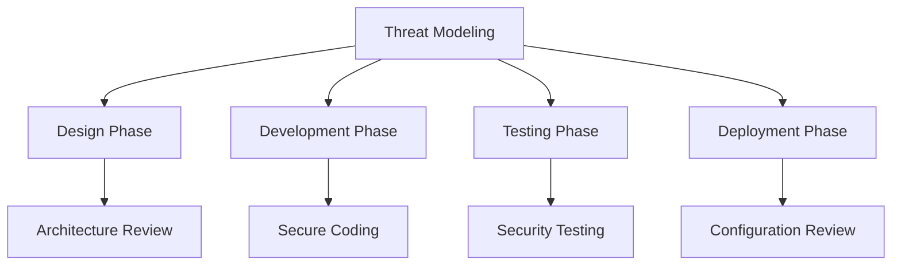
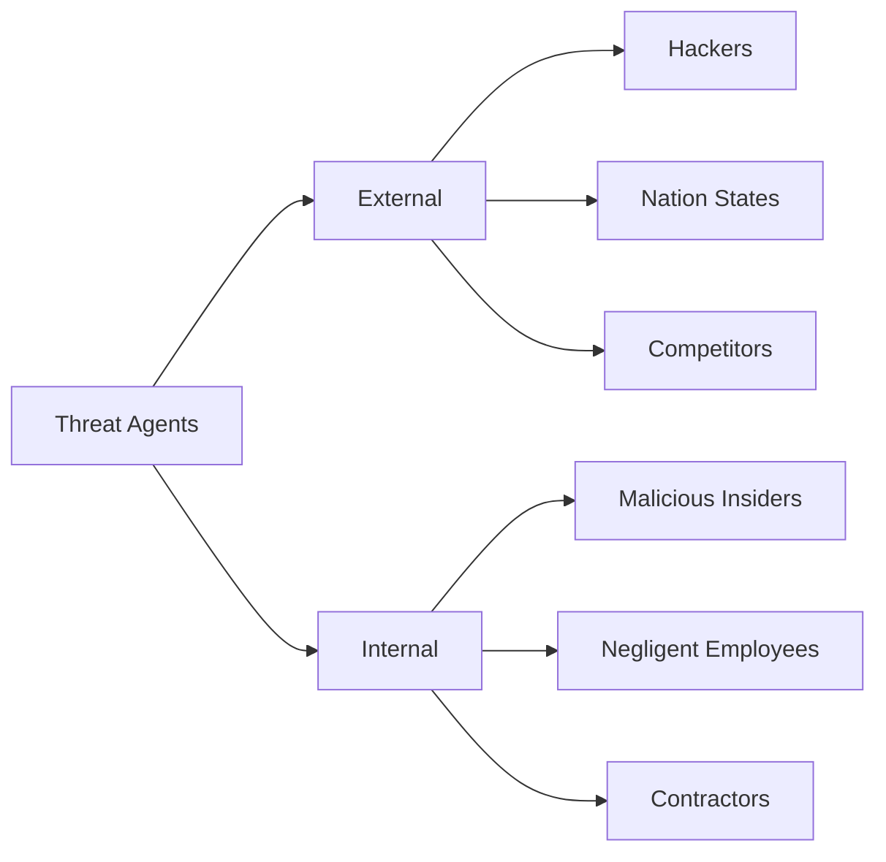
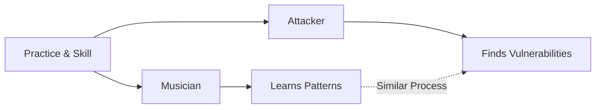
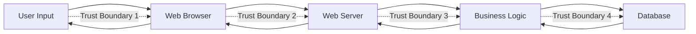
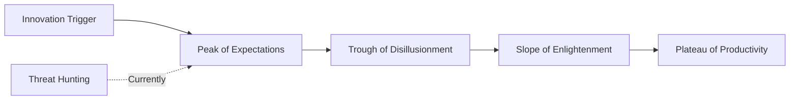
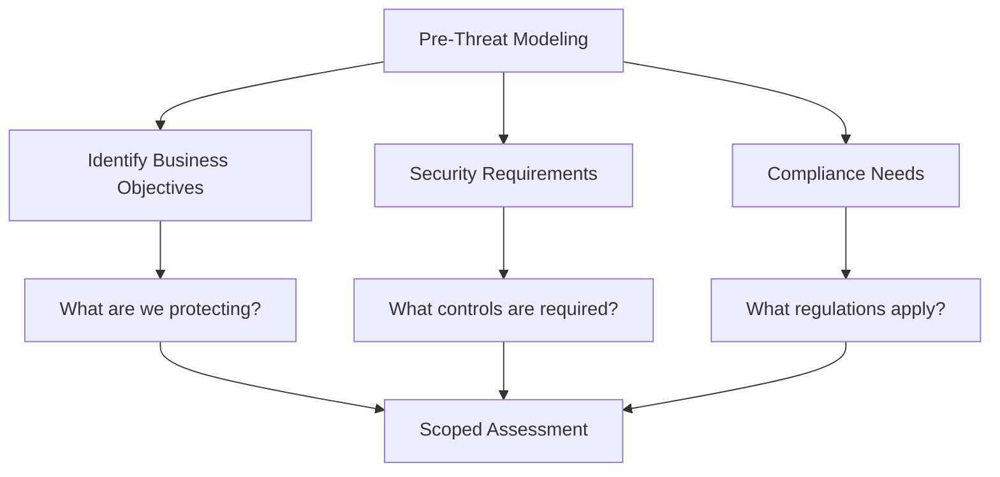
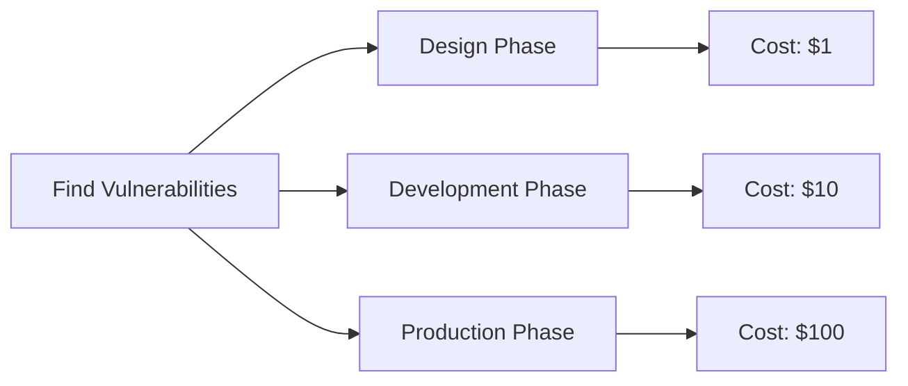

As part of implementing due diligence, doing research, and ensuring that our systems are safe, we need to perform *threat modeling*. **Threat modeling** is a structured approach to identifying and prioritizing potential threats to a system and determining the value that possible mitigations would have in reducing or neutralizing those threats.

> **Key Insight**: Threat modeling is the practice of thinking like an attacker during the design phase—finding and fixing vulnerabilities before a single line of code is written.

## What is Threat Modeling?

*Threat modeling* ensures that potential threats aren't exploited. The actual implementation of solutions to minimize data loss and protect personal information is the **due care** taken during threat modeling.

### Who Should Do Threat Modeling?

**All of these roles should include threat modeling:**
- Developers
- Software system designers
- System architects
- Security engineers
- Product managers
- DevOps engineers



> **Best Practice**: Threat modeling should be included in the Software Development Life Cycle (SDLC). It's especially valuable in agile environments when combined with continuous testing.

## Threat Modeling Terminology

Understanding key terms is essential for effective threat modeling:

| **Term** | **Definition** | **Example** |
|----------|----------------|-------------|
| **Threat Agent** | Individual or group capable of carrying out a threat | Hackers, insiders, nation-states |
| **Impact** | Measure of potential damage | Data loss, downtime, financial cost |
| **Likelihood** | Probability of threat occurring | Low, Medium, High |
| **Controls** | Safeguards to protect against threats | Firewalls, encryption, MFA |
| **Preventions** | Controls that eliminate the threat | Input validation, secure defaults |
| **Mitigations** | Controls that reduce likelihood or impact | Monitoring, backups |
| **Data Flow Diagram** | Visual representation of information flow | Shows inputs, outputs, processes |
| **Trust Boundary** | Where data changes trust level | User input, API calls, network boundaries |

### Threat Agent Analysis

A *threat agent* is fundamental to identify:
- **Who** would want to exploit your assets?
- **How** might they use them against you?
- **Are they capable** of executing the attack?



### Impact Assessment

*Impact* is a measure of potential damage:
- Physical asset damage
- Financial loss
- Reputation damage
- Data breach
- Service disruption
- Compliance violations

### Likelihood Evaluation

*Likelihood* is influenced by:
- Complexity of the attack
- Attacker skill required
- Reward for the attacker
- Existing controls
- Attack surface exposure

## The Analogy: Playing an Instrument

Let's compare threat modeling to playing an instrument:

**When a person plays an instrument**, they develop:
- Muscle memory
- Listening skills
- Pattern recognition

**Similarly, an attacker "plays around" a vulnerable system:**
- Develops exploitation techniques
- Recognizes vulnerable patterns
- Builds attack playbooks



**Models are used for:**
- Communication
- Enhancing understanding
- Abstraction of complexity

## System Architecture and Trust Boundaries

The layout of any given system:



**Every process** has assigned trust boundaries—**exactly where malicious actors try to tamper** with the system.

### Typical Assets Attackers Want

**Tangible targets:**
- User passwords or keys
- Social Security numbers or other identifiers
- Credit card numbers
- Confidential business data
- Healthcare records
- Financial information

## Threat Modeling Methodologies

### Simple Strategy: Brainstorming

**Brainstorming approach:**
- Ideas from every corner of the room
- Create attack scenarios
- Focus on assets at hand
- **Think like an attacker**

### STRIDE Methodology

A beneficial methodology for structured threat identification is **STRIDE**:

```mermaid
mindmap
root((STRIDE))
Spoofing
Identity Theft
Fake Credentials
Tampering
Data Modification
Code Injection
Repudiation
Deny Actions
No Audit Trail
Information Disclosure
Data Leaks
Unauthorized Access
Denial of Service
Availability
Resource Exhaustion
Elevation of Privilege
Privilege Escalation
Unauthorized Access
```

| **Threat** | **Definition** | **Example** |
|------------|----------------|-------------|
| **S**poofing | Pretending to be someone else | Fake login, email spoofing |
| **T**ampering | Modifying data or code | SQL injection, code modification |
| **R**epudiation | Denying actions taken | No logging, unsigned transactions |
| **I**nformation Disclosure | Exposing protected information | Data breach, verbose errors |
| **D**enial of Service | Making system unavailable | DDoS, resource exhaustion |
| **E**levation of Privilege | Gaining unauthorized access | Admin access from user account |

**Goal**: Help you find attacks and categorize them against all sorts of technological systems.

## Threat Modeling Maturity: Gartner's Hype Cycle

Threat modeling can be compared to *Gartner's Hype Cycle*, which helps understand realistic expectations for emerging technologies:



**Gartner's Hype Cycle Stages:**
1. **Innovation Trigger** - Technology breakthrough
2. **Peak of Expectations** - Inflated expectations
3. **Trough of Disillusionment** - Reality sets in
4. **Slope of Enlightenment** - Understanding grows
5. **Plateau of Productivity** - Mainstream adoption

**Threat hunting** currently lies somewhere between the innovation trigger and peak of expectation. In the next ten years, it's expected to reach the productive plateau.

## The Threat Modeling Process

### Before You Start

**Essential Preparation:**



Before starting, it's essential to:
- Identify **business objectives** of applications
- Determine **security requirements**
- Understand **compliance requirements** (GDPR, HIPAA, PCI-DSS, etc.)

Having these in mind helps **evaluate the impact** of threats during risk analysis.

### Step-by-Step Process

#### Step 1: Create Visual Representation

Create a visual representation using **Data Flow Diagrams (DFD)** showing:
- System components
- Data flows
- Trust boundaries
- External dependencies

#### Step 2: Decompose the Application

**Break down into elements:**
- User interfaces
- APIs
- Services
- Databases
- External integrations

#### Step 3: Identify Threats

**Use STRIDE or other methodology** to identify threats at each trust boundary.

#### Step 4: Document Threats

**Document as many potential threats as possible:**
- Threat description
- Attack vector
- Impact
- Likelihood
- Affected component

#### Step 5: Determine Mitigations

**For each threat, document:**
- Security controls to implement
- Likelihood reduction
- Impact reduction
- Implementation cost
- Priority

#### Step 6: Validate and Iterate

**Review and refine:**
- Validate with stakeholders
- Update as system evolves
- Regular reassessment

## Threat Modeling Tools

| **Tool** | **Approach** | **Best For** |
|----------|--------------|--------------|
| **Microsoft Threat Modeling Tool** | STRIDE | Windows applications |
| **OWASP Threat Dragon** | STRIDE | Web applications |
| **IriusRisk** | Automated | Enterprise |
| **ThreatModeler** | Comprehensive | Large systems |
| **Threagile** | Risk-based | Agile teams |

## Real-World Application

### Example: E-Commerce Application

**Assets:**
- Customer data
- Payment information
- Order history
- User credentials

**Threats Identified:**

| **Threat** | **STRIDE Category** | **Mitigation** |
|------------|-------------------|----------------|
| SQL Injection | Tampering | Parameterized queries |
| Stolen session cookies | Spoofing | HTTPS, HttpOnly flags |
| Price manipulation | Tampering | Server-side validation |
| Payment data leakage | Information Disclosure | PCI-DSS compliance, encryption |
| DDoS | Denial of Service | Rate limiting, CDN |
| Privilege escalation | Elevation of Privilege | Role-based access control |

## Benefits of Threat Modeling

### Early Detection



**Cost to Fix:**
- Design: $1
- Development: $10
- Production: $100

> **Economic Reality**: Finding and fixing vulnerabilities during design is exponentially cheaper than patching production systems.

### Other Benefits

- **Prioritized security efforts** - Focus on real risks
- **Documentation** - Creates security knowledge base
- **Team alignment** - Shared understanding of threats
- **Compliance** - Meet regulatory requirements
- **Security awareness** - Educates entire team

## Conclusion

*Threat modeling* is an essential practice for building secure systems. By **thinking like an attacker** during the design phase, teams can identify and address vulnerabilities before they become exploits.

The process doesn't have to be complex—start simple with brainstorming sessions, use structured methodologies like STRIDE, and create basic data flow diagrams. As your practice matures, you can adopt more sophisticated tools and techniques.

Remember: **threat modeling is not a one-time activity**. It should be:
- Part of every new feature design
- Revisited when architecture changes
- Updated as threats evolve
- Integrated into your SDLC

The investment in threat modeling pays dividends through:
- Reduced vulnerabilities
- Lower remediation costs
- Better security architecture
- More secure products

> **Final Takeaway**: An hour of threat modeling during design saves days of incident response in production. Think like an attacker, design for defense, and build security in from the start.

## References

- [OWASP Threat Modeling](https://owasp.org/www-community/Threat_Modeling)
- [Microsoft Threat Modeling Tool](https://www.microsoft.com/en-us/securityengineering/sdl/threatmodeling)
- [STRIDE Methodology](https://docs.microsoft.com/en-us/azure/security/develop/threat-modeling-tool-threats)
- [Threat Modeling Manifesto](https://www.threatmodelingmanifesto.org/)
