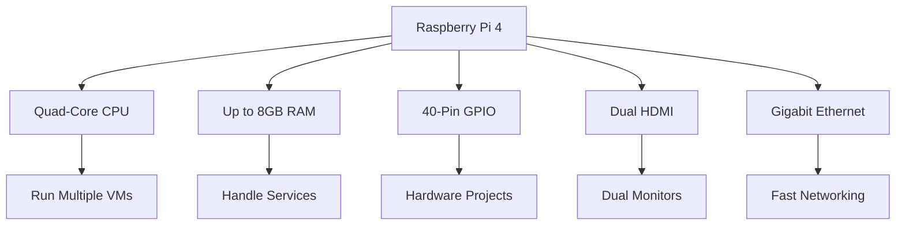
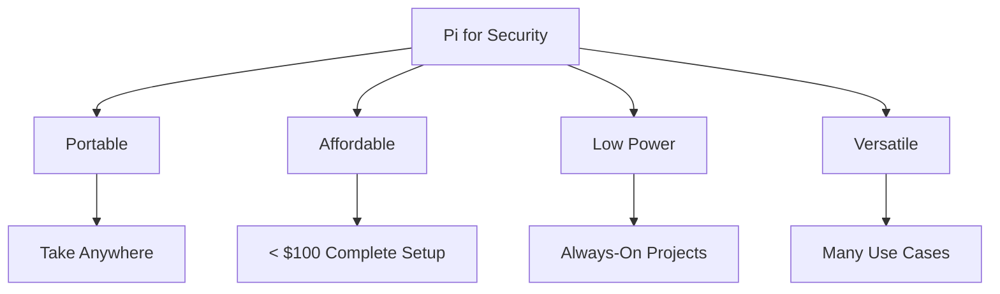
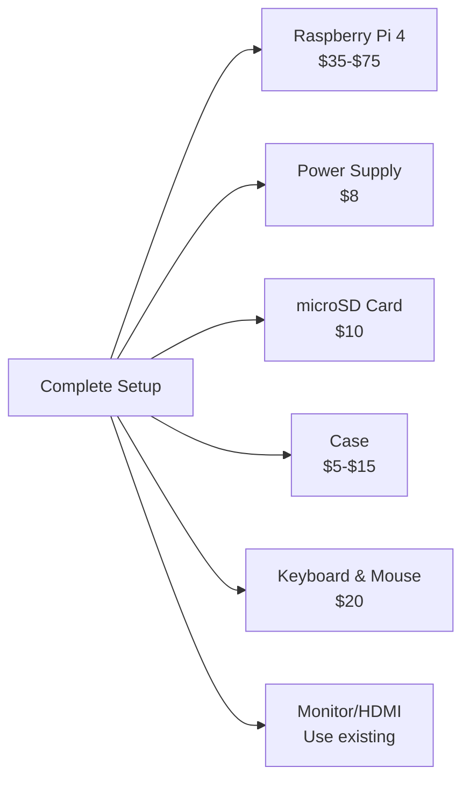
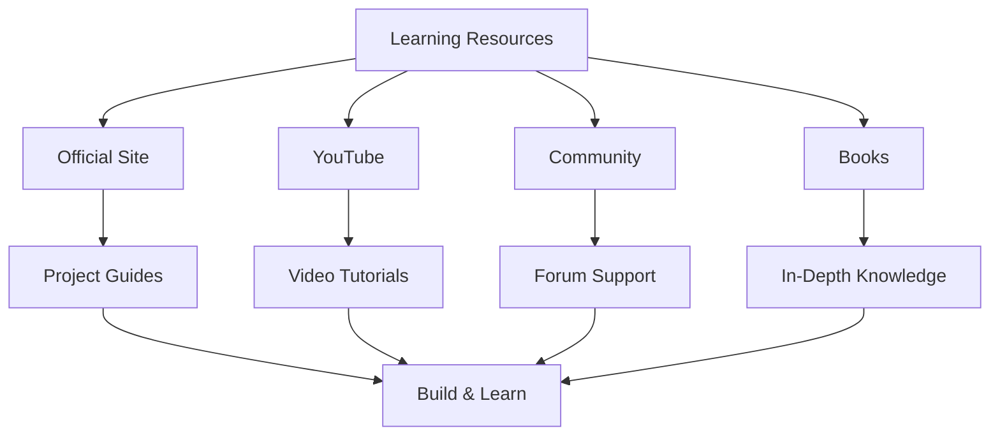

The *Raspberry Pi* is not a kid's toy. Let's just say it's a **portable computer in your pocket**. Being the size of a credit card, it will let you do almost anything that a normal desktop PC can do—without spending a lot of money. Over the years, it has cultivated a huge developer community.

> **Key Insight**: The Raspberry Pi is the perfect platform for learning cybersecurity, Linux, programming, and hardware hacking—all for under $50.

## Raspberry Pi 4 Specifications

In 2019, the *Raspberry Pi 4* was released with impressive specs:

### Technical Specifications

| **Component** | **Specification** | **Benefit** |
|---------------|------------------|-------------|
| **Memory** | 1GB, 2GB, 4GB, 8GB options | Run multiple services |
| **CPU** | Quad-core ARM Cortex-A72 | Decent performance |
| **Power Supply** | USB Type-C (5V, 3A) | Universal connector |
| **Display Output** | Dual micro HDMI | Support 2 monitors |
| **GPIO** | 40-pin header | Hardware projects |
| **Network** | Gigabit Ethernet, WiFi, Bluetooth | Full connectivity |
| **Storage** | microSD card slot | Expandable storage |



## The Game-Changer: 40-Pin GPIO

What makes the Pi **truly impressive** is the **40-pin General Purpose Input/Output (GPIO)** which allows you to connect the Pi to everything:

**GPIO Capabilities:**
- Weather stations
- Robots
- LED displays
- Sensors and alarms
- IoT projects

> **Original Purpose**: This functionality was built into the Pi to teach computer science and programming to students—and it does that brilliantly.

## Endless Project Possibilities

With the Raspberry Pi, you're **only limited by your imagination**:

### Popular Projects

```mermaid
mindmap
root((Raspberry Pi<br/>Projects))
Security
Kali Linux Station
Network Monitor
IDS/IPS
Penetration Testing
Networking
Pi-hole Ad Blocker
VPN Server
Web Server
NAS Storage
Learning
Programming
Linux Administration
Hardware Interfacing
Media
Retro Gaming
Media Center
Digital Signage
Home Automation
Smart Home Hub
Security Cameras
Environmental Monitoring
```

**Project Categories:**

1. **Security & Hacking**
 - Kali Linux platform
 - Network monitoring
 - WiFi security testing
 - Penetration testing lab

2. **Networking**
 - Pi-hole (network-wide ad-blocking)
 - VPN server
 - Web server
 - NAS (Network Attached Storage)
 - Proxy server

3. **Learning & Development**
 - Linux learning platform
 - Programming practice (Python, etc.)
 - Prototyping new ideas
 - IoT development

4. **Other Cool Stuff**
 - Retro gaming consoles
 - Digital signage
 - Robotics
 - Home automation

## Using Raspberry Pi as a Hacking Station

One compelling way to use the Pi is to turn it into a **cybersecurity learning platform**.

### Why Pi for Security?

**Advantages:**



**Reasons to use a Raspberry Pi:**
- **Run Kali Linux** without needing a virtual machine
- **Dedicated security platform** - separate from main computer
- **Low power consumption** - can run 24/7
- **Portable** - pocket-sized penetration testing rig
- **Affordable** - much cheaper than dedicated laptop

### Network Monitoring & WiFi Security

**The Raspberry Pi 4** has a built-in WiFi network adapter that can be configured with **monitor mode**, making it ideal for:

**WiFi Security Activities:**
- Grabbing WPA handshakes
- Listening and monitoring WiFi traffic
- Executing WiFi-based attacks using tools:
 - **Fern WiFi Cracker**
 - **Aircrack-ng suite**
 - **Airmon-ng**
 - **Wireshark**

**Network Projects:**
- Static web server
- NAS (Network Attached Storage)
- Proxy server
- Network monitoring station

```bash
# Example: Put WiFi adapter in monitor mode
sudo airmon-ng start wlan0

# Capture WiFi handshakes
sudo airodump-ng wlan0mon

# Crack WPA password
sudo aircrack-ng -w wordlist.txt capture.cap
```

> **Legal Warning**: Only test WiFi security on networks you own or have explicit permission to test. Unauthorized access is illegal.

## Operating Systems for Raspberry Pi

Learning on the Raspberry Pi means you're not just tied to one OS:

| **OS** | **Purpose** | **Best For** |
|--------|-------------|--------------|
| **Kali Linux** | Penetration testing | Security professionals |
| **Raspberry Pi OS** | General use | Beginners, everyday use |
| **Ubuntu** | Server projects | Web hosting, development |
| **RetroPie** | Gaming | Retro gaming enthusiasts |
| **LibreELEC** | Media center | Home entertainment |

### Kali Linux on Raspberry Pi

Many developers and security professionals use the Pi for:
- **Security research** - Test exploits safely
- **POCs (Proof of Concepts)** - Validate ideas
- **Penetration testing** - Mobile testing rig
- **Learning** - Safe environment to experiment

### The Mr. Robot Factor

The Raspberry Pi can be used for powerful tasks, such as:
> Remotely hacking into the climate control system of a data center—as featured in the popular show *Mr. Robot*.

## Getting Started: The Beginner Path

If you're a beginner, an effective way to use a Pi is to **literally use it as a desktop**:

### Starter Kit



**Budget Breakdown:**
- Raspberry Pi 4 (4GB): ~$55
- Official power supply: ~$8
- 32GB microSD card: ~$10
- Case: ~$10
- Keyboard & Mouse: ~$20
- Monitor: Use existing TV/monitor
- **Total**: ~$100 for complete setup

### Learning Path

**With your Pi, you can:**

1. **Learn Linux basics**
 - Command line
 - File system navigation
 - Package management
 - User permissions

2. **Learn programming**
 - Python (perfect for Pi)
 - Bash scripting
 - GPIO programming
 - Web development

3. **Build projects**
 - Home automation
 - Security tools
 - Network services
 - IoT devices

> **Reality Check**: It also runs Raspbian (now Raspberry Pi OS), the official Debian-based OS. While it's not a supercomputer, it's important to **set your expectations fun-sized**.

## Security and Hacking Projects

### Pi-hole: Network-Wide Ad Blocking

**Block ads for your entire network:**

```bash
# Install Pi-hole
curl -sSL https://install.pi-hole.net | bash

# Access admin panel
http://pi.hole/admin
```

**Benefits:**
- Blocks ads on all devices
- Improves browsing speed
- Enhances privacy
- Network-level protection

### Penetration Testing Lab

**Use Pi as part of a home lab:**
- Run vulnerable VMs
- Practice attacks safely
- Learn exploitation
- Understand defenses

### Network Monitoring

**Monitor your network traffic:**
- Run Wireshark 24/7
- Detect anomalies
- Learn network protocols
- Capture and analyze packets

## The Community and Resources

The **sky is the limit** when it comes to working with the Raspberry Pi. It is an excellent learning tool, and if you want to expand your learning, there are numerous project ideas online.

### Where to Find Projects

- **Official Raspberry Pi Projects**: raspberrypi.org/projects
- **YouTube Channels**: NetworkChuck, ExplainingComputers
- **Magazines**: MagPi Magazine (free PDF)
- **Forums**: Raspberry Pi Forums, Reddit r/raspberry_pi
- **Books**: "Raspberry Pi for Secret Agents"



## Conclusion

The *Raspberry Pi* is an incredibly versatile, affordable, and powerful platform for learning, experimentation, and practical projects. Whether you're:

- **Learning Linux** - Perfect desktop replacement
- **Studying cybersecurity** - Kali Linux platform
- **Building projects** - Limitless possibilities
- **Home automation** - Control your environment
- **Networking** - Server and network tools

The Raspberry Pi offers an accessible entry point that grows with your skills.

For cybersecurity enthusiasts specifically, the Pi provides:
- Dedicated hacking platform
- Safe learning environment
- Portable testing rig
- Network security tools
- Hands-on experience

**So what are you waiting for? Go get your Raspberry Pi today!** 

> **Final Takeaway**: The best investment you can make in your tech education is a Raspberry Pi. For the price of a few coffees, you get a complete computer, learning platform, and project foundation that will serve you for years.

## References

- [Teach, Learn, and Make with Raspberry Pi](https://www.raspberrypi.org/)
- [Kali Linux on Raspberry Pi](https://www.kali.org/docs/arm/raspberry-pi/)
- [Pi-hole Documentation](https://docs.pi-hole.net/)
- [Raspberry Pi Projects](https://projects.raspberrypi.org/)
