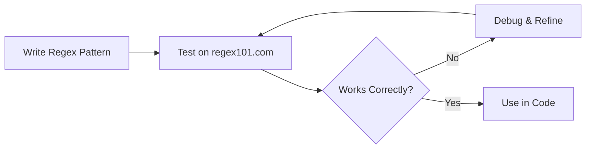
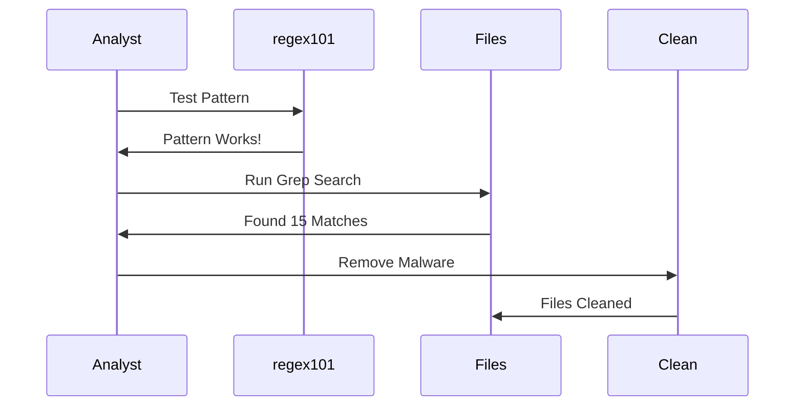
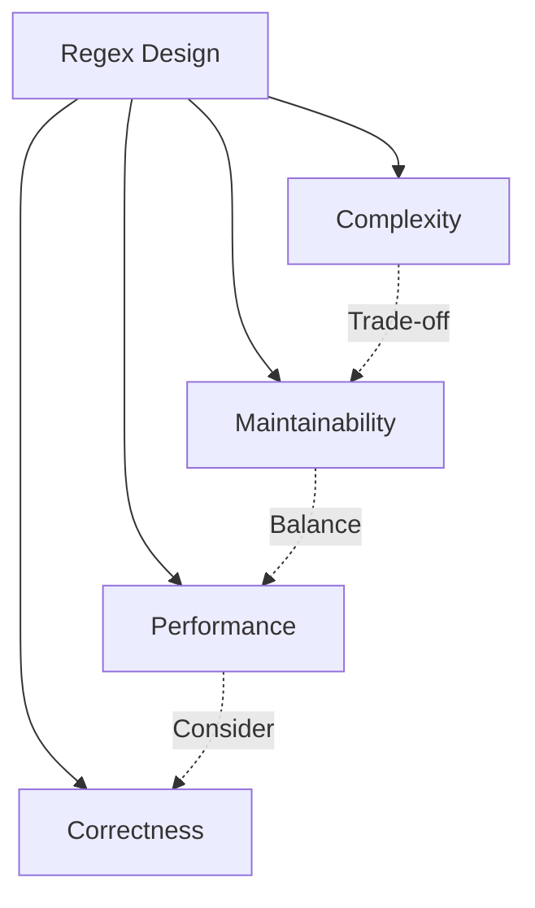

*Regular expressions* (aka **Regex**) are a powerful tool for finding patterns within strings or sets of strings. Once intimidating with their cryptic syntax, regex becomes an indispensable asset once mastered—offering a universal way to parse text or code in any programming language.

> **Key Insight**: Regular expressions are like a superpower—once you master them, you can search, validate, and manipulate text with surgical precision across any programming language.

## Common Use Cases for Regex

The most common use cases include:

```mermaid
mindmap
root((Regex<br/>Use Cases))
Validation
Email Addresses
Phone Numbers
URLs
Credit Cards
Search & Replace
Log Analysis
Code Refactoring
Text Processing
Extraction
Parse Data
Extract Patterns
Tokenization
Security
Malware Detection
Input Sanitization
Log Monitoring
```

### Primary Applications

1. **Validate user-generated input**
 - Email addresses
 - Phone numbers
 - Credit card format
 - URLs and domains

2. **Search and match patterns**
 - Find and replace in documents
 - Log file analysis
 - Code searching

3. **Split strings into tokens**
 - Parse CSV files
 - Extract data fields
 - Break apart log entries

## Why Regex Seems Intimidating

Regular expressions can be very intimidating because of their syntax that looks like **"a pile of gibberish"**:

**Example:**
```regex
^(?=.*[A-Z])(?=.*[a-z])(?=.*\d)(?=.*[@$!%*?&])[A-Za-z\d@$!%*?&]{8,}$
```

> **First Impression**: What in the world is that?!

But once you learn and get the hang of it, you'll have a very powerful and universal way to parse text or code.

## My Regex Journey

Initially, when I started learning regex, I felt it was very complicated. The syntax looked frustrating. But recently, after finding good resources and working on the defensive side of security (*Blue Team*), researching different types of malware, **I use it every single day**. It has become a great and powerful tool to boost my workflow.

## Regex Basics Reference

Here are essential regex patterns:

| **Expression** | **Purpose** | **Example** |
|----------------|-------------|-------------|
| `.` | Match any single character except line break | `a.c` matches "abc", "a1c" |
| `*` | Match zero or more of preceding | `ab*` matches "a", "ab", "abb" |
| `.*` | Match any character zero or more times | `a.*c` matches "ac", "abc", "a123c" |
| `+` | Match one or more of preceding | `ab+` matches "ab", "abb" (not "a") |
| `.+` | Match any character one or more times | `a.+c` matches "abc" (not "ac") |
| `*?` | Match zero or more (non-greedy) | Minimal match |
| `+?` | Match one or more (non-greedy) | Minimal match |
| `^` | Anchor to beginning of line/string | `^Hello` must start with "Hello" |
| `$` | Anchor to end of line/file | `bye$` must end with "bye" |
| `\r?$` | Anchor to end of line | Windows/Unix line endings |
| `[abc]` | Match any character in set | Matches "a", "b", or "c" |
| `[a-f]` | Match any character in range | Matches "a" through "f" |
| `\w` | Match any word character | `[A-Za-z0-9_]` |
| `\s` | Match any whitespace | Space, tab, newline |
| `\d` | Match any decimal digit | `[0-9]` |
| `["']` | Match quotes | Double or single quote |

### Character Classes

```regex
\d # Digit [0-9]
\D # Not a digit
\w # Word character [A-Za-z0-9_]
\W # Not a word character
\s # Whitespace
\S # Not whitespace
. # Any character except newline
```

### Quantifiers

```regex
* # 0 or more
+ # 1 or more
? # 0 or 1
{3} # Exactly 3
{3,} # 3 or more
{3,5} # 3, 4, or 5
```

## Testing Regex

Before using regular expressions in your code, test them using an online regex evaluator:

**Recommended Tool**: [regex101.com](https://regex101.com/)



**Features of regex101.com:**
- Real-time pattern matching
- Detailed explanation
- Multiple regex flavors (PCRE, JavaScript, Python)
- Test cases
- Quick reference guide

## Real-World Example: WordPress Malware Detection

Let's look at a **malware sample** injected into WordPress core files.

### The Scenario

This injected malicious code is:
- **Obfuscated** using Base64 encoding
- **Placed cleverly** in WordPress files
- **Changing permissions**, creating spam directories
- **Reading file contents** from malicious redirection links

### The obfuscated code (example):

```php
<?php
eval(base64_decode("ZXZhbCggZ3ppbmZsYXRlKCBiYXNlNjRfZGVjb2RlKCA..."));
?>
```

### The Decoded Malicious Code

When decoded, it reveals:
- File permission changes
- Spam directory creation
- External file inclusion
- Malicious redirects

### The Regex Solution

**Pattern to match this malware:**

```regex
eval\s*\(\s*base64_decode\s*\(\s*["']([A-Za-z0-9+/=]+)["']\s*\)\s*\)
```

**Breaking it down:**
```regex
eval # Literal "eval"
\s* # Optional whitespace
\( # Opening parenthesis
\s* # Optional whitespace
base64_decode # Literal function name
\s* # Optional whitespace
\( # Opening parenthesis
\s* # Optional whitespace
["'] # Quote (single or double)
([A-Za-z0-9+/=]+) # Capture base64 string
["'] # Closing quote
\s*\)\s*\) # Closing parentheses
```

### Using the Regex

```bash
# Find infected files
grep -r -P 'eval\s*\(\s*base64_decode' /var/www/html/

# Or use regex101 to test
# Then clean matched patterns from files
```



## The Time Savings

### Manual vs Regex Comparison

**Without Regex (Manual Search):**
- Search through files one by one
- Visually scan for patterns
- Copy-paste code to analyze
- **Hours** for large codebases

**With Regex (Automated):**
- Search all files instantly
- Pattern-based matching
- Bulk find and replace
- **Seconds to minutes**

> **Efficiency Gain**: Regex can save hours or even days on tasks that would be tedious and error-prone manually.

## Practical Regex Examples

### Email Validation

```regex
^[a-zA-Z0-9._%+-]+@[a-zA-Z0-9.-]+\.[a-zA-Z]{2,}$
```

### IP Address

```regex
\b(?:[0-9]{1,3}\.){3}[0-9]{1,3}\b
```

### URL Extraction

```regex
https?://(?:www\.)?[-a-zA-Z0-9@:%._\+~#=]{1,256}\.[a-zA-Z0-9()]{1,6}\b
```

### Password Strength (8+ chars, uppercase, lowercase, number, special)

```regex
^(?=.*[a-z])(?=.*[A-Z])(?=.*\d)(?=.*[@$!%*?&])[A-Za-z\d@$!%*?&]{8,}$
```

### Log File Parsing

```regex
^(\d{4}-\d{2}-\d{2})\s+(\d{2}:\d{2}:\d{2})\s+\[(\w+)\]\s+(.*)$

# Captures:
# Group 1: Date (2024-01-15)
# Group 2: Time (14:30:45)
# Group 3: Level (ERROR)
# Group 4: Message
```

## Security Applications

### 1. Input Validation

```javascript
// Validate username (alphanumeric, 3-20 chars)
const usernameRegex = /^[a-zA-Z0-9]{3,20}$/;

if (!usernameRegex.test(userInput)) {
 throw new Error('Invalid username');
}
```

### 2. Log Analysis

```python
import re

# Find failed login attempts
pattern = r'Failed password for (\w+) from ([\d.]+)'

with open('auth.log', 'r') as f:
 for line in f:
 match = re.search(pattern, line)
 if match:
 user, ip = match.groups()
 print(f"Failed login: {user} from {ip}")
```

### 3. Malware Signature Detection

```regex
# Detect base64 encoded eval
eval\s*\(\s*(?:base64_decode|atob)\s*\(

# Detect obfuscated JavaScript
\b(?:eval|setTimeout|setInterval)\s*\(\s*(?:unescape|decodeURI)
```

## Best Practices

### Do's

- **Test patterns** thoroughly on regex101.com
- **Comment complex regex** to explain logic
- **Use named groups** for clarity
- **Validate performance** on large datasets
- **Use raw strings** in Python (`r"pattern"`)

### Don'ts

- **Don't parse HTML** with regex (use proper parser)
- **Don't make overly complex** patterns
- **Don't forget to escape** special characters
- **Don't use regex** when simple string methods work
- **Don't trust user-provided** regex patterns

## The Trade-offs



> **Reality**: The trade-off between **complexity**, **maintainability**, **performance**, and **correctness** should be a conscious decision. It is difficult to read regex patterns, let alone debug them.

## Regex Resources

### Learning

- [RegexOne](https://regexone.com/) - Interactive tutorial
- [Regex Crossword](https://regexcrossword.com/) - Fun practice
- [Regular-Expressions.info](https://www.regular-expressions.info/) - Comprehensive guide
- [regex101.com](https://regex101.com/) - Testing playground

### Cheat Sheets

- [MDN Regex Guide](https://developer.mozilla.org/en-US/docs/Web/JavaScript/Guide/Regular_Expressions)
- [RegexLib](http://www.regexlib.com/) - Pattern library
- [Regex Cheat Sheet PDF](https://cheatography.com/davechild/cheat-sheets/regular-expressions/)

## Conclusion

Learning *regular expressions* can be a **lifelong investment** with endless use cases. From validating user input to hunting malware in log files, from parsing data to securing applications, regex is a fundamental skill that multiplies your effectiveness.

While the syntax may initially seem like gibberish, with practice and the right resources, regex becomes second nature. The time investment pays dividends through:
- **Faster text processing**
- **More accurate pattern matching**
- **Automated workflows**
- **Better security analysis**
- **Increased productivity**

Regex can save you **time and effort** on tasks that would otherwise take hours of manual work. For security professionals especially, regex is essential for log analysis, malware detection, and data extraction.

> **Final Takeaway**: Don't let the syntax scare you. Start simple, practice regularly, use regex101.com for testing, and gradually build complexity. Regular expressions are a game changer that every security professional, developer, and analyst should master.

## References

- [Regex101](https://regex101.com/) - Testing and learning
- [RegexOne Tutorial](https://regexone.com/)
- [MDN: Regular Expressions](https://developer.mozilla.org/en-US/docs/Web/JavaScript/Guide/Regular_Expressions)
- [Regular-Expressions.info](https://www.regular-expressions.info/)
